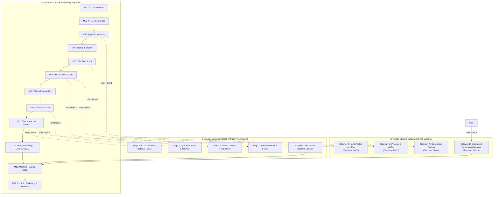

# The Go Engineer Learning Path (v3)

This guide defines the multi-track navigation architecture for **The Go Engineer v3** on `release/v3`.

The source of truth for module progression is [`curriculum/path.core.json`](./curriculum/path.core.json), [`curriculum/path.electives.json`](./curriculum/path.electives.json), and [ARCHITECTURE.md](./ARCHITECTURE.md).

> **Visual Diagrams:** For interactive Mermaid flowcharts mapping phase-level and module-level dependency graphs, see [`docs/PROGRESSION.md`](./docs/PROGRESSION.md).

---

## 1. Multi-Track "Trunk & Fork" Architecture

The curriculum is structured around a single **Core Backend Trunk** (the highway) accompanied by parallel **Companion Frontend Sidecars** and modular **Elective Specialization Gateways**:

---

## 2. The 3 Learner Profiles

Choose your trajectory before beginning Phase 2 (Module 05):

| Profile | Primary Goal | Recommended Track Navigation |
|---|---|---|
| **Profile A: Pure Backend Specialist** *(Default)* | Master high-throughput Go backend services, distributed systems, and cloud infrastructure. | Follow the **Core Trunk linearly** (Modules 00 $\rightarrow$ 18). Skip Frontend and Electives entirely until the Flagship Capstone is complete. |
| **Profile B: Autonomous Full-Stack Engineer** | Build complete web applications, SaaS MVPs, and internal consoles with pure Go, Templ, and hypermedia. | Follow the **Core Trunk**, branching into **Companion Frontend Stages** at Fork Points 2, 3, 5, and 6. |
| **Profile C: Systems & Performance Architect** | Deep-dive into Go runtime internals, zero-allocation memory pooling, gRPC streaming, and distributed patterns. | Follow the **Core Trunk**, branching into **Elective Gateways** immediately after their foundational core modules (after M05, M08, M11, and M15). |

---

## 3. Non-Negotiable Track-Shifting Rules

1. **Never Shift Mid-Module**: A module is an atomic cognitive unit (mental model $\rightarrow$ code walkthrough $\rightarrow$ failure handling $\rightarrow$ portfolio project). Never pause halfway through a core module to start a frontend stage or elective.
2. **Shift Only at Module Crossroads**: Forking into companion stages or electives is only permitted after completing the module's formal assessment and project checkpoint.
3. **The Core Trunk Is Sovereign**: Companion stages and electives are optional enrichments. If time is constrained, always prioritize the Core Backend Trunk.

---

## 4. Master Crossroads & Forking Matrix

| Completed Core Module | Available Branch / Fork | Prerequisites Earned | Why Fork Here? |
|---|---|---|---|
| **After Module 05** *(Types, Interfaces & Packages)* | 🚀 **Elective Gateway A** (Electives 01–04) | Struct composition, method sets, interfaces | Deepen type-parameter mechanics with Generics and Functional Options before handling file I/O. |
| **After Module 07** *(CLI, Files & Templates)* | 🎨 **Companion Frontend Stage 1** | Filesystem I/O, config parsing, `text/template` | Build a static documentation and template renderer using Go and semantic HTML/CSS without JavaScript. |
| **After Module 08 & 09** *(REST APIs & SQL)* | 🎨 **Companion Frontend Stage 2** | HTTP routing, JSON serialization, PostgreSQL | Build a responsive browser client querying the Book Catalog REST API and PostgreSQL database engineered in M08/M09. |
| **After Module 08** *(HTTP & REST)* | 🚀 **Elective Gateway B** (Electives 09–13) | HTTP lifecycle, handlers, serialization | Compare JSON HTTP APIs with high-performance binary Protobuf and gRPC streaming services. |
| **After Module 10** *(Auth & Security)* | 🎨 **Companion Frontend Stage 3** | JWT, bcrypt, RBAC, CSRF, cookie sessions | Build an authenticated multi-tenant portal with type-safe `templ` components, Tailwind styling, and CSRF protection. |
| **After Module 11** *(Concurrency & Context)* | 🎨 **Companion Frontend Stage 4** | Goroutines, channels, `http.Flusher`, context | Stream real-time server-sent events (SSE) to reactive HTMX/Datastar dashboards without Node or npm. |
| **After Module 11** *(Concurrency & Context)* | 🚀 **Elective Gateway C** (Electives 14–15) | Mutex, atomics, race detector, leaks | Master memory pooling with `sync.Pool` and read-heavy concurrent maps with `sync.Map`. |
| **After Module 15** *(Docker & CI/CD)* | 🚀 **Elective Gateway D** (Electives 16–20) | Multi-stage Docker, GitHub Actions, runbooks | Explore distributed patterns: CQRS, Feature flags, Blue/Green deployments, and microservice boundaries. |
| **At Module 18** *(Opslane Capstone)* | 🏁 **Final Convergence** | All core and companion foundations | Engineer the complete 15-milestone Opslane SaaS platform and companion administration console. |

---

## 5. Phase Overview

| Phase | Modules | Focus | Key Projects & Milestones |
|---|---|---|---|
| **0. Orientation & Foundations** | `00`–`02` | Terminal, Git, operating system concepts, and Go toolchain mechanics | Course Setup Verification, Shell & Git Lab, Tooling Failure Lab |
| **1. Go Core & Semantics** | `03`–`04` | Types, memory layout, control flow, functions, and error handling | Pricing Checkout, Contact Directory, Order Summary Refactor |
| **2. Engineering Core** | `05`–`07` | Interfaces, polymorphism, test-driven refactoring, CLI tools, JSON, files | Bank Account, Payroll Processor, Bug Hunt Pack, Config Parser |
| **3. Backend & Persistence** | `08`–`09` | HTTP/REST APIs, routing, middleware, SQL, PostgreSQL migrations, connection pools | Book Catalog REST API, Task API with PostgreSQL |
| **4. Security & Concurrency** | `10`–`11` | Bcrypt, JWT auth, RBAC, goroutines, channels, bounded worker pools, context | Secure Authenticated API, Bounded Worker Pool, Concurrent Downloader |
| **5. Production Systems** | `12`–`15` | Structured logging (`slog`), Prometheus, OpenTelemetry, profiling (`pprof`), hexagonal architecture, Docker, CI/CD | PII Redactor, Observability Retrofit, Performance Lab, Dockerized Service |
| **6. Career & Portfolio** | `16` | Portfolio review engine, technical documentation, architectural interview defense | Portfolio Review Pack & Defense Guides |
| **7. Flagship Capstone** | `18` | Multi-tenant incident management, event bus, worker pools, caching, and graceful shutdown | Flagship Opslane Platform (15 milestones) |

---

## 6. Verification & Proof

Every module and fork provides automated verification:

- **Lessons:** Runnable code with verified machine execution traces (`go run main.go`).
- **Projects:** Reference solutions (`_solution/`), starter templates (`_starter/`), and test suites (`go test ./...`).
- **Milestones:** Comprehensive assessments, rubrics, and answer keys.
- **Repository Quality Gates:** 17 automated gates checked via `go run ./scripts/validate_curriculum.go`.
