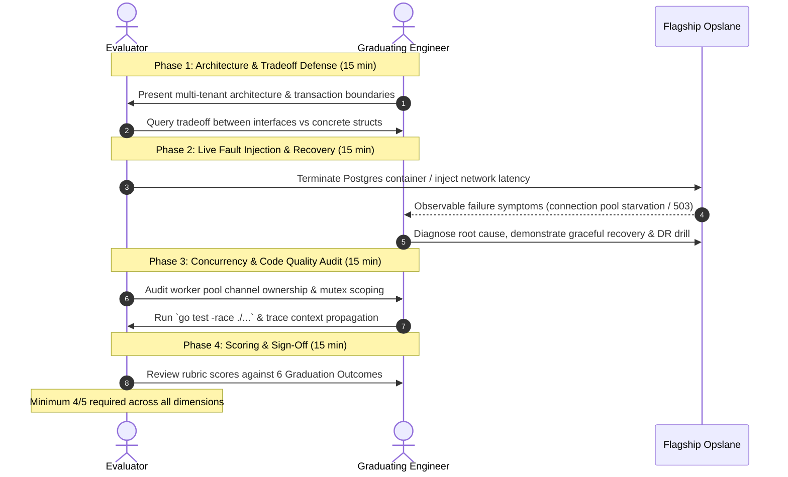

# The Go Engineer v3 — Graduation Outcomes & Capstone Defense Rubric

> **Target Standard:** Produce an autonomous, capable software engineer who can build, explain, test, deploy, monitor, and recover Go backend software.  
> **Status:** Active Authoritative Standard (`v3.0.0`)  
> **Scope:** Evaluates mastery across all 18 mandatory core modules (Modules 00–16 and Module 18 Flagship Opslane). Module 17 (Advanced Electives) provides optional specialization tracks and is not required for core graduation.

---

## 1. The 6 Core Graduation Outcomes

Graduation from *The Go Engineer* is determined by observable engineering behavior, not passive lesson completion. A graduating engineer must independently prove competence across six core dimensions:

### Outcome 1: Unassisted Problem Decomposition
- **Capability:** Given an unfamiliar requirement or ambiguous specification, decompose it into clear input/output contracts, boundary constraints, and loop invariants.
- **Evidence:** Completing algorithmic tasks (custom multi-key sorting via `slices.SortFunc`, binary search tier lookups, order-preserving deduplication, two-pointer partitioning) and business domain logic without copying prior solutions or relying on boilerplate generators.

### Outcome 2: Autonomous Debugging & Execution Tracing
- **Capability:** Diagnose panics, nil pointer dereferences, data races, deadlocks, and goroutine leaks using Delve, stack traces, and the Go race detector (`-race`).
- **Evidence:** Tracing through execution state tables, setting conditional breakpoints, analyzing compiler escape decisions, and identifying the exact hardware or runtime root cause before applying a minimal, verified regression fix.

### Outcome 3: Automated Verification & Test Rigor
- **Capability:** Write robust, deterministic, table-driven unit and integration test suites that prove correctness under both success and failure conditions.
- **Evidence:** Testing boundary values ($N=0, 1, \infty$), validating error returns with `errors.Is`/`errors.As`, structuring subtests with `t.Run()`, avoiding non-deterministic time-dependent assertions, and asserting transactional rollback on simulated database failures.

### Outcome 4: End-to-End Delivery & Disaster Recovery Proof
- **Capability:** Package services into minimal, secure multi-stage Docker containers, configure CI/CD pipelines, and execute verified database disaster recovery drills.
- **Evidence:** Performing live container destruction and proving reproducible recovery: backup artifact generation (`pg_dump`) $\to$ volume and container purge $\to$ automated restore (`pg_restore`) $\to$ automated SQL row count and sequence integrity verification. The drill must satisfy defined **Recovery Point Objective (RPO: zero loss of committed transactions prior to backup timestamp)** and **Recovery Time Objective (RTO: complete restore and service health check passed in $\le 5$ minutes)**.

### Outcome 5: Code Review & Architectural Tradeoff Defense
- **Capability:** Articulate *why* a particular design was chosen, analyze time/space Big-O and memory allocation costs, and defend Architecture Decision Records (ADRs).
- **Evidence:** Providing actionable, constructive peer reviews, choosing between generics and interfaces using explicit engineering criteria, and conducting a formal oral and technical defense of Flagship Opslane.

### Outcome 6: Live Operational Incident Response
- **Capability:** Instrument services with structured logging (`slog`), Prometheus metrics, and OpenTelemetry spans, and respond deterministically to production failures.
- **Evidence:** Triage simulated operational failures: deadlocks, connection pool starvation, memory exhaustion, token tampering, and cross-tenant leakage attempts with deterministic 401/403/404 isolation.

---

## 2. Flagship Opslane Capstone Defense Rubric

The capstone defense evaluates the learner's complete implementation of **Flagship Opslane** (Module 18) across 5 observable competency levels:

| Score | Rating | Meaning | Defense Criteria |
| :---: | :--- | :--- | :--- |
| **5** | **Exemplary** | Autonomous Technical Mastery | Demonstrates complete technical mastery; explains runtime mechanics when relevant to debugging; zero data races under `-race`; deterministic failure handling; reproducible disaster recovery drill satisfying defined RPO/RTO. |
| **4** | **Proficient** | Core Engineering Competence | Meets all mandatory specification requirements; clean idiomatic Go; deterministic unit and integration tests; robust error handling; clearly defends architectural decisions and operational trade-offs. |
| **3** | **Competent** | Foundational Competence | Implements core behavior; tests cover major happy paths; requires minor guidance during technical defense of distributed tradeoffs or failure modes. |
| **2** | **Novice** | Developing Competence | Incomplete specification requirements; brittle error handling; struggles to explain race conditions, context lifecycle, or tenant isolation boundaries. |
| **1** | **Unprepared**| Incomplete | Code non-functional or copied without comprehension; missing tests; service panics or leaks resources under failure scenarios. |

> **Evaluation Disclaimer:** Meeting the curriculum graduation standard certifies demonstrated technical capability against the observable engineering benchmarks above. It confirms readiness to contribute autonomously to production Go codebases within defined operational bounds; it does not claim universal hiring guarantees across unrelated tech stacks or unverified operational environments.

---

## 3. Mandatory Deliverables Checklist (Prior to Scheduling Defense)

Before scheduling the oral and technical defense, the learner must provide verified evidence of completion across all 7 core deliverables:

1. **Clean Version Control & Repository Hygiene:**
   - Git repository with clear, conventional commit messages.
   - Zero committed secrets, API keys, or uncommitted `.env` files.
   - Comprehensive top-level `README.md` with system overview, architecture diagram, and local setup instructions.

2. **3-Tier Clean Domain Architecture:**
   - Strict separation of transport (`transport/http`), business domain (`domain/`), and database persistence (`repo/postgres`).
   - Clean abstraction seams with domain models containing zero database-specific struct tags or transport logic.

3. **Multi-Tenant PostgreSQL Persistence:**
   - Forward and rollback SQL migrations managed via migration tooling (`golang-migrate` / goose).
   - Strict tenant isolation enforced at the repository level (`tenant_id` scoping on all queries).
   - Explicit database transaction management (`BEGIN` / `COMMIT` / `ROLLBACK`) for multi-step mutations.
   - Connection pool bounds configured (`SetMaxOpenConns`, `SetMaxIdleConns`, `SetConnMaxLifetime`).

4. **Authentication & Authorization:**
   - Cryptographically verified JWT authentication and role-based access control (RBAC).
   - Middleware enforcing authenticated context extraction, request timeouts, and structured error responses.

5. **Asynchronous Worker Pool & Event Pipeline:**
   - Buffered channel event bus processing background jobs.
   - Bounded worker pool preventing unbounded goroutine proliferation.
   - Graceful shutdown handling OS signals (`SIGINT`, `SIGTERM`), flushing pending jobs, and draining connection pools within a bounded timeout.

6. **Automated Verification Suite:**
   - Table-driven unit and integration test suites passing cleanly:
     ```bash
     go test -v -race -shuffle=on ./...
     ```
   - Zero data races detected under `-race`.
   - Test execution completes deterministically without intermittent time-dependent flakes.

7. **Disaster Recovery Proof & Observability:**
   - Multi-stage Docker container build producing a minimal production binary (`scratch` or `alpine`) running as a non-root user.
   - Reproducible disaster recovery script (`scripts/dr-test.sh`) proving automated backup, volume purge, database restore, and SQL integrity validation satisfying **RPO = 0** and **RTO $\le 5$ min**.
   - Structured JSON logging (`slog`) with correlated request IDs.
   - Prometheus metrics endpoint (`/metrics`) exposing request latencies, error counts, and active worker pool gauges.

---

## 4. Capstone Defense Protocol (Oral & Technical Defense)

The defense is a 60-minute interactive technical review conducted with an engineering evaluator:



1. **Architecture Walkthrough (15 min):** Explain the multi-tenant architecture, database schema, transaction boundaries, and event pipeline. Defend key Architecture Decision Records (ADRs).
2. **Failure Simulation & Incident Response (15 min):** The reviewer injects a simulated fault (e.g., terminate database container, simulate network timeout, submit unauthorized cross-tenant requests). The learner must diagnose the symptom from logs/metrics, explain runtime behavior, and demonstrate recovery.
3. **Code Quality & Concurrency Audit (15 min):** Review worker pool implementation under the Go race detector (`go test -race ./...`), inspecting channel ownership, mutex scopes, context cancellation, and goroutine cleanup.
4. **Scoring & Graduation Sign-Off (15 min):** Reviewer and learner score the implementation against the 5-point rubric. Requires a minimum score of **4/5 (Proficient)** across all core dimensions to certify graduation.

---

## 5. Post-Graduation Competency Alignment

Graduates of *The Go Engineer* demonstrate the technical autonomy and operational judgment expected of production backend engineers:

| Engineering Role / Level | Operational Readiness Benchmark |
| :--- | :--- |
| **Go Backend Engineer (L3/L4 / Mid-Level)** | Capable of designing, implementing, testing, and shipping robust Go microservices independently without day-to-day oversight. |
| **Production Systems Reliability** | Diagnoses production outages from structured telemetry, reads assembly/compiler escape traces when debugging performance bottlenecks, and maintains zero-data-loss disaster recovery runbooks. |
| **Code Quality & Team Stewardship** | Enforces idiomatic Go patterns, table-driven testing standards, clean architectural boundaries, and defensive concurrency practices in peer code reviews. |
