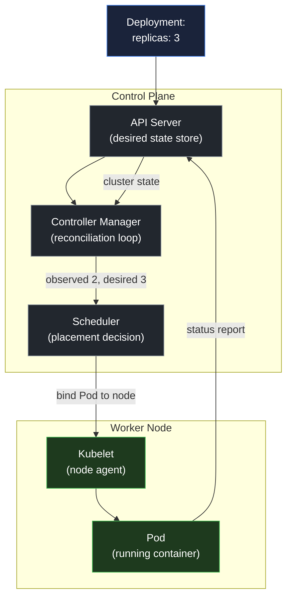

# Why orchestration: desired state and the control loop

## Learning objective

By the end of this lesson, you will be able to explain desired state and the reconciliation loop in your own words, and choose between a single host, a managed platform, Kubernetes, and serverless using explicit criteria.

## Why this matters

At 02:00, a host running three Go services loses power. With Docker Compose, all three stay down until an engineer is paged, SSHes in, and restarts them. With an orchestrator, the control plane observes that the declared replica count is no longer met, schedules replacements on healthy nodes, and removes the failed node from service. The difference is not the container image. It is the model of operation: you declare what should be true, and a controller continuously makes it true.

That model has a cost. An orchestrator adds a control plane, a network model, a storage model, a security model, and a new class of failures. Adopting it for one service on one host trades a simple restart command for a distributed system that can be unavailable, misconfigured, or misunderstood. This lesson gives you the decision rule before the object model, so the rest of the stream is a tool you choose deliberately rather than a default you inherit.

## Mental model

An orchestrator is a thermostat for infrastructure.

| Thermostat | Orchestrator |
|---|---|
| You set the target temperature (desired state) | You declare replicas, image, resources, and probes (desired state) |
| The sensor reads the current temperature (observed state) | Controllers and the scheduler read the current objects (observed state) |
| The controller compares target and current | The reconciliation loop compares desired and observed |
| The furnace turns on or off to close the gap | The scheduler creates or deletes Pods to close the gap |
| It keeps working without you | It keeps reconciling without you |

The analogy breaks in two ways. A thermostat controls one variable, while an orchestrator reconciles many kinds of objects: Pods, Deployments, Services, Endpoints, and more. And a thermostat can always act, while an orchestrator can be blocked by a node that has no free memory, a quota, an image that cannot be pulled, or a dependency that never becomes ready. When the gap cannot be closed, the controller reports it as an event or a condition. "Self-healing" means "keeps trying and tells you why it cannot," not "cannot fail."

## Visual model

Caption: the control plane never runs your application. It compares the desired state stored in the API server with the observed state reported by kubelets, and acts to close the gap.

## Core idea

Declarative operation has three parts:

1. **Desired state.** You write what should exist, not the sequence of commands to create it. A Deployment says "three replicas of image X with these resources and probes."
2. **Observed state.** Controllers and the scheduler read the current cluster. The observed state includes which Pods exist, whether they are ready, and which nodes have capacity.
3. **Reconciliation.** A control loop compares the two and acts. If a Pod dies, the ReplicaSet controller creates a replacement. If a node fails, the scheduler places the replacement on a healthy node. If the desired state is impossible, the loop retries and records an event.

The decision rule:

| Situation | Reach for | Why |
|---|---|---|
| One service, one host, low ops budget | Docker Compose on a VM | You keep the process model visible and the failure domain small |
| A few services, no desire to run a control plane | Managed PaaS or serverless | The platform owns scheduling, TLS, and scaling |
| Many services, multiple machines, self-healing, declarative rollout | Kubernetes or a comparable orchestrator | Reconciliation and scheduling are now required, not optional |
| Event-driven, bursty, cold-start tolerant | Serverless | Scale-to-zero fits the workload; long-lived connections do not |
| A single team that cannot operate a control plane | Managed Kubernetes or a PaaS | You can still get the model without owning the control plane |

Use the smallest model that satisfies the requirement. Orchestration is a response to scale, distribution, and operational complexity, not a sign of maturity.

## Common mistakes

| Mistake | Why it happens | Fix |
|---|---|---|
| Choosing Kubernetes for one service on one host | It is the default in tutorials | Start with Compose or a PaaS; revisit when a row in the decision rule applies |
| Treating YAML as the goal | The tooling is visible; the model is not | Learn desired state, observed state, and reconciliation first |
| Assuming orchestration removes Linux knowledge | The abstraction hides the substrate until it leaks | Keep the Module 15 foundation: processes, signals, cgroups, networking |
| Expecting self-healing to fix a broken image | "Self-healing" sounds absolute | Read the events; `ImagePullBackOff` and `CrashLoopBackOff` are the controller reporting an impossible desired state |
| Adding an orchestrator without an on-call plan | The control plane is now a dependency | Decide who pages, what the rollback is, and how the cluster is upgraded |

## Review questions

1. In your own words, what is the difference between desired state and observed state?
2. What does a controller do when it cannot close the gap between desired and observed state?
3. Give one requirement that justifies an orchestrator and one that does not.
4. Why does orchestration not remove the need to understand Linux processes and containers?
5. A single service on one host meets its availability target with Docker Compose. What evidence would justify moving it to Kubernetes?

## NEXT UP

[Pods, Deployments, Services, and Ingress](../22-kubernetes-object-model/README.md)
