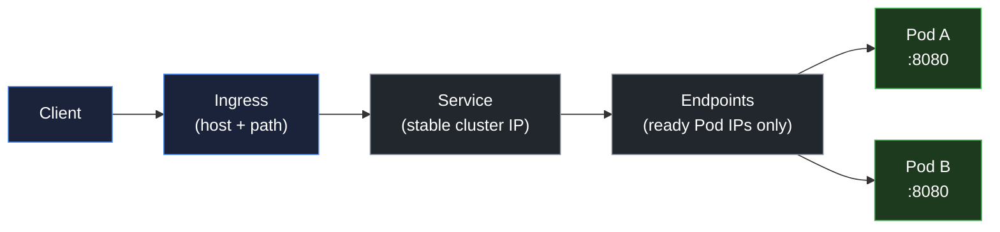
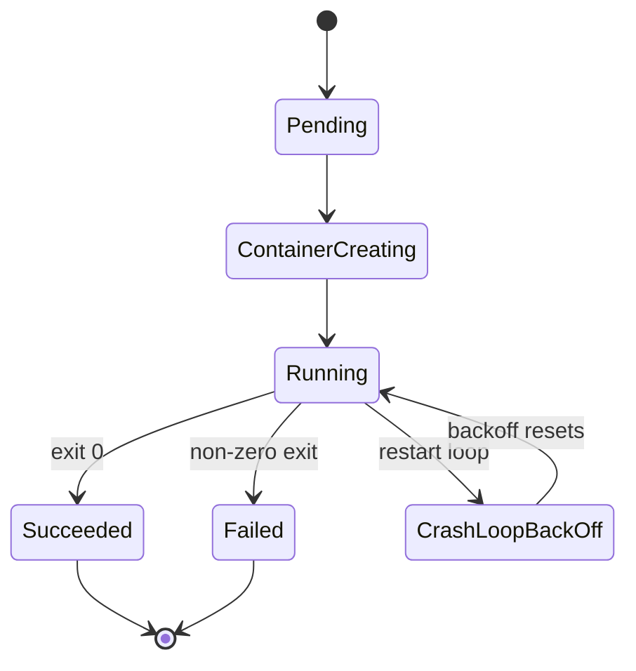

# Pods, Deployments, Services, and Ingress

## Learning objective

By the end of this lesson, you will be able to model a stateless Go service as a Deployment behind a Service and an Ingress, and trace the path of a request from the client to the container process.

## Why this matters

The container image is only half of a deployment. A bare container on a node has a short lifetime and no stable address. The moment a Pod is rescheduled, its name, its IP, and its host change. If clients address the Pod directly, every restart is an outage. Kubernetes separates the running process (the Pod) from the address clients use (the Service), and from the entry point outside the cluster (the Ingress). That separation is what makes a rollout invisible to clients.

Understanding the object graph also tells you where a request actually goes when it fails. A 404 at the edge, a connection refused at the Service, and a crash in the container are three different layers with three different tools. This lesson builds the map so the later operations lessons can debug each layer.

## Mental model

A Kubernetes Service is a phone book entry, not a phone.

| Directory service | Kubernetes |
|---|---|
| You look up a name and get a current number | A client resolves a Service name and gets a virtual IP |
| The number connects to whoever is on duty | The virtual IP forwards to a healthy Pod endpoint |
| Staff rotate; the listing does not change | Pods come and go; the Service name and cluster IP are stable |
| A front desk routes external calls | The Ingress controller accepts external traffic and routes by host and path |

The analogy breaks at selection. A phone book lists every extension. A Service lists only Pods whose labels match its selector and whose readiness probe passes. When a Pod is not ready, it is removed from the Endpoints list even though the process still exists. That is why a Service can be "up" while delivering no traffic.

## Visual model

Request path from the client to the container:

Caption: each arrow is a different object, a different failure mode, and a different command. The Service selector chooses Endpoints; only ready Pods appear there.

Pod phases and container states:

Caption: a Pod in `Running` can still serve no traffic if its readiness probe fails. `CrashLoopBackOff` is not a phase; it is the kubelet's backoff between restarts of a container that keeps failing.

## Core idea

Four objects compose a stateless service:

- **Pod.** The scheduling unit. It holds one or more containers that share a network namespace and a lifecycle. A Pod is ephemeral; its name, IP, and node are not stable. Treat every Pod as disposable.
- **ReplicaSet.** Keeps a declared number of identical Pods alive. You rarely create one directly; a Deployment owns it.
- **Deployment.** Declares the Pod template and the rollout strategy. It manages ReplicaSets so a change produces a new ReplicaSet and a controlled transition.
- **Service.** A stable virtual IP and DNS name that load-balances to the Pods selected by labels. `ClusterIP` is internal, `NodePort` exposes a port on every node, and `LoadBalancer` asks the cloud for an external address.
- **Ingress.** HTTP routing from outside the cluster to Services, keyed by host and path. An Ingress object does nothing without an Ingress controller (for example Ingress-NGINX or Traefik) running in the cluster.

Labels and selectors connect these objects. A Service does not reference Pods by name; it selects them by label. A mismatch between `spec.selector` and `spec.template.metadata.labels` produces a Service with zero Endpoints and no error.

## Under the hood

When you `kubectl apply` a Deployment, the object is written to the API server and persisted in etcd. The Deployment controller observes the new object and creates a ReplicaSet; the ReplicaSet controller creates Pod objects. The scheduler assigns each Pod to a node by writing `spec.nodeName`. The kubelet on that node pulls the image, starts the container, and runs the probes. The kubelet then reports Pod status back to the API server.

Networking is separate from the objects. Each node runs a proxy (historically `kube-proxy`) that programs the data plane (iptables or IPVS). The data plane rewrites packets destined for a Service cluster IP to a chosen Pod IP. When Pods become ready, the Endpoints controller adds their IPs to the Service's Endpoints; when they are deleted or fail readiness, it removes them. The cluster IP itself is virtual: no process listens on it. Only the rewrite rules make it work.

## How Go uses it

Go's API is `client-go` and the higher-level `controller-runtime`. The pattern is the same reconciliation loop this stream teaches: watch objects, compare desired and observed state, and act. Libraries such as `k8s.io/client-go/kubernetes`, `k8s.io/apimachinery`, and `sigs.k8s.io/controller-runtime` are the standard building blocks for Go services that extend the cluster. Custom controllers and operators are ordinary Go programs that speak the Kubernetes API.

For a Go service that only consumes the cluster, no client library is required. The service reads configuration from environment variables or mounted files, binds a port, and answers HTTP. The cluster handles discovery, addressing, and routing around it.

## Common mistakes

| Mistake | Why it happens | Fix |
|---|---|---|
| Addressing Pods directly by name or IP | The address is visible and seems stable | Address the Service DNS name; let the Service track endpoints |
| Assuming a Pod keeps its name across restarts | Pods look like VMs | Treat a Pod as disposable; never depend on its identity |
| Bypassing the Service with a Deployment selector | The Deployment has labels too | Expose the Deployment through a Service; never use it as an address |
| Forgetting that an Ingress needs a controller | The YAML applies cleanly | Install an ingress controller and verify the Ingress has an address |
| Confusing `containerPort` with the listen port | The field looks authoritative | `containerPort` is documentation; the process binds its own port |
| Treating a namespace as a network boundary | Namespaces feel isolated | Apply NetworkPolicies; namespaces alone do not restrict traffic |

## Production notes

- **Pods are ephemeral.** Do not store state in the container filesystem. Write to a volume, a database, or object storage, or the data is lost on reschedule.
- **Selectors must match exactly.** A typo in one label produces a Service with no endpoints and no error. `kubectl get endpoints <service>` is the fastest way to confirm.
- **Readiness gates traffic.** A Pod that is `Running` but not `Ready` is excluded from endpoints. Readiness is the contract that lets a rollout happen without dropping requests.
- **The Ingress is a shared resource.** A misconfigured host or path can shadow another team's route. Review the routing table, not only your own object.
- **Cluster IPs are not pingable.** They are virtual. Use the Service DNS name and an actual TCP connection to test connectivity, not `ping`.

## Review questions

1. What problem does a Service solve that a Pod cannot solve by itself?
2. How does a Service decide which Pods receive traffic?
3. Why does an Ingress require a controller to function?
4. A client receives a 404 from the edge, and the Pods are healthy. Which layer do you inspect first, and why?
5. What is the difference between `containerPort` and the port the Go process actually listens on?

## NEXT UP

[Configuration, secrets, and security context](../23-config-and-security-context/README.md)
