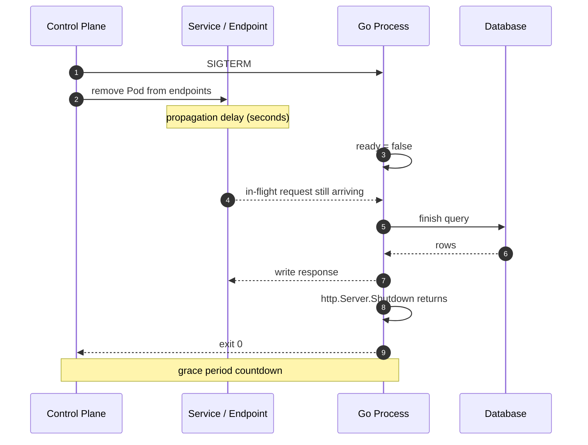

# Probes, lifecycle, and graceful shutdown

## Learning objective

By the end of this lesson, you will be able to implement startup, readiness, and liveness probes with correct timing, and drain in-flight HTTP requests on `SIGTERM` within the termination grace period without returning errors to clients.

## Why this matters

A rolling update replaces Pods one at a time. The control plane sends `SIGTERM` and removes the Pod from Service endpoints at roughly the same time, then waits for the container to exit. During that window, two independent clocks are running: the grace period countdown, and the time your process needs to finish the requests it already accepted. When the process exits before the drain finishes, in-flight requests fail and users see 502s during a deploy that looked healthy.

The `http.Server.Shutdown` method does not solve this by itself. If you call it with a background context, or if you never flip readiness to false, or if the grace period is shorter than the drain, the process still loses requests. Probes and shutdown are one contract with three parts: tell the load balancer when to stop sending traffic, stop accepting new connections, and finish the work already in progress.

## Mental model

Think of a restaurant closing for the night.

| Restaurant | Kubernetes Pod |
|---|---|
| The host stops seating new guests | Readiness fails, so the Service stops sending new connections |
| The kitchen finishes the orders already taken | In-flight requests complete |
| The staff leave when the last table is done | The process exits when the drain completes |
| A closing-time alarm cuts off the lights | The grace period expires and `SIGKILL` terminates the process |

The analogy breaks at the alarm. In a restaurant, the kitchen controls when it is done. In Kubernetes, the platform controls the deadline. If the kitchen is slower than the alarm, the meal is lost. The grace period is the alarm, and it is not negotiable at runtime.

## Visual model



Caption: readiness controls new traffic, `SIGTERM` starts the drain, and the grace period bounds the total time. Endpoint removal and `SIGTERM` are concurrent, so a small delay or a readiness gate is required.

## Core idea

A Pod has three probes, and each answers a different question.

| Probe | Question | Failure action | What to check |
|---|---|---|---|
| Startup | Has the process started? | Liveness and readiness do not run until it succeeds | Migration or warm-up complete |
| Readiness | Should this Pod receive traffic? | Remove from Service endpoints | Dependencies the request path needs |
| Liveness | Is the process stuck? | Restart the container | The process itself, not its dependencies |

The lifecycle contract:

1. On startup, readiness is false until the process can serve requests.
2. Once ready, the Pod is added to endpoints and receives traffic.
3. On `SIGTERM`, set readiness to false first.
4. Stop accepting new connections with `http.Server.Shutdown`.
5. Let in-flight requests finish.
6. Exit before `terminationGracePeriodSeconds` expires.

Probe timing is part of the contract, not a default. A liveness probe that fires during a garbage-collection pause restarts a healthy process. A readiness probe that is too slow keeps a bad Pod in rotation. A startup probe that is too short kills a slow migration.

## Under the hood

`http.Server.Shutdown` does not interrupt handlers. It closes the listeners, then waits for active connections to become idle. A handler that is blocked in a database call keeps its connection active, so `Shutdown` waits. A handler that opened a connection for a long poll or a stream can prevent `Shutdown` from returning until the context expires.

The sequence in the example:

1. `Shutdown(ctx)` sets `ready` to false, so `/readyz` returns 503.
2. `srv.Shutdown(ctx)` closes the listener and stops accepting new connections.
3. The runtime waits for active handlers to return.
4. A watcher goroutine runs `inflight.Wait()` while a `select` races it against the same `ctx` — the second guard honors the same deadline as the HTTP shutdown.
5. If `ctx` expires first, `Shutdown` returns the context error (or a drain-deadline error if the wait itself timed out) and the process should exit rather than hang.

## Go example

```go
package main

import (
	"context"
	"errors"
	"fmt"
	"log"
	"net"
	"net/http"
	"os"
	"os/signal"
	"sync"
	"sync/atomic"
	"syscall"
	"time"
)

const (
	defaultAddr        = ":8080"
	defaultDrainWindow = 10 * time.Second
)

// Server owns the readiness state and the HTTP listener.
type Server struct {
	ready    atomic.Bool
	inflight sync.WaitGroup
	work     http.HandlerFunc
	srv      *http.Server
	ln       net.Listener
}

// NewServer returns a server that is ready. If work is nil, /work sleeps
// briefly and returns 200.
func NewServer(work http.HandlerFunc) *Server {
	s := &Server{work: work}
	if s.work == nil {
		s.work = func(w http.ResponseWriter, r *http.Request) {
			time.Sleep(10 * time.Millisecond)
			w.WriteHeader(http.StatusOK)
		}
	}
	s.ready.Store(true)
	return s
}

// Ready reports whether the server should receive traffic.
func (s *Server) Ready() bool { return s.ready.Load() }

// NotReady removes the server from rotation without stopping it.
func (s *Server) NotReady() { s.ready.Store(false) }

// Start listens on addr and serves in the background.
func (s *Server) Start(addr string) error {
	ln, err := net.Listen("tcp", addr)
	if err != nil {
		return fmt.Errorf("listen on %s: %w", addr, err)
	}
	s.ln = ln
	s.srv = &http.Server{Handler: s.routes()}
	go func() {
		if err := s.srv.Serve(ln); err != nil && err != http.ErrServerClosed {
			log.Printf("serve: %v", err)
		}
	}()
	return nil
}

// Addr returns the bound address. It is only valid after Start.
func (s *Server) Addr() string {
	if s.ln == nil {
		return ""
	}
	return s.ln.Addr().String()
}

// Shutdown marks the server not ready, stops accepting new connections, and
// waits for in-flight requests to finish or ctx to expire. If the deadline
// passes with handlers still running, the returned error reports it.
func (s *Server) Shutdown(ctx context.Context) error {
	s.ready.Store(false)
	if s.srv == nil {
		return nil
	}
	err := s.srv.Shutdown(ctx)

	// srv.Shutdown returns as soon as ctx expires, even with handlers still
	// running, so the in-flight wait must honor the same deadline. The
	// watcher goroutine outlives this call only when a handler ignored the
	// deadline; the kubelet's SIGKILL at the grace period is the backstop.
	waitDone := make(chan struct{})
	go func() {
		s.inflight.Wait()
		close(waitDone)
	}()
	select {
	case <-waitDone:
	case <-ctx.Done():
		if err == nil {
			err = errors.New("drain deadline expired with handlers still in flight")
		}
	}
	return err
}

func (s *Server) routes() http.Handler {
	mux := http.NewServeMux()
	mux.HandleFunc("/healthz", func(w http.ResponseWriter, r *http.Request) {
		w.WriteHeader(http.StatusOK)
		_, _ = w.Write([]byte("ok\n"))
	})
	mux.HandleFunc("/readyz", func(w http.ResponseWriter, r *http.Request) {
		if !s.ready.Load() {
			w.WriteHeader(http.StatusServiceUnavailable)
			_, _ = w.Write([]byte("draining\n"))
			return
		}
		w.WriteHeader(http.StatusOK)
		_, _ = w.Write([]byte("ready\n"))
	})
	mux.HandleFunc("/work", s.work)
	return s.track(mux)
}

// track counts in-flight requests so the shutdown path can assert that all
// work finished.
func (s *Server) track(next http.Handler) http.Handler {
	return http.HandlerFunc(func(w http.ResponseWriter, r *http.Request) {
		s.inflight.Add(1)
		defer s.inflight.Done()
		next.ServeHTTP(w, r)
	})
}

func main() {
	addr := defaultAddr
	if v := os.Getenv("ADDR"); v != "" {
		addr = v
	}
	s := NewServer(nil)
	if err := s.Start(addr); err != nil {
		log.Fatal(err)
	}
	fmt.Printf("listening on %s; ready=%t\n", s.Addr(), s.Ready())

	stop := make(chan os.Signal, 1)
	signal.Notify(stop, syscall.SIGTERM, syscall.SIGINT)
	sig := <-stop
	fmt.Printf("received %s; draining for up to %s\n", sig, defaultDrainWindow)

	ctx, cancel := context.WithTimeout(context.Background(), defaultDrainWindow)
	defer cancel()
	if err := s.Shutdown(ctx); err != nil {
		log.Fatalf("shutdown: %v", err)
	}
	fmt.Println("shutdown complete")
}
```

The matching Deployment:

```yaml
apiVersion: apps/v1
kind: Deployment
metadata:
  name: orders-api
spec:
  replicas: 3
  strategy:
    type: RollingUpdate
    rollingUpdate:
      maxUnavailable: 0
      maxSurge: 1
  selector:
    matchLabels:
      app: orders-api
  template:
    metadata:
      labels:
        app: orders-api
    spec:
      terminationGracePeriodSeconds: 20
      containers:
        - name: api
          image: registry.example.com/orders-api:v1.4.0
          ports:
            - containerPort: 8080
          readinessProbe:
            httpGet:
              path: /readyz
              port: 8080
            periodSeconds: 5
            timeoutSeconds: 2
            failureThreshold: 3
          livenessProbe:
            httpGet:
              path: /healthz
              port: 8080
            periodSeconds: 10
            timeoutSeconds: 2
            failureThreshold: 3
          startupProbe:
            httpGet:
              path: /healthz
              port: 8080
            periodSeconds: 2
            failureThreshold: 30
```

## Step-by-step execution

Predict before you run: during the 100 ms window after `Shutdown` starts and before the blocked request is released, what status and body does `/readyz` return? Write down your answer before reading the next paragraph.

1. `NewServer(work)` sets `ready=true`.
2. `Start("127.0.0.1:0")` binds an ephemeral port and serves `routes` in a goroutine.
3. The test sends `GET /work`. The handler signals `started`, then blocks on `<-release`.
4. The test calls `Shutdown(ctx)` in a goroutine. `Shutdown` sets `ready=false`, so `/readyz` now returns `503 draining`.
5. `srv.Shutdown` closes the listener and waits for the `/work` handler to return.
6. The test waits 100 ms and asserts that `Shutdown` has not returned. If it returned, the process could exit while the response is still being written.
7. The test closes `release`. The handler writes `200`, the connection becomes idle, `srv.Shutdown` returns, the watcher's `inflight.Wait()` completes, and the `select` takes the `waitDone` branch.
8. The request goroutine receives the response and `Shutdown` returns `nil`.

## Runtime evidence

```bash
go test -race -count=1 .
```

Expected output:

```text
ok  	github.com/swe-labs/the-go-engineer/curriculum/electives/advanced-electives/lessons/24-probes-and-graceful-shutdown	2.4s
```

Interpretation: `TestShutdownWaitsForInflightRequest` blocks a handler, starts shutdown, asserts that shutdown does not return for at least 100 ms, releases the handler, and then asserts that both the request and shutdown complete. A failure means the process can exit while a request is still in flight. The `-race` flag proves the `atomic.Bool` and `WaitGroup` usage is free of data races.

To see the process handle a real signal:

```bash
ADDR=127.0.0.1:8080 go run .
```

Expected output on start:

```text
listening on 127.0.0.1:8080; ready=true
```

Send `Ctrl+C` and the process prints the signal, drains, and exits:

```text
received interrupt; draining for up to 10s
shutdown complete
```

## Common mistakes

| Mistake | Why it happens | Fix |
|---|---|---|
| Liveness probe checks the database | "Liveness should prove the app works" | Check only the process; a dependency outage would restart every Pod |
| `Shutdown` uses `context.Background()` | It compiles and seems clean | Use a context with a deadline shorter than `terminationGracePeriodSeconds` |
| Readiness never flips to false | The happy path is the only path tested | Set readiness false before shutdown and test it |
| Grace period shorter than the drain | The default is small | Measure the p99 request duration and set the grace period above it with headroom |
| New connections arrive after `SIGTERM` | Endpoint propagation is not instant | Add `preStop` sleep or rely on a readiness gate before removing the Pod |
| Streaming handlers ignore the request context | The handler predates the shutdown work | Pass the request context to every blocking call so it can be canceled |

## Debugging walkthrough

**Symptom:** a rolling update completes, but the error rate spikes to 4% for about 15 seconds during the window. The Pods are `Ready` and the rollout reports success.

**Hypotheses, cheapest first:**

1. The new version has a bug. Rejected: the same image is healthy after the rollout.
2. The readiness probe is too slow, so traffic reaches a Pod that is not ready. Check `kubectl describe pod` and the endpoint changes.
3. The process exits before the drain finishes. Check the logs for `shutdown complete` and the timing relative to `SIGTERM`.

**Tool:** `kubectl logs` with timestamps and `kubectl describe pod` for the termination reason.

**Root cause:** the process calls `srv.Shutdown(context.Background())` after a fixed `time.Sleep(2 * time.Second)`. When a request takes longer than 2 seconds, the process exits at the grace period and the connection is reset. The readiness probe is correct, but the drain is not bounded to the actual work.

**Fix:** replace the sleep with a tracked in-flight wait and a shutdown context. Set `terminationGracePeriodSeconds: 20` and a 10-second drain window. Confirm that `shutdown complete` appears before the grace period expires.

**Prevention:** add a test that blocks a handler and asserts that shutdown waits. Alert on 5xx rate during rollouts, not only on rollout status.

## Production notes

- **Probe timing is a budget.** Startup: `periodSeconds: 2`, `failureThreshold: 30` allows about 60 seconds to start. Readiness: `periodSeconds: 5`, `failureThreshold: 3` removes a Pod in about 15 seconds. Liveness: `periodSeconds: 10`, `failureThreshold: 3` restarts in about 30 seconds.
- **Keep liveness shallow.** It answers "is the process stuck?" If it checks a dependency, a slow database restarts every replica and turns a partial outage into a full one.
- **Readiness can check dependencies** that are required to serve a request. Return failure when the database is unreachable or the process is shutting down.
- **Endpoint removal races with `SIGTERM`.** Some clusters send both at once. A `preStop` sleep of a few seconds, or a readiness gate in the rollout, closes the gap.
- **`terminationGracePeriodSeconds` must exceed the drain.** `grace = preStop delay + in-flight drain + margin`. If the drain exceeds the grace period, the process receives `SIGKILL` and in-flight requests fail.
- **A PodDisruptionBudget protects availability** during node drains and cluster upgrades; it does not protect against a bad rollout. Use `maxUnavailable: 0` and `maxSurge: 1` for the rollout.
- **Check the actual listener, not a static file.** A liveness endpoint that returns 200 from a static handler proves the process is running, which is exactly what liveness should prove.

## Performance implications

- Every probe is an HTTP request. With 100 Pods, a 5-second readiness probe is 20 requests per second across the cluster. Keep probe handlers cheap and allocation-free.
- The drain window determines the minimum rollout duration. A 10-second drain per Pod with `maxUnavailable: 0` and 10 replicas adds up. Measure the p99 request duration and set the drain just above it.
- `http.Server.Shutdown` closes listeners immediately, so new connections are refused rather than queued. Clients that do not retry see an error; this is why readiness must flip first.
- In-flight accounting adds one atomic operation per request. It is negligible compared with the request itself, and it makes the shutdown guarantee testable.

## Practice task

The example starts serving immediately. Add a startup phase that simulates a slow migration:

1. Add a `migrate func(ctx context.Context) error` field and a `startupDone` flag.
2. `/readyz` returns 503 until the migration completes, then 200 until shutdown.
3. `/healthz` returns 200 as soon as the process is listening.
4. Add a startup probe with `periodSeconds: 2` and `failureThreshold: 30`.
5. Write a test that starts the server with a migration that blocks for 50 ms and asserts that `/readyz` returns 503, then 200, then 503 after shutdown.

## Tests / verification

```bash
go run .
go test -race -count=1 .
```

The tests verify:

- `/healthz` returns 200 in every state.
- `/readyz` returns 200 while ready and 503 while draining.
- `Shutdown` marks the server not ready even with no listener.
- `Shutdown` blocks while a handler is in flight and returns after it completes.
- The race detector proves the readiness flag and in-flight counter are safe.

## Review questions

1. What question does each probe answer: startup, readiness, liveness?
2. Why must readiness fail before `http.Server.Shutdown` is called?
3. A request handler takes 30 seconds. `terminationGracePeriodSeconds` is 20. What does the client see, and why?
4. Why is a liveness probe that checks the database dangerous during a database outage?
5. `Shutdown` is called with a context that expires. What does the process do next, and what should it not do?

## NEXT UP

[Resources, the Go runtime, and autoscaling](../25-resources-and-go-runtime/README.md) connects container CPU and memory limits to `GOMAXPROCS`, `GOMEMLIMIT`, garbage collection, CPU throttling, and OOM kills.

