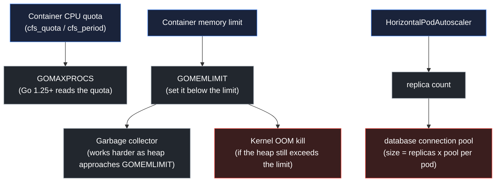

# Resources, the Go runtime, and autoscaling

## Learning objective

By the end of this lesson, you will be able to set container CPU and memory requests and limits, relate them to `GOMAXPROCS`, `GOMEMLIMIT`, and garbage-collection behavior, and diagnose CPU throttling and OOM kills from measured signals.

## Why this matters

A Go service does not run in a vacuum. The kernel enforces container CPU and memory limits, and the Go runtime makes scheduling and garbage-collection decisions from its own view of the machine. When those two views disagree, the failure is confusing: the process is healthy, the average CPU is low, and p99 latency still spikes, or the container is killed with no Go panic in the logs.

Two concrete mechanisms cause most of these incidents. A CPU limit is enforced as a per-period quota; a bursty service can be throttled even when its average utilization is far below the limit. A memory limit is enforced by the kernel OOM killer; a Go process that grows its heap past the container limit is killed before its own garbage collector notices. Both are avoidable once you connect the container settings to the runtime controls that answer them.

## Mental model

A container resource limit is a speed limit with a camera, and the Go runtime is the driver who cannot see the sign.

| Driving | Kubernetes and the Go runtime |
|---|---|
| The speed limit is the maximum allowed, not the target | A limit is the ceiling; throttling happens at the ceiling, not the average |
| A police camera tickets each burst | The CFS quota is consumed per 100 ms period; bursts are throttled at period boundaries |
| The driver reads the dashboard, not the sign | Go reads `NumCPU`, not the cgroup CPU quota, before Go 1.25 |
| The fuel tank has a hard floor | The kernel OOM killer is the floor; the runtime must be told the floor with `GOMEMLIMIT` |

The analogy breaks at feedback. A driver sees the speedometer and adjusts. The Go runtime before Go 1.25 had no speedometer for the cgroup quota; it assumed the limit did not exist and set `GOMAXPROCS` to the node's CPU count. The fix is to give the runtime the missing signal, either because the runtime reads it (Go 1.25+) or because you set it explicitly.

## Visual model



Caption: each container limit needs a runtime answer. CPU quota maps to `GOMAXPROCS`; memory limit maps to `GOMEMLIMIT`. Replica count multiplies the connection pool, which is why autoscaling without pool sizing exhausts the database.

## Core idea

Requests and limits are different promises:

- **Request** is what the scheduler reserves. It determines which node the Pod fits on and the CPU shares it receives under contention. It is a scheduling guarantee, not a runtime cap.
- **Limit** is the ceiling the kernel enforces. CPU is enforced as a quota; memory is enforced by the OOM killer. A limit higher than the request lets a Pod burst while others are idle.

The runtime controls that answer a limit:

| Container setting | Runtime control | Effect |
|---|---|---|
| CPU limit | `GOMAXPROCS` | Caps goroutines executing Go code in parallel |
| Memory limit | `GOMEMLIMIT` | Tells the GC the target heap ceiling |
| Memory limit | `GOGC` | How aggressively the GC runs before the limit is reached |

`GOMAXPROCS` and the cgroup quota interact directly. A 2-CPU limit on a 16-core node means the process may schedule 16 goroutines in parallel and then be throttled to 2. Go 1.25 and later read the cgroup CPU quota and cap `GOMAXPROCS` to it by default. On earlier versions you must set `GOMAXPROCS` explicitly, for example from a downward API value or with a library such as `automaxprocs`.

`GOMEMLIMIT` and the container limit interact directly too. Set `GOMEMLIMIT` below the container limit, leaving headroom for the runtime, the stacks, and the page cache. If `GOMEMLIMIT` equals the container limit, the GC and the OOM killer race, and the OOM killer wins: it is not managed by Go.

## Go example

```go
package main

import (
	"fmt"
	"os"
	"runtime"
	"runtime/debug"
	"strconv"
)

// Budget describes the CPU and memory budget the process should respect.
type Budget struct {
	GOMAXPROCS  int
	MemoryLimit int64 // bytes used for GOMEMLIMIT
	GCPercent   int
}

// ComputeBudget builds a Budget from the runtime and an explicit container
// memory limit. It reserves headroom for the Go runtime and the page cache,
// then sets GOMEMLIMIT below the container limit so the garbage collector runs
// before the kernel OOM killer does.
func ComputeBudget(containerLimitBytes int64, gcPercent int) (Budget, error) {
	if containerLimitBytes <= 0 {
		return Budget{}, fmt.Errorf("container memory limit %d must be positive", containerLimitBytes)
	}
	if gcPercent < 0 {
		return Budget{}, fmt.Errorf("gc percent %d must not be negative", gcPercent)
	}

	b := Budget{
		GOMAXPROCS:  runtime.GOMAXPROCS(0),
		MemoryLimit: containerLimitBytes * 85 / 100,
		GCPercent:   gcPercent,
	}
	if gcPercent > 0 {
		debug.SetGCPercent(gcPercent)
	}
	debug.SetMemoryLimit(b.MemoryLimit)
	return b, nil
}

func parseGCPercent(raw string) (int, error) {
	if raw == "" {
		return 100, nil
	}
	n, err := strconv.Atoi(raw)
	if err != nil || n < 0 {
		return 0, fmt.Errorf("GOGC %q must be a non-negative integer", raw)
	}
	return n, nil
}

func main() {
	limit := int64(512 << 20)
	if raw := os.Getenv("APP_MEMORY_LIMIT_BYTES"); raw != "" {
		n, err := strconv.ParseInt(raw, 10, 64)
		if err != nil || n <= 0 {
			fmt.Fprintf(os.Stderr, "invalid APP_MEMORY_LIMIT_BYTES %q\n", raw)
			os.Exit(1)
		}
		limit = n
	}
	gc, err := parseGCPercent(os.Getenv("GOGC"))
	if err != nil {
		fmt.Fprintf(os.Stderr, "config error: %v\n", err)
		os.Exit(1)
	}
	b, err := ComputeBudget(limit, gc)
	if err != nil {
		fmt.Fprintf(os.Stderr, "config error: %v\n", err)
		os.Exit(1)
	}

	var m runtime.MemStats
	runtime.ReadMemStats(&m)
	fmt.Printf("gomaxprocs=%d container_limit=%d soft_limit=%d gc_percent=%d heap_alloc=%d\n",
		b.GOMAXPROCS, limit, b.MemoryLimit, b.GCPercent, m.HeapAlloc)
}
```

The matching Deployment fragment:

```yaml
apiVersion: apps/v1
kind: Deployment
metadata:
  name: orders-api
spec:
  replicas: 3
  template:
    spec:
      containers:
        - name: api
          image: registry.example.com/orders-api:v1.4.0
          env:
            - name: APP_MEMORY_LIMIT_BYTES
              value: "536870912"
          resources:
            requests:
              cpu: "250m"
              memory: "256Mi"
            limits:
              cpu: "1"
              memory: "512Mi"
```

## Step-by-step execution

Predict before you run: with a container memory limit of 512 MiB and `GOMEMLIMIT` set to exactly 512 MiB, the heap reaches 500 MiB and the GC has not yet run. Which acts first, the Go garbage collector or the kernel OOM killer? Write your answer before reading the next section.

1. The container starts with `resources.limits.memory: 512Mi`, which the kernel exposes as `cfs` quota and a memory cgroup ceiling.
2. `GOMAXPROCS(0)` queries the current processor count. On Go 1.25+ this reflects the cgroup CPU quota; on older versions it reflects the node's CPU count.
3. `ComputeBudget` reserves 15% of the container limit, so a 1 GiB limit becomes an 85% `GOMEMLIMIT` of about 870 MiB.
4. `debug.SetGCPercent(gcPercent)` tunes how much the heap may grow between collections. A lower value collects more often and uses less peak memory at the cost of CPU.
5. `debug.SetMemoryLimit(soft)` sets the target heap ceiling. As the live heap approaches it, the GC runs more often and more aggressively.
6. `runtime.ReadMemStats` reports the current heap in use. In the configuration below it is a few hundred kilobytes at startup, far below the soft limit.

## Runtime evidence

Run the tests with the race detector:

```bash
go test -race -count=1 .
```

Expected output (from `curriculum/electives/advanced-electives/lessons/25-resources-and-go-runtime`):

```text
ok  	github.com/swe-labs/the-go-engineer/curriculum/electives/advanced-electives/lessons/25-resources-and-go-runtime	1.7s
```

Now run the binary with a 1 GiB container limit and `GOGC=50`:

```bash
APP_MEMORY_LIMIT_BYTES=1073741824 GOGC=50 go run .
```

Expected output:

```text
gomaxprocs=12 container_limit=1073741824 soft_limit=912680550 gc_percent=50 heap_alloc=241328
```

Interpretation: `container_limit` is the ceiling the kernel enforces. `soft_limit` is `debug.SetMemoryLimit` applied: 85% of the container limit, about 870 MiB. The gap between them is the headroom the GC uses to start collecting before the kernel OOM killer acts. `gomaxprocs=12` reflects the machine's logical CPUs; inside a Pod with a 2-CPU limit on Go 1.25+, this value would be 2 instead. `heap_alloc` is the live heap at startup and grows with the workload. Change `GOGC` and rerun: a lower value lowers peak heap at the cost of more collections.

At the cluster level, confirm the effective values with the runtime's own view:

```bash
kubectl exec deploy/orders-api -- sh -c 'cat /sys/fs/cgroup/cpu.max /sys/fs/cgroup/memory.max'
```

The first line is the CPU quota and period (for example `200000 100000`, which is 2 CPUs). The second is the memory ceiling in bytes. Compare them with the values your process logs at startup.

## Common mistakes

| Mistake | Why it happens | Fix |
|---|---|---|
| Setting a CPU limit and no request | The limit is the visible knob | Set a request for scheduling and a limit for the ceiling; a request equal to the limit gives a Guaranteed class |
| Ignoring CFS throttling because average CPU is low | Averages hide per-period bursts | Watch `container_cpu_cfs_throttled_seconds_total`; throttle ratio, not average, predicts p99 |
| Setting `GOMEMLIMIT` equal to the container limit | It looks like the correct ceiling | Leave 10-20% headroom; the runtime and page cache need space too |
| Assuming `GOMAXPROCS` equals the CPU limit | Both are CPU numbers | Go 1.25+ reads the cgroup quota; earlier versions need explicit `GOMAXPROCS` |
| Scaling replicas without scaling the connection pool | Each replica opens its own pool | Budget `maxReplicas x pool size` against the database `max_connections` |
| Using CPU alone to drive the HPA for a queue-bound service | CPU is the default metric | Scale on queue depth or latency; CPU does not rise while workers wait |
| Copying limits from a tutorial | The numbers look reasonable | Measure the real working set and p99, then set requests from data |

## Debugging walkthrough

**Symptom:** p99 latency for a Go service rises from 40 ms to 900 ms every few seconds. The average CPU utilization stays near 20% of the limit. No OOM kill, no error logs, no goroutine leak.

**Hypotheses, cheapest first:**

1. A downstream dependency is slow. Rejected: the dependency's p99 is flat.
2. The Go scheduler is starved. Check `GOMAXPROCS` and the node CPU count.
3. The container is being CPU-throttled. Check the CFS throttle counters.

**Tool:** `kubectl top pod` shows low average CPU. The decisive signal is the throttle metric:

```promql
rate(container_cpu_cfs_throttled_periods_total[5m])
  /
rate(container_cpu_cfs_periods_total[5m])
```

**Root cause:** the limit is `500m`. The service handles requests in short bursts that use a full core for 30 ms. The CFS quota for a 100 ms period allows only 50 ms of CPU, so any burst of two concurrent 30 ms requests is throttled at the period boundary. Average utilization stays low because the service is idle between bursts, but every burst that crosses the quota is delayed by up to the remainder of the period. The throttling shows up as a periodic latency spike.

**Fix:** raise the CPU limit to `2` (or remove the limit and keep a request of `500m`), then confirm the throttle ratio drops below a few percent. Measure the peak burst requirement with `go test -bench` or a load generator before choosing the number. Do not remove the request; the scheduler still needs it.

**Prevention:** alert on the CFS throttle ratio, not only on average CPU. Average utilization hides the exact failure that throttling causes.

## Production notes

- **Measure before you set numbers.** Run the workload, record the working set and the p99, and derive requests from data. A number copied from a tutorial is a guess.
- **Set requests, and set limits deliberately.** A CPU request without a limit lets a Pod burst while capacity exists. A CPU limit protects neighbors but risks throttling. Decide which failure you prefer.
- **Leave memory headroom.** Set `GOMEMLIMIT` 10-20% below the container limit. The runtime, goroutine stacks, and page cache live in the gap.
- **Watch throttling and OOM, not just CPU and memory.** `container_cpu_cfs_throttled_periods_total` and `container_oom_events_total` are the leading signals. Average CPU and memory are lagging.
- **Size the database pool against `maxReplicas`.** `replicas x pool_size` must stay under the database `max_connections`, with room for migrations and other clients.
- **Scale on a leading signal.** CPU lags for queue-bound services. Scale on queue depth, in-flight requests, or latency. Add stabilization windows to avoid flapping.
- **Use the Guaranteed quality of service when latency matters.** Setting `request == limit` for both CPU and memory places the Pod in the Guaranteed class and reduces eviction risk under node pressure.

## Practice task

Given a Go service that allocates about 120 MiB at steady state, bursts to 400 MiB under load, and must answer requests in under 100 ms:

1. Choose a CPU request and limit. Justify the limit with a throttling argument.
2. Choose a memory request and limit. Set `GOMEMLIMIT` and explain the gap.
3. Write the `resources` block and the `env` entry that passes `APP_MEMORY_LIMIT_BYTES` to the process.
4. Explain what changes when you scale from 3 to 12 replicas, given a per-pod pool size of 10 and a database `max_connections` of 100.
5. Name the two metrics you would alert on, and the threshold you would start with.

## Tests / verification

```bash
go run ./curriculum/electives/advanced-electives/lessons/25-resources-and-go-runtime
go test -race -count=1 ./curriculum/electives/advanced-electives/lessons/25-resources-and-go-runtime
```

The tests verify:

- The soft limit is 85% of the container limit.
- `GOMAXPROCS` matches `runtime.GOMAXPROCS(0)`.
- `debug.SetMemoryLimit` is applied to the computed value.
- A zero or negative container limit returns an error.
- A negative `GOGC` returns an error.
- An empty `GOGC` returns the Go default of 100.

## Review questions

1. What is the difference between a CPU request and a CPU limit?
2. Why can a container be throttled while its average CPU utilization is low?
3. Why must `GOMEMLIMIT` be lower than the container memory limit?
4. How does Go 1.25 and later determine `GOMAXPROCS` inside a container, and what did earlier versions do?
5. A service scales to 20 replicas. Its per-pod pool size is 25 and the database allows 100 connections. What breaks, and how do you fix it?

## NEXT UP

[Rollouts, rollback, PDB, and troubleshooting](../26-rollouts-and-troubleshooting/README.md)
