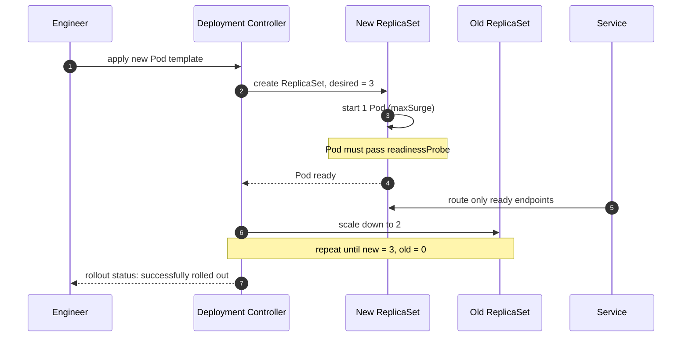
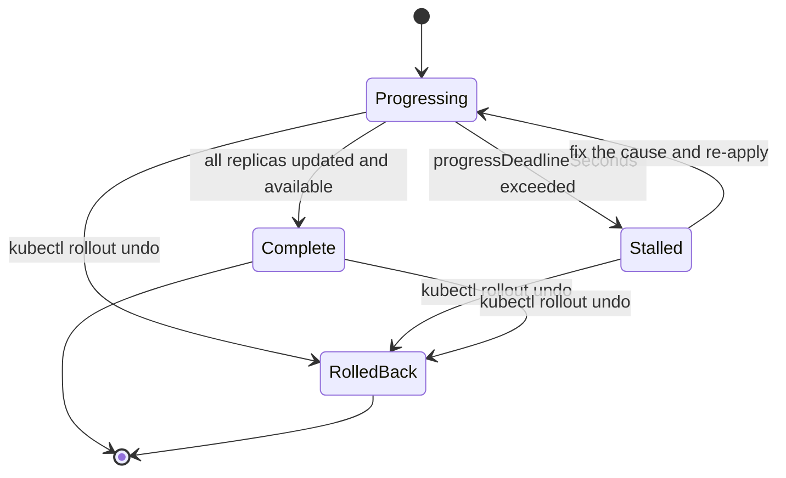

# Rollouts, rollback, and troubleshooting

## Learning objective

By the end of this lesson, you will be able to perform a zero-downtime rolling update, verify which revision is serving traffic, roll back safely, protect availability during a node drain with a PodDisruptionBudget, and diagnose a stalled rollout from cluster events.

## Why this matters

A rollout is the riskiest routine operation you perform. It replaces every instance of a running service in front of real users, and a mistake in the update strategy, the probe, or the schema turns a routine deploy into an outage. The cluster gives you a controlled transition and a one-command rollback, but only if the objects are configured for it.

The failure that surprises teams is a rollout that reports success and still drops requests. `kubectl rollout status` returns zero when every new Pod is available; it says nothing about whether the version that answered was the one you intended, or whether a migration in the same release made the old revision incompatible. This lesson connects the update strategy, the version endpoint that proves what is running, and the rollback path so a deploy is a measurement, not a hope.

## Mental model

A rolling update is a bridge being repainted while traffic keeps crossing it.

| Bridge repaint | Rolling update |
|---|---|
| Keep at least one lane open at all times | `maxUnavailable` bounds how many Pods may be down |
| Add a detour lane before closing one | `maxSurge` adds new Pods before removing old ones |
| Close a lane only after the new paint is dry | A Pod is removed only after it passes readiness |
| If the paint is wrong, reopen the old lane | `kubectl rollout undo` restores the previous ReplicaSet |
| Inspect the closed lane before reopening | `kubectl describe` and events explain a stalled rollout |

The analogy breaks when the old and new paint interact. In a bridge, old and new never touch. In a service, the old and new revisions run at the same time and share a database. If the new release changes the schema destructively, the old revision breaks while it is still serving traffic, and the rollback no longer works. That is why schema changes must be backward compatible across a release boundary.

## Visual model

The rolling update sequence:



Caption: the controller never replaces all Pods at once. Each new Pod must become Ready before the controller removes an old one, and the Service only ever routes to endpoints that pass readiness.

The rollout state machine:



Caption: `Progressing` is the normal transition state. `Stalled` means the controller waited past `progressDeadlineSeconds` without progress; the deployment stays stalled until you fix the cause or roll back. A rollback creates a new revision that is a copy of an earlier one, so it is itself a rollout.

## Core idea

Four controls define the transition, and each answers a question:

| Control | Question it answers | Typical value |
|---|---|---|
| `maxUnavailable` | How much capacity may I lose during the update? | `0` for zero-downtime |
| `maxSurge` | How much extra capacity may I add? | `1` |
| `minReadySeconds` | How long must a new Pod stay Ready before it counts? | `5` to catch flapping |
| `revisionHistoryLimit` | How many old ReplicaSets must I keep? | `10` for rollback headroom |

The verification and recovery commands:

- `kubectl rollout status deploy/<name> --timeout=60s` blocks until the rollout completes or fails.
- `kubectl rollout history deploy/<name>` lists revisions; `--revision=N` shows one.
- `kubectl rollout undo deploy/<name>` restores the previous revision; `--to-revision=N` restores a specific one.
- `kubectl get pods -l app=<name>` and `kubectl describe pod <pod>` show which revision is running and why a Pod is stuck.

A rollout is only meaningful if readiness is meaningful. If the new Pod has no `readinessProbe`, the controller considers it available the instant the container starts, so a Pod that cannot serve is counted as healthy. `maxUnavailable: 0` with a real readiness probe is the combination that produces zero-downtime updates; either one without the other does not.

## Under the hood

When the Pod template changes, the Deployment controller computes a new ReplicaSet hash and creates a ReplicaSet for it. It then adjusts the two ReplicaSets step by step, respecting `maxUnavailable` and `maxSurge`. The ReplicaSet controller creates and deletes Pods; the scheduler places them; the kubelet starts containers and runs probes.

The rollout completes when the new ReplicaSet has the desired count of available replicas and the old ReplicaSet has zero. A Pod counts as available only after its readiness probe succeeds and it has been Ready for `minReadySeconds`. If the controller observes no progress for `progressDeadlineSeconds` (default 600s), it sets the Deployment condition `ProgressDeadlineExceeded` and the rollout is reported as stalled; it does not revert automatically.

Two mechanisms cause most adverse rollouts:

1. **An unpullable or crashing image.** The kubelet cannot start the container, so no new Pod becomes available. Events show `ImagePullBackOff` or `CrashLoopBackOff`.
2. **Insufficient capacity under `maxUnavailable: 0`.** The controller must add a new Pod before it may remove an old one. If the cluster cannot schedule that extra Pod (resource pressure, taints, a full node), the rollout waits indefinitely.

A PodDisruptionBudget is unrelated to the rollout strategy. It limits how many Pods may be voluntarily disrupted at once during node drains and cluster upgrades (`kubectl drain`), not during a bad deploy. Use `maxUnavailable: 0` for the deploy and a PDB for maintenance.

## Go example

```go
package main

import (
	"encoding/json"
	"fmt"
	"net/http"
	"os"
	"runtime/debug"
)

// VersionInfo is the payload returned by /version. Every field is additive: a
// release may add fields but never removes or repurposes one, so an older
// client keeps decoding a newer response.
type VersionInfo struct {
	Schema      string `json:"schema"`
	Version     string `json:"version"`
	Commit      string `json:"commit"`
	BuildTime   string `json:"build_time"`
	Modified    bool   `json:"modified"`
	Environment string `json:"environment"`
}

// currentSchema identifies the response shape. Bump it only when a field is
// removed or changes meaning; adding a field keeps the schema version.
const currentSchema = "version.v1"

// BuildVersion assembles a VersionInfo from the build metadata that the Go
// toolchain embeds and from the runtime environment. buildInfo may be nil when
// the binary is built without module information.
func BuildVersion(env string, bi *debug.BuildInfo) VersionInfo {
	v := VersionInfo{
		Schema:      currentSchema,
		Version:     "(devel)",
		Commit:      "unknown",
		BuildTime:   "unknown",
		Environment: env,
	}
	if v.Environment == "" {
		v.Environment = "local"
	}
	if bi != nil {
		if bi.Main.Version != "" {
			v.Version = bi.Main.Version
		}
		for _, s := range bi.Settings {
			switch s.Key {
			case "vcs.revision":
				if s.Value != "" {
					v.Commit = s.Value
				}
			case "vcs.time":
				if s.Value != "" {
					v.BuildTime = s.Value
				}
			case "vcs.modified":
				v.Modified = s.Value == "true"
			}
		}
	}
	return v
}

// versionHandler serves the running build so a rollout can be verified by asking
// the Service which revision answered the request.
func versionHandler(bi *debug.BuildInfo) http.HandlerFunc {
	return func(w http.ResponseWriter, r *http.Request) {
		w.Header().Set("Content-Type", "application/json")
		_ = json.NewEncoder(w).Encode(BuildVersion(os.Getenv("APP_ENV"), bi))
	}
}

func main() {
	bi, ok := debug.ReadBuildInfo()
	if !ok {
		bi = nil
	}

	mux := http.NewServeMux()
	mux.HandleFunc("/version", versionHandler(bi))
	mux.HandleFunc("/healthz", func(w http.ResponseWriter, r *http.Request) {
		w.WriteHeader(http.StatusOK)
		_, _ = w.Write([]byte("ok\n"))
	})

	addr := ":8080"
	if v := os.Getenv("ADDR"); v != "" {
		addr = v
	}
	fmt.Printf("listening on %s version=%s env=%s\n",
		addr, BuildVersion(os.Getenv("APP_ENV"), bi).Version, BuildVersion(os.Getenv("APP_ENV"), bi).Environment)
	if err := http.ListenAndServe(addr, mux); err != nil {
		fmt.Fprintf(os.Stderr, "server error: %v\n", err)
		os.Exit(1)
	}
}
```

The matching Deployment with an explicit strategy, a rollout guard, and a PodDisruptionBudget:

```yaml
apiVersion: apps/v1
kind: Deployment
metadata:
  name: orders-api
spec:
  replicas: 3
  revisionHistoryLimit: 10
  progressDeadlineSeconds: 120
  minReadySeconds: 5
  strategy:
    type: RollingUpdate
    rollingUpdate:
      maxUnavailable: 0
      maxSurge: 1
  selector:
    matchLabels:
      app: orders-api
  template:
    metadata:
      labels:
        app: orders-api
        version: v1.5.0
    spec:
      containers:
        - name: api
          image: registry.example.com/orders-api:v1.5.0
          ports:
            - containerPort: 8080
          readinessProbe:
            httpGet:
              path: /healthz
              port: 8080
            periodSeconds: 5
            failureThreshold: 3
---
apiVersion: policy/v1
kind: PodDisruptionBudget
metadata:
  name: orders-api
spec:
  minAvailable: 2
  selector:
    matchLabels:
      app: orders-api
```

## Step-by-step execution

Predict before you run: the version string `v1.0.1-0.20261106134150-47461017c170+dirty` appears during a `go build`. What do the `+dirty` suffix and the long hash mean, and why does the version not read `v1.5.0`? Write your answer before reading the Runtime evidence interpretation.

1. A rolling update begins when the Pod template hash changes. `kubectl set image` or `kubectl apply` writes the new Deployment spec.
2. The Deployment controller creates a new ReplicaSet tagged with the template hash and scales it up by `maxSurge` (one Pod).
3. The new Pod is scheduled, the kubelet pulls the image, starts the container, and runs `readinessProbe`.
4. Once the Pod is Ready and has stayed Ready for `minReadySeconds`, the controller scales the old ReplicaSet down by `maxUnavailable` (zero here, so it removes one old Pod).
5. Steps 2 through 4 repeat until the new ReplicaSet has three available Pods and the old has zero.
6. During the transition, a request to the Service may be answered by either revision. `GET /version` reports which one.
7. If the new Pod never becomes Ready, the controller stops making progress. After `progressDeadlineSeconds` it sets `ProgressDeadlineExceeded` and the rollout is stalled.
8. `kubectl rollout undo` copies the previous ReplicaSet's template into a new revision and runs the same transition in reverse.

## Runtime evidence

Run the tests with the race detector:

```bash
go test -race -count=1 .
```

Expected output (from `curriculum/electives/advanced-electives/lessons/26-rollouts-and-troubleshooting`):

```text
ok  	github.com/rasel9t6/the-go-engineer/curriculum/electives/advanced-electives/lessons/26-rollouts-and-troubleshooting	2.0s
```

The tests cover metadata extraction, the missing-metadata defaults, the JSON handler, and the rollback-compatible response shape. Now build the binary and query the version endpoint:

```bash
go build -o lesson26 .
ADDR=127.0.0.1:8129 APP_ENV=staging ./lesson26 &
curl -s localhost:8129/version
```

Expected output (the version string is derived from this repository's VCS state and will differ on your machine):

```json
{"schema":"version.v1","version":"v1.0.1-0.20261106134150-47461017c170+dirty","commit":"47461017c170490157061ede129c3b45c5a20796","build_time":"2026-11-06T13:41:50Z","modified":true,"environment":"staging"}
```

The process also logs its identity at startup:

```text
listening on 127.0.0.1:8129 version=v1.0.1-0.20261106134150-47461017c170+dirty env=staging
```

Interpretation: the `version` field is the module pseudo-version the Go toolchain derives when the binary is built from a working tree that is not at an exact tag. `v1.0.1-0.20261106134150-47461017c170` means "after v1.0.1, at commit 4746101, timestamped 2026-11-06T13:41:50Z." The `+dirty` suffix means the working tree had uncommitted changes at build time, which `modified: true` confirms. A tagged release would instead read `v1.5.0`. The `commit` and `build_time` come from the `vcs.revision` and `vcs.time` build settings the toolchain embeds when `-buildvcs` is enabled (the default since Go 1.18).

After a rollout, verify the running revision through the Service rather than by name:

```bash
kubectl exec deploy/orders-api -- wget -qO- localhost:8080/version
kubectl rollout status deploy/orders-api --timeout=60s
kubectl rollout history deploy/orders-api
```

Compare the `version` and `commit` from the endpoint with the tag you deployed. If they disagree, the rollout has not finished or the Service is still routing to the old ReplicaSet.

## Common mistakes

| Mistake | Why it happens | Fix |
|---|---|---|
| A destructive schema change in the same release | The migration and the code ship together | Expand first (add nullable columns), deploy, backfill, then contract in a later release |
| No `readinessProbe` | The container starts, so it looks healthy | Add a readiness probe; without it `maxUnavailable` counts an unready Pod as available |
| `maxUnavailable: 0` with no spare capacity | Zero-downtime sounds strictly better | Ensure the cluster can schedule `maxSurge` extra Pods, or allow a small `maxUnavailable` |
| Deleting the Deployment to "start over" | It is the first instinct under pressure | Use `kubectl rollout undo`; deleting loses the Service, PDB, and history |
| Ignoring `ProgressDeadlineExceeded` | The event is buried | Read `kubectl describe deploy` and `kubectl get events --sort-by=.lastTimestamp` |
| Rolling back a release that changed the schema | The rollback works mechanically | Make every release backward compatible; a rollback must not need a schema revert |
| Confusing the PDB with the rollout strategy | Both are availability controls | Use `maxUnavailable`/`maxSurge` for deploys and a PDB for node drains |

## Debugging walkthrough

**Symptom:** a rollout stalls at 50%. Two of three new Pods are running, one old Pod remains, and `kubectl rollout status` never returns. The error rate is flat, so users are not affected yet.

**Hypotheses, cheapest first:**

1. The new image is wrong or private. Check the Pod events.
2. The cluster has no room for the surge Pod. Check node pressure and scheduling events.
3. The readiness probe never passes. Check the probe path and its logs.

**Tool:** `kubectl get pods -l app=orders-api` shows one Pod in `ImagePullBackOff`. `kubectl describe pod <pending-pod>` shows the events:

```text
Failed to pull image "registry.example.com/orders-api:v1.5.0": ... 401 Unauthorized
```

**Root cause:** the new image lives in a private registry, but the Deployment does not reference an `imagePullSecret`, so the kubelet on the node pulls anonymously and is rejected. The first two Pods landed on nodes that had cached credentials; the third node did not, so it stalls. Because `maxSurge: 1` and `maxUnavailable: 0`, the controller will not remove the healthy old Pod until the stuck Pod becomes Ready, so the rollout hangs.

**Fix:** attach a pull secret to the Pod service account or `spec.imagePullSecrets`, then re-apply. The stuck Pod is replaced and the rollout completes. To recover immediately, `kubectl rollout undo deploy/orders-api` returns to the last good revision.

```bash
kubectl create secret docker-registry regcred \
  --docker-server=registry.example.com \
  --docker-username="$REG_USER" \
  --docker-password="$REG_PASS"
kubectl patch deployment orders-api -p \
  '{"spec":{"template":{"spec":{"imagePullSecrets":[{"name":"regcred"}]}}}}'
```

**Prevention:** pull the image from every node class before a rollout (`kubectl run pulltest --image=... --restart=Never`), or verify registry credentials on a node with no cache. Alert on `ProgressDeadlineExceeded`, not only on rollout failure, so a stalled rollout is noticed before an on-call engineer finds it.

## Production notes

- **Readiness gates the rollout.** Without a real `readinessProbe`, `kubectl rollout status` is meaningless because every started container counts as available.
- **`minReadySeconds` catches flapping.** A Pod that passes readiness and crashes repeatedly will be caught if it must stay Ready for a minimum window before it counts as available.
- **Keep rollback headroom.** `revisionHistoryLimit` of at least 10 keeps the previous ReplicaSet available for `kubectl rollout undo`. A limit of 0 removes the rollback path.
- **Roll back, do not delete.** `kubectl rollout undo` reuses the previous ReplicaSet and preserves the Service, PDB, and history. Deleting the Deployment is a rebuild, not a rollback.
- **Make schema changes expand/contract.** Add the new column and write to both, deploy the code that reads the new column, then remove the old column in a later release. A rollback must remain valid at every point.
- **A PDB is for maintenance, not deploys.** It bounds voluntary disruption during `kubectl drain` and node upgrades. Pair it with `maxUnavailable`/`maxSurge` for the deploy.
- **Verify the version that serves traffic.** A `GET /version` endpoint that reports the build revision is the only proof that the intended code answered the request.
- **Alert on leading signals.** `ProgressDeadlineExceeded`, restart counts, and 5xx rate during a rollout catch a bad deploy earlier than a page after the fact.

## Performance implications

- **`maxSurge: 1` temporarily increases capacity by one Pod.** During a rollout the cluster runs `replicas + 1`; ensure nodes and the database connection pool can absorb the surge.
- **`maxUnavailable: 0` slows a rollout.** Each Pod must become Ready before the next old Pod is removed, so a 10-replica rollout with a 5-second readiness period plus `minReadySeconds` takes longer than a surge-heavy strategy.
- **Rollouts multiply connection pools.** The new and old ReplicaSets run at the same time, so `replicas x pool_size` is briefly exceeded. Size pools and database `max_connections` for the transient overlap, not the steady state.
- **`kubectl rollout status` polls.** The client polls the Deployment condition; it adds marginally to API server load. It is negligible next to the API traffic from kubelets, but avoid tight polling loops in scripts.
- **A long `progressDeadlineSeconds` delays failure detection.** A shorter deadline detects a stalled rollout sooner at the cost of failing a legitimately slow but healthy rollout. Set it above your p99 startup time with margin.

## Practice task

Extend the runbook from Module 15 (lesson 19) with a Kubernetes rollout and rollback phase:

1. Add a rollout procedure: apply the new image, then `kubectl rollout status --timeout=60s`, then verify `GET /version` through the Service.
2. Add a rollback procedure: `kubectl rollout undo`, then confirm the previous `version` and `commit` are serving.
3. Add an expand/contract migration step that keeps the previous revision compatible during the overlap.
4. Define a PodDisruptionBudget and explain what it protects against, and what it does not.
5. List the top three failure modes you would check first when a rollout stalls, and the exact command for each.

## Tests / verification

```bash
go run ./curriculum/electives/advanced-electives/lessons/26-rollouts-and-troubleshooting
go test -race -count=1 ./curriculum/electives/advanced-electives/lessons/26-rollouts-and-troubleshooting
```

The tests verify:

- Build metadata is extracted from `vcs.revision`, `vcs.time`, and `vcs.modified`.
- A nil build info defaults the version to `(devel)` and the metadata to `unknown`.
- The handler returns `application/json` and a valid `version.v1` payload.
- A legacy client that ignores unknown fields still decodes a newer response, which proves the rollback-compatible shape.
- The metadata path resolves against the test binary's own build info.

## Review questions

1. What does `maxUnavailable: 0` require to actually produce zero downtime?
2. Why does `kubectl rollout status` report success even when a rollout is dropping requests?
3. What does a PodDisruptionBudget protect against, and what does it not protect against?
4. A release adds a non-nullable column and the code that reads it in the same commit. Why is a rollback unsafe, and what is the correct sequence?
5. A rollout is stalled at 50% with one Pod in `ImagePullBackOff`. Why does the controller not remove the healthy old Pods and continue?

## NEXT UP

[Capstone: containerize and operate a Go service on Kubernetes](../../projects/kubernetes-go-service-capstone/README.md)
