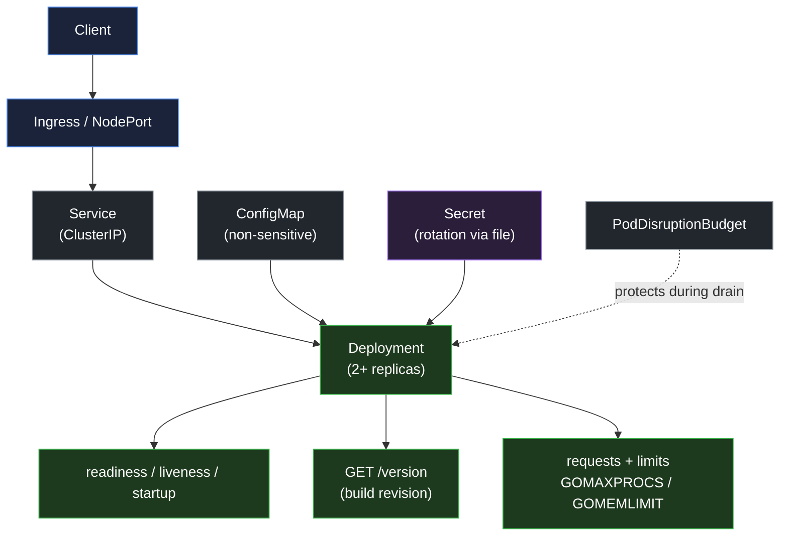

# Project: Kubernetes Go Service Capstone

> **Track:** Kubernetes Operations Stream (Module 17, Stream E)  
> **Status:** Released  
> **Difficulty:** Advanced  
> **Estimated Effort:** 12–18 hours  

---

## 1. Project Mission

Deploy the containerized Go service you built in Module 15 to a local Kubernetes cluster (kind or k3d), operate it with production-grade objects, and prove the deployment survives a rolling update, a rollback, and a node drain.

You will not learn Kubernetes by reading YAML. You will learn it by declaring desired state, watching the control loop close the gap, breaking the deployment on purpose, and reading the cluster's own evidence until you can explain exactly why each failure happened.

---

## 2. Architecture and Design Requirements



Caption: every object in the diagram is a deliverable, and every arrow is a contract you must be able to explain. The Pod is disposable; the Service is stable; the ConfigMap, Secret, probes, and resource settings are what make the Pod production-ready.

---

## 3. Required Deliverables

1. **A local cluster and a deployed service.** A kind or k3d cluster with your Module 15 image loaded, and the service reachable through a Service and either an Ingress or a NodePort.
2. **A production Deployment.** Resource requests and limits, all three probes, `maxUnavailable: 0` and `maxSurge: 1`, `minReadySeconds`, and `revisionHistoryLimit`.
3. **A non-root, hardened security context.** `runAsNonRoot`, `runAsUser`, `readOnlyRootFilesystem: true`, `allowPrivilegeEscalation: false`, `capabilities.drop: ["ALL"]`, a seccomp profile, and `automountServiceAccountToken: false`.
4. **A ConfigMap and Secret split.** Non-sensitive values in the ConfigMap, the sensitive value mounted as a file that the loader reads. Prove rotation by changing the Secret and observing the new value.
5. **A demonstrated rollout, rollback, and drain.** Roll out a change, verify the serving revision through `/version`, roll back, confirm the previous revision, and drain a node while a PodDisruptionBudget keeps the minimum available.
6. **A version endpoint.** `GET /version` returns the build revision and environment, so you can prove which revision answered.
7. **A runbook extension.** A markdown document covering the rollout procedure, the rollback procedure, the expand/contract migration step, and the top three failure modes with the exact diagnostic command for each.

---

## 4. Evaluation Rubric

| Criterion | Weight | Description |
| :--- | :---: | :--- |
| **Correctness** | **35%** | The service runs in the cluster; traffic reaches it; the rollout, rollback, and drain all complete as specified. |
| **Production readiness** | **25%** | Probes, resource requests and limits, security context, and the ConfigMap/Secret split are all present and correct. |
| **Proof** | **25%** | `kubectl rollout status`, `/version` output, probe results, and the drain evidence are captured and interpretable. |
| **Explanation** | **15%** | A clear written defense of each object, the failure modes you tested, and the tradeoffs you chose. |

The weights sum to 100%. A project must reach 80% to pass.

---

## 5. Verification Commands

Run these from the project directory against your local cluster:

```bash
# 1. Confirm the Deployment is fully rolled out
kubectl rollout status deploy/orders-api --timeout=120s

# 2. Confirm which revision is serving through the Service
kubectl run curl --rm -it --restart=Never --image=curlimages/curl -- \
  curl -s http://orders-api/version

# 3. Confirm the Pod security context
kubectl get pod -l app=orders-api -o jsonpath='{.items[0].spec.securityContext}'

# 4. Confirm resource requests and limits
kubectl get pod -l app=orders-api -o jsonpath='{.items[0].spec.containers[0].resources}'

# 5. Confirm the PodDisruptionBudget
kubectl get pdb orders-api

# 6. Exercise a rollback
kubectl rollout undo deploy/orders-api
kubectl rollout status deploy/orders-api --timeout=120s

# 7. Exercise a node drain and watch the PDB hold the minimum
kubectl drain <node-name> --ignore-daemonsets --delete-emptydir-data
kubectl get pods -l app=orders-api -w
kubectl uncordon <node-name>
```

### Reference scaffold

A working reference ships beside this README so you are never blocked on a blank page:

- [`_starter/`](./_starter) is a scaffold with the required endpoints stubbed and the open questions marked as `TODO`.
- [`_solution/`](./_solution) is one complete answer: `main.go` with probes, a bounded drain, a validated loader, and a budget derived from the container limit; matching unit tests; and the Kubernetes objects under [`_solution/k8s/`](./_solution/k8s).

Read the solution only after you have made your own attempt. The point of the capstone is the reasoning that produces the objects, not the objects themselves.

---

## 6. Submission

Submit the deployment manifests, the hardened image reference, the `/version` response captured after the rollout, the captured output of each verification command, and the runbook extension. The written defense must explain, for each of the top three failure modes, the symptom, the tool you used, the root cause, and the fix.

---

## NEXT UP

Complete the defense for [`assessment-project-kubernetes-go-service`](../../assessments/kubernetes-go-service/README.md) to close the stream.
