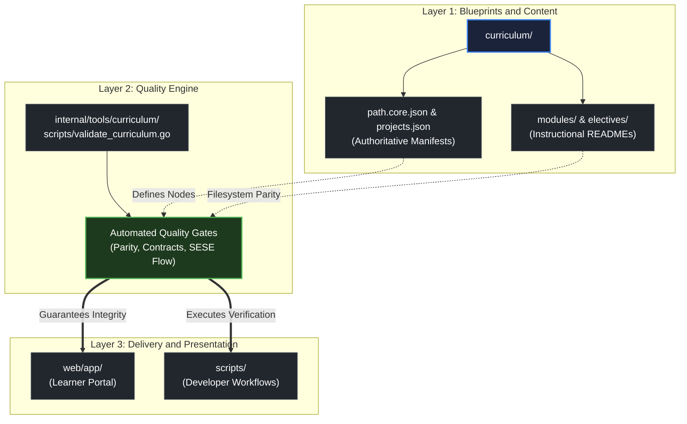

# How to use this repository

> *"Simplicity is prerequisite for reliability."* — Edsger W. Dijkstra

## Learning objective

By the end of this lesson, you will be able to navigate the repository layout, locate instructional modules and manifests on disk, and explain the separation of concerns between curriculum blueprints, validation tooling, and learner interfaces.

## Why this matters

Professional software engineering projects rely on consistent directory conventions. When an engineer joins a team, they must quickly locate source code, specifications, tests, and configuration without guesswork. This curriculum enforces the same structural discipline. Understanding the layout on day one prevents confusion across every subsequent module.

## Mental model

Think of this repository as an engineered software system organized into four distinct layers:

```text
Repository Root
├── curriculum/      Blueprints (JSON manifests), core modules, electives, and companion tracks
├── internal/tools/  Automated quality gates and curriculum verification toolchain
├── web/             Learner portal and interactive curriculum dependency graph
└── scripts/         Command-line automation runners and validation scripts
```

The relationship between these folders is deliberate:
1. `curriculum/` holds both machine-readable blueprints (`path.core.json`, `projects.json`) and physical instructional materials (`modules/`).
2. `internal/tools/` acts as the curriculum compiler, validating that every reference in the blueprints matches a real file on disk.
3. `web/` presents the curriculum to learners as an interactive roadmap.
4. `scripts/` provides one-command execution of quality checks and tests.

## Visual model



## Key principles

1. **Manifests are Authoritative**: The JSON files in `curriculum/` define the learning path, node dependencies, prerequisite edges, and rubric links. If an item is not in the manifest, it is not part of the formal curriculum graph.
2. **Predictable File Paths**: Every module follows a consistent hierarchy:
   - Module root: `curriculum/modules/<module-name>/README.md`
   - Lessons: `curriculum/modules/<module-name>/lessons/<lesson-name>/README.md`
   - Projects: `curriculum/modules/<module-name>/projects/<project-name>/README.md`
   - Assessments: `curriculum/modules/<module-name>/assessments/<assessment-name>/README.md`
3. **Automated Verification**: You do not have to wonder if files are broken or links are invalid. Automated verification scripts check every markdown link, prerequisite reference, and contract across the entire codebase.

## Common mistakes

| Mistake | Consequence | Correction |
|---|---|---|
| Browsing randomly through folders | Missing fundamental concepts and prerequisite steps | Follow the module progression sequentially starting at Module 00 |
| Editing JSON manifests directly | Breaking automated validation gates | Treat `curriculum/*.json` as read-only blueprints unless authoring curriculum updates |
| Skipping module root READMEs | Losing context on module learning goals and project requirements | Always begin each module at its root `README.md` |

## Review questions

1. What are the four primary top-level directories in this repository, and what is the responsibility of each?
2. What role do the JSON manifest files in `curriculum/` play in the learning system?
3. Where on disk are the instructional READMEs for core backend lessons located?
4. What happens if a lesson referenced in `path.core.json` does not exist on disk?

## NEXT UP

Advance to the core philosophy of this curriculum:

- [Lesson 02: What zero magic means](../02-what-zero-magic-means/README.md)
