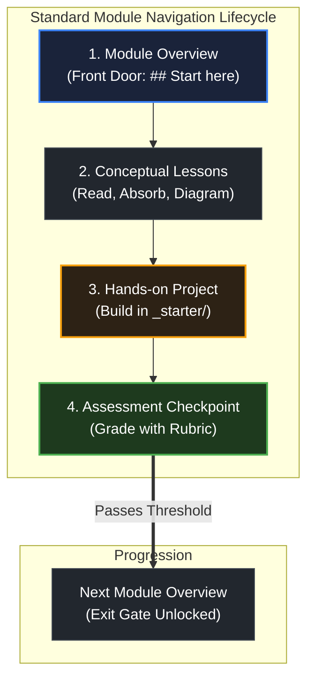

# How to use this repository

> *"Simplicity is prerequisite for reliability."* — Edsger W. Dijkstra

## Learning objective

By the end of this lesson, you will understand how this curriculum is organized across its three learning tracks, how individual modules are structured, and how to navigate between lessons, projects, and assessments without confusion.

## Why this matters

A large curriculum can feel overwhelming if you do not understand how its parts fit together. When you know where lessons live, where project scaffolds are stored, and how assessments measure your progress, you can focus 100% of your mental energy on mastering backend systems engineering.

## Mental model

This curriculum is organized into three distinct learning tracks:

```text
Curriculum Architecture
├── Core Backend Path (curriculum/modules/)
│   └── 18 sequential modules from foundational computing to Flagship Opslane
├── Companion Frontend Track (curriculum/companion-frontend/)
│   └── 4 progressive server-driven hypermedia stages running parallel to backend modules
└── Advanced Electives (curriculum/electives/)
    └── Specialized deep dives into gRPC streaming, advanced generics, and distributed patterns
```

Every module within the curriculum follows an identical, predictable anatomy:
1. **Module Root (`README.md`)**: The front door. Outlines the module mission, concept map, prerequisites, and SESE entry point.
2. **Lessons (`lessons/`)**: Focused conceptual topics introducing mental models, architectural diagrams, principles, and common mistakes.
3. **Projects (`projects/`)**: Hands-on engineering milestones. Dual-state capstones provide starter scaffolds (`_starter/`) and reference implementations (`_solution/`); earlier foundation projects are guided checklists instead.
4. **Assessments (`assessments/`)**: Objective diagnostic checkpoints with explicit rubrics to evaluate your understanding before advancing.

You write your code and build your projects in your own dedicated local workspace or personal git repository, keeping the curriculum repository clean as your authoritative reference.

## Visual model



## Core idea

1. **Sequential Progression**: The core backend trunk (Modules 00 through 18) is designed to be completed in order. Each module builds directly upon the concepts mastered in the previous one.
2. **Single-Entry, Single-Exit (SESE)**: Enter each module through its root `README.md` at `## Start here`. Complete all lessons and projects in sequence. You exit the module only when you pass the final assessment checkpoint.
3. **Dedicated Working Space**: Keep your personal practice code, experiment files, and project implementations in a separate personal working directory or personal repository. Treat the curriculum as your textbook and specification.
4. **Active Reflection**: At the end of every lesson, test your understanding against the review questions before clicking the link to the next topic.

## Practice task

1. Open your terminal or file explorer and locate three distinct lessons across different modules in the repository:
   - Module 00: `curriculum/modules/00-orientation/lessons/02-what-zero-magic-means/README.md`
   - Module 01: `curriculum/modules/01-computers-terminal-git-web/lessons/01-what-is-a-program/README.md`
   - Module 04: `curriculum/modules/04-functions-errors-data-semantics/lessons/01-function-basics/README.md`
2. Open each file and locate its structure: confirm that each lesson begins with an authoritative quote, a clear `## Learning objective`, a `## Mental model`, and a `## Visual model`.
3. Choose an absolute directory path outside the curriculum repository on your local machine (such as `~/the-go-engineer-workspace`) where you will keep your project implementations and notes. Record this absolute path in your study log.

## Common mistakes

| Mistake | Consequence | Correction |
|---|---|---|
| Browsing randomly instead of following sequential order | Encountering advanced concepts without required foundational knowledge | Always follow the curriculum sequence from Module 00 forward |
| Skipping the module root README | Missing the big-picture context, prerequisites, and learning goals | Read the module root `README.md` before starting Lesson 01 |
| Editing curriculum files directly for personal scratch notes | Risking merge conflicts or git issues during updates | Keep all personal exercise code in your own private development workspace |

## Review questions

1. What are the three primary tracks in this curriculum, and what is the focus of each?
2. What four standard sections make up each curriculum module?
3. Where should you write and store your personal practice code and project implementations?
4. What is the role of an assessment checkpoint at the end of a module?

## NEXT UP

Advance to the core philosophy of this curriculum:

- [Lesson 02: What zero magic means](../02-what-zero-magic-means/README.md)
