# What zero magic means

> *"Clear is better than clever."* — Rob Pike

## Learning objective

By the end of this lesson, you will be able to define the "Zero-Magic" engineering principle, contrast explicit mechanical reality with opaque abstractions, and apply this mental framework to evaluate your own understanding of software systems.

## Why this matters

Many introductory programming tutorials rely on "magic": copy-pasting code snippets, relying on invisible framework conventions, and accepting unexplained abstractions. When software breaks in production, engineers who rely on magic are stranded because they do not know what happens under the surface. A zero-magic engineer can trace any behavior down to the operating system, memory layout, and network protocols.

## Mental model

In software engineering, there are two distinct ways to approach tools and abstractions:

```text
The Black Box Approach (Magic)
Input ──> [ Opaque Framework / Hidden Automation ] ──> Output
(You cannot explain what happened, why it worked, or how to fix it when it breaks)

The Zero-Magic Approach (Transparency)
Input ──> [ Explicit Tooling → Known System Calls → Clear Memory Changes ] ──> Output
(Every layer is observable, reproducible, and mechanically explainable)
```

Zero magic does not mean you must write everything in assembly language. It means that when you use an abstraction, you understand what that abstraction is doing on your behalf:
- Which files are created or modified on disk?
- How is memory allocated and referenced?
- What commands run under the hood when you press Enter?
- What happens when a network connection drops or a file cannot be opened?

## Visual model

```mermaid
flowchart TD
    classDef frontDoor fill:#1a233a,stroke:#3b82f6,stroke-width:2px,color:#ffffff;
    classDef exitGate fill:#1e3a1e,stroke:#4caf50,stroke-width:2px,color:#ffffff;
    classDef standardNode fill:#22272e,stroke:#444c56,stroke-width:1px,color:#ffffff;
    classDef capstoneNode fill:#2d2215,stroke:#f59e0b,stroke-width:2px,color:#ffffff;

    subgraph BlackBox ["The Fragile Magic Approach"]
        B1["Blind Copy-Paste"]:::frontDoor --> B2["Unexplained Framework Magic"]:::standardNode
        B2 --> B3["Superficial Success"]:::standardNode
        B3 -.->|Production Outage| B4["Helpless Debugging & Guesses"]:::capstoneNode
    end

    subgraph ZeroMagic ["The Zero-Magic Standard"]
        Z1["First Principles"]:::frontDoor --> Z2["Explicit System Calls & Memory"]:::standardNode
        Z2 --> Z3["Deterministic Verification"]:::standardNode
        Z3 ==>|Production Outage| Z4["Systematic Root Cause Isolation"]:::exitGate
    end
```



## Key principles

1. **Explicit Over Implicit**: Nothing happens in software by accident. Config files, environment variables, and execution parameters should be transparently declared rather than assumed.
2. **First-Principles Grounding**: Real computers consist of CPUs, memory registers, disk storage, and network interfaces. Every software concept maps to these physical components.
3. **Traceable Failure Modes**: You truly understand a system only when you can explain how it fails, why it fails, and what specific error output it produces under pressure.
4. **No Unexplained Steps**: If a lesson or tutorial asks you to run a command without explaining what that command executes, question it until you understand the underlying mechanism.

## Common mistakes

| Mistake | Consequence | Correction |
|---|---|---|
| Memorizing commands without understanding their flags | Inability to adjust to different operating systems or environments | Look up command arguments and verify what each option controls |
| Relying exclusively on graphical IDE buttons | Helplessness when working on remote Linux servers or CI runners | Learn and practice the underlying terminal commands first |
| Assuming "it works" means "I understand it" | Fragile knowledge that crumbles during interviews or production incidents | Ask yourself: "Can I explain what happens in memory and on disk?" |

## Review questions

1. What is the fundamental difference between the "black box" approach and the "zero-magic" approach to software engineering?
2. Why is implicit behavior dangerous in distributed production systems?
3. What four physical components do all software abstractions ultimately map down to?
4. How can you test whether you truly understand a tool or command versus just remembering its syntax?

## NEXT UP

Advance to how the learning cycle is structured:

- [Lesson 03: How lessons, exercises, projects, and checkpoints work](../03-how-lessons-exercises-projects-and-checkpoints-work/README.md)
