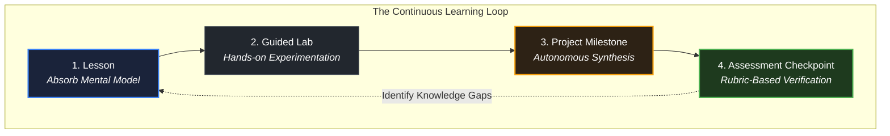

# How lessons, exercises, projects, and checkpoints work

> *"An algorithm must be seen to be believed, and the best way to see what an algorithm does is to execute it yourself."* — Donald Knuth

## Learning objective

By the end of this lesson, you will understand the four distinct content types in this curriculum (Lessons, Guided Labs, Projects, and Assessment Checkpoints) and be able to execute the 4-phase learning loop for every technical topic.

## Why this matters

Passive consumption creates an illusion of competence. Reading technical explanations gives the sensation of learning, but true engineering skill is built only through hands-on implementation, error diagnosis, and rigorous verification. Understanding how the curriculum structures each learning stage ensures you get maximum retention from your study time.

## Mental model

Every technical milestone in this curriculum follows an active, iterative 4-step loop:

```text
The 4-Step Engineering Learning Loop
1. ABSORB (Lesson)       ──> Read the concept, mental model, and visual diagram
2. PRACTICE (Lab)        ──> Complete guided drills and observe runtime behavior
3. SYNTHESIZE (Project)  ──> Build a complete working system from specifications
4. VERIFY (Checkpoint)   ──> Self-evaluate against objective rubrics and questions
```

The four content types serve distinct pedagogical functions:
- **Lesson**: Introduces one primary concept with zero hand-waving, providing real-world context and visual architecture models.
- **Guided Lab**: Hands-on exercises where you modify parameters, trigger intentional failures, and observe system responses.
- **Project**: Substantial engineering milestones where you implement end-to-end applications from scratch using starter scaffolds.
- **Assessment Checkpoint**: Objective knowledge checks evaluating both conceptual understanding and implementation correctness before unlocking downstream modules.

## Visual model



## Core idea

1. **One Concept at a Time**: Lessons are bounded to prevent cognitive overload. Master the isolated concept before moving forward.
2. **Experimentation Over Memorization**: Change inputs, break code intentionally, and observe compiler warnings. Understanding error paths is essential for debugging.
3. **Autonomous Problem Solving**: Project capstones do not provide line-by-line instructions. You receive an architectural specification and must implement the solution independently.
4. **Gated Progression**: Assessment checkpoints ensure you have solid mastery before you proceed to advanced modules that depend on those foundations.

## Practice task

1. Select an upcoming core technical topic in the curriculum (such as Module 03 on variables and memory layout, or Module 08 on HTTP requests).
2. Trace the 4-phase learning loop for this topic in your notes:
   - **Phase 1 (Absorb)**: What mental model will you absorb from the lesson text and diagrams?
   - **Phase 2 (Practice)**: What hands-on guided drills will you execute to test edge cases?
   - **Phase 3 (Synthesize)**: What standalone software system will you construct in the project?
   - **Phase 4 (Verify)**: What objective rubric criteria in the checkpoint will validate your understanding?
3. In one paragraph, explain which specific physical artifact produced during this cycle (such as an automated test transcript, a performance benchmark log, or an architectural design doc) will serve as verifiable proof in your engineering portfolio, and why passive reading alone fails to produce that proof.

## Common mistakes

| Mistake | Consequence | Correction |
|---|---|---|
| Reading lessons without doing the labs | Superficial recall that disappears under pressure | Complete every lab and exercise before advancing |
| Jumping straight to projects without reading prerequisites | Getting stuck and guessing randomly | Work through lessons sequentially to build prerequisite scaffolding |
| Treating checkpoints as an afterthought | Moving forward with hidden gaps that cause failure later | Use checkpoints honestly to find and fix weak points early |

## Review questions

1. What are the four primary content types in this curriculum, and what is the role of each?
2. What are the four phases of the engineering learning loop?
3. Why does passive reading fail to develop production-grade programming capability?
4. How do assessment checkpoints help prevent compounding learning deficits?

## NEXT UP

Advance to how execution workflows operate across the repository:

- [Lesson 04: How to run code in this repository](../04-how-to-run-code-in-this-repository/README.md)
