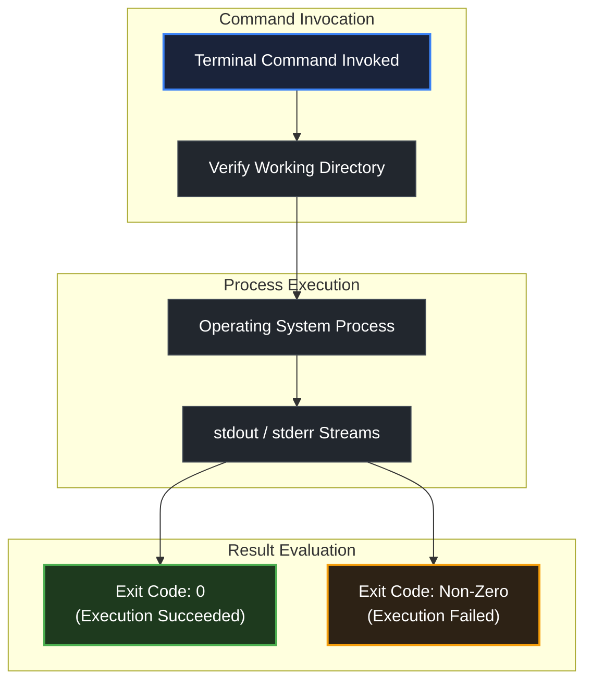

# How to run code in this repository

> *"You can't trust code that you did not totally create yourself."* — Ken Thompson

## Learning objective

By the end of this lesson, you will understand how programs and automation scripts are invoked from the command line in this repository, how the operating system communicates execution results via standard streams and exit codes, and how to verify command success reliably.

## Why this matters

The command line is the universal execution environment for software engineering. Compilers, test runners, container runtimes, and deployment pipelines all run as terminal processes. Mastering command invocation, working directories, and process return codes is an essential prerequisite before writing or running application code.

## Mental model

When you execute any tool or script from your terminal, an operating system lifecycle occurs:

```text
1. Terminal Shell     ──> Reads command text and resolves the executable binary
2. Process Spawn      ──> Allocates process memory and assigns Standard Streams:
                          • stdin  (Standard Input, file descriptor 0)
                          • stdout (Standard Output, file descriptor 1)
                          • stderr (Standard Error, file descriptor 2)
3. Execution          ──> Program runs its instructions in the current working directory
4. Process Exit       ──> Terminates with an integer Exit Code (0 = success, non-zero = error)
```

The integer **exit code** is the definitive truth in automated environments:
- An exit code of `0` indicates successful completion without errors.
- Any non-zero exit code (such as `1`, `2`, or `127`) signals a specific runtime or validation failure.
- Continuous integration pipelines and validation test harnesses rely exclusively on exit codes to determine whether a build passes or fails.

## Visual model



## Key principles

1. **Know Your Working Directory**: Command-line tools resolve relative paths from the current working directory of your shell. Running a command from the repository root behaves differently than running it from inside a module subdirectory.
2. **Inspect the Output Streams**: Programs output diagnostic messages to `stdout` and error details to `stderr`. Never ignore terminal text; error messages usually explain the exact root cause.
3. **Verify the Exit Code**: In automated workflows, a script is considered successful only when its exit code is zero. Always confirm that your verification commands terminate cleanly without errors.
4. **Clean Environment Isolation**: Tools should execute predictably regardless of local machine configuration. Keeping dependencies explicit and environment variables clean ensures consistent results.

## Common mistakes

| Mistake | Consequence | Correction |
|---|---|---|
| Running commands from the wrong directory | "File not found" or "no such directory" errors | Check your current path using `pwd` (Linux/macOS) or `Get-Location` (Windows) before running tools |
| Ignoring warning and error lines in terminal output | Believing a command succeeded when it actually failed | Read the entire terminal output from top to bottom |
| Blindly copy-pasting commands without reviewing flags | Unintended file modifications or unexpected behavior | Inspect every command argument to understand its purpose |

## Review questions

1. What are the three standard I/O streams assigned to every operating system process?
2. What does an exit code of 0 mean versus a non-zero exit code?
3. Why does your current working directory matter when executing terminal commands?
4. How do automated test harnesses and CI/CD pipelines determine whether a script passed?

## NEXT UP

Advance to how project starter folders and solutions are structured:

- [Lesson 05: How starter folders work](../05-how-starter-folders-work/README.md)
