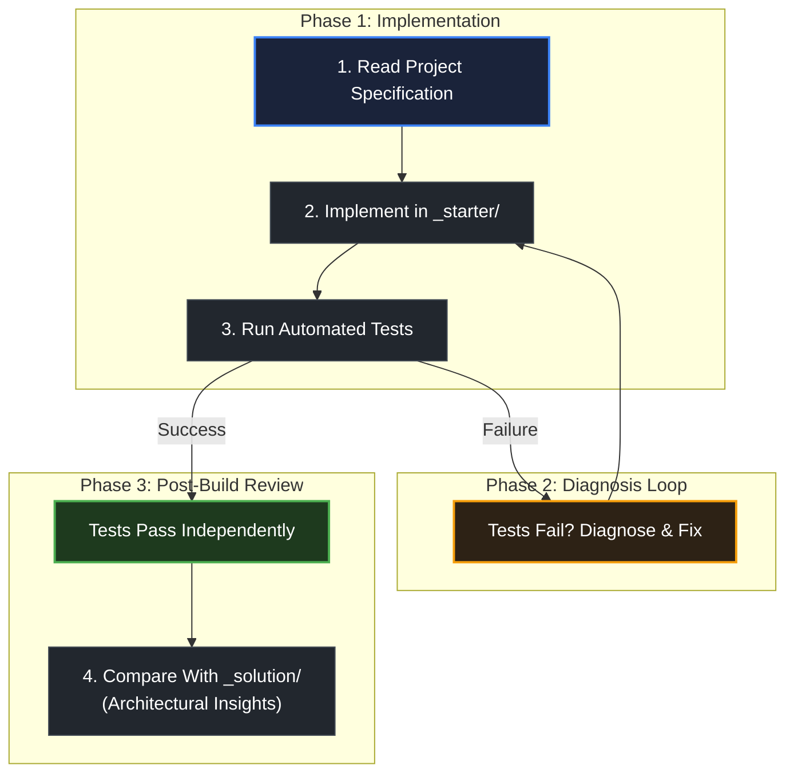

# How starter folders work

> *"Plan to throw one away; you will, anyhow."* — Fred Brooks

## Learning objective

By the end of this lesson, you will understand how project capstones use dual-state directory scaffolds (`_starter/` and `_solution/`), how to work independently in your own development workspace, and how to use reference implementations responsibly without short-circuiting your learning.

## Why this matters

In professional software development, nobody gives you complete solutions to copy. You are given an architectural requirement, an existing codebase with intentional extension points, and a suite of tests that define acceptance criteria. The dual-state scaffold trains you to build software under real-world conditions while preserving a trusted reference implementation for comparative review.

## Mental model

Project directories in this curriculum are structured into two complementary states:

```text
Project Directory
├── README.md       ──> Problem specification, constraints, and acceptance criteria
├── _starter/       ──> Your starting workspace: skeleton layout, configuration, and test suites
└── _solution/      ──> Authoritative reference implementation for post-build review
```

The intended workflow is strictly sequential:
1. **Analyze the Spec**: Read the project `README.md` to understand what inputs the system receives, what outputs it produces, and what error conditions it must handle.
2. **Work in the Starter Scaffold**: Implement the missing functionality directly in `_starter/` (or copy it to a private working folder). Run the provided verification checks as you build.
3. **Persist Through Roadblocks**: When a test fails or code does not behave as expected, debug it using logs, documentation, and the scientific method.
4. **Compare With the Solution**: Only after your implementation passes all verification checks should you inspect `_solution/` to study architectural choices, code style, and error handling idioms.

## Visual model



## Core idea

1. **Struggle Builds Competence**: The cognitive friction you feel when debugging failing tests is where real learning happens. Peeking at solutions eliminates this friction and stunts growth.
2. **Preserve the Test Invariants**: Do not alter test expectations in `_starter/` to make buggy code pass. The tests represent the customer specification.
3. **Comparative Analysis**: Use `_solution/` not as an answer key to copy, but as an engineering peer review. Compare how the reference implementation structured its types, handled errors, and organized responsibilities.
4. **Independent Reproduction**: If you do consult a reference implementation to unblock yourself, close it and rewrite your solution from scratch without looking.

## Practice task

1. Navigate to the project directory for Module 00: `curriculum/modules/00-orientation/projects/course-setup-verification/`.
2. Inspect `README.md` and observe its sections: Learning objective, Prerequisites, Project overview, Tasks, Verification, and Rubric.
3. Navigate to a dual-state capstone in an upcoming module (for example, `curriculum/modules/01-computers-terminal-git-web/projects/shell-git-lab/`):
   - Notice the coexistence of `_starter/` (the scaffold containing starter files) and `_solution/` (the reference implementation).
4. In your notes, write down a personal engineering commitment: under what exact conditions will you permit yourself to open a `_solution/` folder during your coursework?

## Common mistakes

| Mistake | Consequence | Correction |
|---|---|---|
| Opening `_solution/` before attempting `_starter/` | Creating the illusion of understanding while developing zero problem-solving ability | Keep `_solution/` closed until your code passes tests |
| Modifying test assertions to hide bugs | Producing invalid, brittle software that fails in production | Fix your implementation code so it satisfies the test contract |
| Copy-pasting solution code line for line | Inability to explain architectural decisions during code review or interviews | Always write every line yourself and verify understanding |

## Review questions

1. What are the two distinct states represented by `_starter/` and `_solution/` folders?
2. Why is peeking at the reference solution early harmful to long-term engineering skill development?
3. Under what conditions is it appropriate to review the `_solution/` folder?
4. If your starter implementation fails a test, why should you never change the test file itself?

## NEXT UP

Advance to how assessments and checkpoints measure your progress:

- [Lesson 06: How assessments work](../06-how-assessments-work/README.md)
