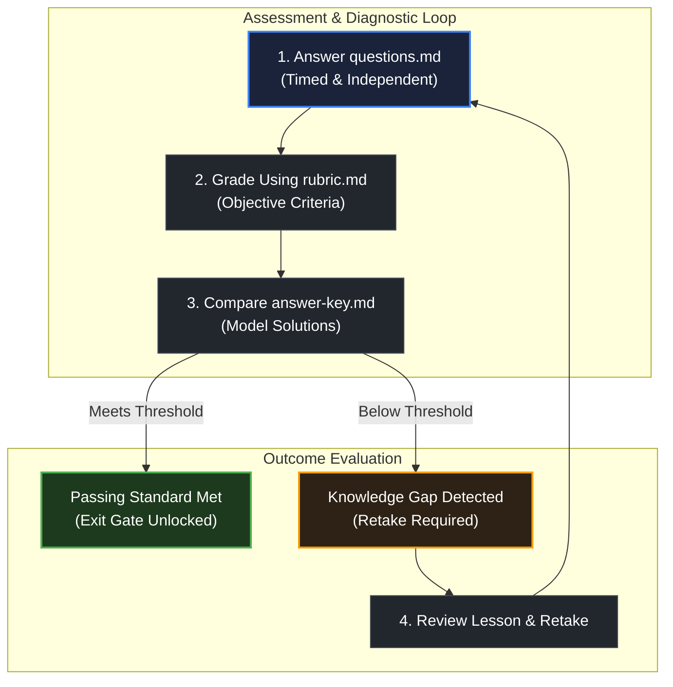

# How assessments work

> *"There are two ways of constructing a software design: One way is to make it so simple that there are obviously no deficiencies, and the other way is to make it so complicated that there are no obvious deficiencies."* — C.A.R. Hoare

## Learning objective

By the end of this lesson, you will understand how module assessments and checkpoints evaluate your comprehension, how to evaluate your work against multi-dimensional rubrics, and how to execute the retake cycle to turn knowledge gaps into durable mastery.

## Why this matters

In professional software development, teams evaluate code through code reviews, design docs, performance benchmarks, and automated test coverage. Assessments in this curriculum mirror this discipline. Instead of multiple-choice trivia, assessments evaluate your ability to reason about mechanics, diagnose failures, and defend architectural decisions.

## Mental model

Each assessment suite in this curriculum is composed of four standardized files:

```text
Assessment Directory
├── README.md       ──> Purpose, time budget, allowed resources, passing threshold, and exit gate link
├── questions.md    ──> Diagnostic conceptual, scenario-based, and failure-mode questions
├── rubric.md       ──> Objective multi-tier evaluation criteria across specific dimensions
└── answer-key.md   ──> Authoritative model explanations and grading standards
```

The assessment workflow follows an honest self-evaluation protocol:
1. **Take the Assessment**: Answer all prompts in `questions.md` independently within the suggested time budget, using only allowed resources.
2. **Grade Against the Rubric**: Open `rubric.md` and evaluate your responses honestly across each dimension (such as Conceptual Precision, Mechanical Grounding, Failure Mode Handling, and Code Quality).
3. **Compare With Answer Key**: Inspect `answer-key.md` to identify nuances, deeper insights, or edge cases you missed.
4. **Execute the Retake Policy**: If any dimension falls below the passing threshold, review the underlying lesson, revise your answer, and document what changed in your mental model.

## Visual model



## Core idea

1. **Diagnostic, Not Punitive**: Assessments are not designed to rank you; they exist to detect misunderstandings before you tackle advanced topics that depend on those concepts.
2. **Strict Objective Grading**: Grade yourself with the rigor of an external engineering reviewer. If your explanation is vague or misses the mechanical reality, mark it down and review.
3. **The Exit Gate Role**: Checkpoints serve as the single exit gate for each module. You do not advance to the next module until the assessment checkpoint is verified.
4. **Articulate the Shift**: The retake policy requires that you write down what was missing in your original answer and what you now understand. Articulation cements retention.

## Practice task

1. Open the assessment directory for Module 00: `curriculum/modules/00-orientation/assessments/checkpoint/`.
2. Inspect the 4 files in the suite: `README.md`, `questions.md`, `rubric.md`, and `answer-key.md`.
3. Open `rubric.md` and review the 4 evaluation dimensions: Repository navigation, Zero-magic contract, Workflow and tooling, and Roadmap and portfolio planning.
4. Identify the single dimension where you currently feel least prepared. Review the corresponding orientation lesson, and write a two-sentence reflection explaining what evidence you will provide in your checkpoint submission to satisfy that rubric criterion.

## Common mistakes

| Mistake | Consequence | Correction |
|---|---|---|
| Reading the answer key before attempting the questions | Robbing yourself of the cognitive retrieval practice that builds memory | Write out complete answers to every question before opening the answer key |
| Giving yourself full credit for vague answers | Passing with unverified gaps that cause roadblocks later | Compare your answers word-for-word against the rubric requirements |
| Skipping assessments because "the concepts make sense" | Discovering too late that you cannot apply concepts independently | Always complete the checkpoint at the end of each module |

## Review questions

1. What four files constitute an assessment suite, and what is the role of each?
2. What is the difference between an assessment rubric and an answer key?
3. How should you respond if your score on a checkpoint falls below the passing threshold?
4. Why is writing down "what changed in your understanding" an effective learning technique during retakes?

## NEXT UP

Advance to how to formulate high-signal technical debugging questions:

- [Lesson 07: How to ask good debugging questions](../07-how-to-ask-good-debugging-questions/README.md)
