# What job ready means

> *"If you don't start with a spec, every piece of code you write is a bug."* — Leslie Lamport

## Learning objective

By the end of this lesson, you will understand what "job readiness" means in professional backend engineering, evaluate yourself across the 5 Pillars of Engineering Proof, and understand why verifiable evidence outweighs tutorial completion.

## Why this matters

The software engineering industry is flooded with applicants who have completed video tutorials or generated code with AI assistants, but cannot build, debug, or explain real systems independently. Engineering hiring managers look for candidates who can solve ambiguous technical problems, write verifiable automated tests, and communicate engineering tradeoffs. Aligning your learning with this standard from day one ensures that every project you build serves as tangible proof of capability.

## Mental model

Job readiness is not a feeling of confidence; it is the presence of objective evidence across **5 Pillars of Engineering Proof**:

```text
The 5 Pillars of Engineering Proof
1. AUTONOMOUS PROBLEM SOLVING ──> Translating ambiguous specifications into working systems
2. MECHANICAL COMPREHENSION   ──> Explaining memory layout, OS processes, and network lifecycles
3. RIGOROUS TEST ENGINEERING  ──> Writing automated test suites covering failure paths and edge cases
4. OPERATIONAL MATURITY       ──> Understanding builds, logs, error monitoring, and configuration
5. TECHNICAL COMMUNICATION    ──> Writing clear architectural READMEs, specs, and commit histories
```

A tutorial follower can replicate what they were shown. A job-ready engineer can take a new problem, analyze constraints, design an architecture, implement the code, test edge cases, and defend their design decisions under code review.

## Visual model

```mermaid
flowchart TD
    classDef frontDoor fill:#1a233a,stroke:#3b82f6,stroke-width:2px,color:#ffffff;
    classDef exitGate fill:#1e3a1e,stroke:#4caf50,stroke-width:2px,color:#ffffff;
    classDef standardNode fill:#22272e,stroke:#444c56,stroke-width:1px,color:#ffffff;
    classDef capstoneNode fill:#2d2215,stroke:#f59e0b,stroke-width:2px,color:#ffffff;

    subgraph Perception ["The Tutorial Trap (Low Value)"]
        T1["Syntax Familiarity"]:::frontDoor --> T2["Completed Tutorials"]:::standardNode
        T2 --> T3["Unverified Confidence"]:::capstoneNode
    end

    subgraph Proof ["The Job-Ready Standard (High Value)"]
        P1["Autonomous Problem Solving"]:::frontDoor
        P2["Mechanical Hardware Grounding"]:::standardNode
        P3["Automated Test Suites"]:::standardNode
        P4["Operational Diagnostics"]:::standardNode
        P5["Clear Technical Communication"]:::standardNode

        P1 --> P2 --> P3 --> P4 --> P5
        P5 ==> JR["Verifiable Engineering Proof"]:::exitGate
    end
```



## Core idea

1. **Proof Over Perception**: Resumes make claims; public repositories, green test suites, and clean commit logs provide undeniable proof.
2. **Every Choice Has Tradeoffs**: There are rarely "perfect" solutions in engineering. Every architectural decision involves tradeoffs between performance, complexity, memory, and readability. A job-ready engineer can articulate why they chose one approach over another.
3. **Failure Engineering**: Production software spends most of its life handling unexpected network drops, corrupt inputs, and exhausted resources. You are job-ready when you design systems for failure from the beginning.
4. **Ownership**: A professional engineer takes responsibility for the complete lifecycle of their code: understanding requirements, implementing functionality, verifying correctness, and documenting operational behavior.

## Practice task

1. Open your notes and review the 5 Pillars of Engineering Proof:
   - Autonomous problem solving
   - Mechanical comprehension
   - Rigorous test engineering
   - Operational maturity
   - Technical communication
2. Self-evaluate your current software engineering experience on a 1–5 scale across each of the 5 pillars.
3. Identify your single lowest-scoring pillar.
4. Write a 3-bullet concrete improvement plan describing how you will use upcoming curriculum modules (such as building projects from specifications in `_starter/` scaffolds and passing automated test suites) to generate undeniable proof for that specific dimension.

## Common mistakes

| Mistake | Consequence | Correction |
|---|---|---|
| Equating knowing syntax with being ready for a job | Failing technical interview design and debugging questions | Focus on architecture, failure modes, and automated testing |
| Building only cookie-cutter tutorial apps | Being lost in an applicant pool of identical projects | Build complete, standalone systems with custom architecture and deep tests |
| Neglecting technical writing and documentation | Projects look incomplete and unmaintained to reviewers | Write thorough READMEs explaining problem statement, architecture, and verification |

## Review questions

1. What are the 5 Pillars of Engineering Proof that define job readiness?
2. Why is tutorial completion insufficient evidence of engineering competence?
3. Why do senior engineers evaluate candidates on their ability to explain tradeoffs rather than finding a "single best answer"?
4. What role does failure handling play in distinguishing junior developers from production-ready engineers?

## NEXT UP

Advance to navigating the curriculum roadmap and prerequisite dependencies:

- [Lesson 09: How to use the roadmap](../09-how-to-use-the-roadmap/README.md)
