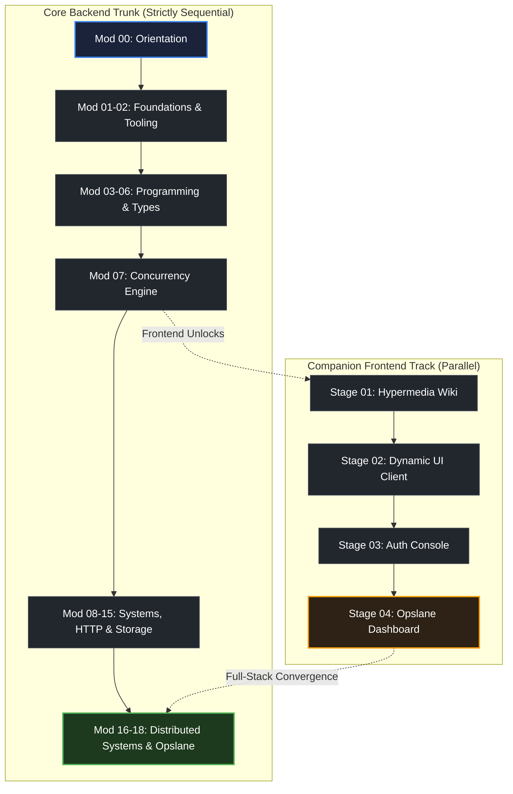

# How to use the roadmap

> *"Simple things should be simple, complex things should be possible."* — Alan Kay

## Learning objective

By the end of this lesson, you will understand the three-track topology of this curriculum (Core Backend Path, Companion Frontend Track, and Advanced Electives), how prerequisites enforce sequential mastery, and how to navigate modules using the Single-Entry, Single-Exit (SESE) standard.

## Why this matters

A curriculum without clear dependency boundaries leads to frustration. If you attempt concurrent programming before understanding memory semantics, or attempt web servers before understanding operating system I/O, you will struggle with concepts you are not yet prepared to understand. The curriculum roadmap is engineered as a directed acyclic graph (DAG) where every module explicitly builds upon verified prerequisites.

## Mental model

The curriculum coordinates your engineering growth across three complementary paths:

```text
The 3-Track Curriculum Architecture

1. CORE BACKEND TRUNK (Modules 00 to 18)
   • Foundations, OS basics, Go syntax, data structures, concurrency, networking, microservices, and Flagship Opslane
   • Strictly sequential: must be completed in order from start to finish

2. COMPANION FRONTEND TRACK (Stages 01 to 04)
   • Server-driven hypermedia (templ + HTMX + Tailwind CSS + Alpine.js)
   • Runs in parallel with Modules 07 to 15, converging at Flagship Opslane to build full-stack engineering delivery

3. ADVANCED ELECTIVES (Specializations)
   • Deep dives into gRPC streaming, complex generics, CQRS, and advanced distributed patterns
   • Unlocked after completing relevant prerequisite checkpoints in the core trunk
```

Navigation through every module follows the **Single-Entry, Single-Exit (SESE)** contract:
- You enter a module through its root `README.md` and start at `Lesson 01`.
- You advance sequentially through all lessons, projects, and assessments.
- The sole exit gate unlocking the next module is the final assessment checkpoint.

## Visual model



## Core idea

1. **Prerequisite Integrity**: Every topic assumes mastery of its predecessors. Never skip modules in the core trunk.
2. **SESE Navigation Discipline**: Do not use "escape hatches" to jump across modules. Finish the lessons, complete the project, and pass the assessment checkpoint to earn your progression.
3. **Electives are Extensions, Not Shortcuts**: Electives offer specialized depth for specific career tracks. Finish the core foundations before branching into electives.
4. **Pacing for Retention**: Moving thoroughly through one module every week or two with complete exercises yields far greater competence than skimming multiple modules quickly.

## Practice task

1. Open `curriculum/path.core.json` or the root learning path document and trace the 18 modules of the Core Backend Trunk from Module 00 to Module 18.
2. Identify the first 3 fork points where elective gateways and the companion frontend track branch off:
   - Module 05 completion: Unlocks Elective Gateway A (Generics)
   - Module 07 completion: Unlocks Companion Frontend Stage 1 (Semantic HTML5 & Modern CSS)
   - Module 08/09 completion: Unlocks Companion Frontend Stage 2 and Elective Gateway B (Protobuf & gRPC)
3. Select your intended engineering persona:
   - **Profile A (Pure Backend Specialist)**: Maintain focus on the Core Trunk (M00 through M18) without detours.
   - **Profile B (Autonomous Full-Stack Engineer)**: Complete the Core Trunk and execute the 4 Companion Frontend Stages.
   - **Profile C (Systems & Performance Architect)**: Complete the Core Trunk and execute all 4 Elective Gateways.
4. Record your chosen profile and your estimated progression pace in your personal roadmap document.

## Common mistakes

| Mistake | Consequence | Correction |
|---|---|---|
| Skipping foundational modules to jump to concurrency or web servers | Hitting severe knowledge gaps and failing exercises | Follow the roadmap sequentially; foundations make advanced topics easy |
| Getting distracted by electives before mastering the core trunk | Fragmented knowledge without end-to-end backend capability | Keep focused on the core trunk until prerequisite gates are cleared |
| Treating frontend as an afterthought or a replacement for backend | Incomplete software delivery capability | Use the companion frontend track in parallel to become an autonomous full-stack engineer |

## Review questions

1. What are the three tracks that compose this curriculum roadmap?
2. What does the Single-Entry, Single-Exit (SESE) navigation invariant mean in practice?
3. At which module does the Companion Frontend Track become accessible, and where does it converge with the core trunk?
4. Why is prerequisite integrity strictly enforced across the curriculum graph?

## NEXT UP

Advance to planning your engineering portfolio:

- [Lesson 10: How to build a portfolio from this curriculum](../10-how-to-build-a-portfolio-from-this-curriculum/README.md)
