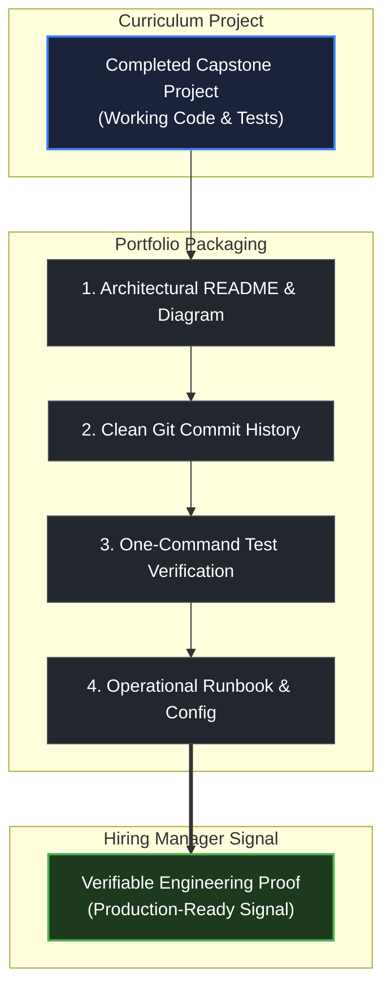

# How to build a portfolio from this curriculum

> *"Talk is cheap. Show me the code."* — Linus Torvalds

## Learning objective

By the end of this lesson, you will understand how to transform the capstone projects you build throughout this curriculum into a compelling engineering portfolio that provides undeniable proof of competence to engineering hiring managers.

## Why this matters

A resume listing programming languages and buzzwords is easy to write, but offers zero verifiable evidence to hiring teams. Engineering managers and tech leads evaluate candidates by inspecting real work: public GitHub repositories, architecture documentation, clean git commit history, and passing automated test suites. By packaging your projects properly as you progress through this curriculum, you build a production-grade portfolio that speaks for itself.

## Mental model

A high-signal portfolio project is structured around five core engineering components:

```text
The Anatomy of a High-Impact Portfolio Project
1. SPECIFICATION & ARCHITECTURE ──> Clear problem statement, constraints, and Mermaid system diagram
2. ITERATIVE GIT HISTORY        ──> Granular, purposeful commits documenting why changes were made
3. COMPLETE AUTOMATED TESTS     ──> Unit, integration, and edge-case tests runnable via one command
4. OPERATIONAL RUNBOOK          ──> Clear instructions for building, configuring, and verifying the system
5. ENGINEERING TRADEOFF ANALYSIS ──> Honest discussion of alternatives considered and known constraints
```

Your portfolio is not an archive of school homework; it is a demonstration of professional software craftsmanship. Three deeply understood, rigorously tested systems demonstrate vastly more capability than a dozen shallow tutorial clones.

## Visual model



## Core idea

1. **Depth Over Breadth**: Focus on mastering and documenting fewer, high-complexity systems rather than producing many shallow exercises.
2. **Every Project Needs an Architecture Diagram**: Diagrams show that you understand the boundaries, data flows, and concurrency patterns in your system.
3. **Commit Discipline from Day One**: Avoid single commits containing an entire project. Commit frequently in logical increments with descriptive commit messages explaining why each change was made.
4. **Document Tradeoffs**: Engineering is the art of compromise. Explain in your project README why you chose a particular data structure, protocol, or design pattern, and what the drawbacks were.

## Practice task

1. In your personal workspace notes, draft a project portfolio template containing the 5 required sections:
   - Problem Specification and Constraints
   - Architecture Model and Data Flow Diagram
   - Iterative Git Commit Protocol
   - Automated Verification and Benchmark Suite
   - Engineering Tradeoffs and Alternative Designs
2. Select one future capstone project from the curriculum that aligns with your goals (such as the HTTP API in Module 08, the Concurrent Worker Pool in Module 11, or Flagship Opslane in Module 18).
3. Draft a mock problem statement and write out two distinct architectural tradeoffs you anticipate facing in that project (for example: synchronous HTTP handling versus an asynchronous queue, or in-memory state versus transactional database persistence).
4. Save this template in your personal workspace as your standard specification for packaging all completed curriculum projects.

## Common mistakes

| Mistake | Consequence | Correction |
|---|---|---|
| Pushing entire projects in one "Initial commit" | Concealing your thought process and problem-solving iteration | Commit incrementally as you build features and fix tests |
| Leaving READMEs blank or with default generator text | Giving reviewers the impression of an unfinished project | Write a thorough README covering architecture, usage, and testing |
| Omitting verification instructions | Reviewers cannot run or verify your tests easily | Provide exact terminal commands to run the test suite and build the project |

## Review questions

1. What are the five essential components of a high-impact portfolio project?
2. Why is a granular, meaningful git commit history valuable to hiring managers?
3. Why are three deeply understood, well-documented projects more impressive than ten small tutorial clones?
4. Why is documenting engineering tradeoffs and design decisions important in project READMEs?

## NEXT UP

Advance to the practical capstone project for Module 00:

- [Project: Course Setup Verification](../../projects/course-setup-verification/README.md)

Then continue to [What is a program?](../../../01-computers-terminal-git-web/lessons/01-what-is-a-program/README.md) after finishing the Module 00 project and checkpoint.
