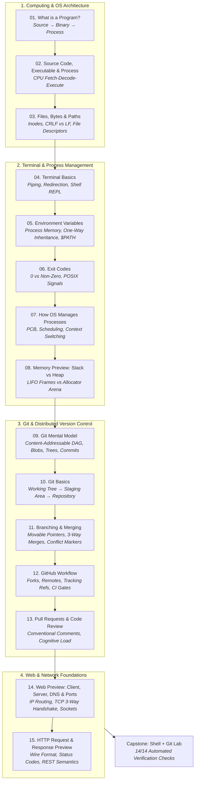

# Module 01: Computers, Terminal, Git, and the Web

## Mission

> *"Computers are incredibly fast, accurate, and stupid. Human beings are incredibly slow, inaccurate, and brilliant. Together they are powerful beyond imagination."* — Paul Armer (attribution traced by Quote Investigator; commonly misattributed to Einstein and Feynman)

This module establishes the foundational systems mental models every software engineer needs before writing syntax.

You will learn what a program physically is — from source text to compiled binary to active operating system process — and how the kernel manages files, processes, memory address spaces, and hardware registers. These concepts eliminate the "magic" from compilation, segmentation faults, and deployment.

With that machine foundation established, you will gain terminal fluency: navigating filesystem hierarchies, chaining commands, redirecting streams, and harvesting exit codes. You will master Git's content-addressable Directed Acyclic Graph (DAG) of immutable snapshots, branching mechanics, and the pull request workflow that powers modern engineering teams. Finally, you will explore the networking bedrock of the web: DNS name resolution, the TCP 3-way handshake, port multiplexing, and the HTTP request-response wire format.

## Tracks in this curriculum

The curriculum organizes your engineering journey into three coordinated tracks:

1. **Core Backend Path (`curriculum/modules/`):** Module 01 is the mandatory foundation following Module 00 Orientation. It bridges physical hardware abstractions to developer tooling, preparing you directly for Module 02 (Go Foundations) and beyond.
2. **Advanced Electives (`curriculum/electives/`):** The process scheduling, memory allocation (stack vs heap), and TCP socket models learned here are direct prerequisites for advanced electives in systems programming, eBPF, and distributed consensus.
3. **[Frontend Companion Track](../../companion-frontend/README.md) (`curriculum/companion-frontend/`):** The network protocols and HTTP request/response wire formats introduced in Lessons 14–15 form the architectural foundation for building hypermedia web UIs (`templ`, `HTMX`, `Tailwind CSS`) running alongside Modules 07–15.

## Who this module is for

This module is designed for:

- Aspiring software engineers and career transitioners who want to build durable systems understanding rather than superficial syntax tricks.
- Self-taught programmers who find terminal commands, Git merge conflicts, or compiler errors mysterious or stressful.
- Experienced developers from interpreted languages (Python, JavaScript, Ruby) who want to understand machine compilation, process memory models, and native binary execution.
- Engineers seeking mechanical sympathy for how CPU registers, operating system kernels, and network sockets collaborate.

## What you will build

Throughout this module and its capstone lab, you will build and verify concrete systems artifacts:

- Cross-platform filesystem navigation and manipulation scripts.
- Multi-command shell pipelines with independent standard stream (`stdin`, `stdout`, `stderr`) redirection.
- A fully initialized local Git repository featuring feature branches, 3-way merges, and resolved merge conflicts.
- A functional Go networking harness that resolves DNS records, binds ephemeral TCP sockets, and inspects HTTP request/response wire data.
- Automated verification evidence passing 14/14 automated checks via `verify.ps1` and `verify.sh`.

## Prerequisites

- [Module 00: Orientation](../00-orientation/README.md)

You should be able to:

- Open a terminal emulator on your operating system (Windows Terminal, iTerm2, Alacritty, or Bash).
- Clone this repository locally.
- Run Go toolchain commands (`go version`).

## Concept map

## Lessons

| Order | Lesson                                                                                                       | Outcome                                                                                                                                |
| :---: | :----------------------------------------------------------------------------------------------------------- | :------------------------------------------------------------------------------------------------------------------------------------- |
|   1   | [What is a program?](./lessons/01-what-is-a-program/README.md)                                                | Distinguish source code, compiled binary, and running process; explain the three-part lifecycle of any program.                        |
|   2   | [Source code, executable, and process](./lessons/02-source-code-executable-and-process/README.md)             | Trace how the CPU fetches, decodes, and executes compiled machine instructions from system memory using registers and the ALU.         |
|   3   | [Files, bytes, directories, and paths](./lessons/03-files-bytes-directories-and-paths/README.md)              | Navigate the filesystem tree, understand how bytes map to content, and write cross-platform Go file operations.                        |
|   4   | [Terminal basics](./lessons/04-terminal-basics/README.md)                                                     | Run commands, redirect output, pipe data between programs, and explain how the shell forks and manages child processes.                |
|   5   | [Environment variables](./lessons/05-environment-variables/README.md)                                         | Read and set environment variables, understand inheritance across processes, and configure Go applications without hard-coded secrets. |
|   6   | [Exit codes](./lessons/06-exit-codes/README.md)                                                               | Write programs that signal success or failure via exit codes; chain commands with `&&` and `\|\|` in shell scripts. |
|   7   | [How the OS manages processes](./lessons/07-how-the-os-manages-processes/README.md)                           | Spawn child processes, collect exit codes, and explain scheduling, context switching, and zombie processes.                            |
|   8   | [Memory preview: stack vs heap](./lessons/08-memory-preview-stack-vs-heap/README.md)                          | Identify stack- vs heap-allocated variables; use `go build -gcflags=-m` to verify escape analysis decisions.                          |
|   9   | [Git mental model](./lessons/09-git-mental-model/README.md)                                                   | Explain Git's content-addressable object model, the DAG of commits, and why branches are just movable pointers.                        |
|  10  | [Git basics: status, add, commit](./lessons/10-git-basics-status-add-commit/README.md)                        | Navigate the working directory, staging area, and commit history; write meaningful commit messages.                                    |
|  11  | [Branching and merging](./lessons/11-branching-and-merging/README.md)                                         | Create branches, merge with fast-forward and three-way merges, and resolve merge conflicts.                                            |
|  12  | [GitHub workflow](./lessons/12-github-workflow/README.md)                                                     | Fork, clone, branch, push, and open pull requests; explain the propose-verify-merge cycle.                                             |
|  13  | [Pull requests and code review](./lessons/13-pull-requests-and-code-review/README.md)                         | Write effective PR descriptions, leave constructive review comments, and respond to feedback professionally.                           |
|  14  | [Web preview: client, server, DNS, and ports](./lessons/14-web-preview-client-server-dns-and-ports/README.md) | Resolve domain names to IPs, establish TCP connections, and explain how a browser loads a webpage.                                     |
|  15  | [HTTP request and response preview](./lessons/15-http-request-and-response-preview/README.md)                 | Start an HTTP server, send GET requests, read status codes and headers, and understand the request-response cycle.                     |

## Labs

Module 01 integrates guided terminal, Git, and networking drills into every lesson:

- **Filesystem & Stream Lab (Lessons 03 & 04):** Creating directory trees, testing CRLF line endings, and piping stdout/stderr into separate buffers.
- **Process & Signal Lab (Lessons 06 & 07):** Capturing child exit statuses, inspecting `$PATH` resolution, and triggering graceful terminations.
- **Git DAG Plumbing Drill (Lessons 09–11):** Inspecting `.git/objects/` with `git cat-file` and resolving multi-line merge conflicts.

## Projects

Module 01 culminates in a hands-on project capstone:

- [**Shell + Git Lab**](./projects/shell-git-lab/README.md) — A complete terminal and Git lab where you construct a multi-tier project directory tree, initialize a local Git repository, manage feature branch lifecycles, execute three-way merges, resolve simulated merge conflicts, and verify repository health against an automated 14-point test suite (`verify.ps1` / `verify.sh`).

## Assessments

Evaluate your conceptual and operational mastery with the module assessment suite:

- [**Shell + Git Lab Assessment**](./assessments/shell-git-lab/README.md) — A 30-minute structured assessment covering shell streams, process isolation, Git DAG mechanics, and network protocol layers.
  - Diagnostic review questions: [`questions.md`](./assessments/shell-git-lab/questions.md)
  - Detailed evaluation rubric: [`rubric.md`](./assessments/shell-git-lab/rubric.md)
  - Thorough answer key: [`answer-key.md`](./assessments/shell-git-lab/answer-key.md)

## Common failure modes

| Failure Mode                                   | Observable Symptom                                                                               | Root Cause                                                                                            | Engineering Fix                                                                                                                  |
| ---------------------------------------------- | ------------------------------------------------------------------------------------------------ | ----------------------------------------------------------------------------------------------------- | -------------------------------------------------------------------------------------------------------------------------------- |
| **CRLF Script Termination**              | `/bin/bash^M: bad interpreter: No such file or directory`                                      | Windows carriage return bytes (`\r\n`) committed to shell scripts                                   | Normalize line endings via `dos2unix` or configure `.gitattributes` to force `LF` on scripts.                               |
| **Stream Blindness**                     | `cmd > output.log` passes silently, but errors still print to terminal and logs are incomplete | Single `>` only redirects `stdout` (fd 1); diagnostic errors and panics write to `stderr` (fd 2) | Redirect both streams: `cmd > output.log 2>&1`.                                                                                 |
| **Environment Variable Leak Assumption** | Child script modifies an environment variable, but parent terminal shell remains unchanged       | Environment variables have one-way inheritance and process-level isolation                            | Use `source script.sh` if parent shell mutation is intended, or pass values via stdout pipes.                                   |
| **Silent Force-Push Overwrite**          | Teammates' remote commits vanish without warning after a rebase                                  | Running `git push --force` unconditionally updates remote refs                                       | Standardize on `git push --force-with-lease` across all workflows and protect `main`.                                         |
| **Port Collision**                       | `listen tcp :8080: bind: address already in use`                                               | Another active process or orphaned daemon is holding socket port 8080                                 | Identify PID via `lsof -i :8080` or `netstat -ano`, terminate holding process, or configure dynamic ephemeral ports (`:0`). |

## Completion checklist

You are ready to advance to Module 02 when you can:

- [ ] Explain the three-part program lifecycle (source code on disk → executable binary → active OS process in memory).
- [ ] Describe the CPU Instruction Cycle (Fetch, Decode, Execute, Advance) and explain the role of `RIP` and hardware registers.
- [ ] Explain the difference between file descriptors 0 (stdin), 1 (stdout), and 2 (stderr), and use redirection operators (`>`, `>>`, `2>`, `|`).
- [ ] Read and set environment variables, and explain how `$PATH` command resolution works.
- [ ] Interpret standard exit codes (0 for success, non-zero for failure, 137 for OOM, 143 for SIGTERM).
- [ ] Differentiate Call Stack allocation from Dynamic Heap allocation and understand compiler Escape Analysis.
- [ ] Explain Git's object model (blobs, trees, commits) as a content-addressable DAG.
- [ ] Execute a full Git branching, 3-way merging, and conflict resolution cycle.
- [ ] Describe DNS resolution, the TCP 3-way handshake, port demultiplexing, and HTTP wire format.
- [ ] Pass all 14/14 checks in the Shell + Git Lab verification suite (`./verify.ps1` or `./verify.sh`).
- [ ] Complete the Shell + Git Lab assessment scoring at least 70%.

## Start here

Begin Step 1 of this module with the first lesson:

- [Lesson 01: What is a program?](./lessons/01-what-is-a-program/README.md)

> [!NOTE] Single-Entry Navigation
> Module progression is strictly sequential. Complete lessons 01 through 15, build and verify the shell-git lab project, and complete the assessment suite. The exit gate to Module 02 unlocks upon completing the assessment checkpoint.
