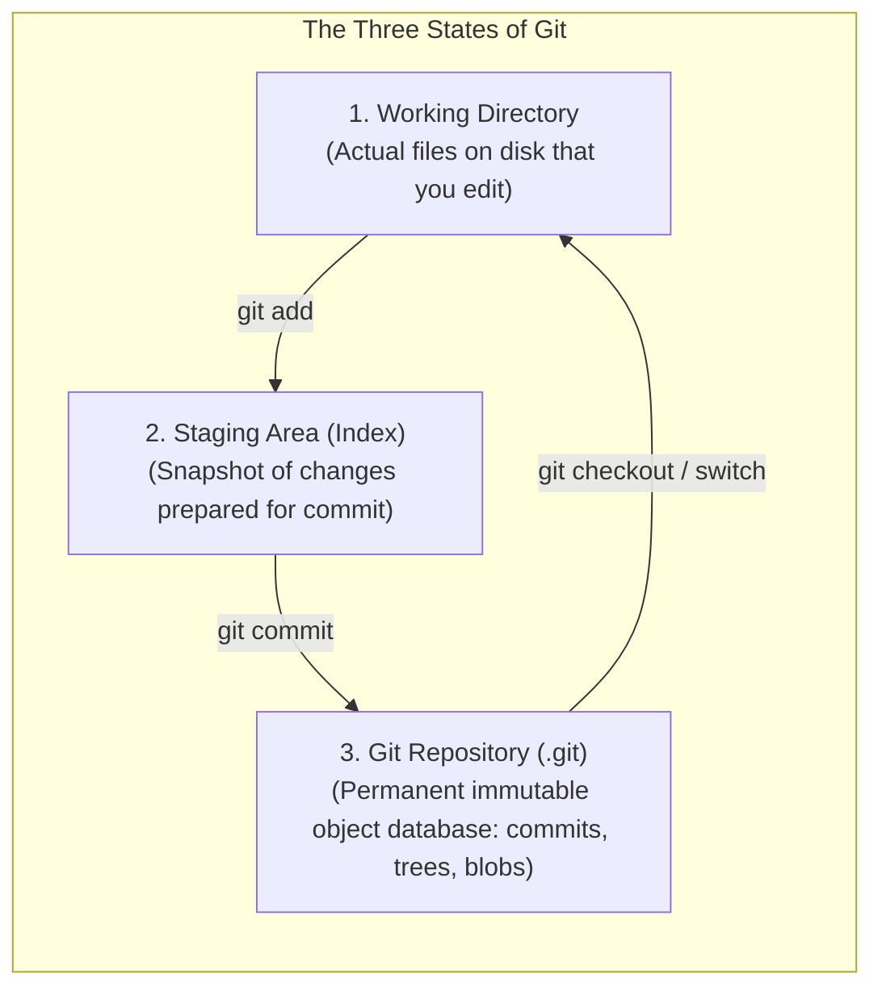

# Git mental model

## Learning objective

Formulate a mental model of Git as a content-addressable directed acyclic graph (DAG) of immutable snapshots.

## Why this matters

Developers need to track changes, collaborate on code, experiment safely, and revert mistakes. Git provides a distributed, offline-capable version control system that solves all these problems with a unified data model.

## Mental model

Git is a content-addressable filesystem where every object is identified by its SHA-1 hash. A commit is a snapshot of the entire repository at a point in time, linked to its parent(s) in a Directed Acyclic Graph (DAG). Branches are just movable pointers to commits.

## Visual model



## Core idea

Without version control, teams lose history, overwrite each other's changes, and cannot safely experiment. Git's distributed model, content-addressable storage, and branching model make it the most powerful and resilient version control system ever built.

## Under the hood

Git's object database is a content-addressable key-value store housed directly inside `.git/objects/`. There are four primitive object types:
- **`blob`**: Stores raw file bytes (no filename, no permissions—just file contents).
- **`tree`**: Represents a directory, storing filenames, file permissions (modes like `100644` or `100755`), and hashes pointing to blobs or nested subtree objects.
- **`commit`**: Stores a pointer to the root `tree` snapshot, zero or more `parent` commit hashes, author and committer metadata (name, email, timestamp), and the commit message.
- **`tag`**: An annotated reference pointing directly to a specific commit.

### How Git stores objects on disk (Zero-Magic)

When Git hashes an object, it prepends a header:
```text
header = "<type> <content-length-in-bytes>\0"
full_payload = header + content
object_id = sha1(full_payload)
```

Git splits the 40-character hexadecimal SHA-1 string:
- The first 2 characters become a folder name under `.git/objects/` (e.g., `.git/objects/2a/`).
- The remaining 38 characters become the filename (e.g., `ae6c35c94fcfb415dbe95f408b9ce91ee846ed`).
- The entire payload (header + content) is compressed with zlib before being written to disk.

### Low-Level Git Plumbing Commands

High-level "porcelain" commands (`git add`, `git commit`) call these low-level "plumbing" tools under the hood:

```bash
# 1. Manually hash a string and store it in .git/objects/
echo "hello world" | git hash-object -w --stdin
# Output: 3b18e512dba79e4c8300dd08aeb37f8e728b8dad

# 2. Inspect the object's type (-t)
git cat-file -t 3b18e512dba79e4c8300dd08aeb37f8e728b8dad
# Output: blob

# 3. Pretty-print the object's contents (-p)
git cat-file -p 3b18e512dba79e4c8300dd08aeb37f8e728b8dad
# Output: hello world

# 4. Inspect a commit's tree snapshot
git cat-file -p HEAD
# Output shows 'tree <hash>', 'parent <hash>', 'author ...', and the commit message.
```

Packfiles (`.git/objects/pack/`) subsequently compress multiple objects together with delta encoding for efficient disk storage and network transfer.

## How Go uses it

Go projects depend on Git for version control and module distribution. 'go mod download' fetches modules from Git repositories. 'go get' resolves package paths to Git remote URLs. The Go ecosystem on GitHub relies entirely on Git for collaboration, code review, and release management.

## Go example

```go
package main

import (
	"crypto/sha1"
	"fmt"
)

// HashContent returns the SHA-1 hash of content as a hex string (like Git object IDs).
func HashContent(content string) string {
	h := sha1.Sum([]byte(content))
	return fmt.Sprintf("%x", h)
}

// Blob represents a Git-like blob object.
type Blob struct {
	Hash    string
	Content string
}

// NewBlob creates a blob by hashing the content (like git hash-object).
func NewBlob(content string) Blob {
	return Blob{Hash: HashContent(content), Content: content}
}

// Commit represents a Git-like commit with a message, hash, and parent.
type Commit struct {
	Hash    string
	Message string
	Parent  string
}

// NewCommit creates a commit with a hash derived from its content.
func NewCommit(message, parentHash string) Commit {
	content := fmt.Sprintf("commit: %s\nparent: %s", message, parentHash)
	return Commit{Hash: HashContent(content), Message: message, Parent: parentHash}
}

func main() {
	blob := NewBlob("hello world")
	fmt.Printf("Blob hash: %s\n", blob.Hash)

	commit1 := NewCommit("Initial commit", "")
	fmt.Printf("Commit 1 hash: %s\n", commit1.Hash)

	commit2 := NewCommit("Add feature", commit1.Hash)
	fmt.Printf("Commit 2 hash: %s\n", commit2.Hash)

	sameBlob := NewBlob("hello world")
	fmt.Printf("Same content: %s == %s: %v\n", blob.Hash, sameBlob.Hash, blob.Hash == sameBlob.Hash)
}
```

## Step-by-step execution

1. Initialize a Git repository — this creates the .git directory with objects/, refs/, HEAD, and config files.
2. Create or modify files in the working directory — Git detects changes by comparing current file hashes with the index.
3. Stage changes with 'git add' — Git computes the SHA-1 hash of each file, stores the content as a blob in objects/, and updates the index.
4. Commit with 'git commit' — Git creates a tree object (listing blobs and subtrees), a commit object (linking to tree, parent, author, message), and advances the current branch pointer.
5. Push with 'git push' — Git uploads new objects to the remote, and the remote updates its refs to match.

## Common mistakes

| Mistake | Why it happens | Fix |
|---------|---------------|-----|
| Thinking Git stores versions of files as deltas | Git stores full snapshots, not diffs — each commit is a complete copy of the tracked files | Understand that Git uses content-addressable storage; diffs are computed on demand for transfer |
| Believing git commit saves changes to a remote server | Commits are local until git push | Remember: commit is local, push sends to remote |
| Confusing the working directory, the staging area (index), and the commit history as all the same thing | They are three distinct areas with different purposes | Learn the three-basket model: working (edits), staging (planned commit), history (saved snapshots) |

## Debugging walkthrough

### Scenario: A developer runs git commit but forgets to git add first, and wonders why their changes were not committed.

**Cause:** Git only commits changes that have been staged (added to the index). Unstaged changes are not included.

**Fix:** Use 'git add <file>' to stage changes, or 'git commit -a' to automatically stage tracked files before committing.

### Scenario: A developer makes changes, commits them, then realizes they committed to the wrong branch.

**Cause:** Git commits are attached to the current branch HEAD. The developer did not switch to the intended branch first.

**Fix:** Use 'git log --oneline -1' to find the commit hash, then 'git cherry-pick <hash>' on the correct branch and 'git reset HEAD~1' on the wrong branch.

## Production notes

Git is the de facto standard for version control in the software industry. Every open-source project, every enterprise codebase, every CI/CD pipeline, and every deployment system integrates with Git. GitHub, GitLab, and Bitbucket host millions of repositories.

## Performance implications

- Git operations are fast because they are local — no network needed for commit, diff, log, or branch operations.
- Git's object store uses zlib compression, reducing disk usage by 30-70% compared to storing raw files.
- Large binary files bloat Git history — Git is optimized for text files that diff well.

## Tests / verification

1. Initialize a new Git repository: `git init test-model && cd test-model`.
2. Create three commits (add a file, modify it, modify it again). Run `git log --oneline --graph` and explain the commit DAG.
3. Use `git diff <commit1> <commit2>` to show changes between two commits. Then inspect an object directly: `git cat-file -p <commit-hash>`.

The [Shell + Git Lab](../../projects/shell-git-lab/README.md) will ask you to apply this mental model directly — you will init a real repository, examine .git/objects, create commits, and verify the DAG with `git log --graph`.

## Review questions

1. Explain the difference between the working directory, the staging area, and the commit history.
2. Identify what happens to committed data when a branch is deleted.
3. Explain why Git can reconstruct any version of any file from its object database.
4. How many parent commits does a merge commit have? How many does an initial commit have?
5. What is the difference between a branch name and a tag in Git's object model?

## NEXT UP

Lesson 10: [Git basics: status, add, commit](../10-git-basics-status-add-commit/README.md)
