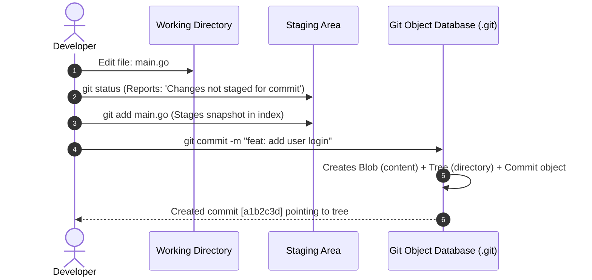

# Git basics: status, add, commit

## Learning objective

Initialize repositories, stage changes, create atomic commits with clear messages, and inspect repository status and diffs.

## Why this matters

Developers need a repeatable workflow to save work-in-progress, review changes before committing, and build a clean history. The status-add-commit cycle provides a safe, structured way to record progress.

## Mental model

The Git workflow is three baskets: the working directory (your current edits), the staging area (what you plan to commit), and the commit history (what has been saved). Changes flow left to right: working → staged → committed.

## Visual model



## Core idea

Without staging, every file change would be automatically included in the next commit — making partial commits, code review, and selective history impossible. The status-add-commit workflow gives developers fine-grained control over what enters the permanent record.

## Under the hood

### The Staging Area (`.git/index`) Internal Structure

The Git index (staging area) is a high-performance binary file located at `.git/index`. It is **not** a copy of your files; rather, it is a binary cache containing:
1. A sorted table of all tracked file paths.
2. Cached OS filesystem metadata (`stat` cache): modification timestamp (`mtime`), file size, inode, and file permissions.
3. The SHA-1 hash of the corresponding `blob` stored in `.git/objects/`.
4. Stage flags (used during merge conflict resolution: Stage 1 = Common Ancestor, Stage 2 = Target Branch / HEAD, Stage 3 = Incoming Branch).

Because `.git/index` caches OS timestamps and file sizes, `git status` avoids re-hashing thousands of files on every keystroke. It simply calls the OS `stat()` system call; if the `mtime` and file size match the index entry, Git knows instantly the file hasn't changed.

### The Conventional Commits Specification

Professional engineering teams standardize commit messages using the **Conventional Commits** specification. This format enables automated semantic release versioning and generates readable changelogs:

```text
<type>[optional scope]: <short description in imperative mood>

[optional detailed body explaining 'why' rather than 'what']

[optional footer(s): e.g., 'BREAKING CHANGE: ...' or 'Fixes #123']
```

| Type | When to use | Example |
| :--- | :--- | :--- |
| `feat` | A new feature or capability | `feat(auth): add JWT bearer token validation` |
| `fix` | A bug fix | `fix(router): prevent panic on nil context in middleware` |
| `docs` | Documentation updates only | `docs(readme): add docker run instructions` |
| `refactor`| Code restructuring without feature or bug changes | `refactor(db): extract connection pool initialization` |
| `test` | Adding or updating tests | `test(cache): add benchmark for concurrent LRU evictions` |
| `chore` | Build tasks, tool configurations, dependencies | `chore(deps): upgrade golang.org/x/crypto to v0.19.0` |

## How Go uses it

Go developers use Git for every project: 'git init' creates a module, 'git add' and 'git commit' save work, 'git push' publishes code. Go's 'go mod vendor' creates a vendor directory that should be committed. GitHub Actions CI runs tests on every git push.

## Go example

```go
package main

import (
	"fmt"
	"sort"
)

// Repo simulates a basic Git repository with working directory, staging, and history.
type Repo struct {
	Working map[string]string
	staging map[string]string
	History []Commit
}

// Commit represents a saved snapshot.
type Commit struct {
	Message string
	Files   map[string]string
}

// NewRepo creates an empty repository.
func NewRepo() *Repo {
	return &Repo{
		Working: make(map[string]string),
		staging: make(map[string]string),
		History: []Commit{},
	}
}

// StageNames returns sorted names of staged files.
func (r *Repo) StageNames() []string {
	names := make([]string, 0, len(r.staging))
	for name := range r.staging {
		names = append(names, name)
	}
	sort.Strings(names)
	return names
}

// Stage moves a file from working directory to staging area.
func (r *Repo) Stage(name string) error {
	content, ok := r.Working[name]
	if !ok {
		return fmt.Errorf("file not found: %s", name)
	}
	r.staging[name] = content
	return nil
}

// Unstage removes a file from staging area.
func (r *Repo) Unstage(name string) {
	delete(r.staging, name)
}

// Commit saves all staged files to history.
func (r *Repo) Commit(msg string) error {
	if len(r.staging) == 0 {
		return fmt.Errorf("nothing staged")
	}
	files := make(map[string]string)
	for k, v := range r.staging {
		files[k] = v
	}
	r.History = append(r.History, Commit{Message: msg, Files: files})
	r.staging = make(map[string]string)
	return nil
}

func main() {
	repo := NewRepo()
	repo.Working["hello.txt"] = "Hello, Git!"

	fmt.Println("Staged:", repo.StageNames())

	repo.Stage("hello.txt")
	fmt.Println("After stage:", repo.StageNames())

	repo.Commit("feat: add hello.txt")
	fmt.Printf("History: %d commits\n", len(repo.History))

	repo.Working["main.go"] = "package main"
	repo.Stage("main.go")
	repo.Commit("feat: add main.go")
	fmt.Printf("History: %d commits\n", len(repo.History))
}
```

## Step-by-step execution

1. Run 'git status' to see the current state — modified tracked files, staged files, and untracked files are listed separately.
2. Run 'git add <file>' or 'git add .' to stage changes — Git hashes file contents and updates the index.
3. Run 'git diff --staged' to review exactly what will be included in the next commit.
4. Run 'git commit -m "type: description"' to create a commit from the staged snapshot.
5. Run 'git log --oneline' to verify the commit appears at the top of the history.

## Common mistakes

| Mistake | Why it happens | Fix |
|---------|---------------|-----|
| Running git add . blindly without checking what files are being staged | Convenience over caution — you accidentally commit build artifacts or secrets | Use 'git status' and 'git add <file>' selectively, or use .gitignore |
| Writing meaningless commit messages like 'fix' or 'update' | Rush to save work without considering future readers | Use conventional commits: 'feat: add login endpoint', 'fix: handle nil pointer in parser' |
| Committing large binary files or dependency directories | Not understanding that Git stores every version permanently | Use .gitignore for binaries and vendored deps, or use Git LFS for large files |

## Debugging walkthrough

### Scenario: A developer runs 'git commit' without configuring user.name and user.email and gets an error.

**Cause:** Git requires identity information for every commit; it reads from git config user.name and user.email.

**Fix:** Set global config: 'git config --global user.name "Your Name"' and 'git config --global user.email "you@example.com"'.

### Scenario: A developer stages a file, edits it again, then commits — the second edit is not included in the commit.

**Cause:** git add captures the file's content at the moment of staging; subsequent edits are unstaged modifications.

**Fix:** Always run 'git status' before committing, and re-stage changed files or use 'git commit -a' for tracked files.

## Production notes

The status-add-commit cycle is performed dozens of times daily by every professional developer. It is the fundamental rhythm of Git-based development, used in every codebase from small personal projects to monorepos at Google and Microsoft.

## Performance implications

- git add and git commit are local operations — no network, no latency. A typical commit takes under 100ms.
- Large repositories (100k+ files) slow down git status — use .gitignore to exclude build artifacts and dependencies.
- Git's index file scales with the number of tracked files — performance degrades linearly.

## Tests / verification

1. Create a repository, add a file, and stage it with `git add`. Modify the file again without staging — run `git status` and note the file appears in both "staged" and "unstaged" sections.
2. Use `git diff` to see unstaged changes and `git diff --staged` to see staged changes. Commit the staged version with `git commit -m "feat: add initial file"`.
3. Run `git log --oneline` and confirm the commit shows up with your message. Then modify the file, stage it, and amend the commit with `git commit --amend`.

In the [Shell + Git Lab](../../projects/shell-git-lab/README.md), you will practice this exact workflow: initialize a repo, create files, stage them, commit with meaningful messages, and verify the history. The project verification script checks that staged files produce the expected commit graph.

## Review questions

1. Use `git status` to identify which changes are staged, unstaged, and untracked in a given scenario.
2. Write a meaningful commit message following the conventional commit format (type: description).
3. Use `git diff --staged` to review what will be committed before running `git commit`.
4. What is the difference between `git diff` and `git diff --staged`? When would you use each?
5. If you modify a file after staging it, which version will appear in the commit — the staged version or the latest modification?

## NEXT UP

Lesson 11: [Branching and merging](../11-branching-and-merging/README.md)
