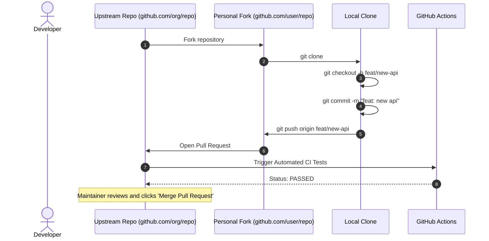

# GitHub workflow

## Learning objective

Manage remote repositories, synchronize branch refs via git fetch, push, and pull, and configure remote tracking branches.

## Why this matters

Direct push to shared branches causes chaos. The GitHub workflow formalizes code review, automated testing, and controlled integration — making collaboration scalable from solo developers to thousands of contributors.

## Mental model

GitHub extends Git with a collaborative layer: remotes host branches for sharing, pull requests are proposals for merging branches with discussion attached, and actions automate verification. The workflow is propose-verify-merge.

## Visual model



## Core idea

The GitHub workflow is a standardized collaboration pattern: fork or clone a repository, create a feature branch, push changes, open a pull request, discuss and review, then merge. This process ensures every change is reviewed, tested, and traceable.

## Under the hood

### Remote Tracking References (Zero-Magic)

Git maintains separate references for your local branches and your view of remote branches:
- **Local branch**: `.git/refs/heads/main` (where you commit locally).
- **Remote-tracking branch**: `.git/refs/remotes/origin/main` (where the remote `origin` was the last time you communicated with it).

When you run:
- **`git fetch origin`**: Git downloads new objects and advances `.git/refs/remotes/origin/main`. Your local working directory and `.git/refs/heads/main` remain untouched.
- **`git merge origin/main`**: Git merges the updated remote tracking branch into your local branch.
- **`git pull`**: A shorthand helper that executes `git fetch` followed immediately by `git merge`.

### Safe Pushing: `--force-with-lease` vs `--force`

When you rewrite history locally (via `git rebase` or `git commit --amend`), a normal `git push` is rejected because your local branch has diverged from the remote.
- **`git push --force` (Dangerous)**: Tells GitHub to point the remote branch to your commit regardless of whether other engineers pushed work. Teammates' commits are permanently detached.
- **`git push --force-with-lease` (Production Standard)**: Tells GitHub: *"Only update the remote branch if the remote commit currently matches my local `origin/<branch>` reference."* If another engineer pushed commits since your last fetch, the push fails safely, preventing silent data loss.

### Branch Protection & Automated Rulesets

In enterprise production repositories, branch protection rules protect `main` by rejecting direct pushes:
1. **Require pull request before merging**: All changes must go through review.
2. **Require status checks to pass**: CI workflows (e.g., `go test ./...`, `golangci-lint`) must succeed before the merge button unlocks.
3. **Require approvals**: At least 1-2 authorized reviewers must sign off.
4. **Require linear history**: Encourages squash-and-merge or rebase merges to prevent noisy multi-parent merge bubbles.

## How Go uses it

The Go project itself uses GitHub with pull requests, code review, and CI. The standard library, community packages, and most Go tools follow the same fork-branch-PR-review workflow. GitHub Actions runs Go tests on every PR for most open-source Go projects.

## Go example

The example program simulates the GitHub workflow as a state machine: a repository with forks, feature branches, pull requests with review status, and merge validation through branch protection rules.

```go
package main

import (
	"errors"
	"fmt"
)

type PRStatus string

const (
	StatusDraft            PRStatus = "Draft"
	StatusPendingReview    PRStatus = "Pending Review"
	StatusChangesRequested PRStatus = "Changes Requested"
	StatusApproved         PRStatus = "Approved"
	StatusMerged           PRStatus = "Merged"
)

// PullRequest simulates a GitHub pull request with branch protection rules.
type PullRequest struct {
	ID             int
	Title          string
	Author         string
	SourceBranch   string
	TargetBranch   string
	Status         PRStatus
	ApprovalsCount int
	CIPassing      bool
}

// CanMerge validates GitHub branch protection rules: CI must pass and at least 1 approval.
func (pr *PullRequest) CanMerge() error {
	if !pr.CIPassing {
		return errors.New("cannot merge: CI checks are failing")
	}
	if pr.ApprovalsCount < 1 {
		return errors.New("cannot merge: at least 1 approval is required by branch protection")
	}
	return nil
}

func (pr *PullRequest) Merge() error {
	if err := pr.CanMerge(); err != nil {
		return err
	}
	pr.Status = StatusMerged
	return nil
}

func main() {
	fmt.Println("=== GitHub Workflow State Machine Simulation ===")

	pr := &PullRequest{
		ID:           101,
		Title:        "feat: add rate limiting middleware",
		Author:       "alice",
		SourceBranch: "feature/rate-limiter",
		TargetBranch: "main",
		Status:       StatusPendingReview,
		CIPassing:    true,
	}

	fmt.Printf("PR #%d: %s (Status: %s)\n", pr.ID, pr.Title, pr.Status)
	fmt.Printf("Initial merge attempt: %v\n", pr.Merge())

	// Reviewer adds approval
	fmt.Println("\nReviewer 'bob' reviews and submits Approval...")
	pr.ApprovalsCount++
	pr.Status = StatusApproved
	fmt.Printf("PR Status: %s (Approvals: %d, CI: %t)\n", pr.Status, pr.ApprovalsCount, pr.CIPassing)

	// Second merge attempt
	if err := pr.Merge(); err != nil {
		fmt.Printf("Merge failed: %v\n", err)
	} else {
		fmt.Printf("✓ Merge successful! PR #%d is now merged into %s.\n", pr.ID, pr.TargetBranch)
	}
}
```

## Step-by-step execution

1. Fork the upstream repository on GitHub to create a personal copy under your account.
2. Clone your fork locally: `git clone https://github.com/your-username/repo.git`.
3. Create a feature branch, make changes, commit logically, and push: `git push origin feature-branch`.
4. On GitHub, open a pull request from your feature branch to the upstream repository's target branch.
5. Address review feedback with additional commits, then the maintainer merges the PR.

## Common mistakes

| Mistake | Why it happens | Fix |
|---|---|---|
| Making changes directly on main | Not familiar with branching workflow | Always create a feature branch for changes |
| Pushing sensitive data (API keys) to a public repo | Committing secrets without realizing Git history retains them | Use `.gitignore` and `git secrets` or similar pre-commit hooks |
| Opening a PR with unrelated changes in a single commit | Not committing logically after each change | Use `git add -p` and make focused, single-purpose commits |

## Debugging walkthrough

**Scenario: PR shows "This branch has conflicts that must be resolved."**
- **Cause:** The target branch has changed since the feature branch was created.
- **Diagnosis:** Click "Resolve conflicts" on GitHub or check locally with `git merge main`.
- **Resolution:** Resolve conflicts locally: `git merge main` on the feature branch, resolve conflicts, commit, and push.

**Scenario: New commits pushed after PR approval bypass the review.**
- **Cause:** Branch protection rules are not configured to dismiss stale reviews.
- **Diagnosis:** Check the repository's branch protection settings.
- **Resolution:** Enable "Dismiss stale pull request approvals when new commits are pushed" in branch protection rules.

## Production notes

GitHub is the largest code hosting platform in the world. Millions of developers use pull requests daily for code review, CI verification, and collaborative development. The PR workflow is the industry standard for team contribution.

## Performance implications

- Pushing to GitHub is network-bound — a typical push of a few commits takes 1-5 seconds.
- Large PRs (1000+ lines changed) are slower to review and more likely to have merge conflicts.
- GitHub Actions CI adds 1-10 minutes per PR depending on test suite size.

## Tests / verification

1. Fork a public repository on GitHub, clone it locally, create a `feature` branch, make a change, commit it, and push the branch to your fork.
2. Open a pull request on GitHub from your fork's feature branch to the original repo's main branch. Write a descriptive title and body.
3. Explore the PR page: check the "Files changed" tab, leave a comment on a diff line, and verify the status checks section.

In the [Shell + Git Lab](../../projects/shell-git-lab/README.md), you will use a local Git workflow that mirrors the GitHub fork-branch-PR cycle. Understanding remotes, pushes, and the propose-verify-merge pattern prepares you to publish your project to GitHub.

## Review questions

1. What is the correct sequence of steps in the GitHub workflow?
2. What do the remote names `upstream` and `origin` mean?
3. What happens when a PR is merged via "Create a merge commit" vs "Squash and merge" vs "Rebase and merge"?
4. Why should you never force-push to a shared branch?
5. What is the purpose of branch protection rules?

## NEXT UP

[Lesson 13: Pull requests and code review](../13-pull-requests-and-code-review/README.md)
