# Module 02: Go Setup and Tooling

## Mission

> "Go was designed to address the problems of scale at Google: millions of lines of code, thousands of developers, and immense distributed infrastructure. The toolchain was built from the ground up to be blazingly fast, reproducible, and transparent."
> — Rob Pike, *Go at Google: Language Design in the Service of Software Engineering*

This module equips you with total mechanical mastery of the Go development toolchain.

Rather than treating the compiler and runtime as black boxes, you will understand the exact lifecycle of a Go program: how source text is tokenized and parsed into an Abstract Syntax Tree (AST), how types are verified, how the compiler optimizes intermediate code via Static Single Assignment (SSA), and how the static linker bundles your code, external dependencies, and the Go runtime into a single standalone machine binary.

You will gain operational fluency across the foundational tools: `go version` and environment inspection (`GOROOT`, `GOPATH`, `GOOS`, `GOARCH`), rapid execution with `go run`, static binary emission with `go build`, automated verification with `go test`, canonical code formatting with `gofmt`, static defect analysis with `go vet`, offline documentation with `go doc`, language server protocol integration via `gopls`, and dependency management via `go.mod` and `go.sum`. Finally, you will develop systematic error triage skills: decoding compiler diagnostics down to file-line-column coordinates, unwinding panic tracebacks through goroutine stack frames, and fixing failing test assertions.

## Tracks in this curriculum

The curriculum organizes your engineering journey into three coordinated tracks:

1. **Core Backend Path (`curriculum/modules/`):** Module 02 is the gateway to the Go programming language following Module 01 foundations. It establishes the toolchain discipline and debugging instincts required for Module 03 (Programming Fundamentals) and beyond.
2. **Advanced Electives (`curriculum/electives/`):** The compilation pipeline, linker flags, and module dependency mechanics mastered here directly prepare you for advanced electives in compiler internals, assembly emission, and custom tooling analysis.
3. **Frontend Companion Track (`curriculum/companion-frontend/`):** The module root conventions, build tags, and multi-file project layouts configured here form the build pipeline for compiling backend servers that serve hypermedia UI templates (`templ`, `HTMX`, `Tailwind CSS`).

## Who this module is for

This module is designed for:

- Aspiring backend engineers writing their first Go programs.
- Developers transitioning from interpreted or VM-based languages (Python, JavaScript, Java, Ruby) who want to understand Go's compilation speed, static linking, and toolchain philosophy.
- Programmers who have encountered cryptic compiler errors, panic tracebacks, or module import failures and want a systematic debugging workflow.
- Systems engineers seeking mechanical sympathy for how Go builds and verifies production binaries.

## What you will build

Throughout this module and its capstone project, you will build and verify concrete toolchain artifacts:

- A verified Go development environment with verified `GOROOT`, `GOPATH`, and terminal `$PATH` access.
- Minimal executable programs confirming binary entrypoint conventions (`package main`, `func main()`).
- Ephemeral executions via `go run` and statically linked standalone executables via `go build`.
- Automated test suites using standard library testing (`*testing.T`) with passing and failing assertions.
- Standardized source code formatted via `gofmt` and inspected via `go vet` static analyzers.
- Offline documentation generated and queried via `go doc`.
- A fully initialized Go module root governed by `go.mod` and verified by `go.sum`.
- A completed troubleshooting portfolio (`TROUBLESHOOTING.md`) diagnosing and fixing 5 deliberate failure modes in the Tooling Failure Lab capstone project.

## Prerequisites

- [Module 00: Orientation](../00-orientation/README.md)
- [Module 01: Computers, Terminal, Git, and the Web](../01-computers-terminal-git-web/README.md)

You should be able to:
- Open a terminal and run basic commands (`cd`, `ls`, `mkdir`, `rm`).
- Clone Git repositories and create commits.
- Understand basic file paths, exit codes, and process execution from Module 01.

## Concept map

```mermaid
flowchart TD
    classDef frontDoor fill:#1a233a,stroke:#3b82f6,stroke-width:2px,color:#ffffff;
    classDef exitGate fill:#1e3a1e,stroke:#4caf50,stroke-width:2px,color:#ffffff;
    classDef standardNode fill:#22272e,stroke:#444c56,stroke-width:1px,color:#ffffff;
    classDef capstoneNode fill:#2d2215,stroke:#f59e0b,stroke-width:2px,color:#ffffff;
    classDef container fill:#161b22,stroke:#30363d,stroke-width:1px,color:#8b949e;

    subgraph Phase1["1. Toolchain & First Execution"]
        L01["01. Install & Verify Go<br/><i>GOROOT, GOPATH, PATH</i>"]:::frontDoor
        L02["02. Hello World<br/><i>package main, func main()</i>"]:::standardNode
        L03["03. go run<br/><i>Compile, Exec, Clean</i>"]:::standardNode
        L01 --> L02 --> L03
    end

    subgraph Phase2["2. Binary Production & Quality Tools"]
        L04["04. go build<br/><i>Static Binary Linking</i>"]:::standardNode
        L05["05. go test<br/><i>*testing.T, PASS/FAIL</i>"]:::standardNode
        L06["06. gofmt<br/><i>Canonical AST Formatting</i>"]:::standardNode
        L07["07. go vet<br/><i>Static Defect Analyzers</i>"]:::standardNode
        L08["08. go doc<br/><i>Offline API Reference</i>"]:::standardNode
        L09["09. Editor Setup & gopls<br/><i>Language Server Protocol</i>"]:::standardNode
        L03 --> L04 --> L05 --> L06 --> L07 --> L08 --> L09
    end

    subgraph Phase3["3. Triage & Module Architecture"]
        L10["10. Compiler Errors<br/><i>File:Line:Col Triage</i>"]:::standardNode
        L11["11. Runtime Errors<br/><i>Panic Stack Unwinding</i>"]:::standardNode
        L12["12. Test Failures<br/><i>Assertion Diagnostics</i>"]:::standardNode
        L13["13. Go Module Root<br/><i>go.mod, go.sum, Paths</i>"]:::standardNode
        L14["14. Tooling Checklist<br/><i>Full Suite Verification</i>"]:::standardNode
        L09 --> L10 --> L11 --> L12 --> L13 --> L14
    end

    subgraph Phase4["4. Practical Capstone & Graduation"]
        PROJ["Capstone Project<br/><b>Tooling Failure Lab</b><br/><i>Fix 5 Failure Modes</i>"]:::capstoneNode
        ASSESS["Assessment Suite<br/><b>Tooling Checkpoint</b><br/><i>(SOLE EXIT GATE)</i>"]:::exitGate
        L14 --> PROJ --> ASSESS
    end
```

## Lessons

| # | Lesson | Summary | Est. Time |
|---|--------|---------|-----------|
| 01 | [Install and Verify Go](./lessons/01-install-and-verify-go/README.md) | Install Go and inspect toolchain environment variables (`GOROOT`, `GOPATH`, `PATH`). | 30 min |
| 02 | [Hello World](./lessons/02-hello-world/README.md) | Understand minimal program architecture: packages, imports, and `func main()`. | 30 min |
| 03 | [go run](./lessons/03-go-run/README.md) | Execute Go programs directly using ephemeral build and execution pipelines. | 30 min |
| 04 | [go build](./lessons/04-go-build/README.md) | Compile source files into standalone, statically linked machine executables. | 45 min |
| 05 | [go test](./lessons/05-go-test/README.md) | Execute automated test suites with the standard library `testing` package. | 45 min |
| 06 | [gofmt](./lessons/06-gofmt/README.md) | Enforce canonical formatting across codebases via AST parsing and reprinting. | 30 min |
| 07 | [go vet](./lessons/07-go-vet/README.md) | Detect suspicious code patterns and subtle bugs using static analysis passes. | 45 min |
| 08 | [go doc](./lessons/08-go-doc/README.md) | Query package and function documentation directly from your terminal. | 30 min |
| 09 | [Editor Setup and gopls](./lessons/09-editor-setup-and-gopls/README.md) | Configure editor intelligence, completion, and hover diagnostics via the Go language server. | 45 min |
| 10 | [Reading Compiler Errors](./lessons/10-reading-compiler-errors/README.md) | Triage compiler errors systematically using file, line, and column coordinates. | 45 min |
| 11 | [Reading Runtime Errors](./lessons/11-reading-runtime-errors/README.md) | Decode panic tracebacks, inspect call frames, and locate crash origins in user code. | 45 min |
| 12 | [Reading Test Failures](./lessons/12-reading-test-failures/README.md) | Interpret `go test -v` logs, identify failing assertions, and apply corrections. | 45 min |
| 13 | [Go Module Root Basics](./lessons/13-go-module-root-basics/README.md) | Initialize modules with `go.mod`, manage imports, and understand checksum security in `go.sum`. | 45 min |
| 14 | [Tooling Checklist](./lessons/14-tooling-checklist/README.md) | Run a complete, repeatable environment health check across all toolchain commands. | 30 min |

**Total Estimated Instructional Time:** ~9 hours

## Labs

Hands-on diagnostic drills are embedded in each lesson:
- **Lesson 01:** Inspect environment variables and test cross-compilation target parameters (`GOOS=linux go build`).
- **Lesson 03 vs 04:** Profile the compilation footprint of `go run` temp directories versus persistent `go build` binaries.
- **Lesson 07:** Run `go vet` against suspicious printf format verbs and mutex copies.
- **Lesson 10:** Deliberately induce and fix 4 categories of compile-time syntax and type errors.
- **Lesson 11:** Trace panic crashes from division by zero and nil pointer dereference down to exact lines.

## Projects

- [Tooling Failure Lab](./projects/tooling-failure-lab/README.md): Capstone project where you receive a broken Go repository with 5 deliberate tooling and environment defects, systematically diagnose each failure, write a structured troubleshooting report, and verify that all tools pass.

## Assessments

- [Tooling Failure Lab Assessment](./assessments/tooling-failure-lab/README.md): Thorough evaluation covering toolchain mechanics, compilation pipelines, module root principles, and troubleshooting defense.

## Common failure modes

| Failure Mode | Observable Symptom | Mechanical Root Cause | Remediation |
|---|---|---|---|
| **Command not found** | `go: command not found` | The Go `bin/` directory is missing from the system `$PATH`. | Add `$GOROOT/bin` (e.g. `/usr/local/go/bin` or `C:\Program Files\Go\bin`) to your user `$PATH`. |
| **No main package** | `cannot run non-main package` | Running `go run` on a file declaring `package calc` instead of `package main`. | Executable entrypoints must declare `package main` and define `func main()`. |
| **Unused import or variable** | `imported and not used: "fmt"` | Go compiler strictly forbids unused imports and local variables to prevent code bloat. | Remove unused imports or use `go fmt` / `gopls` to organize imports automatically. |
| **Nil pointer dereference** | `panic: runtime error: invalid memory address or nil pointer dereference` | Reading from or writing to a pointer that has not been initialized (`nil`). | Check pointer initialization before dereferencing; inspect line number in panic traceback. |
| **Missing module root** | `go: go.mod file not found in current directory or any parent directory` | Running module-aware commands in an uninitialized directory without `go.mod`. | Run `go mod init <module-path>` at the root of the project. |
| **Checksum mismatch** | `verifying module: checksum mismatch` | Downloaded dependency does not match the cryptographic hash recorded in `go.sum`. | Investigate supply-chain tampering or run `go clean -modcache` if local cache is corrupted. |

## Completion checklist

You are ready for Module 03 when you can:

- [ ] Execute `go version` and confirm a supported Go release (1.27+).
- [ ] Explain the physical role of `GOROOT`, `GOPATH`, and the `$PATH` variable.
- [ ] Describe the exact difference between `go run` (ephemeral) and `go build` (persistent static binary).
- [ ] Run `go test -v .` and interpret test pass and failure output.
- [ ] Format code automatically using `gofmt` and explain why Go standardizes formatting.
- [ ] Detect suspicious code patterns using `go vet`.
- [ ] Read documentation in the terminal using `go doc`.
- [ ] Configure `gopls` in your editor and use code completion and hover documentation.
- [ ] Read a compiler error down to file, line, and column coordinates.
- [ ] Read a panic traceback and identify the crash site in application code.
- [ ] Initialize and verify a Go module using `go mod init`, `go.mod`, and `go.sum`.
- [ ] Complete the Tooling Failure Lab project fixing all 5 failure modes.
- [ ] Pass the Module 02 assessment scoring at least 80%.

## Start here

Begin Step 1 of this module with the first lesson:

- [Lesson 01: Install and Verify Go](./lessons/01-install-and-verify-go/README.md)

> [!NOTE] Single-Entry Navigation
> Module progression is strictly sequential. Complete lessons 01 through 14, complete the Tooling Failure Lab project, and pass the assessment suite. The exit gate to Module 03 unlocks upon completing the assessment checkpoint.
