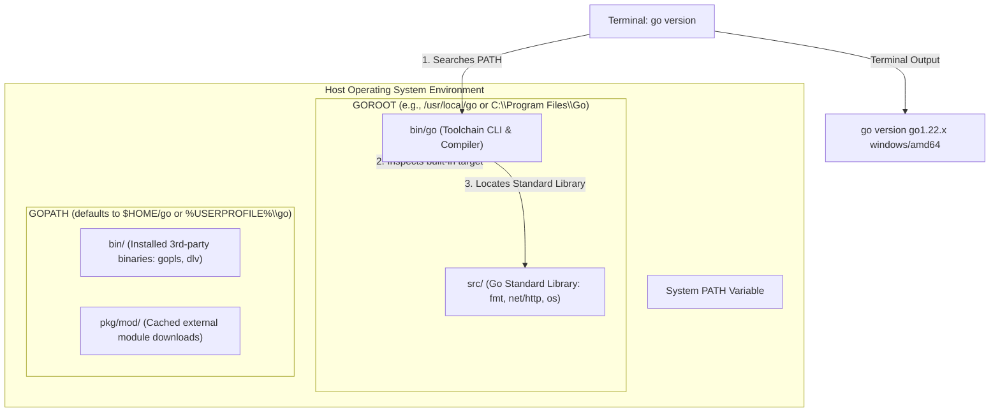

# Install and Verify Go

## Learning objective

By the end of this lesson, you will install Go on your system, verify it works with `go version`, and understand the basic Go environment variables (`GOROOT`, `GOPATH`, `GOOS`, `GOARCH`). You will demonstrate this by running a Go program that confirms your installation.

## Why this matters

Without a working Go installation, nothing else in this curriculum works. Every subsequent lesson depends on `go run`, `go build`, `go test`, and the rest of the toolchain. Verifying your installation now prevents confusion later when a tool fails not because of your code but because of a misconfigured environment.

## Mental model

Go is a compiled language. The `go` command is your gateway to the entire toolchain: it compiles, runs, tests, formats, and analyzes your code. Installing Go places this command and its supporting libraries on your system. The `GOROOT` and `GOPATH` environment variables tell Go where to find its own standard library and where to look for your projects.

## Visual model



## Core idea

Go's toolchain is a single binary (`go`) that provides every operation you need. Installing Go means placing this binary in your PATH so your terminal can find it. Verification means running `go version` and seeing a valid version string.

## Under the hood

The Go distribution contains:

- **`go`**: the main toolchain binary that provides `go run`, `go build`, `go test`, `go fmt`, `go vet`, and more
- **Standard library**: over 100 packages (like `fmt`, `net/http`, `encoding/json`) bundled with the installation
- **Tools**: `gopls` (language server), `dlv` (debugger), `staticcheck` (linter) — installed separately via `go install`

When you run `go version`, the binary prints its own version and the target operating system and architecture. This confirms both that Go is installed and that it can run on your machine.

## How Go uses it

The Go team releases two versions per year (e.g., Go 1.22 in February, Go 1.23 in August). Each release includes toolchain updates, standard library additions, and performance improvements. Running `go version` tells you exactly which release you have. The `GOROOT` environment variable (usually set by the installer) points to the directory containing the Go distribution. `GOPATH` defaults to `$HOME/go` on Unix or `%USERPROFILE%\go` on Windows and is where `go install` places compiled binaries.

## Go example

```go
package main

import (
	"fmt"
	"runtime"
	"strings"
)

// EnvironmentInfo captures essential runtime details about the Go installation.
type EnvironmentInfo struct {
	Version  string
	GOOS     string
	GOARCH   string
	Compiler string
	NumCPU   int
	GOROOT   string
}

// GetEnvironmentInfo extracts active Go runtime and system metadata.
func GetEnvironmentInfo() EnvironmentInfo {
	return EnvironmentInfo{
		Version:  runtime.Version(),
		GOOS:     runtime.GOOS,
		GOARCH:   runtime.GOARCH,
		Compiler: runtime.Compiler,
		NumCPU:   runtime.NumCPU(),
		GOROOT:   runtime.GOROOT(),
	}
}

// VerifyInstallation checks whether the environment is properly configured.
func VerifyInstallation(info EnvironmentInfo) (bool, []string) {
	var issues []string

	if !strings.HasPrefix(info.Version, "go") && !strings.HasPrefix(info.Version, "devel") {
		issues = append(issues, "invalid Go version prefix detected")
	}
	if info.GOOS == "" {
		issues = append(issues, "target operating system (GOOS) is undefined")
	}
	if info.GOARCH == "" {
		issues = append(issues, "target architecture (GOARCH) is undefined")
	}
	if info.NumCPU <= 0 {
		issues = append(issues, "logical CPU count must be greater than zero")
	}

	return len(issues) == 0, issues
}

func main() {
	fmt.Println("=== Go Installation & Environment Diagnostics ===")

	info := GetEnvironmentInfo()
	fmt.Printf("Go Version:           %s\n", info.Version)
	fmt.Printf("Target OS (GOOS):     %s\n", info.GOOS)
	fmt.Printf("Target Arch (GOARCH): %s\n", info.GOARCH)
	fmt.Printf("Compiler:             %s\n", info.Compiler)
	fmt.Printf("Logical CPUs:         %d\n", info.NumCPU)
	if info.GOROOT != "" {
		fmt.Printf("GOROOT Directory:     %s\n", info.GOROOT)
	} else {
		fmt.Printf("GOROOT Directory:     (standard embedded default)\n")
	}

	ok, issues := VerifyInstallation(info)
	if !ok {
		fmt.Println("\nConfiguration Issues Detected:")
		for _, issue := range issues {
			fmt.Printf("  - %s\n", issue)
		}
		return
	}

	fmt.Println("\nStatus: Go toolchain installation is verified and ready for Module 02.")
}
```

This diagnostic program inspects the active Go toolchain directly from within the runtime:
- `runtime.Version()` retrieves the exact compiler release string (e.g., `go1.22.0`).
- `runtime.GOOS` and `runtime.GOARCH` identify the compilation target (e.g., `windows/amd64` or `linux/arm64`).
- `runtime.Compiler` reveals the active compiler backend (`gc` for the standard Go compiler).
- `runtime.GOROOT()` returns the root directory containing the standard library and toolchain files.
- `VerifyInstallation()` validates the operational sanity of the environment.

## Step-by-step execution

1. **Download Go** from [go.dev/dl](https://go.dev/dl/) — choose the installer for your operating system.
2. **Run the installer** and follow the default settings. The installer adds Go to your PATH automatically.
3. **Open a new terminal** (or restart your current one) so the PATH update takes effect.
4. **Run `go version`**. Confirm that a valid version string is returned.
5. **Run the example and test suite**:
   ```bash
   go run .
   go test -v .
   ```

## Common mistakes

- **Installing Go but not restarting the terminal**: The installer updates PATH, but your current terminal session does not see the change. Close and reopen your terminal.
- **Installing Go without admin rights on Windows**: The Windows installer may fail silently. Run the installer as Administrator.
- **Running `go version` from the wrong directory**: `go version` works from any directory — it does not need a Go project. If it fails, Go is not in your PATH.
- **Confusing `GOROOT` and `GOPATH`**: `GOROOT` points to the Go installation; `GOPATH` points to your Go workspace. Do not change `GOROOT` unless you installed Go to a non-default location.

## Debugging walkthrough

**Scenario**: You run `go version` and see `'go' is not recognized as an internal or external command`.

1. Check whether Go is installed at the default path: look for `C:\Go\bin\go.exe` (Windows) or `/usr/local/go/bin/go` (macOS/Linux).
2. If the file exists, add it to your PATH manually:
   - Windows: `setx PATH "%PATH%;C:\Go\bin"` then restart your terminal.
   - macOS/Linux: add `export PATH=$PATH:/usr/local/go/bin` to `~/.bashrc` or `~/.zshrc`.
3. If the file does not exist, re-run the installer from [go.dev/dl](https://go.dev/dl/).
4. Run `go version` again to confirm.

## Production notes

- CI/CD pipelines install Go via the official setup-go action (GitHub Actions) or equivalent. They never use `GOPATH`-based workflows — everything uses Go modules.
- Production Go versions should match the `go` directive in your `go.mod` file. Mixing versions between development and CI causes subtle build differences.
- Always pin your Go version in CI (e.g., `go 1.22.x`), never use `latest`.

## Performance implications

- A fresh Go installation uses approximately 300-500 MB of disk space (standard library + toolchain).
- Compilation from a clean module is slower on the first build because the module cache is empty. Subsequent builds are nearly instant for unchanged packages.
- The `go` binary itself is about 15-20 MB. It is statically linked and has no external dependencies.

## Practice task

1. Open a terminal and run `go version`. Write down the output.
2. Run `go env GOROOT GOPATH GOOS GOARCH` and record each value.
3. Run `go run .` from this lesson directory and confirm the program prints the expected message.

## Tests / verification

Run each command and confirm the output matches what you expect:

```bash
go version
go env GOROOT GOPATH GOOS GOARCH
go run .
```

Expected `go version` output is a version string like `go version go1.22.0 windows/amd64`. The `go env` command prints each variable on its own line. `go run .` should print the two-line confirmation message.

## Review questions

1. What does `go version` tell you about your Go installation?
2. What is the difference between `GOROOT` and `GOPATH`?
3. Why do you need to restart your terminal after installing Go?
4. What happens if Go is not in your PATH when you run `go version`?
5. What three pieces of information appear in a `go version` output string?

## NEXT UP

[Hello World](../02-hello-world/README.md) — write and run your first Go program.
