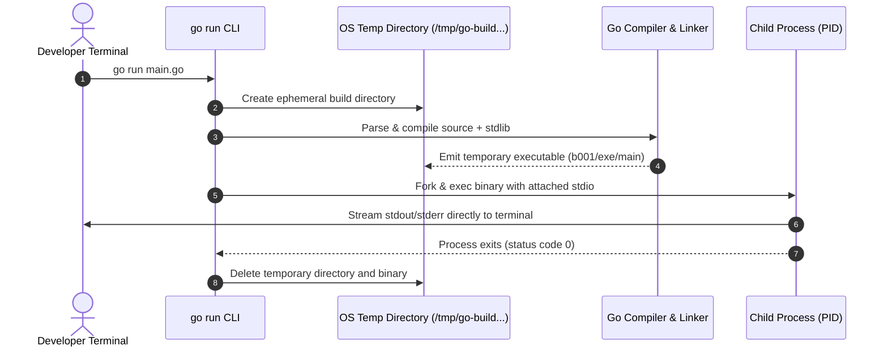

# go run

## Learning objective

By the end of this lesson, you will understand what `go run` does, when to use it, and how it differs from `go build`. You will use `go run` to execute Go programs without producing a permanent binary.

## Why this matters

`go run` is the fastest way to execute a Go program during development. You write code, run it, see output, and iterate. No separate compile step, no binary to clean up. Every Go developer uses `go run` dozens of times per day during the edit-run-debug cycle.

## Mental model

`go run` is like a REPL for compiled languages — it takes your source file, compiles it in a temp directory, runs the result, and cleans up. The source file remains; the binary disappears. Think of it as "compile, execute, forget."

## Visual model



## Core idea

`go run` compiles a Go package and immediately executes the resulting binary, then discards it. It is the fastest feedback loop for Go development.

## Under the hood

When you run `go run main.go`, Go:

1. Creates a temporary directory.
2. Compiles the source files into a binary in that temp directory.
3. Executes the binary with stdout and stderr connected to your terminal.
4. Deletes the temp directory and binary after execution completes.

The binary name is a random hash — you never see it. The entire cycle happens in milliseconds for small programs.

## How Go uses it

The Go standard library uses `go run` extensively in its own development. The `go tool` subcommands (like `go test`, `go build`) are themselves Go programs that are run during development. The `go run` command accepts file paths, package paths, and module patterns:

- `go run main.go` — run a single file
- `go run .` — run the package in the current directory
- `go run ./cmd/server` — run a package in a subdirectory

## Go example

```go
package main

import (
	"fmt"
	"os"
	"path/filepath"
	"strings"
)

// ExecutionMetadata stores details about how the binary was executed.
type ExecutionMetadata struct {
	ExecutablePath string
	IsTemporary    bool
	Directory      string
	Filename       string
}

// InspectExecution determines if the program is running from a temporary build directory.
func InspectExecution() (ExecutionMetadata, error) {
	execPath, err := os.Executable()
	if err != nil {
		return ExecutionMetadata{}, err
	}

	cleanPath := filepath.Clean(execPath)
	dir := filepath.Dir(cleanPath)
	file := filepath.Base(cleanPath)

	// "go run" places compiled binaries in a temporary build directory (e.g. go-build or OS Temp)
	tempDir := os.TempDir()
	isTemp := strings.Contains(cleanPath, "go-build") || strings.HasPrefix(cleanPath, tempDir)

	return ExecutionMetadata{
		ExecutablePath: cleanPath,
		IsTemporary:    isTemp,
		Directory:      dir,
		Filename:       file,
	}, nil
}

func main() {
	fmt.Println("=== Deconstructing 'go run' Execution ===")

	meta, err := InspectExecution()
	if err != nil {
		fmt.Fprintf(os.Stderr, "Failed to inspect executable: %v\n", err)
		os.Exit(1)
	}

	fmt.Printf("Active Executable Path: %s\n", meta.ExecutablePath)
	fmt.Printf("Binary Filename:        %s\n", meta.Filename)
	fmt.Printf("Directory Location:     %s\n", meta.Directory)
	fmt.Printf("Is Temporary Build Dir: %t\n", meta.IsTemporary)

	if meta.IsTemporary {
		fmt.Println("\nInsight: 'go run' compiled this code into a temporary binary and executed it directly.")
		fmt.Println("When this process exits, the temporary directory will be cleaned up.")
	} else {
		fmt.Println("\nInsight: Running from a persistent compiled binary on disk.")
	}
}
```

This program removes the magic from `go run` by interrogating its own active executable at runtime:
- `os.Executable()` resolves the exact path to the executing binary.
- When invoked via `go run .`, the path points directly inside a temporary compiler scratch directory (e.g., `AppData\Local\Temp\go-build...` on Windows or `/tmp/go-build...` on Linux/macOS).
- The binary is completely deleted by the Go toolchain immediately after process exit.

## Step-by-step execution

1. Run the lesson via `go run`:
   ```bash
   go run .
   ```
   Notice that `Is Temporary Build Dir` outputs `true`.
2. Run the automated unit tests:
   ```bash
   go test -v .
   ```
3. Run `go build .` followed by executing `./03-go-run` directly — observe how `Is Temporary Build Dir` switches to `false`.

## Common mistakes

- **Using `go run` for production**: `go run` produces no permanent binary. For production, use `go build` and deploy the resulting executable.
- **Running `go run main.go` when there are multiple files**: If the directory has multiple `.go` files, `go run main.go` only compiles that one file. If `main.go` references functions in other files, compilation fails. Use `go run .` instead.
- **Forgetting that `go run` recompiles every time**: Unlike `go test` which caches results, `go run` always recompiles. For large programs, this adds startup time. Use `go build` + run the binary for repeated executions.

## Debugging walkthrough

**Scenario**: `go run .` produces `package main is not a main package`.

1. Check that one file in the directory has `func main()`. You can only have one `main` function per package.
2. Check that the file with `func main()` is in `package main` (not `package foo`).
3. Run `go run main.go` explicitly if you know which file contains `main`.

## Production notes

- Never use `go run` in CI/CD pipelines. Always use `go build` and run the binary explicitly.
- `go run` is ideal for small CLI tools, one-off scripts, and exploratory coding.
- The `-race` flag works with `go run`: `go run -race .` compiles and runs with the race detector enabled.

## Performance implications

- `go run` recompiles every time — no cache reuse. For a tiny program this is instant; for a large module it adds 1-3 seconds.
- The temporary binary is compiled with debug symbols and no optimizations (like `go build` without flags).
- `go run -count=1 .` is redundant — `go run` never caches.

## Practice task

1. Run `go run .` from this lesson directory.
2. Change the message to something personal and run `go run .` again.
3. Time how long it takes from pressing Enter to seeing output.

## Tests / verification

```bash
go run .
```

Expected output:
```
Running with go run
This program was compiled and executed in one step.
```

After your modification, the output should reflect your new message.

## Review questions

1. What happens to the binary after `go run` finishes?
2. Why should you use `go build` instead of `go run` for production?
3. What is the difference between `go run main.go` and `go run .`?
4. Does `go run` cache compiled results like `go test`?
5. What flag would you add to `go run` to enable the race detector?

## NEXT UP

[go build](../04-go-build/README.md) — compile Go programs into standalone binaries.
