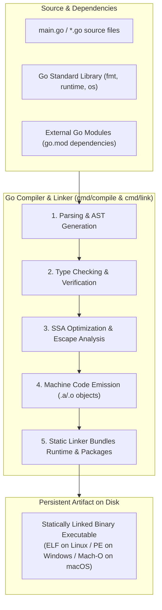

# go build

## Learning objective

By the end of this lesson, you will understand how `go build` compiles Go source into a standalone binary, know the difference between `go build` and `go run`, and be able to produce a binary you can share and deploy.

## Why this matters

`go build` is how you ship Go software. Every binary you distribute — CLI tools, web servers, worker processes — starts with `go build`. Unlike `go run` which compiles and discards, `go build` produces a permanent executable you can run, share, and deploy.

## Mental model

`go build` is like `go run` without the run step — it compiles your source into a binary and saves it to disk. The binary is self-contained: statically linked, no external dependencies, and ready to run on any machine with the same operating system and architecture.

## Visual model



## Core idea

`go build` produces a standalone executable binary from your Go source code. Unlike interpreted languages, Go compiles everything — your code, the standard library, and any dependencies — into a single binary with no runtime or VM required.

## Under the hood

`go build` invokes the Go compiler (`cmd/compile`) which:

1. Parses all `.go` files in the package into an AST.
2. Type-checks every declaration and expression.
3. Applies optimizations (inlining, escape analysis, dead code elimination).
4. Emits machine code via SSA (Static Single Assignment) form.
5. Links the compiled object files with the Go runtime and any dependent packages into a single executable.

The result is a native binary for your OS and architecture.

## How Go uses it

The Go toolchain itself is built with `go build`. Standard build variations:

- `go build .` — produces a binary named after the current directory
- `go build -o myapp .` — names the output binary
- `go build -ldflags="-s -w" .` — strips debug info for a smaller binary
- `GOOS=linux GOARCH=amd64 go build .` — cross-compiles for a different platform

## Go example

```go
package main

import (
	"fmt"
	"os"
	"path/filepath"
	"runtime"
)

// Injected via -ldflags during build (e.g. -ldflags="-X main.Version=v1.0.0")
var Version = "dev"

// BinaryInfo holds characteristics of the compiled binary.
type BinaryInfo struct {
	Name      string
	Path      string
	SizeBytes int64
	GOOS      string
	GOARCH    string
	Version   string
}

// GetBinaryInfo inspects the currently running compiled binary on disk.
func GetBinaryInfo() (BinaryInfo, error) {
	execPath, err := os.Executable()
	if err != nil {
		return BinaryInfo{}, err
	}

	info, err := os.Stat(execPath)
	if err != nil {
		return BinaryInfo{}, err
	}

	return BinaryInfo{
		Name:      filepath.Base(execPath),
		Path:      execPath,
		SizeBytes: info.Size(),
		GOOS:      runtime.GOOS,
		GOARCH:    runtime.GOARCH,
		Version:   Version,
	}, nil
}

// FormatBinaryReport returns a human-readable summary of the binary.
func FormatBinaryReport(b BinaryInfo) string {
	return fmt.Sprintf(
		"Binary: %s\nTarget: %s/%s\nVersion: %s\nSize: %.2f KB (%d bytes)",
		b.Name,
		b.GOOS,
		b.GOARCH,
		b.Version,
		float64(b.SizeBytes)/1024.0,
		b.SizeBytes,
	)
}

func main() {
	fmt.Println("=== Deconstructing 'go build' Standalone Binary ===")

	b, err := GetBinaryInfo()
	if err != nil {
		fmt.Fprintf(os.Stderr, "Error inspecting binary: %v\n", err)
		os.Exit(1)
	}

	fmt.Println(FormatBinaryReport(b))
	fmt.Println("\nInsight: 'go build' emits a self-contained, statically linked binary executable.")
	fmt.Println("It requires no external Go runtime on the host machine to execute.")
}
```

This program highlights how `go build` packages code into a statically linked artifact:
- **Build-Time Metadata Injection (`-ldflags`)**: The `Version` string can be mutated at link time without altering source code via `-ldflags="-X main.Version=v1.2.3"`.
- **Target OS/Arch Embeddings**: Stored in the binary header and inspectable via `runtime.GOOS` / `runtime.GOARCH`.
- **Binary Footprint**: Quantifies the static runtime and compiled standard library footprint.

## Step-by-step execution

1. Compile the program into a persistent local binary:
   ```bash
   go build -o app .
   ```
2. Execute the standalone executable:
   ```bash
   ./app
   ```
3. Test version injection via linker flags:
   ```bash
   go build -ldflags="-X main.Version=v2.0.0" -o app-v2 .
   ./app-v2
   ```
4. Run the automated unit tests:
   ```bash
   go test -v .
   ```

## Common mistakes

- **Running the binary from a different directory**: The binary is placed in the current directory. If you run `go build ./cmd/server`, the binary is placed in the current directory, not in `./cmd/server/`.
- **Confusing `go build` with `go install`**: `go build` places the binary in the current directory. `go install` places it in `$GOPATH/bin` or `$GOBIN`.
- **Forgetting cross-compilation requires CGO disabled**: `CGO_ENABLED=0 GOOS=linux GOARCH=amd64 go build .` produces a fully static Linux binary. If CGO is enabled and you use C libraries, cross-compilation may fail.

## Debugging walkthrough

**Scenario**: `go build .` succeeds but the binary does nothing when run.

1. Ensure your `main()` function is not empty and does not exit immediately.
2. Check that stdout is connected — if running in a terminal, it should be.
3. Run the binary with `-v` or `--version` flags if your program parses flags — missing flags may cause silent exit.

**Scenario**: Cross-compilation fails with `cgo: C compiler "gcc" not found`.

1. Set `CGO_ENABLED=0` before cross-compiling: `CGO_ENABLED=0 GOOS=linux go build .`
2. If you need CGO for cross-compilation, install a cross-compiler for the target platform.

## Production notes

- Always use `go build -ldflags="-s -w"` in CI/CD to produce smaller production binaries (reduces size by ~30%).
- Set the `-o` flag in CI to control the output path: `go build -o bin/myapp .`
- Embed version info at build time: `go build -ldflags="-X main.version=$(git describe)" .`
- Production Docker images use multi-stage builds: build with `go build` in one stage, copy the binary to a minimal `scratch` or `alpine` image.

## Performance implications

- A minimal Go binary is about 1.5 MB — most of this is the Go runtime, not your code.
- Stripping debug symbols (`-ldflags="-s -w"`) reduces binary size by ~30%.
- Cross-compilation produces binaries that run without any runtime or VM on the target system.
- Go binaries are statically linked by default — no libc dependency on Linux when CGO is disabled.

## Practice task

1. Run `go build .` and note the binary name and size.
2. Run the binary directly from your terminal.
3. Build again with `-ldflags="-s -w"` and compare sizes.
4. Cross-compile for Linux: `GOOS=linux GOARCH=amd64 go build .` and verify the binary runs on Linux (or note that it cannot run on your current OS).

## Tests / verification

```bash
go build .
```

Then run the binary:
- Linux/macOS: `./04-go-build`
- Windows: `.\04-go-build.exe`

Expected output:
```
Built with go build
This is a standalone binary.
```

Verify no output from `go build .` itself — it produces a binary silently.

## Review questions

1. What is the difference between `go build` and `go run`?
2. Where does `go build` place the output binary?
3. How do you cross-compile a Go binary for Linux from Windows?
4. What does the `-ldflags="-s -w"` flag do?
5. Why are Go binaries statically linked by default?

## NEXT UP

[go test](../05-go-test/README.md) — run tests and verify your Go code.
