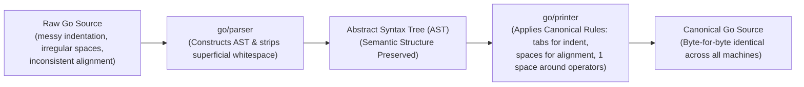

# gofmt

## Learning objective

By the end of this lesson, you will understand what `gofmt` does, why Go enforces a single formatting style, and how to use `gofmt` to format your code automatically.

## Why this matters

Formatting arguments waste time in code reviews. Go eliminates this entirely with `gofmt` — there is one official format, and every Go developer uses it. No tabs vs spaces debates, no brace-placement discussions. `gofmt` is not optional; it is part of the toolchain.

## Mental model

`gofmt` reads your Go source file, parses it into an AST, and prints the AST back out using Go's canonical formatting rules. If your code is valid Go, `gofmt` produces the same program with consistent indentation, spacing, and alignment.

## Visual model



## Core idea

`gofmt` formats Go source code according to a single, official standard. Every Go file should be formatted with `gofmt` before committing. The `go fmt` command (which calls `gofmt`) can format entire packages at once.

## Under the hood

`gofmt` uses the `go/parser` and `go/printer` packages from the standard library. It parses your source into an AST, discards all original whitespace and formatting, then prints the AST using Go's canonical layout rules. The result is byte-for-byte identical to what `gofmt` produces on any other machine running the same Go version.

## How Go uses it

The Go team runs `gofmt -l` on every pull request to the standard library. Any file not formatted correctly is rejected. Most editors run `gofmt` automatically on save via `gopls`. Key commands:

- `gofmt main.go` — prints the formatted file to stdout (does not change the file)
- `gofmt -w main.go` — writes the formatted file back in place
- `gofmt -l .` — lists files that are not formatted correctly
- `gofmt -d main.go` — shows a diff of what would change
- `go fmt ./...` — formats all packages in the module

## Go example

## Go example

```go
package main

import (
	"fmt"
	"go/format"
	"os"
)

// FormatSourceCode formats raw Go code bytes according to canonical gofmt rules.
func FormatSourceCode(src []byte) ([]byte, error) {
	return format.Source(src)
}

func main() {
	fmt.Println("=== Deconstructing 'gofmt' Engine (go/format) ===")

	// Deliberately poorly formatted Go source snippet
	unformattedSnippet := []byte(`package    main
import    "fmt"
func    Calculate(   x int,y int  )   int {
    sum:=x+y
        return sum
}`)

	fmt.Println("--- 1. Unformatted Source Input ---")
	fmt.Println(string(unformattedSnippet))

	formatted, err := FormatSourceCode(unformattedSnippet)
	if err != nil {
		fmt.Fprintf(os.Stderr, "Formatting error: %v\n", err)
		os.Exit(1)
	}

	fmt.Println("\n--- 2. Canonical gofmt Output ---")
	fmt.Println(string(formatted))

	fmt.Println("Insight: gofmt parses Go source into an Abstract Syntax Tree (AST)")
	fmt.Println("and re-emits it according to the language's official grammar specification.")
	fmt.Println("Result: Zero time wasted debating code formatting in code reviews.")
}
```

This program demystifies `gofmt` by invoking the exact same standard library package (`go/format`) that powers the CLI:
- `format.Source()` parses raw Go code bytes into an AST using `go/parser`.
- It recalculates column positions and indent levels, replacing arbitrary spaces with canonical tabs.
- It re-emits pure, standardized Go code with zero human intervention.

## Step-by-step execution

1. Execute the formatting demonstration:
   ```bash
   go run .
   ```
2. Run the automated unit tests:
   ```bash
   go test -v .
   ```
3. Test the official CLI tool:
   ```bash
   gofmt -d main.go
   gofmt -l .
   ```

## Common mistakes

- **Running `gofmt` without `-w` and wondering why the file did not change**: `gofmt` prints to stdout by default. Use `gofmt -w` to write changes back to the file.
- **Editing `gofmt`-formatted code by hand and breaking the style**: Let `gofmt` handle formatting. Write code for humans, let `gofmt` handle the machine-readable layout.
- **Running `gofmt` on generated files**: Some generated files (e.g., protobuf, stringer) are not meant to be reformatted. Add a `//go:generate` comment instead of running `gofmt` on them directly.

## Debugging walkthrough

**Scenario**: `gofmt main.go` prints nothing to stdout.

1. This means the file is already correctly formatted — no changes needed.
2. Check with `gofmt -l main.go` — it prints the filename only if the file needs formatting.

**Scenario**: `gofmt main.go` produces a parse error.

1. `gofmt` can only format valid Go. If you have a syntax error (missing brace, wrong import), fix the error first, then run `gofmt`.
2. The parse error `gofmt` gives is the same error `go build` would give. Use the line number to find and fix the syntax error.

## Production notes

- CI should run `gofmt -l .` and fail if any file needs formatting. Add this as a lint step before tests.
- Most teams add a pre-commit hook that runs `gofmt -w` on staged Go files.
- VS Code's Go extension runs `gofmt` on save by default. If it does not, check that `gopls` is configured with `"formatting.gofmt": true`.

## Performance implications

- `gofmt` runs in milliseconds per file. It is faster than any human could manually format code.
- Running `gofmt` on an entire module usually takes less than a second.
- `gofmt` does not modify the AST — it only changes whitespace. The compiled binary is identical before and after formatting.

## Practice task

1. Create a file called `messy.go` with deliberately bad formatting (tabs mixed with spaces, inconsistent indentation).
2. Run `gofmt -d messy.go` to preview the changes.
3. Run `gofmt -w messy.go` to fix the file.
4. Run `gofmt -l .` to verify no unformatted files remain.

## Tests / verification

```bash
gofmt -l .
```

If the directory contains only formatted files, this command prints nothing (exit 0). If any file needs formatting, it prints the filename.

```bash
go run .
```

Expected output:
```
gofmt formats your Go code
Consistent style across every Go file
```

## Review questions

1. What is the difference between `gofmt main.go` and `gofmt -w main.go`?
2. Why does Go enforce a single formatting style instead of letting teams choose?
3. How does `gofmt` differ from `go fmt`?
4. What does `gofmt -l .` do?
5. What happens if you run `gofmt` on a file with a syntax error?

## NEXT UP

[go vet](../07-go-vet/README.md) — detect suspicious code patterns that compile but may be wrong.
