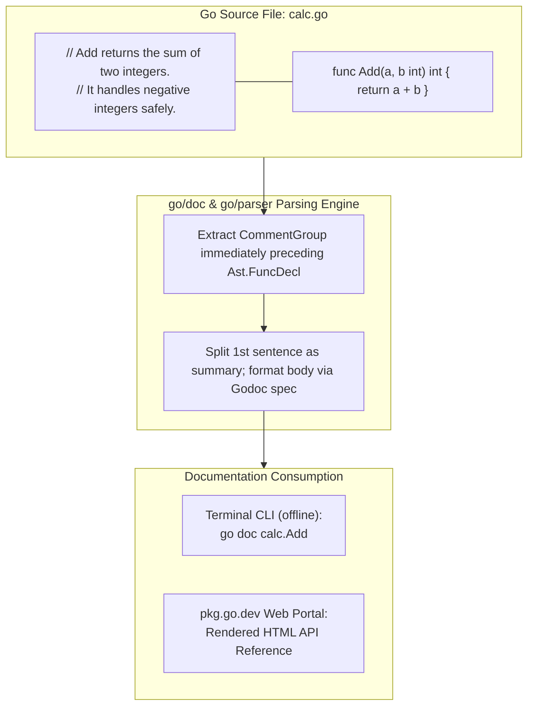

# go doc

## Learning objective

By the end of this lesson, you will understand how to use `go doc` to read documentation from the terminal, how to write doc comments for your own code, and how to verify that your doc comments appear correctly.

## Why this matters

Documentation is useless if it is hard to access. `go doc` puts documentation at your fingertips without leaving the terminal. Every Go developer uses `go doc` constantly to check function signatures, understand package behavior, and verify their own doc comments render correctly.

## Mental model

`go doc` reads doc comments from Go source files and displays them in the terminal. A doc comment is a plain text comment immediately preceding a top-level declaration (package, function, type, const, var). The first sentence becomes the short summary; the full comment body is the detailed documentation.

## Visual model



## Core idea

`go doc` extracts and displays documentation from Go source files without compiling. It works offline and is always available. Writing a doc comment above any exported declaration makes that documentation accessible via `go doc`.

## Under the hood

`go doc` parses Go source files using the `go/parser` and `go/ast` packages from the standard library. It extracts doc comments attached to top-level declarations. The formatting follows the Godoc format rules: indented lines are code blocks, blank lines separate paragraphs, and the first sentence is extracted as a short summary by tools like `pkg.go.dev`.

## How Go uses it

The entire Go standard library is documented via doc comments. The convention is:

- Package comments start with `// Package <name>` — e.g., `// Package fmt implements formatted I/O.`
- Function comments start with the function name — e.g., `// Println formats using the default formats for its operands.`
- Exported types, consts, and vars should all have doc comments.

Key commands:
- `go doc fmt` — documentation for the `fmt` package
- `go doc fmt.Println` — documentation for `Println`
- `go doc .` — documentation for the current package
- `go doc Add` — documentation for the `Add` function in the current package

## Go example

```go
// Package main demonstrates the conventions and mechanics of Go doc comments.
//
// Go's documentation tool ('go doc') extracts comments directly from the Abstract
// Syntax Tree without requiring external annotations, HTML tags, or separate markdown files.
// Every exported symbol should have a comment beginning with its own name.
package main

import (
	"fmt"
	"strings"
)

// Calculator provides basic arithmetic operations with clear documentation contracts.
type Calculator struct {
	Base int
}

// Add computes and returns the sum of the base value and the given integer parameter n.
// It does not mutate the receiver.
func (c Calculator) Add(n int) int {
	return c.Base + n
}

// CleanDocString normalizes raw comment lines for terminal display.
func CleanDocString(comment string) string {
	lines := strings.Split(comment, "\n")
	var cleaned []string
	for _, line := range lines {
		trimmed := strings.TrimSpace(strings.TrimPrefix(line, "//"))
		if trimmed != "" {
			cleaned = append(cleaned, trimmed)
		}
	}
	return strings.Join(cleaned, " ")
}

func main() {
	fmt.Println("=== Deconstructing 'go doc' Documentation Engine ===")

	calc := Calculator{Base: 10}
	result := calc.Add(5)
	fmt.Printf("Calculation: 10 + 5 = %d\n\n", result)

	sampleComment := `// Add computes and returns the sum of the base value.
// It does not mutate the receiver.`

	fmt.Println("--- Doc Comment Parsing Demonstration ---")
	fmt.Println("Raw Doc Comment in Source:")
	fmt.Println(sampleComment)
	fmt.Println("\nCleaned Doc Summary (as shown by 'go doc'):")
	fmt.Printf("  %s\n", CleanDocString(sampleComment))

	fmt.Println("\nInsight: In Go, documentation is code. Run 'go doc' on any package or symbol")
	fmt.Println("to read instantaneous, offline documentation formatted directly from source.")
}
```

This program implements the canonical Go doc comment conventions:
- **Package Comments**: Precedes `package main` without an intervening blank line. Starts with `// Package <name> ...`.
- **Symbol Comments**: Precedes `type Calculator` and `func (c Calculator) Add` starting explicitly with the symbol's name.
- **Pure Go**: Extracts and displays clean human-readable documentation without any HTML or external pre-processors.

## Step-by-step execution

1. Execute the doc parser demonstration:
   ```bash
   go run .
   ```
2. Run the automated unit tests:
   ```bash
   go test -v .
   ```
3. Use the built-in Go documentation reader on this package and standard library:
   ```bash
   go doc .
   go doc Calculator.Add
   go doc fmt.Println
   ```

## Common mistakes

- **Running `go doc fmt.Println` with wrong capitalization**: Go identifiers are case-sensitive. `go doc fmt.println` (lowercase p) finds nothing. Use `go doc fmt.Println` (capital P).
- **Placing a blank line between the comment and the declaration**: A doc comment must immediately precede the declaration. A blank line between them disconnects the comment from the declaration.
- **Not writing package-level doc comments**: A package comment (right above `package main`) provides the overview. Without it, `go doc .` shows nothing useful.
- **Writing comments that repeat the obvious**: `// Add returns the sum of two integers.` is useful. `// Add is a function that adds things.` is not.

## Debugging walkthrough

**Scenario**: `go doc Add` returns no output even though a comment exists above `Add`.

1. Check that the comment is directly above the `func Add` line with no blank line between them.
2. Check that `Add` is exported (capital A). Unexported functions do not show in `go doc`.
3. Run `go doc .` to see all exported declarations and their docs in one view.

## Production notes

- Every exported declaration in a production Go package should have a doc comment.
- Package-level doc comments are the first thing a new user sees — invest time in writing them well.
- `gopls` shows doc comments on hover in your editor. Writing good docs improves your own development experience.

## Performance implications

- `go doc` is instant — it reads source files directly without compiling.
- Well-documented code is faster to onboard into, reducing the time to understand unfamiliar packages.
- Running `go doc` requires no internet access — it works fully offline for any installed package.

## Practice task

1. Run `go doc .` and `go doc Add` from this lesson directory.
2. Run `go doc fmt` and `go doc fmt.Sprintf` to see standard library docs.
3. Add a doc comment to the `main` function and verify it with `go doc main`.
4. Add a package-level doc comment above `package main` and verify with `go doc .`.

## Tests / verification

```bash
go run .
```
Expected output: `7`

```bash
go doc Add
```
Expected output:
```
Add returns the sum of two integers.
```

## Review questions

1. What is the format of a Go doc comment?
2. Why must a doc comment have no blank line between it and the declaration?
3. What is the difference between `go doc fmt` and `go doc fmt.Println`?
4. Why does `go doc println` find nothing?
5. What happens if you run `go doc` on an unexported function?

## NEXT UP

[Editor setup and gopls](../09-editor-setup-and-gopls/README.md) — configure your editor for Go development with gopls.
