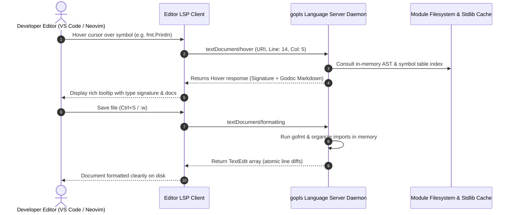

# Editor Setup and gopls

## Learning objective

By the end of this lesson, you will have `gopls` installed, your editor configured for Go development, and you will use editor features like completion, hover documentation, and go-to-definition.

## Why this matters

A text editor without a language server is just a typewriter. `gopls` transforms your editor into a full-featured Go IDE with real-time feedback — errors underlined as you type, completions when you press `.`, documentation on hover, and instant navigation to definitions. This real-time feedback accelerates learning by showing you mistakes immediately.

## Mental model

`gopls` is the brain behind your Go editor. It reads your Go source files, builds an in-memory model of your codebase, and responds to editor requests (hover, go-to-definition, completion) via the Language Server Protocol (LSP). Your editor is the display; `gopls` is the intelligence.

## Visual model



## Core idea

`gopls` (Go Language Server) provides IDE features for any editor that supports the Language Server Protocol. It is developed by the Go team and is the official Go language server. Install it once, and every LSP-compatible editor gets the same high-quality Go experience.

## Under the hood

`gopls` implements the Language Server Protocol (LSP) — a JSON-RPC protocol for editor communication. It parses the module's Go files, resolves imports, builds a type-checked AST, and maintains a cache of symbols and their locations. When you hover over a symbol, `gopls` looks up its doc comment; when you go-to-definition, it returns the file, line, and column of the declaration. `gopls` also runs `gofmt` on save and provides diagnostics (errors and warnings) as you type.

## How Go uses it

The Go team develops `gopls` as the official language server. It powers all Go editor integrations. Key features:

- **Completion**: suggests symbols, methods, and keywords as you type
- **Hover documentation**: shows the doc comment for any symbol
- **Go-to-definition**: navigates to the declaration of any symbol
- **References**: finds all usages of a symbol
- **Rename**: renames a symbol across all files
- **Diagnostics**: shows compiler errors and vet warnings inline
- **Formatting**: runs `gofmt` on save

Installation: `go install golang.org/x/tools/gopls@latest`

## Go example

```go
package main

import (
	"encoding/json"
	"fmt"
)

// LSPRequest models a JSON-RPC request sent by an editor to the gopls language server.
type LSPRequest struct {
	JSONRPC string `json:"jsonrpc"`
	ID      int    `json:"id"`
	Method  string `json:"method"`
	Params  struct {
		URI      string `json:"uri"`
		Position struct {
			Line      int `json:"line"`
			Character int `json:"character"`
		} `json:"position"`
	} `json:"params"`
}

// LSPResponse models a JSON-RPC response returned by gopls to the editor.
type LSPResponse struct {
	JSONRPC string      `json:"jsonrpc"`
	ID      int         `json:"id"`
	Result  interface{} `json:"result,omitempty"`
	Error   string      `json:"error,omitempty"`
}

// HoverResult represents hover documentation sent back to the editor tooltip.
type HoverResult struct {
	Contents string `json:"contents"`
}

// LocationResult represents the target file and coordinates for 'Go to Definition' (F12).
type LocationResult struct {
	URI  string `json:"uri"`
	Line int    `json:"line"`
}

// HandleLSPRequest simulates how gopls answers editor queries over JSON-RPC.
func HandleLSPRequest(req LSPRequest) LSPResponse {
	resp := LSPResponse{
		JSONRPC: "2.0",
		ID:      req.ID,
	}

	switch req.Method {
	case "textDocument/hover":
		resp.Result = HoverResult{
			Contents: "func Println(a ...any) (n int, err error)\nPackage fmt: Println formats using default formats.",
		}
	case "textDocument/definition":
		resp.Result = LocationResult{
			URI:  "file:///usr/local/go/src/fmt/print.go",
			Line: 285,
		}
	default:
		resp.Error = fmt.Sprintf("method not supported: %s", req.Method)
	}

	return resp
}

func main() {
	fmt.Println("=== Deconstructing 'gopls' Language Server Protocol (LSP) ===")

	// Simulating an editor requesting hover information on 'fmt.Println'
	hoverReq := LSPRequest{
		JSONRPC: "2.0",
		ID:      1,
		Method:  "textDocument/hover",
	}
	hoverReq.Params.URI = "file:///project/main.go"
	hoverReq.Params.Position.Line = 10
	hoverReq.Params.Position.Character = 6

	resp := HandleLSPRequest(hoverReq)
	rawJSON, _ := json.MarshalIndent(resp, "", "  ")

	fmt.Println("1. Editor -> gopls: JSON-RPC request for 'textDocument/hover'")
	fmt.Println("2. gopls parses AST, type-checks symbols, and replies:")
	fmt.Println(string(rawJSON))

	fmt.Println("\nInsight: gopls is a standalone background daemon communicating via JSON-RPC.")
	fmt.Println("It decouples language intelligence from the editor, powering VS Code, Neovim, and Zed equally.")
}
```

This program removes the magic from modern editor tooling by modeling the **Language Server Protocol (LSP)**:
- Editors (VS Code, Zed, Neovim) do not have built-in Go compilers; they communicate with a background daemon (`gopls`) over standard JSON-RPC.
- When you hover over a symbol, the editor dispatches a `textDocument/hover` event.
- When you press F12 ("Go to Definition"), the editor dispatches `textDocument/definition` with document URI and cursor line/column coordinates.

## Step-by-step execution

1. Run the LSP simulation:
   ```bash
   go run .
   ```
2. Run the automated unit tests:
   ```bash
   go test -v .
   ```
3. Check your system's installed `gopls` version:
   ```bash
   gopls version
   ```

## Common mistakes

- **Installing the editor extension without installing `gopls`**: The extension is just a UI — it needs `gopls` as a backend. Install `gopls` first, then the extension.
- **Running an outdated `gopls`**: `gopls` is updated frequently. Run `go install golang.org/x/tools/gopls@latest` periodically to get the latest features and fixes.
- **Assuming the editor catches all errors**: `gopls` shows compiler errors, but it may not catch all runtime issues. Always run `go vet` and `go test` before committing.
- **Disabling `gopls` because it feels slow on first start**: The first load indexes the entire module and takes 2-10 seconds. Subsequent changes are near-instant.

## Debugging walkthrough

**Scenario**: The editor shows `gopls: no packages found` for every file.

1. Ensure the module has a `go.mod` file. Run `go mod init <module-name>` in the module root if it does not.
2. Ensure you opened the workspace root (the directory containing `go.mod`), not a subdirectory.
3. Reload the window after creating `go.mod`.

**Scenario**: `gopls` and `go build` show different errors.

1. Check the `gopls` version: `gopls version`. Update if outdated.
2. Check that your editor's Go version matches your terminal's Go version: `go version` in both.
3. Restart the language server: in VS Code, run `Go: Restart Language Server` from the command palette.

## Production notes

- Most teams pin the `gopls` version in their development tooling configuration.
- VS Code settings should include `"go.useLanguageServer": true` and `"gopls": { "analyses": { "unusedparams": true } }` for additional checks.
- `gopls` memory usage is typically 100-300 MB for a medium-sized module. This is normal.

## Performance implications

- `gopls` indexes the module on first open, taking 2-10 seconds for large modules.
- Incremental updates after the initial index are sub-second.
- `gopls` watches file changes and re-indexes only modified files.

## Practice task

1. Verify `gopls` is installed with `gopls version`.
2. Open the `main.go` file from this lesson in your editor.
3. Hover over `fmt.Println` and read the documentation.
4. Place your cursor on `Println` and use go-to-definition (Ctrl+click or F12).
5. Type `fmt.` and observe the completion list.
6. Add a syntax error and watch the diagnostic appear.

## Tests / verification

```bash
gopls version
```

Expected output: a version string like `golang.org/x/tools/gopls v0.16.0`

```bash
go run .
```

Expected output:
```
gopls is the Go language server.
It powers your editor's Go features.
```

Verify with your editor that hover, completion, and diagnostics all work on the `main.go` file.

## Review questions

1. What is `gopls` and what problem does it solve?
2. What protocol does `gopls` use to communicate with editors?
3. How do you install or update `gopls`?
4. Why might your editor show different diagnostics than `go build`?
5. What should you do if `gopls` shows "no packages found"?

## NEXT UP

[Reading compiler errors](../10-reading-compiler-errors/README.md) — understand and fix Go compiler error messages.
