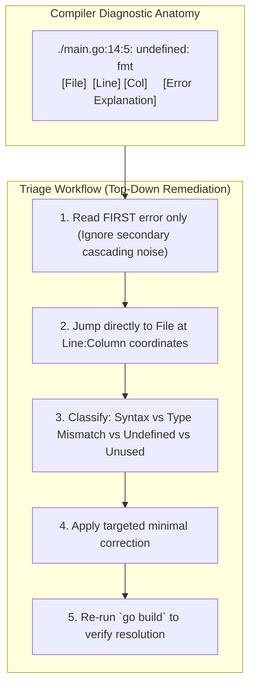

# Reading Compiler Errors

## Learning objective

By the end of this lesson, you will be able to read Go compiler error messages, identify the file, line, column, and error type, and fix common compile errors without guessing.

## Why this matters

Compiler errors are the most frequent feedback you will get as a Go developer. New developers see them as obstacles; experienced developers see them as information. Learning to read error messages systematically turns compile errors from frustration into a fast feedback mechanism.

## Mental model

Go's compiler produces error messages with a consistent format: `file:line:col: error message`. The first error is usually the real cause; later errors are often cascading effects. Fix errors from top to bottom.

## Visual model



## Core idea

Every Go compiler error includes three pieces of information: where (file and line number), what column (precise character position), and why (the error message). Reading all three tells you exactly what to fix.

## Under the hood

Go's compiler (`cmd/compile`) parses source into tokens, builds an AST, performs type checking, and generates machine code via SSA. Errors are collected during each phase. The error format `file:line:col` is produced by the compiler's base position information, which tracks source locations through every transformation.

## How Go uses it

Go's compiler is designed to produce clear, actionable error messages. Starting with Go 1.20, many error messages include suggested fixes. Common error patterns:

- **Syntax errors**: `expected ';', found 'if'` — a structural problem in the code
- **Type errors**: `cannot use str (type string) as type int in argument to add` — wrong type passed
- **Undeclared name**: `undefined: fmt` — package not imported or name misspelled
- **Unused variable**: `x declared and not used` — variable declared but never read

## Go example

```go
package main

import (
	"fmt"
	"strconv"
	"strings"
)

// CompilerError represents a structured Go compile-time error.
type CompilerError struct {
	File     string
	Line     int
	Col      int
	Message  string
	Category string
}

// ParseCompilerError decodes the standard Go compiler diagnostic format: file:line:col: message
func ParseCompilerError(raw string) (CompilerError, error) {
	parts := strings.SplitN(raw, ":", 4)
	if len(parts) < 4 {
		return CompilerError{}, fmt.Errorf("invalid compiler error format: %s", raw)
	}

	file := strings.TrimSpace(parts[0])
	line, err := strconv.Atoi(strings.TrimSpace(parts[1]))
	if err != nil {
		return CompilerError{}, fmt.Errorf("invalid line number: %s", parts[1])
	}
	col, err := strconv.Atoi(strings.TrimSpace(parts[2]))
	if err != nil {
		return CompilerError{}, fmt.Errorf("invalid column number: %s", parts[2])
	}
	msg := strings.TrimSpace(parts[3])

	cat := "General"
	switch {
	case strings.Contains(msg, "imported and not used"):
		cat = "Unused Import"
	case strings.Contains(msg, "declared and not used"):
		cat = "Unused Variable"
	case strings.Contains(msg, "cannot use"):
		cat = "Type Mismatch"
	case strings.Contains(msg, "undefined"):
		cat = "Undefined Identifier"
	case strings.Contains(msg, "syntax error"):
		cat = "Syntax Error"
	}

	return CompilerError{
		File:     file,
		Line:     line,
		Col:      col,
		Message:  msg,
		Category: cat,
	}, nil
}

func main() {
	fmt.Println("=== Deconstructing Go Compiler Error Diagnostics ===")

	sampleErrors := []string{
		`main.go:5:2: "os" imported and not used`,
		`main.go:12:15: cannot use "42" (untyped string constant) as int value in assignment`,
		`main.go:18:5: undefined: UserProfile`,
	}

	for i, raw := range sampleErrors {
		errItem, err := ParseCompilerError(raw)
		if err != nil {
			fmt.Printf("Parse error: %v\n", err)
			continue
		}

		fmt.Printf("[%d] %s Error at %s (Line %d, Col %d):\n", i+1, errItem.Category, errItem.File, errItem.Line, errItem.Col)
		fmt.Printf("    Message: %s\n\n", errItem.Message)
	}

	fmt.Println("Insight: Go compiler errors are deterministic and provide pinpoint coordinate accuracy.")
	fmt.Println("Always address the FIRST error in compiler output, as subsequent errors are often cascades.")
}
```

This program breaks down the compiler output into its constituent parts:
- **`file`**: The exact source file containing the syntax or type violation.
- **`line:col`**: Precise source code coordinates where the lexer or type-checker halted.
- **`category`**: Semantic error classification (Unused Import, Type Mismatch, Undefined Identifier).

## Step-by-step execution

1. Run the error parser program:
   ```bash
   go run .
   ```
2. Run the automated unit tests:
   ```bash
   go test -v .
   ```
3. Intentionally introduce an unused import in `main.go` and run `go build .` to observe the native compiler output.

## Common mistakes

- **Panicking when a compiler error appears**: Read the message calmly. The compiler is telling you exactly what is wrong and where.
- **Looking only at the error type and ignoring the line number**: The line number is the most important piece of information. Always start there.
- **Fixing errors in random order**: Go reports multiple errors from one pass. Fix the first error first — later errors are often caused by the first one.
- **Not reading the full error message**: Error messages contain the expected and actual values. Read the entire message before making a change.

## Debugging walkthrough

**Scenario**: Go reports `declared and not used: x` on line 5, but `x` is clearly assigned on line 6.

1. In Go, a variable is only "used" if it is *read*, not just assigned. An assignment without reading the value is unused.
2. Use the variable in a read context (e.g., `fmt.Println(x)`), or declare it with `_ = x` to suppress the error intentionally.

**Scenario**: Go reports `cannot use str (type string) as type int in argument to add`.

1. The function `add` expects an `int`, but you passed a `string`.
2. Convert the value explicitly: `strconv.Atoi(str)` to get an `int`, or change the argument type to match.

## Production notes

- CI pipelines show compiler errors as build failures. The same reading skills apply — start with the first error.
- `gopls` shows compiler errors in your editor before you run `go build`. Fix them as they appear.
- Compiler errors in large codebases can be overwhelming. Focus on the first error in the first file.

## Performance implications

- Go's compiler stops after the first pass but may report multiple errors from that pass.
- Fix errors from top to bottom — the first error is often the root cause of subsequent ones.
- Reading the error message is faster than random trial-and-error debugging.

## Practice task

1. Create a file with three different compile errors: a missing brace, a type mismatch, and an undeclared variable.
2. For each error, write down the file, line, column, and message.
3. Fix all three errors and confirm the program compiles.

## Tests / verification

```bash
go build .
```

This should succeed with no output. Any output is a compiler error to read and fix.

```bash
go run .
```

Expected output:
```
Compiler errors tell you exactly what is wrong.
Read the file, line, column, and message.
```

## Review questions

1. What three pieces of information does every Go compiler error include?
2. Why should you fix errors from top to bottom?
3. What does `declared and not used` mean in Go?
4. What does `undefined: fmt` indicate?
5. How does Go 1.20+ improve error messages compared to earlier versions?

## NEXT UP

[Reading runtime errors](../11-reading-runtime-errors/README.md) — understand and fix Go panic tracebacks.
