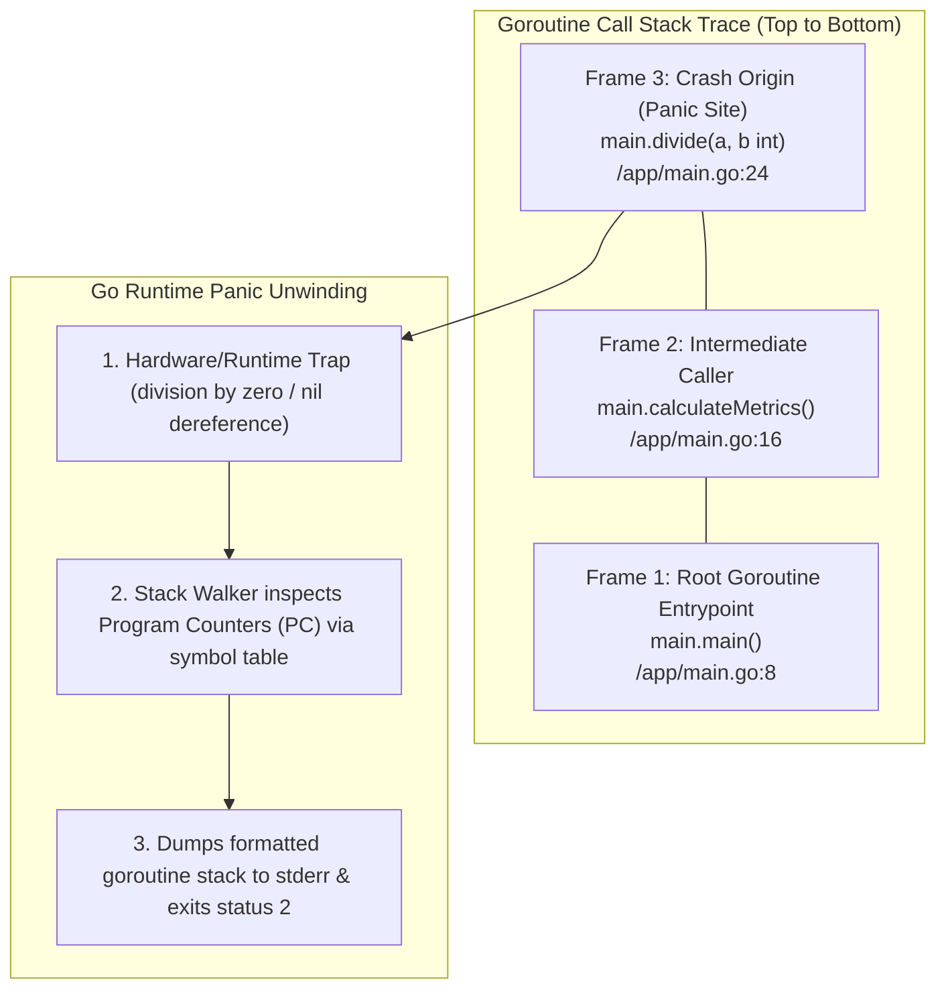

# Reading Runtime Errors

## Learning objective

By the end of this lesson, you will understand how to read a Go panic traceback, identify the file and line where the panic occurred, and fix common runtime errors like index out of range and nil pointer dereference.

## Why this matters

Unlike compile errors which catch problems before the program runs, runtime errors happen while your program is executing. They produce a panic traceback that shows the call stack at the moment of failure. Reading this traceback is the only way to diagnose and fix runtime crashes.

## Mental model

A panic is an unexpected error that stops program execution. When a panic occurs, Go prints a stack trace showing every function call from the start of the program to the crash point. The most recent call is at the top; `main` is somewhere near the bottom.

## Visual model



## Core idea

A Go panic traceback shows: the panic message (what went wrong), the stack frames (where it happened), and the file and line number of each frame. The first frame after the panic message is the exact location of the crash.

## Under the hood

When Go code panics (e.g., accessing an index beyond a slice length, dereferencing a nil pointer), the runtime prints a stack trace before exiting. The traceback is generated by walking the goroutine stack and recording the program counter (PC) of each frame, then mapping each PC to a file and line number using the binary's symbol table.

## How Go uses it

The Go runtime panics for several common errors:

- **Index out of range**: `panic: runtime error: index out of range [5] with length 3`
- **Nil pointer dereference**: `panic: runtime error: invalid memory address or nil pointer dereference`
- **Slice bounds out of range**: `panic: runtime error: slice bounds out of range [:10] with capacity 5`
- **Close of closed channel**: `panic: close of closed channel`
- **Send on closed channel**: `panic: send on closed channel`

## Go example

```go
package main

import (
	"fmt"
	"runtime/debug"
	"strings"
)

// SafeExecute runs an arbitrary function and intercepts any runtime panic,
// returning the recovered value and the top frames of the runtime stack trace.
func SafeExecute(fn func()) (recoveredVal any, stack string) {
	defer func() {
		if r := recover(); r != nil {
			recoveredVal = r
			rawStack := string(debug.Stack())
			lines := strings.Split(rawStack, "\n")
			// Extract top 6 lines of stack trace for concise pedagogical inspection
			if len(lines) > 6 {
				stack = strings.Join(lines[:6], "\n")
			} else {
				stack = rawStack
			}
		}
	}()

	fn()
	return nil, ""
}

// AccessElement attempts an index access that may trigger an out-of-bounds runtime panic.
func AccessElement(items []int, idx int) int {
	return items[idx]
}

func main() {
	fmt.Println("=== Deconstructing Go Runtime Panics & Stack Traces ===")

	numbers := []int{10, 20, 30}
	fmt.Printf("Slice initialized: %v (Length: %d)\n", numbers, len(numbers))

	// Safely trigger and capture an index out-of-bounds runtime panic
	fmt.Println("\nAttempting out-of-bounds access at index 5...")
	recoveredVal, stack := SafeExecute(func() {
		_ = AccessElement(numbers, 5)
	})

	if recoveredVal != nil {
		fmt.Printf("✓ Successfully intercepted runtime panic: %v\n\n", recoveredVal)
		fmt.Println("--- Anatomy of the Runtime Stack Trace ---")
		fmt.Println(stack)
		fmt.Println("\nInsight: The stack trace reads bottom-to-top (caller -> callee -> crash point).")
		fmt.Println("The top frame points directly to the function and line number where the CPU halted.")
	} else {
		fmt.Println("No panic occurred.")
	}
}
```

This program demonstrates the mechanics of Go runtime exceptions:
- **Zero-Crash Inspection**: Intercepts panics using `defer` and `recover()`, preventing process termination while allowing detailed inspection.
- **Stack Trace Introspection**: Extracts the exact call stack using `runtime/debug.Stack()`.
- **Root Cause Isolation**: Identifies the failed instruction, slice boundary violation, and caller history.

## Step-by-step execution

1. Run the safe panic execution demo:
   ```bash
   go run .
   ```
2. Run the automated unit tests:
   ```bash
   go test -v .
   ```
3. Trace the crash frame coordinates (`file.go:line +0x...`) back to `AccessElement`.

## Common mistakes

- **Looking at the bottom of the traceback first**: The panic message and crashing line are at the top. Start there.
- **Not reading the full traceback**: The traceback shows every frame from `main` to the crash. The middle frames show intermediate function calls that led to the crash.
- **Confusing panics with errors**: A panic is unrecoverable (by default). Go functions return errors as values — panics are for exceptional situations.
- **Ignoring the index in "index out of range" messages**: The message includes both the index you tried and the actual length (e.g., `[5] with length 3`).

## Debugging walkthrough

**Scenario**: The program panics with `index out of range [5] with length 3`.

1. Look at the top of the traceback for the file and line number.
2. Find the slice access on that line — you are accessing an index that does not exist.
3. Check the slice length: it has 3 elements (indices 0, 1, 2), but you tried index 5.
4. Fix the index to be within bounds, or add a bounds check before accessing.

**Scenario**: The program panics with `nil pointer dereference`.

1. Look at the traceback for the file and line.
2. Find the variable access on that line — you tried to access a field or method on a nil pointer.
3. Trace back to where the pointer was assigned: it was never initialized or a function returned nil.
4. Initialize the pointer with `&Type{}` or add a nil check before accessing.

## Production notes

- In production, panics are caught by `recover()` in middleware or at the top of goroutines. They are logged and the program continues.
- Always log the full traceback when recovering from a panic — the traceback is essential for debugging.
- Use `panic` only for truly unrecoverable situations. Most errors should be returned as values.

## Performance implications

- Producing a stack trace is relatively expensive (context switching, symbol lookup). Avoid panicking in hot paths.
- The stack trace is printed to stderr and the program exits with a non-zero status code.

## Practice task

1. Run `go run .` from this lesson directory.
2. Change `items[0]` to `items[10]` and run again — read the traceback.
3. Fix the index and add a second slice that causes a nil pointer dereference.
4. Read both tracebacks and identify the file, line, and panic type for each.

## Tests / verification

```bash
go run .
```

Expected output:
```
1
Runtime errors happen when the program is running.
```

## Review questions

1. Where in the traceback should you look first when debugging a panic?
2. What information does `index out of range [5] with length 3` tell you?
3. What is the difference between a compile error and a runtime panic?
4. How does Go indicate a nil pointer dereference in the traceback?
5. Why should production code recover from panics instead of crashing?

## NEXT UP

[Reading test failures](../12-reading-test-failures/README.md) — understand and fix failing test output.
