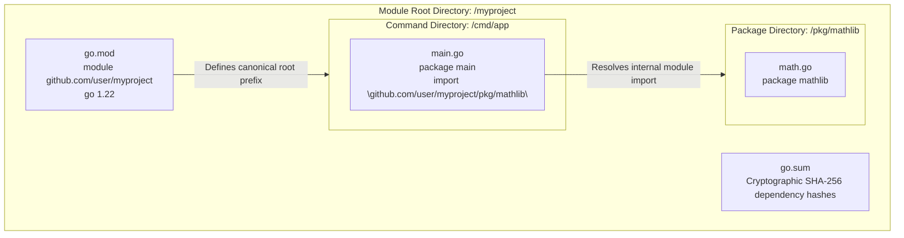

# Go Module Root Basics

## Learning objective

By the end of this lesson, you will understand what a Go module is, how `go.mod` defines the module root, and how Go uses the module path to resolve imports.

## Why this matters

Every Go project starts with `go mod init`. The `go.mod` file defines your module's identity, its dependencies, and the Go version it targets. Without understanding modules, you cannot add dependencies, build reproducible binaries, or organize code across multiple packages.

## Mental model

A Go module is a collection of packages with a single `go.mod` file at the root. The module path in `go.mod` is the import path prefix for all packages in the module. `go mod tidy` ensures the `go.mod` file matches the source code exactly.

## Visual model



## Core idea

The `go.mod` file defines the module path, the Go version, and the dependencies required by the module. Every directory with `.go` files inside the module is a package, and its import path is `module-path/directory-path`.

## Under the hood

The `go.mod` file is a line-oriented text file with directives:

- `module example.com/myapp` — the module's import path prefix
- `go 1.22` — the Go version used for compilation
- `require example.com/lib v1.2.3` — a dependency and its version
- `replace example.com/lib => ../local-lib` — override a dependency's location
- `exclude example.com/lib v1.2.4` — prevent a specific version from being used

The `go.sum` file contains cryptographic hashes of each dependency version, ensuring reproducible builds.

## How Go uses it

Key commands:

- `go mod init example.com/myapp` — creates a new module
- `go mod tidy` — adds missing dependencies and removes unused ones
- `go mod download` — downloads all dependencies to the module cache
- `go mod verify` — checks that cached dependencies match `go.sum`
- `go list -m all` — lists all dependencies with their versions

Import path convention:

```
module github.com/user/repo
├── .                   → github.com/user/repo
├── cmd/server/         → github.com/user/repo/cmd/server
├── pkg/api/            → github.com/user/repo/pkg/api
└── internal/db/        → github.com/user/repo/internal/db
```

## Go example

```go
package main

import (
	"bufio"
	"fmt"
	"strings"
)

// ModuleDeclaration models the parsed contents of a go.mod file.
type ModuleDeclaration struct {
	ModulePath string
	GoVersion  string
	Requires   []string
}

// ParseGoMod extracts essential directives from a raw go.mod file.
func ParseGoMod(content string) (ModuleDeclaration, error) {
	var mod ModuleDeclaration
	scanner := bufio.NewScanner(strings.NewReader(content))

	for scanner.Scan() {
		line := strings.TrimSpace(scanner.Text())
		if line == "" || strings.HasPrefix(line, "//") {
			continue
		}

		fields := strings.Fields(line)
		if len(fields) >= 2 {
			switch fields[0] {
			case "module":
				mod.ModulePath = fields[1]
			case "go":
				mod.GoVersion = fields[1]
			case "require":
				if len(fields) >= 3 {
					mod.Requires = append(mod.Requires, fmt.Sprintf("%s %s", fields[1], fields[2]))
				}
			}
		}
	}

	if mod.ModulePath == "" {
		return mod, fmt.Errorf("missing 'module' directive")
	}

	return mod, nil
}

// ResolveImportPath demonstrates how subpackage import paths map to filesystem folders.
func ResolveImportPath(modulePath, subDir string) string {
	if subDir == "" {
		return modulePath
	}
	return fmt.Sprintf("%s/%s", strings.TrimSuffix(modulePath, "/"), strings.TrimPrefix(subDir, "/"))
}

func main() {
	fmt.Println("=== Deconstructing 'go.mod' and Go Module Root Mechanics ===")

	sampleGoMod := `
module github.com/my-org/payment-gateway

go 1.23.0

require (
	golang.org/x/crypto v0.24.0
	github.com/google/uuid v1.6.0
)
`

	decl, err := ParseGoMod(sampleGoMod)
	if err != nil {
		fmt.Printf("Error parsing go.mod: %v\n", err)
		return
	}

	fmt.Printf("Module Root Path:   %s\n", decl.ModulePath)
	fmt.Printf("Target Go Version:  %s\n\n", decl.GoVersion)

	fmt.Println("--- Subpackage Path Resolution ---")
	internalPkg := ResolveImportPath(decl.ModulePath, "internal/processor")
	fmt.Printf("Filesystem folder: ./internal/processor\n")
	fmt.Printf("Go import path:    %q\n", internalPkg)

	fmt.Println("\nInsight: The go.mod file establishes the root boundary of the module.")
	fmt.Println("All internal packages are imported using the module path prefix, regardless")
	fmt.Println("of whether the repository has been pushed to a remote host yet.")
}
```

This program demonstrates how Go modules establish package namespaces:
- **Module Root**: The directory where `go.mod` resides defines the root boundary for compiler package resolution.
- **Import Prefixes**: Subpackages like `./internal/processor` are imported across the codebase via `github.com/my-org/payment-gateway/internal/processor`.
- **Offline Independence**: The module path does not require network access; it simply maps logical imports to physical files.

## Step-by-step execution

1. Run the module parser demonstration:
   ```bash
   go run .
   ```
2. Run the automated unit tests:
   ```bash
   go test -v .
   ```
3. Inspect the repository root `go.mod` file to verify its `module` and `go` directives.
5. Run `go mod tidy` and examine the updated `go.mod` and `go.sum` files.

## Common mistakes

- **Forgetting `go mod tidy` after adding imports**: The code imports a package but `go.mod` does not list it. Run `go mod tidy` to synchronize.
- **Using `go get` for everything**: `go get` is for getting a specific dependency. `go mod tidy` is the standard way to update `go.mod` after editing imports in source code.
- **Committing without `go mod tidy`**: CI will fail when `go mod tidy` changes `go.mod` or `go.sum`. Run it before every commit.
- **Editing `go.mod` by hand for complex changes**: Use `go get`, `go mod tidy`, and `go mod edit` commands instead of manual edits.

## Debugging walkthrough

**Scenario**: `go run .` fails with `missing go.sum entry for module providing package rsc.io/quote`.

1. The package is imported in your code but not recorded in `go.sum`.
2. Run `go mod tidy` to add the missing entry.
3. `go run .` should now succeed.

**Scenario**: `go mod tidy` removes a dependency you thought you needed.

1. The dependency is imported in a file that is conditionally compiled (build tags) or only imported in test files.
2. Check if the import uses a build tag. If so, run `go mod tidy -tags=yourtag` to include it.
3. If the dependency is needed for tests only, ensure it is imported in a `_test.go` file.

## Production notes

- Commit both `go.mod` and `go.sum`. The `go.sum` file ensures reproducible builds.
- Pin your Go version in `go.mod`: the `go 1.22` directive tells Go which language version to use.
- Use `replace` directives for local development but remove them before merging.
- In CI, run `go mod verify` to ensure no dependency tampering.

## Performance implications

- `go mod tidy` parses all Go files in the module. For large modules, this takes a few seconds.
- The module cache (in `$GOPATH/pkg/mod`) stores downloaded dependencies. Once cached, builds are offline.
- A module with many dependencies takes longer to build on first CI run. Use Docker layer caching for faster builds.

## Practice task

1. Look at the `go.mod` file in the module root. Identify the module path, Go version, and at least one dependency.
2. Create a new temporary directory, run `go mod init example.com/myapp`, create a `main.go` that imports `rsc.io/quote`, run `go mod tidy`, and run the program.
3. Examine the generated `go.mod` and `go.sum` files.

## Tests / verification

```bash
go list -m all | head -10
```

Expected output: shows the current module and its top dependencies.

```bash
go run .
```

Expected output:
```
This package is part of a Go module.
The module root has a go.mod file.
```

## Review questions

1. What file defines the root of a Go module?
2. What does `go mod tidy` do?
3. What is the purpose of `go.sum`?
4. How does Go determine the import path for a package inside a module?
5. What happens if you import a package without running `go mod tidy`?

## NEXT UP

[Tooling checklist](../14-tooling-checklist/README.md) — verify your entire Go development environment.
