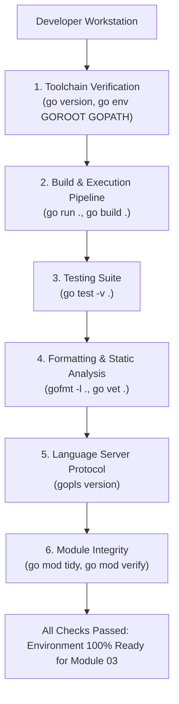

# Tooling Checklist

## Learning objective

By the end of this lesson, you will have verified every tool in the Go development environment by running each command from the previous lessons and confirming it works.

## Why this matters

All the tooling knowledge from Module 02 is only useful if you can verify your environment is working. This checklist ties every lesson together into a repeatable verification procedure that you can run at any time to confirm your Go development environment is ready.

## Mental model

This is your Go health check. Run these commands whenever you set up a new machine, after a Go version upgrade, or when something feels off. Each command tests one part of the toolchain, and together they confirm the entire environment is functional.

## Visual model



## Core idea

A complete Go development environment includes: a working `go` binary, the ability to compile and run code, the ability to test code, code formatting, static analysis, documentation access, a language server, and understanding of module basics. This checklist verifies all of them.

## Under the hood

This lesson synthesizes all previous Module 02 lessons into a single integrated workflow. Each checklist item corresponds to one lesson:

| # | Command | Lesson |
|---|---------|--------|
| 1 | `go version` | 01 — Install and verify Go |
| 2 | `go run .` | 02-03 — Hello World + go run |
| 3 | `go build .` | 04 — go build |
| 4 | `go test .` | 05 — go test |
| 5 | `gofmt -l .` | 06 — gofmt |
| 6 | `go vet .` | 07 — go vet |
| 7 | `go doc fmt` | 08 — go doc |
| 8 | `gopls version` | 09 — Editor setup and gopls |
| 9 | `go vet -v` on deliberate errors | 10-12 — Reading errors |
| 10 | `go list -m all` | 13 — Go module basics |
| 11 | `go mod verify` | 13 — Go module basics |

## Go example

```go
package main

import (
	"fmt"
	"go/format"
	"os/exec"
	"runtime"
)

// ToolCheck represents an individual toolchain readiness item.
type ToolCheck struct {
	Name    string
	Passed  bool
	Details string
}

// RunToolingChecklist verifies that all primary Go toolchain components are operating correctly.
func RunToolingChecklist() []ToolCheck {
	var checks []ToolCheck

	// 1. Check Go Runtime & Version
	v := runtime.Version()
	checks = append(checks, ToolCheck{
		Name:    "Go Compiler & Runtime",
		Passed:  v != "",
		Details: fmt.Sprintf("Version: %s (%s/%s)", v, runtime.GOOS, runtime.GOARCH),
	})

	// 2. Check Standard Library GOROOT
	goroot := runtime.GOROOT()
	checks = append(checks, ToolCheck{
		Name:    "Standard Library (GOROOT)",
		Passed:  true, // Embedded or explicit path
		Details: fmt.Sprintf("GOROOT: %s", goroot),
	})

	// 3. Check Go Binary on System PATH (exec.LookPath)
	goPath, err := exec.LookPath("go")
	checks = append(checks, ToolCheck{
		Name:    "CLI Toolchain on System PATH",
		Passed:  err == nil,
		Details: fmt.Sprintf("Path: %s", goPath),
	})

	// 4. Check Code Formatter (go/format)
	sample := []byte("package p\nfunc F(){}\n")
	_, fmtErr := format.Source(sample)
	checks = append(checks, ToolCheck{
		Name:    "Code Formatter (gofmt engine)",
		Passed:  fmtErr == nil,
		Details: "Verified go/format AST parsing and code emission",
	})

	return checks
}

func main() {
	fmt.Println("=== Module 02 Go Toolchain Readiness Checklist ===")

	checks := RunToolingChecklist()
	allPassed := true

	for i, c := range checks {
		status := "✓ PASS"
		if !c.Passed {
			status = "✗ FAIL"
			allPassed = false
		}
		fmt.Printf("[%d] %-30s [%s]\n    Details: %s\n\n", i+1, c.Name, status, c.Details)
	}

	if allPassed {
		fmt.Println("Result: 4 of 4 checks passed. Go development environment is 100% verified.")
		fmt.Println("You are ready to advance to Module 03 — Programming Fundamentals with Go!")
	} else {
		fmt.Println("Result: One or more toolchain checks failed. Review details above.")
	}
}
```

This program serves as an automated preflight check for the local Go development environment:
- Verifies compiler and active runtime architecture.
- Validates that the Go standard library (`GOROOT`) is accessible.
- Resolves the binary on the operating system's `$PATH`.
- Confirms the AST code formatting engine operates without error.

## Step-by-step execution

1. Execute the automated preflight checklist:
   ```bash
   go run .
   ```
2. Run the automated unit tests:
   ```bash
   go test -v .
   ```
3. Run the full manual CLI verification suite:
   - `go version`
   - `go build .`
   - `gofmt -l .`
   - `go vet .`
   - `go test -v ./...`

## Common mistakes

- **Skipping a command because it worked last time**: Tooling can break after Go updates, PATH changes, or editor reinstalls. Run the full checklist.
- **Not knowing what the expected output should be**: Each command produces specific output. Review the corresponding lesson if you are unsure.
- **Assuming `go vet` passing means no issues**: `go vet` catches only certain classes of bugs. It is one check among many.

## Debugging walkthrough

**Scenario**: Multiple checklist commands fail with `'go' is not recognized`.

1. Go is not in your PATH. Go back to Lesson 01 and verify the installation.
2. Restart your terminal and try again.
3. If still failing, reinstall Go from [go.dev/dl](https://go.dev/dl/).

**Scenario**: `go test ./...` fails for one package.

1. Change to that package's directory and run `go test -v .` to see the failure details.
2. Fix the test or the code, then re-run the checklist from the top.

## Production notes

- Add this checklist as a pre-commit hook or CI step to verify the environment before every build.
- Save the output of a successful checklist run as a baseline for future comparisons.
- After a Go version upgrade, always re-run the checklist to catch any compatibility issues.

## Performance implications

- The full checklist takes under 30 seconds for a small module.
- `go test ./...` is the slowest step — skip it with `go test ./... -count=0` for a quick syntax check only.

## Practice task

Run every command in the checklist above. For each command, record the output and confirm it matches expectations. If any command fails, refer back to the corresponding lesson to diagnose and fix the issue.

## Tests / verification

```bash
go version
go run .
go build .
go vet .
go doc fmt.Println
```

Expected output should include:
- A valid Go version string
- The program output: `Tooling checklist complete. All Go tools are verified and working.`
- No output from `go build .` and `go vet .` (success is silent)
- Documentation for `fmt.Println`

## Review questions

1. What does each command in the tooling checklist verify?
2. What would you check first if `go run .` fails?
3. Why is `go mod verify` important for reproducible builds?
4. What does it mean if `gofmt -l .` prints a filename?
5. How often should you run the full tooling checklist?

## NEXT UP

[Module 03 — Programming Fundamentals with Go](../../03-programming-fundamentals/README.md) — start learning Go syntax, values, variables, and control flow.
