# Module 03: Programming Fundamentals with Go

## Mission

> "Data dominates. If you've chosen the right data structures and organized things well, the algorithms will almost always be self-evident. Data structures, not algorithms, are central to programming."
> — Rob Pike, *Notes on Programming in C* (Rule 5)

This module delivers total mechanical mastery of programming fundamentals through the lens of Go's explicit, hardware-grounded systems architecture.

Rather than treating variables, types, collections, and control flow as abstract mathematical concepts, you will study how code executes physically on a computer:
- How primitive types (`int8` through `uint64`, `float32`, `float64`, `bool`) occupy concrete bit widths and word-aligned memory addresses.
- Why Go's **Zero-Value Guarantee** is not an abstract default, but physical contiguous memory initialized by the runtime to binary zeros (`00000000`).
- How the compiler enforces strict type safety without implicit type coercion, preventing precision loss and silent overflow.
- How control structures (`if`, `switch`, `for`, `range`) compile into branch instructions and conditional jump offsets.
- How composite data structures exist in hardware: contiguous memory arrays, 24-byte slice descriptors (`Data`, `Len`, `Cap`), 16-byte string headers pointing to immutable UTF-8 bytes, and `hmap` bucket array hash tables with tombstone deletion semantics.
- How pointers represent 64-bit physical memory addresses, how pointer dereferencing accesses underlying stack/heap values, and why Go values are passed strictly by copy.
- How algorithmic problem-solving and Big-O complexity govern memory allocation and execution time in production systems.

By the end of this module, you will build and verify two complete standalone applications: an in-memory **Contact Directory** CLI and a production-grade **Pricing Checkout** cart engine with discount rules, tax computation, and rigorous table-driven test suites.

## Tracks in this curriculum

The Go Engineer curriculum organizes your progression into three synchronized tracks:

1. **Core Backend Path (`curriculum/modules/`):** Module 03 is the foundational programming engine of the entire curriculum. The data semantics, slice headers, and pointer mechanics mastered here form the non-negotiable prerequisite for Module 04 (Functions, Errors, and Data Semantics), Module 05 (Types, Structs, and Interfaces), and all subsequent backend modules.
2. **Advanced Electives (`curriculum/electives/`):** The bitwise representations, type memory layouts, and slice backing array sharing studied in this module directly unlock Advanced Electives Gateway A (Generics 01–04) and high-throughput low-level memory allocation techniques.
3. **Companion Frontend Track (`curriculum/companion-frontend/`):** Data formatting, string manipulation, JSON marshaling, and slice filtering taught here directly power backend handlers serving hypermedia UI components.

## Who this module is for

This module is designed for:

- Programmers transitioning to Go from dynamic or garbage-collected languages (Python, JavaScript, Ruby, PHP) who want to understand explicit typing, zero values, and memory layout.
- Computer science graduates and self-taught developers seeking mechanical sympathy for pointers, contiguous arrays, slice headers, and hash table buckets.
- Backend engineers who want to eliminate slice aliasing bugs, map read/write concurrency traps, and unintentional heap allocations.
- Systems engineers preparing for production backend development and technical systems design interviews.

## What you will build

Throughout this module, you will build and verify working Go programs and two major project capstones:

- Standalone diagnostic scripts evaluating bit representations, arithmetic overflows, and zero-value initialization.
- Control flow engines implementing branch logic, pattern matching via tagless switches, and iterative accumulator loops.
- Dynamic collection managers manipulating arrays, performing sub-slice reslicing, managing capacity reallocation triggers, and utilizing the `comma-ok` map idiom.
- Unicode string decoders differentiating raw byte offsets from multi-byte UTF-8 code points (`rune`).
- Pointer mutating functions demonstrating value copy semantics versus memory address indirection.
- **Project 1: Contact Directory (`projects/contact-directory/`):** An interactive in-memory directory tracking records, supporting search filters, validating email formats, and demonstrating slice manipulation.
- **Project 2: Pricing Checkout (`projects/pricing-checkout/`):** A production checkout pricing engine calculating subtotal line items, volume discount tiers, tax rates, and coupon logic, verified by exhaustive table-driven test suites.

## Prerequisites

- [Module 00: Orientation](../00-orientation/README.md)
- [Module 01: Computers, Terminal, Git, and the Web](../01-computers-terminal-git-web/README.md)
- [Module 02: Go Setup and Tooling](../02-go-setup-tooling/README.md)

You should be able to:
- Open a terminal and run `go run .`, `go build .`, `go test -v .`, and `gofmt -l .`.
- Understand operating system processes, virtual memory preview, exit codes, and standard streams (`stdin`, `stdout`, `stderr`).
- Initialize and inspect a Go module using `go mod init`.

## Concept map

```mermaid
flowchart TD
    classDef frontDoor fill:#1a233a,stroke:#3b82f6,stroke-width:2px,color:#ffffff;
    classDef exitGate fill:#1e3a1e,stroke:#4caf50,stroke-width:2px,color:#ffffff;
    classDef standardNode fill:#22272e,stroke:#444c56,stroke-width:1px,color:#ffffff;
    classDef capstoneNode fill:#2d2215,stroke:#f59e0b,stroke-width:2px,color:#ffffff;
    classDef container fill:#161b22,stroke:#30363d,stroke-width:1px,color:#8b949e;

    subgraph Phase1["1. Values, Variables, Types, and Zero Values"]
        L01["01. Values & Expressions<br/><i>Literals, Evaluation</i>"]:::frontDoor
        L02["02. Variables<br/><i>var, short declaration :=</i>"]:::standardNode
        L03["03. Types<br/><i>Sizes, Bit Widths</i>"]:::standardNode
        L04["04. Zero Values<br/><i>Physical 00000000</i>"]:::standardNode
        L05["05. Type Conversions<br/><i>Explicit Casts, No Coercion</i>"]:::standardNode
        L06["06. Constants<br/><i>Untyped Literals</i>"]:::standardNode
        L07["07. iota<br/><i>Enum Bitmask Generation</i>"]:::standardNode
        L01 --> L02 --> L03 --> L04 --> L05 --> L06 --> L07
    end

    subgraph Phase2["2. Boolean Logic & Control Flow"]
        L08["08. Boolean Logic<br/><i>Truth Tables, Short-Circuit</i>"]:::standardNode
        L09["09. If and Else<br/><i>Initializers, Scoping</i>"]:::standardNode
        L10["10. Switch<br/><i>Tagless, Fallthrough</i>"]:::standardNode
        L11["11. Loops<br/><i>for Forms, break/continue</i>"]:::standardNode
        L12["12. Range<br/><i>Value Copy Iteration</i>"]:::standardNode
        L07 --> L08 --> L09 --> L10 --> L11 --> L12
    end

    subgraph Phase3["3. Collections, Strings, Runes, and Pointers"]
        L13["13. Arrays<br/><i>Fixed Sizing, Value Type</i>"]:::standardNode
        L14["14. Slices<br/><i>24B Header, Backing Array</i>"]:::standardNode
        L15["15. Length & Capacity<br/><i>Cap Doubling, append()</i>"]:::standardNode
        L16["16. Sharing & Aliasing<br/><i>Backing Array Overwrite</i>"]:::standardNode
        L17["17. Maps<br/><i>hmap, Buckets, Tombstones</i>"]:::standardNode
        L18["18. Comma-Ok Idiom<br/><i>Safe Key Retrieval</i>"]:::standardNode
        L19["19. Strings<br/><i>16B Header, Read-Only Bytes</i>"]:::standardNode
        L20["20. Bytes<br/><i>[]byte Slices, Mutability</i>"]:::standardNode
        L21["21. Runes & Unicode<br/><i>UTF-8 Code Points, int32</i>"]:::standardNode
        L22["22. Pointers as Addresses<br/><i>64-Bit Addresses, & and *</i>"]:::standardNode
        L23["23. Beginner Pointer Traps<br/><i>Nil Dereference, Dangling</i>"]:::standardNode
        L24["24. Algorithmic Complexity<br/><i>Big-O Time & Space</i>"]:::standardNode
        L12 --> L13 --> L14 --> L15 --> L16 --> L17 --> L18 --> L19 --> L20 --> L21 --> L22 --> L23 --> L24
    end

    subgraph Phase4["4. Projects & Graduation Exit Gate"]
        P1["Project: Contact Directory<br/><i>CRUD In-Memory CLI</i>"]:::capstoneNode
        P2["Capstone Project: Pricing Checkout<br/><i>Discounts, Tax, Table Tests</i>"]:::capstoneNode
        ASSESS["Assessment Checkpoint<br/><b>Module 03 Graduation</b><br/><i>(SOLE EXIT GATE)</i>"]:::exitGate
        L24 --> P1 --> P2 --> ASSESS
    end
```

## Lessons

| # | Lesson | Summary | Est. Time |
|---|--------|---------|-----------|
| 01 | [Values and Expressions](./lessons/01-values-and-expressions/README.md) | Distinguish between raw literals, evaluation operators, and typed expressions. | 30 min |
| 02 | [Variables](./lessons/02-variables/README.md) | Master `var` declarations, type inference, short declarations (`:=`), and scoping. | 30 min |
| 03 | [Types](./lessons/03-types/README.md) | Inspect Go's basic types (`int8`–`uint64`, `float`, `bool`) and their physical bit widths. | 45 min |
| 04 | [Zero Values](./lessons/04-zero-values/README.md) | Understand the hardware zero-value guarantee and how binary zeros represent defaults. | 30 min |
| 05 | [Type Conversions](./lessons/05-type-conversions/README.md) | Perform explicit type conversions safely without truncation or precision traps. | 30 min |
| 06 | [Constants](./lessons/06-constants/README.md) | Understand untyped vs typed constants, arbitrary precision, and compile-time evaluation. | 30 min |
| 07 | [iota](./lessons/07-iota/README.md) | Use the `iota` enumerator to generate typed constants and bitmask flags. | 30 min |
| 08 | [Boolean Logic](./lessons/08-boolean-logic/README.md) | Evaluate boolean expressions, truth tables, and short-circuit evaluation rules. | 30 min |
| 09 | [If and Else](./lessons/09-if-and-else/README.md) | Write idiomatic branch logic using statement initializers (`if err := ...; err != nil`). | 30 min |
| 10 | [Switch](./lessons/10-switch/README.md) | Replace complex if-else ladders with tagged and tagless switches and fallthrough rules. | 30 min |
| 11 | [Loops](./lessons/11-loops/README.md) | Master Go's singular loop construct: three-component, while-style, and infinite loops. | 30 min |
| 12 | [Range](./lessons/12-range/README.md) | Iterate over arrays, slices, maps, and strings while avoiding value copy mutations. | 45 min |
| 13 | [Arrays](./lessons/13-arrays/README.md) | Understand fixed-size, contiguous memory buffers and their value-copy assignment semantics. | 30 min |
| 14 | [Slices](./lessons/14-slices/README.md) | Inspect the 24-byte slice header (`Data`, `Len`, `Cap`) and dynamic backing arrays. | 45 min |
| 15 | [Slice Length and Capacity](./lessons/15-slice-length-and-capacity/README.md) | Predict slice growth reallocation, geometric doubling, and memory allocation triggers. | 45 min |
| 16 | [Slice Sharing and Aliasing](./lessons/16-slice-sharing-and-aliasing/README.md) | Diagnose and avoid shared backing array bugs using three-index slicing and `copy()`. | 45 min |
| 17 | [Maps](./lessons/17-maps/README.md) | Master Go's hash table: pointer semantics, `hmap` buckets, and non-deterministic iteration. | 45 min |
| 18 | [Comma-Ok Idiom](./lessons/18-comma-ok-idiom/README.md) | Differentiate missing keys from zero-value stored entries safely. | 30 min |
| 19 | [Strings](./lessons/19-strings/README.md) | Understand the 16-byte `StringHeader`, immutability, and raw byte indexing. | 30 min |
| 20 | [Bytes](./lessons/20-bytes/README.md) | Manipulate mutable byte slices (`[]byte`) and transition between strings and bytes. | 30 min |
| 21 | [Runes and Unicode](./lessons/21-runes-and-unicode/README.md) | Decode multi-byte UTF-8 codepoints into 32-bit runes (`int32`) and handle grapheme clusters. | 45 min |
| 22 | [Pointers as Addresses](./lessons/22-pointers-as-addresses/README.md) | Understand 64-bit memory addresses, address-of (`&`), and dereferencing (`*`). | 45 min |
| 23 | [Beginner Pointer Mistakes](./lessons/23-beginner-pointer-mistakes/README.md) | Prevent nil pointer dereference panics and diagnose value copy vs pointer mutations. | 45 min |
| 24 | [Algorithmic Problem-Solving](./lessons/24-algorithmic-problem-solving/README.md) | Analyze time and space complexity ($O(1)$, $O(n)$, $O(n^2)$) and write efficient algorithms. | 45 min |

**Total Estimated Instructional Time:** ~15 hours

## Labs

Hands-on diagnostic drills are embedded in each lesson:
- **Lesson 03 & 04:** Print memory representations and verify hardware zero values with `fmt.Printf("%08b\n", b)`.
- **Lesson 05:** Deliberately induce integer overflow wrapping in `uint8` and verify unsigned bit truncation.
- **Lesson 12:** Prove that `for _, v := range s` copies values by modifying `v` and asserting the slice remains unchanged.
- **Lesson 15 & 16:** Profile backing array pointer addresses with `unsafe.SliceData()` and demonstrate sub-slice aliasing writes.
- **Lesson 17 & 18:** Test map operations and verify that deleting a missing key is a safe no-op while writing to a `nil` map triggers a runtime panic.
- **Lesson 21:** Iterate over multi-byte strings like `"Go 世界"` and observe the difference between byte offsets and rune indices.
- **Lesson 22 & 23:** Trace memory addresses across function boundaries and fix nil pointer dereference crashes.

## Projects

- [Project 1: Contact Directory](./projects/contact-directory/README.md): An in-memory CLI application for managing contact records with search filters, input validation, and slice manipulation drills.
- [Project 2: Pricing Checkout](./projects/pricing-checkout/README.md): A comprehensive production-grade checkout calculator applying tiered quantity discounts, coupon validation, and state sales tax calculations, verified by table-driven test suites.

## Assessments

- [Module 03 Checkpoint Assessment](./assessments/checkpoint/README.md): Comprehensive 4-file evaluation suite testing data types, slice header mechanics, pointer behavior, and problem-solving.
- [Contact Directory Assessment](./assessments/contact-directory/README.md): Rubric and question suite validating the Contact Directory project.
- [Pricing Checkout Assessment](./assessments/pricing-checkout/README.md): Rubric and question suite validating the Pricing Checkout project.

## Common failure modes

| Failure Mode | Observable Symptom | Mechanical Root Cause | Remediation |
|---|---|---|---|
| **Integer Overflow** | Calculation results in unexpected small number or negative value | Assigning a value exceeding type bit width (e.g., `uint8(255) + 1 == 0`). | Use properly sized types (`int64`, `uint64`) or check boundaries before arithmetic. |
| **Nil Map Write Panic** | `panic: assignment to entry in nil map` | Inserting a key into an uninitialized `var m map[string]int`. | Initialize maps with `make(map[K]V)` or a map literal before writing. |
| **Slice Backing Array Overwrite** | Modifying sub-slice mutated the original slice | Slices created via `s[start:end]` share the original backing array. | Use 3-index slicing `s[start:end:end]` to limit capacity, or allocate a new slice with `copy()`. |
| **Nil Pointer Dereference** | `panic: runtime error: invalid memory address or nil pointer dereference` | Dereferencing an uninitialized `*T` pointer pointing to address `0x0`. | Check `ptr != nil` before dereferencing, or initialize the pointer using `new(T)` or `&val`. |
| **Range Variable Mutation Trap** | Modifying range variable `v` does not alter the underlying collection | `for _, v := range slice` assigns a local copy of each element to `v`. | Access and mutate the element directly using its index: `slice[i] = newValue`. |
| **UTF-8 Byte vs Rune Confusion** | `len("世界") == 6` instead of `2` | `len()` returns byte count, not character count, and string indexing accesses raw bytes. | Use `utf8.RuneCountInString()` for character count and `range` to iterate codepoints. |

## Completion checklist

You are ready for Module 04 when you can:

- [ ] Explain the physical memory representation of Go primitive types and verify the zero-value guarantee.
- [ ] Perform explicit type conversions and explain why Go prohibits implicit coercion.
- [ ] Write idiomatic conditional statements with initializers and tagless switch blocks.
- [ ] Explain the internal 24-byte layout of a slice header (`Data`, `Len`, `Cap`).
- [ ] Predict when `append()` will reallocate a slice backing array and avoid aliasing bugs.
- [ ] Use the `comma-ok` idiom to distinguish between missing map keys and zero-value stored entries.
- [ ] Differentiate between ASCII bytes, UTF-8 byte streams, and 32-bit runes (`int32`).
- [ ] Trace pointer memory addresses with `&` and safely dereference pointers with `*`.
- [ ] Implement and test the Contact Directory project.
- [ ] Implement and pass all table-driven tests for the Pricing Checkout capstone project.
- [ ] Pass the Module 03 Checkpoint assessment with a score of 80% or higher.

## Start here

Begin Step 1 of this module with the first lesson:

- [Lesson 01: Values and expressions](./lessons/01-values-and-expressions/README.md)

> [!NOTE] Single-Entry Navigation
> Module progression is strictly sequential. Complete lessons 01 through 24, complete the projects, and pass the assessment checkpoint. The exit gate to Module 04 unlocks upon completing the assessment checkpoint.
