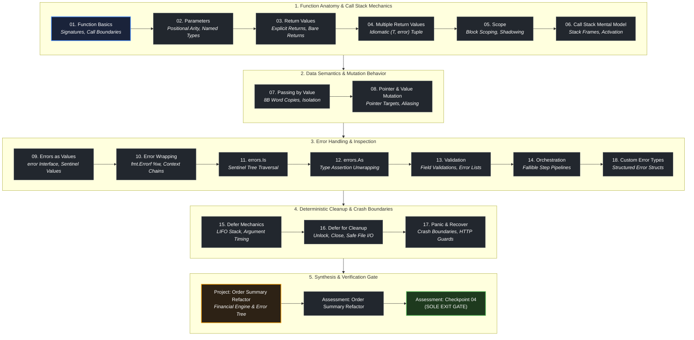

# Module 04 — Functions, Errors, and Data Semantics

## Mission

> *"Errors are values."* — Rob Pike

This module teaches you how Go organizes program execution, manages data across memory boundaries, and handles runtime failures with absolute clarity.

In many languages, functions are wrapped in hidden exception handlers, implicit object receivers, and magical pass-by-reference semantics. Go rejects this opacity. In Go, every function call allocates a concrete stack frame, parameters are strictly passed by value, and errors are regular, inspectable values rather than invisible control-flow exceptions.

By the end of this module, you will understand how the call stack allocates and unwinds stack frames, predict exactly when values are copied versus referenced, construct resilient error chains using `fmt.Errorf("%w")`, match errors with `errors.Is` and `errors.As`, enforce deterministic cleanup with `defer`, and build production-grade custom error types.

## Tracks in this curriculum

1. **Core Backend Path (`curriculum/modules/`):** The primary 18-module progression. Module 04 establishes the structural foundation for interfaces, packages, and unit testing in Modules 05 and 06.
2. **Advanced Electives (`curriculum/electives/`):** Advanced error handling, sentinels, and custom domain errors will be leveraged in gRPC interceptors and distributed pipelines.
3. **[Frontend Companion Track](../../companion-frontend/README.md) (`curriculum/companion-frontend/`):** The error handling patterns and data semantics learned here are required for form validation and hypermedia handlers in Stage 01.

## Who this module is for

- Engineers who understand Go syntax from Module 03 and want to master function design.
- Developers transitioning from languages with exception handling (`try/catch`) who need to adopt Go's explicit error-as-value philosophy.
- Systems engineers who want a precise physical mental model of the CPU call stack and pointer mutation.
- Backend engineers who want to build resilient APIs that never panic in production.

## What you will build

You will build production-grade function and error architectures:

- An **Order Summary Processor** capstone that parses, validates, and calculates financial order totals with wrapped error trees.
- A **Structured Validation Pipeline** that aggregates multiple domain validation errors without early termination.
- A **Deterministic Resource Cleanup Manager** using LIFO `defer` stacks for safe file and lock releasing.
- **Custom Error Types** implementing the `error` interface with structured fields, HTTP status mapping, and sentinel error chaining.

## Prerequisites

- [Module 00: Orientation](../00-orientation/README.md)
- [Module 01: Computers, Terminal, Git, and the Web](../01-computers-terminal-git-web/README.md)
- [Module 02: Go Setup and Tooling](../02-go-setup-tooling/README.md)
- [Module 03: Programming Fundamentals with Go](../03-programming-fundamentals/README.md)

You should be able to:
- Declare and initialize Go variables, constants, slices, maps, and structs.
- Use control flow statements (`if/else`, `switch`, `for`, `for range`).
- Understand memory addresses, pointer syntax (`*T`, `&x`), and dereferencing (`*ptr`).
- Execute `go run`, `go build`, and `go test` from your terminal.

## Concept map

## Lessons

| Order | Type | Path | Outcome |
| ----: | :--- | :--- | :--- |
| 1 | Lesson | `lessons/01-function-basics/` | Declare functions, specify input parameters, and trace call boundaries. |
| 2 | Lesson | `lessons/02-parameters/` | Design function signatures with strict positional types and variadic slices. |
| 3 | Lesson | `lessons/03-return-values/` | Return explicit results, name return values, and avoid naked return traps. |
| 4 | Lesson | `lessons/04-multiple-return-values/` | Use the standard `(T, error)` tuple pattern for transparent failure propagation. |
| 5 | Lesson | `lessons/05-scope/` | Control variable lifetimes, package visibility, and diagnose lexical shadowing. |
| 6 | Lesson | `lessons/06-call-stack-mental-model/` | Diagram stack frames, activation records, and frame unwinding down to memory. |
| 7 | Lesson | `lessons/07-passing-by-value/` | Explain why Go is strictly pass-by-value and how byte copies occur at boundaries. |
| 8 | Lesson | `lessons/08-pointer-and-value-mutation-behavior/` | Predict when data is mutated versus copied using pointer dereferencing. |
| 9 | Lesson | `lessons/09-errors-as-values/` | Implement the built-in `error` interface and inspect errors like any other value. |
| 10 | Lesson | `lessons/10-error-wrapping/` | Annotate errors with contextual metadata using `fmt.Errorf("%w", err)`. |
| 11 | Lesson | `lessons/11-errors-is/` | Inspect nested error chains for target sentinels using `errors.Is`. |
| 12 | Lesson | `lessons/12-errors-as/` | Extract typed error structs from wrapped chains using `errors.As`. |
| 13 | Lesson | `lessons/13-validation/` | Construct multi-field domain validators that accumulate errors without premature exit. |
| 14 | Lesson | `lessons/14-orchestration/` | Compose fallible multi-step operations cleanly with early-return error guards. |
| 15 | Lesson | `lessons/15-defer-mechanics/` | Trace the LIFO defer stack and explain immediate parameter evaluation. |
| 16 | Lesson | `lessons/16-defer-for-cleanup/` | Guarantee resource release (files, locks, connections) even during error returns. |
| 17 | Lesson | `lessons/17-panic-and-recover/` | Establish crash boundaries around critical runtime panics without abusing exceptions. |
| 18 | Lesson | `lessons/18-custom-error-types/` | Author domain-specific error structs with custom formats and field unpacking. |

## Projects

Module 04 concludes with a major engineering capstone:

- [`projects/order-summary-refactor/`](./projects/order-summary-refactor/README.md) — **Order Summary Refactor**: Refactor a legacy financial calculation engine to use structured error handling: custom error types, contextual error wrapping with `%w`, multi-error aggregation with `errors.Join`, and deterministic cleanup via `defer`.

## Assessments

Complete the two Module 04 assessments:

1. [`assessments/order-summary-refactor/`](./assessments/order-summary-refactor/README.md) — Capstone Project Review: evaluates your order summary implementation, error wrapping, and test coverage.
2. [`assessments/checkpoint/`](./assessments/checkpoint/README.md) — Module 04 Checkpoint: evaluates your conceptual understanding of stack frames, pass-by-value semantics, error tree traversal, and defer mechanics.

## Common failure modes

| Failure | Symptom | Fix |
| :--- | :--- | :--- |
| Treating errors as exceptions | Ignoring returned errors with `_` or using `panic` for normal business validation | Check `if err != nil` immediately at the call site and return early |
| Discarding root cause during wrapping | Calling `fmt.Errorf("failed: %v", err)` instead of `%w` | Use `%w` to preserve the original error in the unwrap chain for `errors.Is`/`errors.As` |
| Accidental variable shadowing | Using `:=` inside an `if` block, masking an outer variable | Use `=` for assignment to existing variables when updating outer scope |
| Leaking resources in loops | Putting `defer file.Close()` inside a `for` loop, causing descriptor exhaustion | Encapsulate the loop body in a separate helper function so `defer` runs every iteration |
| Expecting mutation with value receivers | Passing a struct by value and wondering why caller data remains unchanged | Pass a pointer `*T` when mutation or large copy avoidance is required |

## Completion checklist

You are ready for Module 05 when you can:

- [ ] explain how stack frames are allocated and deallocated during function calls
- [ ] write functions with multiple return values adhering to the `(T, error)` standard
- [ ] demonstrate that Go is strictly pass-by-value through memory copy diagrams
- [ ] wrap errors with contextual messages using `fmt.Errorf` and `%w`
- [ ] match sentinel errors with `errors.Is` and extract custom types with `errors.As`
- [ ] explain the exact execution order of multiple deferred statements (LIFO)
- [ ] implement a custom error type that fulfills the `error` interface
- [ ] pass the Order Summary Processor capstone and score $\ge 80\%$ on the checkpoint

## Start here

Begin your study of function architecture with Lesson 01:

- [Lesson 01: Function basics](./lessons/01-function-basics/README.md)

> [!NOTE] Single-Entry Navigation
> Module progression is strictly sequential. Complete lessons 01 through 18, finish the Order Summary Processor project, and pass the assessment checkpoint. The exit gate to Module 05 unlocks upon completing the assessment checkpoint.
