# Function basics

> *"The purpose of abstracting is not to be vague, but to create a new semantic level in which one can be absolutely precise."*
> — Edsger W. Dijkstra, *The Humble Programmer* (1972)

## Learning objective

Declare and call functions in Go using the `func` keyword, distinguish named from anonymous functions, assign functions to variables, and pass functions as arguments.

## Why this matters

Functions are the fundamental unit of organization in Go. Every executable line of Go code lives inside a function. The `main()` function is the entry point, but real programs compose dozens or hundreds of functions. Mastering function declaration and invocation is the foundation for everything else: methods, interfaces, goroutines, and error handling.

## Mental model

A function is a named sequence of statements packaged as a single unit. Think of it as a miniature program: it receives inputs (parameters), executes a recipe, and optionally sends back a result (return value). Once defined, a function can be "called" from anywhere within its scope, as many times as needed.

Go treats functions as _first-class values_. This means you can store a function in a variable, pass it to another function, and return it from a function — the same way you manipulate strings or integers. An anonymous function is a function literal without a name, useful for short inline operations.

## Visual model

```mermaid
flowchart TD
    classDef frontDoor fill:#1a233a,stroke:#3b82f6,stroke-width:2px,color:#ffffff;
    classDef exitGate fill:#1e3a1e,stroke:#4caf50,stroke-width:2px,color:#ffffff;
    classDef standardNode fill:#22272e,stroke:#444c56,stroke-width:1px,color:#ffffff;
    classDef capstoneNode fill:#2d2215,stroke:#f59e0b,stroke-width:2px,color:#ffffff;

    subgraph FuncSignature["Function Declaration Anatomy"]
        KW["func Keyword"]:::frontDoor --- NAME["Identifier: CalculateTax"]:::standardNode
        NAME --- PARAMS["Parameters: (amount, rate float64)"]:::standardNode
        PARAMS --- RET["Return: (total float64)"]:::exitGate
    end

    subgraph Execution["Call & Return Flow"]
        CALLER["Caller Stack Frame<br/>tax := CalculateTax(100.0, 0.08)"]:::frontDoor
        ENTRY["Stack Frame Pushed<br/>amount=100.0, rate=0.08"]:::standardNode
        BODY["Execute Body<br/>result := amount * rate"]:::standardNode
        RETURN["Return Slot Written<br/>total = 8.0"]:::standardNode
        RESUME["Caller Resumes<br/>Frame Popped, tax = 8.0"]:::exitGate

        CALLER -->|Copy Arguments| ENTRY
        ENTRY --> BODY
        BODY --> RETURN
        RETURN -->|Pop Frame| RESUME
    end
```



## Core idea

Every function in Go starts with the `func` keyword:

```
func name(parameters) returnType {
    body
}
```

- The **name** must be a valid identifier.
- **Parameters** are a comma-separated list of variable names with types (can be empty).
- The **return type** is optional — omit it for procedures that do not return a value.
- The **body** is a block of statements executed when the function is called.

A function declaration without a name creates an **anonymous function**. Named functions at the package level cannot be nested, but you can assign an anonymous function literal to a variable inside any function.

## Under the hood

When Go compiles a function, it records the function's signature (name, parameter types, return types) in the object file's symbol table. At runtime, calling a function pushes a new _stack frame_ (activation record) containing:
- Space for parameters (copied from caller)
- Space for local variables
- The return address (where execution resumes after the function completes)

The `func` value in memory is a descriptor pointing to the function's machine code entry point. When you assign a function to a variable, you are copying this descriptor — not the function body itself.

## How Go uses it

Go programs organise logic into functions from day one:

- **Entry point**: `func main()` in package `main`.
- **Library functions**: exported (capitalised) functions in other packages.
- **Methods**: functions with a receiver — `func (t *Type) Method()`.
- **Closures**: anonymous functions that capture surrounding variables.
- **Deferred calls**: `defer func() { ... }()` for cleanup.
- **Goroutines**: `go func() { ... }()` for concurrency.

## Go example

```go
package main

import "fmt"

func main() {
	fmt.Println("add(3, 5)     =", add(3, 5))
	fmt.Println("subtract(10, 4) =", subtract(10, 4))
	fmt.Println("operate(6, 2, \"mul\") =", operate(6, 2, "mul"))
	fmt.Println("operate(10, 3, \"div\") =", operate(10, 3, "div"))

	double := func(x int) int {
		return x * 2
	}
	fmt.Println("double(9)     =", double(9))
}

func add(a int, b int) int {
	return a + b
}

func subtract(a int, b int) int {
	return a - b
}

func operate(a, b int, op string) int {
	if op == "add" {
		return a + b
	}
	if op == "sub" {
		return a - b
	}
	if op == "mul" {
		return a * b
	}
	if op == "div" {
		return a / b
	}
	panic("unknown operator: " + op)
}
```

## Step-by-step execution
1. `main` starts; the runtime pushes its stack frame.
2. `add(3, 5)` is called: a new frame receives copies of `3` and `5` as parameters `a` and `b`; the frame computes and returns `8`.
3. `subtract(10, 4)` is called the same way and returns `6`.
4. `operate(6, 2, "mul")` dispatches: `op == "mul"` matches, so it returns `6 * 2 = 12`.
5. `operate(10, 3, "div")` returns `10 / 3 = 3` (integer division truncates).
6. The anonymous function assigned to `double` is created in `main`'s frame; `double(9)` invokes it and returns `18`.
7. `main`'s frame is popped and the process exits with status 0.

The `panic("unknown operator: " + op)` at the end of `operate` fires only for operators outside the four handled cases — `panic` is formally taught in Lesson 17.
## Common mistakes

- **Missing parentheses on call**: `greet` (without `()`) does not call the function — it evaluates to the function value itself. Only `greet()` invokes it.
- **Redeclaring a name**: `double := func...` shadows any previous `double` in the same scope. Use a new name or a different block.
- **Mismatched return types**: `return a + b` when the function signature says `func() string` causes a compile error.
- **Unused function**: Go does not compile if you declare a package-level variable or import that is unused, but unused *functions* are allowed.

## Debugging walkthrough

Consider this code that does not compile:

```go
package main

import "fmt"

func main() {
	result := add(3, 5)
	fmt.Println(result)
}

func add(a int, b int) {
	return a + b
}
```

**Symptom**: Compiler error: `too many arguments to return` / `return with value in function with no return`.

**Root cause**: `add` declares no return type, yet `return a + b` tries to return an `int`. The return statement must match the signature.

**Fix**: Add the return type:

```go
func add(a int, b int) int {
	return a + b
}
```

## Production notes

- **Exported vs unexported**: A capitalised function name (`Add`) is exported — visible to other packages. Lowercase (`add`) is package-private.
- **Function length**: Keep functions short (20-40 lines). A function should do one thing. If it spans a screen, extract helper functions.
- **Comment conventions**: Exported functions must have a comment: `// Add returns the sum of a and b.` preceding the declaration.
- **`go doc`**: Documented exported functions appear in `go doc` output.

## Performance implications

- **Function call overhead** is small in Go: typically a few nanoseconds for a simple call.
- **Inlining**: The compiler inlines small functions automatically, eliminating call overhead entirely. Use `-gcflags=-m` to see which functions are inlined.
- **Anonymous functions** that capture variables (closures) may allocate on the heap, increasing GC pressure.
- **Deferred function calls** have a small overhead (~50 ns) because the runtime must record the deferred call in a linked list.

## Practice task

Write a function `operate(a, b int, op string) int` that returns:
- `a + b` when `op` is `"add"`
- `a - b` when `op` is `"sub"`
- `a * b` when `op` is `"mul"`
- `a / b` when `op` is `"div"`
- Panics with `"unknown operator: <op>"` for anything else

Then in `main()`, call `operate` at least four times with different operators and print results.

## Tests / verification

```bash
go run ./curriculum/modules/04-functions-errors-data-semantics/lessons/01-function-basics
go test ./curriculum/modules/04-functions-errors-data-semantics/lessons/01-function-basics
```

## Review questions

1. What does the `func` keyword introduce? List the four parts of a function declaration.
2. Can you assign a named function to a variable? Why or why not?
3. What is the difference between `greet` and `greet()` in Go source code?
4. Where in Go code can you declare an anonymous function?
5. What happens if you declare a function without a return type but include `return x` in its body?

## NEXT UP

Advance to function parameter mechanics:

- [Lesson 02: Parameters](../02-parameters/README.md)
