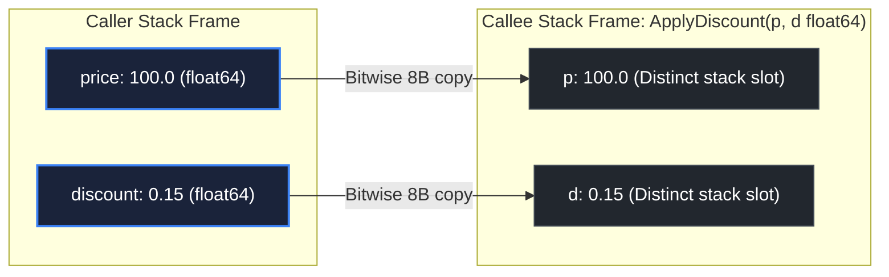

# Parameters

> *"The bigger the interface, the weaker the abstraction."*
> — Rob Pike, Go Proverbs (2015)

## Learning objective

Declare functions with positional parameters, use type shorthand for same-type parameters, and write variadic functions that accept zero or more arguments of a given type.

## Why this matters

Parameters define the interface of every function. Clear, minimal parameter lists make functions easier to call and reason about. Variadic parameters are used throughout Go's standard library — `fmt.Println`, `append`, `errors.Join` — and mastering them lets you write flexible APIs that handle dynamic numbers of arguments.

## Mental model

Parameters are local variables inside the function that receive values from the caller. The caller supplies _arguments_ that are copied into the _parameters_ when the function is called. Think of parameters as "slots" — the caller fills them with values.

Variadic parameters (`...T`) are a special slot that collects all remaining arguments into a slice. The caller can pass zero, one, or many values, and the function receives them as a `[]T`.

## Visual model



## Core idea

Every parameter has a name and a type:

```go
func add(a int, b int) int { ... }
```

When adjacent parameters share the same type, you can omit the type for all but the last:

```go
func add(a, b int) int { ... }
```

A **variadic parameter** is declared with `...` before the type and must be the last (or only) parameter:

```go
func sum(nums ...int) int { ... }
```

Inside the function, `nums` is a `[]int`. The caller can pass any number of `int` arguments:

```go
sum(1, 2, 3)
sum()         // valid — nums is nil or empty slice
```

You can also _slice_ an existing slice into a variadic call with the `...` suffix:

```go
vals := []int{1, 2, 3}
sum(vals...)
```

An empty interface variadic `args ...interface{}` accepts zero or more arguments of any type — this is what `fmt.Println` uses.

## Under the hood

The compiler treats variadic parameters as syntactic sugar. The function signature is rewritten to accept a slice: `func sum(nums []int) int`. A call like `sum(1, 2, 3)` is equivalent to `sum([]int{1, 2, 3})`.

When you pass an existing slice with `vals...`, Go passes the slice directly — no new allocation. When you pass individual arguments, the compiler allocates a new slice backing array on the heap if the number of arguments is not constant across calls; otherwise it may stack-allocate.

## How Go uses it

- **`fmt.Println`** — `func Println(a ...any) (n int, err error)`.
- **`append`** — `func append(slice []T, elems ...T) []T`.
- **`errors.Join`** — `func Join(errs ...error) error`.
- **`log.Printf`** — "format" string plus variadic args: `func Printf(format string, v ...any)`.
- Custom functions that aggregate or batch arguments.

## Go example

```go
package main

import "fmt"

func main() {
	fmt.Println("max() =", max())
	fmt.Println("max(3, 7, 2) =", max(3, 7, 2))
	fmt.Println("max(-5, -1, -10) =", max(-5, -1, -10))
	fmt.Println("concat(\", \", \"a\", \"b\", \"c\") =", concat(", ", "a", "b", "c"))
	fmt.Println("concat(\"-\", \"x\") =", concat("-", "x"))
	fmt.Println("concat(\" \") =", concat(" "))
}

func max(nums ...int) int {
	if len(nums) == 0 {
		return 0
	}
	m := nums[0]
	for _, n := range nums[1:] {
		if n > m {
			m = n
		}
	}
	return m
}

func concat(sep string, parts ...string) string {
	result := ""
	for i, p := range parts {
		if i > 0 {
			result += sep
		}
		result += p
	}
	return result
}
```

## Step-by-step execution
1. `max()` is called with zero arguments, so `nums` is an empty `[]int` slice; `len(nums) == 0` returns `0`.
2. `max(3, 7, 2)` packs the three values into `nums`; the loop keeps the largest, returning `7`.
3. `max(-5, -1, -10)` returns `-1` (the largest of the negatives).
4. `concat(", ", "a", "b", "c")` walks `parts`, inserting the separator between elements: `"a, b, c"`.
5. `concat("-", "x")` has one part, so the separator is never inserted: `"x"`.
6. `concat(" ")` has zero parts; the loop never runs, returning `""`.
## Common mistakes

- **Variadic not last**: `func bad(a ...int, b string)` is a compile error. The variadic parameter must be the final one.
- **Calling with wrong type**: `sum("a", "b")` fails because `"a"` is not assignable to `int`.
- **Forgetting `...` on slice**: `sum(nums)` is a compile error — `nums` is `[]int`, but `sum` expects `int` arguments. Use `sum(nums...)`.
- **Assuming variadic is always a copy**: When you pass `args...` from another variadic, Go passes the slice reference — mutations inside the callee affect the caller's slice.
- **Overusing `...interface{}`**: It disables compile-time type checking. Prefer specific types or generics (Go 1.18+).

## Debugging walkthrough

This code does not compile:

```go
package main

func main() {
	greet("Hello", "Alice", "Bob")
}

func greet(greeting string, names ...string, suffix string) string {
	return ""
}
```

**Symptom**: Compiler error: `syntax error: cannot use ... with non-final parameter names`.

**Root cause**: `suffix` appears after the variadic `names ...string`. The variadic parameter must be the last one.

**Fix**: Either remove `suffix` or make it a variadic too:

```go
func greet(greeting string, names ...string) string {
	result := greeting
	for _, n := range names {
		result += " " + n
	}
	return result
}
```

## Production notes

- **Type shorthand** is preferred for conciseness: `func add(a, b int) int` not `func add(a int, b int) int`.
- **Variadic for optional args**: When a function naturally takes zero or more items of the same kind (e.g., options, log entries), variadic is idiomatic.
- **Empty interface variadic** is used in logging, formatting, and middleware but should be avoided in business logic where type safety matters.
- **Document the variadic**: `// Sum returns the sum of zero or more ints.` clarifies usage.

## Performance implications

- **Individual args → slice**: Passing individual variadic arguments allocates a new slice each call. In hot paths, consider accepting a slice explicitly to control allocation at the call site.
- **Slice expansion (`args...`)**: No new allocation — the original slice is reused.
- **Empty variadic call** (`sum()`) allocates an empty slice (`nums` is `[]int{}`), which is a small allocation.

## Practice task

Write a function `max(nums ...int) int` that returns the largest value among the arguments. If no arguments are passed, return `0`. Then write a function `concat(sep string, parts ...string) string` that joins `parts` with `sep` between them. In `main()`, call both with various inputs and print results.

## Tests / verification

```bash
go run ./curriculum/modules/04-functions-errors-data-semantics/lessons/02-parameters
go test ./curriculum/modules/04-functions-errors-data-semantics/lessons/02-parameters
```

## Review questions

1. What does `func add(a, b int) int` mean in terms of parameter types?
2. How do you declare a variadic parameter that accepts zero or more `float64` values?
3. Given `nums := []int{1, 2, 3}`, how do you call `sum(nums ...int)` with `nums`?
4. Can a function have more than one variadic parameter? Why or why not?
5. What is the type of the variadic parameter `args ...interface{}` inside the function body?

## NEXT UP

Advance to return value semantics:

- [Lesson 03: Return values](../03-return-values/README.md)
