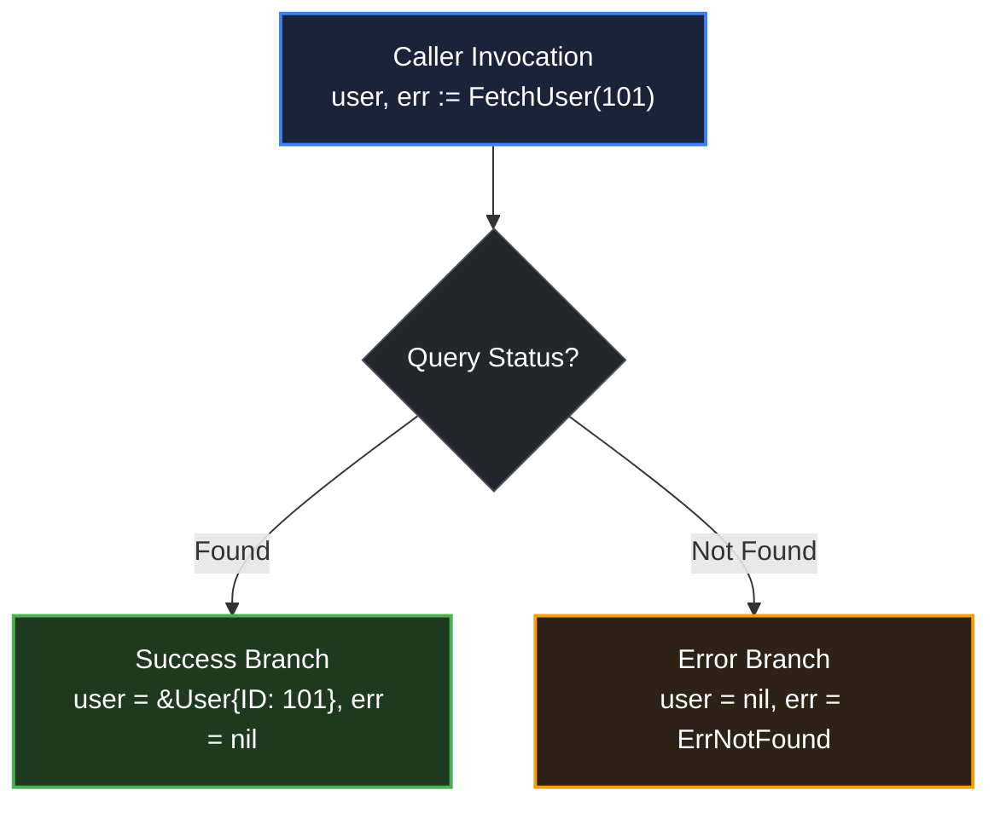

# Multiple return values

> *"Clear is better than clever."*
> — Rob Pike, Go Proverbs (2015)

## Learning objective

Write and call functions that return multiple values, use the `(T, error)` return idiom, discard unwanted returns with the blank identifier `_`, and name multiple return values for clarity.

## Why this matters

Multiple return values are one of Go's signature features. They enable the idiomatic `(value, error)` pattern that makes error handling explicit rather than relying on exceptions. Understanding how to return and consume multiple values is essential for writing idiomatic Go.

## Mental model

A function can return a tuple of values. Think of it like a delivery: the function hands back several items at once. The caller receives them by assigning to a comma-separated list of variables.

The blank identifier `_` acts as a "don't care" slot. If a function returns three values but you only need two, assign the unwanted one to `_`.

## Visual model



## Core idea

Multiple return types are listed in parentheses:

```go
func div(a, b int) (int, error) {
    if b == 0 {
        return 0, errors.New("division by zero")
    }
    return a / b, nil
}
```

Callers receive all values:

```go
result, err := div(10, 0)
if err != nil {
    log.Fatal(err)
}
```

**Named multiple returns** work the same as single named returns:

```go
func divide(a, b int) (result int, err error) {
    if b == 0 {
        err = errors.New("division by zero")
        return // naked return: returns 0 and the error
    }
    result = a / b
    return // naked return: returns result and nil
}
```

**Blank identifier** discards unwanted values:

```go
quotient, _ := div(10, 3) // ignore the error (not recommended in production)
_, err := div(10, 0)      // ignore the result, check the error
```

## Under the hood

Go's multi-return values are not a tuple type — they are multiple values on the stack. When a function returns `(int, error)`, the compiler allocates space for both values on the caller's frame. The function writes both values before returning, and the caller reads them.

This is different from languages that pack multiple values into a single tuple object. In Go, there is no allocation or boxing — multiple returns are a low-level calling convention feature.

## How Go uses it

- **`(T, error)` idiom**: The standard pattern for functions that can fail.
- **Comma-ok idiom**: `val, ok := map[key]` — two returns from map access.
- **Comma-ok type assertion**: `val, ok := x.(Type)`.
- **Channel receive**: `val, ok := <-ch`.
- **Splitting results**: Functions that return both a result and a status (e.g., `strconv.Atoi`).

## Go example

```go
package main

import (
	"errors"
	"fmt"
	"strconv"
)

func main() {
	inputs := []string{"42", "-1", "abc", "0"}
	for _, s := range inputs {
		val, err := parsePositive(s)
		if err != nil {
			fmt.Printf("parsePositive(%q) error: %v\n", s, err)
		} else {
			fmt.Printf("parsePositive(%q) = %d\n", s, val)
		}
	}
}

func parsePositive(s string) (int, error) {
	n, err := strconv.Atoi(s)
	if err != nil {
		return 0, err
	}
	if n <= 0 {
		return 0, errors.New("value must be positive")
	}
	return n, nil
}
```

## Step-by-step execution
1. `main` iterates over the inputs `"42"`, `"-1"`, `"abc"`, `"0"`.
2. For `"42"`: `strconv.Atoi` succeeds, the `n <= 0` guard passes, and `parsePositive` returns `(42, nil)` — the caller prints `42`.
3. For `"-1"`: `Atoi` succeeds but `n <= 0`, so `parsePositive` returns `(0, errors.New("value must be positive"))`.
4. For `"abc"`: `Atoi` fails, and the parse error is returned as-is — the caller sees the exact `strconv` message.
5. For `"0"`: the positivity guard fires again.
6. Each call site uses the two-value idiom: the value and the error are inspected together.
## Common mistakes

- **Calling a multi-return function in a single-value context**: `result := divide(10, 3)` is a compile error — you must assign both values, or use `_` for the ones you ignore.
- **Forgetting the second return in an error path**: `return a / b` when the signature is `(int, error)` — you must return both values.
- **Ignoring errors with `_`**: `result, _ := divide(...)` discards the error. Only do this when you are absolutely certain the error is impossible (e.g., `divide(0, 1)`).
- **Confusing return order**: The order in the signature must match the order in `return`. Returning `(nil, result)` when the signature says `(int, error)` is a type error.

## Debugging walkthrough

This code does not compile:

```go
package main

import "fmt"

func half(n int) (int, bool) {
	if n%2 == 0 {
		return n / 2, true
	}
	// missing return for odd case
}

func main() {
	fmt.Println(half(4))
}
```

**Symptom**: `missing return at end of function`.

**Root cause**: When `n` is odd, the `if` body is skipped and no `return` follows.

**Fix**:

```go
func half(n int) (int, bool) {
	if n%2 == 0 {
		return n / 2, true
	}
	return n / 2, false
}
```

## Production notes

- **Always handle errors**: Check `err != nil` immediately after the call. Ignoring errors with `_` is appropriate only in toy code or when the function contract guarantees success.
- **Named returns for documentation**: In functions with multiple returns of the same type, names help the reader: `func parse(input string) (tokens []string, err error)`.
- **Consistent ordering**: Standard Go convention is `(result, error)` when one return is the success value and the other is an error. Do not swap the order.
- **Zero values on error**: When returning an error, the other return values should be their zero values so callers do not accidentally use invalid data.

## Performance implications

- Multiple return values compile to multiple contiguous values on the stack — no heap allocation.
- Named multiple returns do not add overhead.
- Returning large structs alongside an error still copies the struct. If the struct is large and the error path is common, consider returning a pointer.

## Practice task

Write a function `parsePositive(s string) (int, error)` that:
- Uses `strconv.Atoi` to convert the string to an `int`
- Returns an error if the result is negative or zero
- Returns `(value, nil)` on success

In `main()`, call it with `"42"`, `"-1"`, `"abc"`, and `"0"`, printing each result or error.

## Tests / verification

```bash
go run ./curriculum/modules/04-functions-errors-data-semantics/lessons/04-multiple-return-values
go test ./curriculum/modules/04-functions-errors-data-semantics/lessons/04-multiple-return-values
```

## Review questions

1. Write the function signature for a function that returns an `int` and an `error`.
2. How do you call a two-return-value function when you only care about the second return value?
3. What is the blank identifier, and how is it used with multiple return values?
4. Can named multiple return values use naked returns? Give an example.
5. Why does `result := divide(10, 3)` fail to compile if `divide` returns `(int, error)`?

## NEXT UP

Advance to variable scoping rules:

- [Lesson 05: Scope](../05-scope/README.md)
