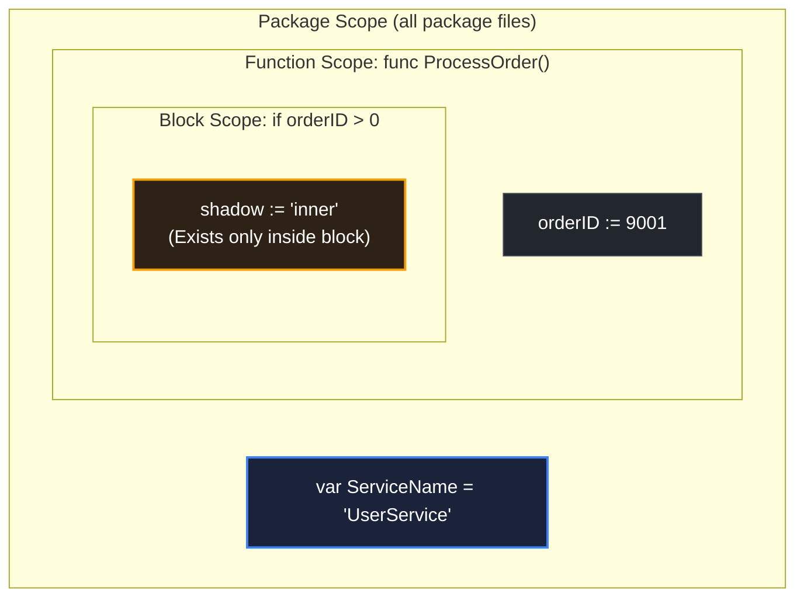

# Scope

> *"The value of an expression depends only on the values of its sub-expressions and the bindings of its variables."* — Peter Landin

## Learning objective

Identify the scope of variables in Go — package scope, function scope, and block scope — and explain how lexical scoping and shadowing affect variable visibility and lifetime.

## Why this matters

Scope determines where a variable is visible and usable. Bugs caused by shadowing, unintended variable reuse, or accessing variables outside their scope are common in every codebase. Understanding scope is essential for writing correct code, especially as programs grow beyond a single file.

## Mental model

Scope is the region of source code where a name (variable, function, type) is visible. Think of it as concentric circles: the innermost block can see outwards, but outer blocks cannot see inwards.

- **Package scope**: visible everywhere in the package (all files).
- **Function scope**: visible from declaration to the end of the function.
- **Block scope**: visible only within `{ }` braces.

Lexical scoping means the scope is determined by the source code structure at compile time, not by runtime call paths.

## Visual model



## Core idea

**Package scope**: Declarations at the top level (outside any function) are visible in all files of the same package. This includes variables, constants, types, and functions.

```go
package main

var packageVar = "visible everywhere in main"

func hello() {
    fmt.Println(packageVar) // ok
}
```

**Function scope**: Variables declared in a function are visible from their declaration to the end of the function.

**Block scope**: Variables declared inside `{ }` (if, for, switch, etc.) are visible only within that block. Each `case` in a `switch` or `select` is also a block.

**Shadowing**: A variable declared in an inner scope with the same name as one in an outer scope "shadows" (hides) the outer one. The outer variable is inaccessible within that inner block.

**Scope vs lifetime**: Scope is compile-time visibility. Lifetime is how long a variable exists at runtime. A variable can be out of scope but still alive (e.g., closure capturing a local variable).

## Under the hood

The Go compiler builds a symbol table that maps names to declarations. When the compiler encounters a name, it searches from the innermost scope outward. The first match wins — that's why shadowing occurs.

At runtime, local variables typically live on the stack (function scope) or in registers. Variables captured by closures escape to the heap, extending their lifetime beyond their scope. The compiler performs escape analysis to decide this.

## How Go uses it

- **Package-level variables** for configuration, shared state, or caches (use sparingly).
- **Local variables** for computation within a function.
- **Block-scoped variables** in `if`, `for`, `switch` to limit visibility.
- **Shadowing** is common (and often accidental) in `if err := ...` — you think you are assigning to an outer `err`, but instead you create a new one.

## Go example

```go
package main

import "fmt"

var name = "global"

func main() {
	fmt.Println("demoScope result:", demoScope())
}

func demoScope() string {
	globalCopy := name
	name := "local"
	localCopy := name

	if true {
		name := "block"
		blockCopy := name

		// Return in order: block, local, global
		return blockCopy + " " + localCopy + " " + globalCopy
	}

	// unreachable but keeps return type satisfied
	return ""
}
```

## Step-by-step execution
1. `main` calls `demoScope`; `demoScope` reads the package-level `name` ("global") into `globalCopy`.
2. `name := "local"` declares a new function-scope `name`, shadowing the package-level one; `localCopy` captures it.
3. Inside the `if true` block, `name := "block"` shadows again; `blockCopy` captures "block".
4. The return expression concatenates the three: `"block local global"`.
5. The block-scope `name` disappears when the `if` ends; the function-scope and package-level `name`s were untouched by the inner declarations.
## Common mistakes

- **Accidental shadowing with `:=`**: Inside an `if` or `for`, `err := ...` creates a new `err`, shadowing an outer one. Use `=` (with `err` already declared) to reuse the outer variable.
- **Using loop variable after loop**: Go 1.22 fixed this, but in older versions, `for i := 0; i < 3; i++` declared a single `i` reused across iterations. Capturing `&i` in a goroutine caused bugs.
- **Assuming if/for variable is accessible outside**: `if x := compute(); x > 0 { ... }` — `x` is only visible inside the `if` block and its `else`.
- **Shadowing needed packages**: `fmt := "hello"` shadows the `"fmt"` package import, preventing any use of `fmt.Println` in that scope.

## Debugging walkthrough

This code has a subtle shadowing bug:

```go
package main

import (
	"errors"
	"fmt"
)

func main() {
	err := errors.New("outer error")
	fmt.Println("before:", err)

	if true {
		err := errors.New("inner error")
		fmt.Println("inside:", err)
	}

	fmt.Println("after:", err) // still prints "outer error"!
}
```

**Symptom**: The `after` print shows `"outer error"` even though "inner error" was assigned.

**Root cause**: Inside the `if` block, `err := ...` creates a new variable `err` that shadows the outer `err`. The outer `err` is never modified.

**Fix**: Use `=` instead of `:=` to reuse the existing outer variable:

```go
if true {
    err = errors.New("inner error") // assignment, not declaration
}
```

## Production notes

- **Minimise package-level variables**: They increase coupling and make testing harder. Prefer passing state explicitly through function parameters.
- **Limit variable scope**: Declare variables as close to their use as possible. This reduces the cognitive load of tracking where a variable is modified.
- **Shadow detection**: The `go vet` tool can detect some shadowing cases. Use `go vet ./...` regularly.
- **Named returns**: A named return variable has function scope. If you redeclare it with `:=` inside the function, you shadow it — the named return is no longer accessible.

## Performance implications

- Package-level variables live for the entire program lifetime — they cannot be garbage collected.
- Block-scoped variables are typically stack-allocated and freed when the block exits.
- Variables captured by closures escape to the heap, increasing GC pressure.
- Scoping has zero runtime cost — it is purely a compile-time concept.

## Practice task

Write a function `demoScope() string` that:
- Declares a package-level variable `name = "global"`
- Declares a function-level `name` with value `"local"`
- Inside an `if true` block, declares a block-level `name` with value `"block"`
- Returns the concatenation of all three values in order (block, local, global) — but you cannot access them directly once shadowed. Hint: assign to different variables before shadowing.

## Tests / verification

```bash
go run ./curriculum/modules/04-functions-errors-data-semantics/lessons/05-scope
go test ./curriculum/modules/04-functions-errors-data-semantics/lessons/05-scope
```

## Review questions

1. What is the difference between package scope and block scope?
2. What is variable shadowing, and how does `:=` cause accidental shadowing?
3. Can a block-scoped variable be accessed after the block ends?
4. If a function declares `x := 1` and an inner `if` declares `x := 2`, does the outer `x` change? Explain.
5. What does `go vet` report about shadowing?

## NEXT UP

Advance to call stack mechanics:

- [Lesson 06: Call stack mental model](../06-call-stack-mental-model/README.md)
