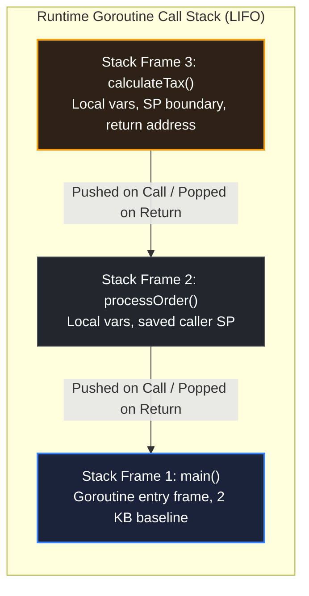

# Call stack mental model

> *"It was on one of my journeys between the EDSAC room and the punching equipment that the realization came over me with full force that a good part of the remainder of my life was going to be spent in finding errors in my own programs."*
> — Maurice V. Wilkes, *Memoirs of a Computer Pioneer* (1985)

## Learning objective

Visualise the call stack as a LIFO structure of stack frames, track how data flows between frames, and distinguish stack allocation from heap allocation in Go.

## Why this matters

Every function call pushes a new frame onto the stack; every return pops the frame. Stack overflow, goroutine stack growth, and escape analysis are direct consequences of this model. Understanding the call stack helps you debug crashes, reason about recursion, and write memory-efficient code.

## Mental model

The call stack is a stack of "frames" — one per active (called but not yet returned) function. It operates like a stack of plates:
- **Push**: When a function is called, a new frame is placed on top.
- **Pop**: When a function returns, its frame is removed (popped).
- **LIFO**: The last function called is the first to return.

Each frame contains the function's parameters, local variables, and the return address (where execution should continue after the function returns). The frame at the top is the currently executing function.

## Visual model



## Core idea

**Stack frames** grow downward in memory (on most architectures). The stack pointer (SP) marks the boundary of the current frame. When `main` calls `foo` which calls `bar`, the stack looks like:

```
  | main frame     |  ← bottom (pushed first)
  | foo frame      |
  | bar frame      |  ← top (currently executing)
  +----------------+
```

When `bar` returns, its frame is popped and execution resumes in `foo`.

**Stack vs heap**:
- **Stack**: Small, fast, per-goroutine, LIFO. For local variables whose size is known at compile time.
- **Heap**: Large, slower, shared, garbage-collected. For variables that outlive their creating function or have dynamic size.

**Goroutine stacks**: Each goroutine starts with a small stack (2 KB in Go 1.4+). When needed, Go's runtime dynamically grows (or shrinks) the stack by copying it to a larger (or smaller) memory region. This is transparent to the programmer.

## Under the hood

When `main` calls `foo(42)`:

1. The caller (`main`) pushes the argument `42` and the return address onto the stack.
2. Execution jumps to `foo`'s code.
3. `foo` adjusts the stack pointer to reserve space for its local variables.
4. During execution, local variables are accessed via offsets from the stack pointer.
5. When `foo` returns, it restores the stack pointer to `main`'s frame and jumps to the return address.

The compiler performs **escape analysis**: if a local variable's address is returned or stored in a globally reachable location, the variable "escapes" to the heap. Otherwise, it is allocated on the stack.

Go's stack is **contiguous** (since Go 1.3). Before that, Go used segmented stacks. The contiguous stack model is simpler: when the stack runs out of space, the runtime allocates a larger buffer and copies the entire stack, updating pointers.

## How Go uses it

- **Recursive functions** push many frames. Deep recursion (e.g., 100,000 calls) may exceed the goroutine's stack limit and cause a crash.
- **Defer** is implemented as a linked list on the goroutine, but the deferred function itself still creates a frame when called.
- **Goroutines** each have their own stack, starting at 2 KB and growing as needed. This is why you can have millions of goroutines but not millions of OS threads.
- **`runtime.Stack`** lets you inspect the call stack programmatically for debugging or logging.

## Go example

```go
package main

import "fmt"

func main() {
	fmt.Println("fib(5) =", fib(5))
}

func fib(n int) int {
	indent := ""
	for i := 0; i < 5-n; i++ {
		indent += "  "
	}
	fmt.Printf("%sfib(%d) called\n", indent, n)

	if n <= 1 {
		fmt.Printf("%sfib(%d) returns %d\n", indent, n, n)
		return n
	}

	a := fib(n - 1)
	b := fib(n - 2)
	result := a + b
	fmt.Printf("%sfib(%d) returns %d\n", indent, n, result)
	return result
}
```

## Step-by-step execution
1. `main` calls `fib(5)`, pushing a frame whose indent level (0) marks its depth.
2. `fib(5)` calls `fib(4)`, which calls `fib(3)`, down to `fib(1)` — five frames deep; the printed indentation visualizes the stack depth.
3. `fib(1)` and `fib(0)` hit the base case and return immediately.
4. Each returning frame is popped, and its caller resumes: `fib(2)` returns `1`, `fib(3)` returns `2`, and so on up to `fib(5)` returning `5`.
5. The maximum stack depth equals the recursion depth — five simultaneous `fib` frames at the deepest point.
## Common mistakes

- **Deep recursion causing stack overflow**: `runtime: goroutine stack exceeds 1000000000-byte limit` — each recursive call adds a frame. For deep recursion, use iteration or tail-call workarounds.
- **Assuming all variables are on the stack**: If you take the address of a local variable (`&x`) and return it, `x` escapes to the heap. This is correct but may surprise you if you are watching allocations.
- **Confusing goroutine stacks with OS threads**: Goroutine stacks are small and dynamic. A goroutine blocked on I/O does not hold its stack frame.
- **Forgetting defer runs in the same stack frame**: The deferred call's arguments are evaluated immediately, but the call itself executes when the surrounding function returns.

## Debugging walkthrough

Consider this program that crashes:

```go
package main

func recurse(n int) int {
	if n == 0 {
		return 0
	}
	return n + recurse(n-1)
}

func main() {
	recurse(1000000)
}
```

**Symptom**: Panic: `runtime: goroutine stack exceeds 1000000000-byte limit`.

**Root cause**: Each recursive call pushes a frame. With 1,000,000 calls, the stack grows to gigabytes and exceeds the limit.

**Fix**: Rewrite as iteration:

```go
func recurse(n int) int {
	total := 0
	for i := n; i > 0; i-- {
		total += i
	}
	return total
}
```

Alternatively, use a smaller input: `recurse(10000)` is fine.

## Production notes

- **Stack overflow limits**: Go's stack limit is 1 GB per goroutine (as of Go 1.19). This is very large, but unbounded recursion can still hit it.
- **Escape analysis** is your friend: run `go build -gcflags="-m"` to see which variables escape. Minimise heap allocations in hot paths.
- **Stack tracing**: When a panic occurs, Go prints the full goroutine stack trace. Use `debug.PrintStack()` for manual inspection.
- **Goroutine leaks**: A goroutine blocked forever holds its stack frame. Use `pprof` goroutine profiles to detect leaks.

## Performance implications

- **Stack allocation** is nearly free (just a stack pointer adjustment). Heap allocation requires garbage collector coordination.
- **Stack growth** involves copying the entire stack (up to 1 GB). This is rare in practice but expensive when it happens.
- **Inline expansion** eliminates the frame entirely — the callee's code is placed in the caller's frame. This is the most important optimisation for small functions.
- **Passing large structs by value** copies them into the callee's frame, increasing stack memory and copy time. Use pointers for large structs.

## Practice task

Write a recursive function `fib(n int) int` that computes the nth Fibonacci number. Use `fmt.Printf` with increasing indentation to print each call depth (e.g., `  fib(3)`, `    fib(2)`). Run it with `fib(5)` and observe the call/return pattern in the output.

## Tests / verification

```bash
go run ./curriculum/modules/04-functions-errors-data-semantics/lessons/06-call-stack-mental-model
go test ./curriculum/modules/04-functions-errors-data-semantics/lessons/06-call-stack-mental-model
```

## Review questions

1. What data is stored in a stack frame?
2. In what order are frames pushed and popped?
3. What triggers a variable to be heap-allocated instead of stack-allocated?
4. How does Go's goroutine stack differ from an OS thread stack?
5. What happens when a goroutine's stack needs more space?

## NEXT UP

Advance to data semantics and pass-by-value:

- [Lesson 07: Passing by value](../07-passing-by-value/README.md)
