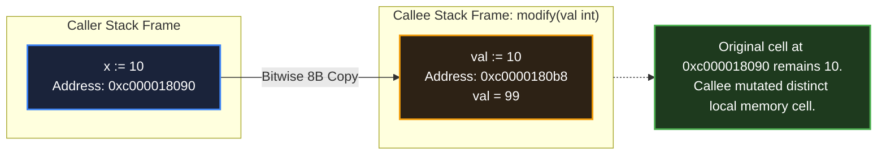

# Passing by value

> *"In C, all function arguments are passed 'by value'."*
> — Brian W. Kernighan & Dennis M. Ritchie, *The C Programming Language* (1978)

## Learning objective

Explain that Go is always pass-by-value, demonstrate how values are copied for all types, and identify when pass-by-value has performance implications for large structs.

## Why this matters

Many developers from C++, Java, or Python assume Go sometimes passes by reference. It does not. Every function argument is a copy. This mistake leads to bugs where a function appears to modify a caller's map or slice header, or where large structs are unexpectedly copied on every call.

## Mental model

When you pass a variable to a function, Go makes a photocopy of it. The function gets its own copy — any changes it makes to the copy do not affect the original.

For maps, slices, and channels, the "value" being copied is the descriptor (pointer, length, capacity). The underlying data is shared, but the descriptor itself is copied. Think of it as photocopying a slip of paper that contains a street address: both you and the function have your own copy of the address, but both point to the same building.

## Visual model



## Core idea

**Go is always pass-by-value.** There are no reference parameters. Every parameter receives a copy of the argument's value.

```go
func zero(x int) {
    x = 0  // modifies the copy, not the caller's variable
}

func main() {
    a := 5
    zero(a)
    fmt.Println(a) // still 5
}
```

**Maps, slices, and channels** are reference types at the data level, but the argument is still a copy of the header. Modifying elements of a map or slice is visible to the caller because both copies point to the same underlying data. However, reassigning the header (e.g., `s = s[:0]` inside the function) is not visible to the caller.

**Large structs** are copied entirely on every function call — including all fields. Passing a 1 MB struct by value copies 1 MB onto the stack.

## Under the hood

When the compiler sees `f(x)`, it generates code that:
1. Evaluates `x` to its value.
2. Pushes a copy of the value onto the stack (or into registers on modern architectures).
3. The called function accesses its own copy.

For a `map[string]int` value, the copied data is a pointer to the runtime hashmap structure (8 bytes on 64-bit systems). The hashmap itself is not copied. Similarly, a `[]int` slice value copies 24 bytes (pointer + length + capacity), not the entire backing array.

## How Go uses it

- **Small types by value**: `int`, `float64`, `bool`, `string` (string header is 16 bytes), small structs — all passed by value with no performance concern.
- **Large structs by pointer**: Pass `*LargeStruct` to avoid copying megabytes of data.
- **Modifying slice elements inside a function**: Works because the copy of the slice header shares the backing array.
- **Appending to a slice inside a function**: If the slice grows beyond its capacity, the function's copy gets a new backing array — the caller's slice header is unchanged.

## Go example

```go
package main

import "fmt"

func main() {
	original := []int{1, 2, 3, 4, 5}
	rotated := rotate(original, 2)
	fmt.Println("original:", original)
	fmt.Println("rotated:", rotated)
}

func rotate(nums []int, n int) []int {
	if len(nums) == 0 {
		return []int{}
	}
	n = n % len(nums)
	result := make([]int, len(nums))
	for i, v := range nums {
		newPos := (i - n + len(nums)) % len(nums)
		result[newPos] = v
	}
	return result
}
```

## Step-by-step execution
1. `original` is a slice: the variable holds a 24-byte header (pointer, length, capacity), not the elements.
2. `rotate(original, 2)` receives a **copy of the header** — both header copies point at the same backing array.
3. `rotate` builds a brand-new `result` slice (a fresh backing array) and returns its header; the caller's `original` is untouched: `[1 2 3 4 5]`.
4. The printed `rotated: [3 4 5 1 2]` is the new slice; comparing the two lines proves the elements were not shared — mutation inside `rotate` would have been invisible anyway because it only wrote to `result`.
## Common mistakes

- **Thinking slices are "passed by reference"**: The slice header is copied, but the backing array is shared. Appending may or may not modify the caller's view depending on capacity.
- **Passing large structs by value unconsciously**: A struct with a `[10000]int` field copied on every call costs 80 KB per call. Use a pointer in the function signature.
- **Expecting map nil assignment to affect caller**: `m = nil` inside a function only nilifies the local copy. The caller's map variable is unchanged.
- **Using pointer receivers when value receivers suffice**: If the method does not mutate the receiver and the receiver is small, a value receiver is simpler and sometimes faster.

## Debugging walkthrough

Consider this code:

```go
package main

import "fmt"

func main() {
	s := []int{1, 2, 3}
	appendTwo(s)
	fmt.Println(s) // still [1 2 3] — user expected [1 2 3 4 5]
}

func appendTwo(s []int) {
	s = append(s, 4, 5)
}
```

**Symptom**: `s` prints `[1 2 3]` even though `appendTwo` added elements.

**Root cause**: `appendTwo` receives a copy of the slice header. When `append` needs to grow the backing array, it creates a new one and assigns the new header to the local `s`. The caller's `s` is unchanged.

**Fix**: Return the new slice:

```go
func appendTwo(s []int) []int {
    return append(s, 4, 5)
}
```

Caller: `s = appendTwo(s)`.

## Production notes

- **Prefer pass-by-value for small types**: It is simpler, avoids nil checks, and enables immutability guarantees at the function boundary.
- **Use `*T` for large structs**: When a struct exceeds ~64 bytes or contains a large array/slice, pass a pointer to avoid copying overhead.
- **Slices in APIs**: If the function may grow the slice, return the new slice. Document whether the slice is modified in place.
- **Maps and channels**: Passing a map or channel is "cheap" because the copied header is small (8 bytes for map, 8 bytes for channel).

## Performance implications

- **Small value copy** (int, bool, struct ≤ 4 words) is as fast as or faster than a pointer copy (no indirection, better cache locality).
- **Large value copy** scales linearly with struct size. A 1 KB struct copy costs ~1 KB of memory bandwidth.
- **Register-based calling convention** (Go 1.17+) passes up to 9 ints and 15 floats in registers, making small value copies extremely cheap.
- **Escape analysis**: Passing a pointer to a small value may cause the value to escape to the heap, making the pointer approach slower than copying on the stack.

## Practice task

Write a function `rotate(nums []int, n int) []int` that returns a new slice with the elements rotated left by `n` positions. The original slice must not be modified. In `main()`, create a slice, call `rotate`, print both the original and the returned slice to verify the original is unchanged.

## Tests / verification

```bash
go run ./curriculum/modules/04-functions-errors-data-semantics/lessons/07-passing-by-value
go test ./curriculum/modules/04-functions-errors-data-semantics/lessons/07-passing-by-value
```

## Review questions

1. Does Go ever pass arguments by reference? Explain.
2. When you pass a slice to a function, what exactly is copied?
3. Why can a function modify the elements of a caller's slice but not the length?
4. What is the performance risk of passing a large struct by value?
5. If a function receives a map and deletes a key, is the caller's map affected? Why?

## NEXT UP

Advance to pointer and value mutation behavior:

- [Lesson 08: Pointer and value mutation behavior](../08-pointer-and-value-mutation-behavior/README.md)
