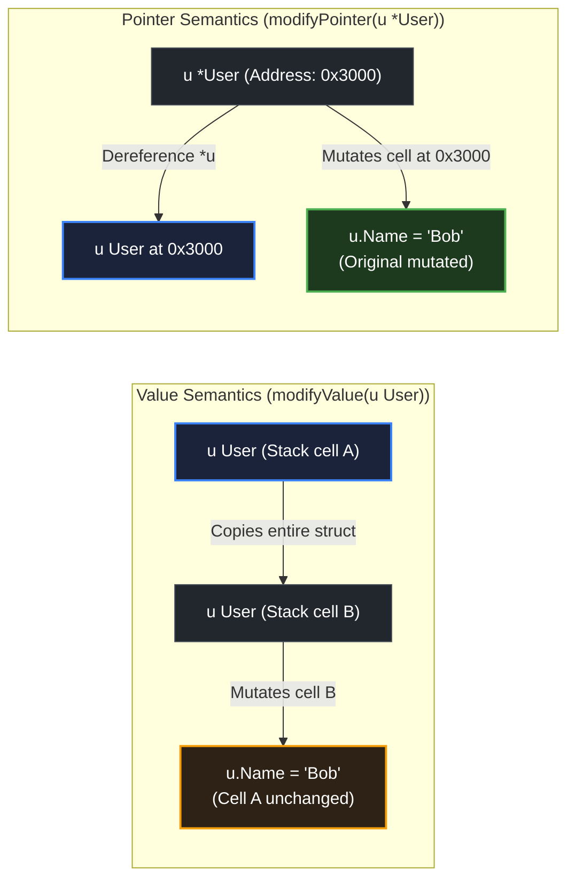

# Pointer and value mutation behavior

> *"Pointers are like jumps, leading wildly from one part of the data structure to another."*
> — C.A.R. Hoare, *Hints on Programming Language Design* (1973)

## Learning objective

Use pointer parameters (`*T`) to mutate caller state, distinguish value receivers from pointer receivers, handle nil pointers safely, and decide when to use pointer vs value parameters.

## Why this matters

Go gives you explicit control over whether a function can modify its caller's data. Pointers make mutations visible and intentional. Choosing between value and pointer semantics for function parameters and method receivers is a daily decision in Go that affects correctness, API design, and performance.

## Mental model

A pointer is an address — a signpost to a value. Passing a `*T` gives the function the signpost. The function can follow it to reach and modify the original value.

A value receiver reads the signpost and copies what is at the destination; the method works on its own private copy. A pointer receiver keeps the signpost and can modify the original.

Nil is a valid pointer value meaning "no signpost here." Dereferencing a nil pointer panics, so you must check before following.

## Visual model



## Core idea

Pointer parameter:

```go
func zero(x *int) {
    *x = 0 // dereference to write through the pointer
}

func main() {
    a := 5
    zero(&a) // pass address
    fmt.Println(a) // 0
}
```

Value receiver vs pointer receiver on a type:

```go
type Counter struct {
    Value int
}

// Value receiver — cannot mutate the original.
func (c Counter) String() string {
    return fmt.Sprintf("Count: %d", c.Value)
}

// Pointer receiver — can mutate.
func (c *Counter) Increment() {
    c.Value++ // no explicit dereference needed — Go does it
}
```

**When to use pointer parameters**:
1. You need to modify the caller's variable.
2. The value is large (> ~64 bytes) and you want to avoid copying.
3. The value's type has pointer receiver methods, and you want consistency.
4. You need to represent "no value" (nil).

**Nil pointer safety**: Always check `if p == nil { return }` before dereferencing a pointer parameter.

## Under the hood

A pointer in Go is an unsigned integer holding a memory address (8 bytes on 64-bit systems). When you pass `*T`, the 8-byte address is copied onto the stack. Dereferencing (`*p`) reads the value at that address.

The compiler performs **nil pointer checking** at the hardware level for each dereference. A nil dereference triggers a segmentation fault, which Go's runtime catches and turns into a panic.

## How Go uses it

- **Method sets**: Value methods can be called on both values and pointers. Pointer methods can only be called on pointer values (or addressable values — Go takes the address automatically for you in most cases).
- **Interface satisfaction**: A type with only value methods satisfies an interface for both `T` and `*T`. A type with pointer methods only satisfies it for `*T`.
- **Setters**: `func (u *User) SetName(name string)` — pointer receiver mutates the user.
- **Large structs**: `func (r *Report) Summary() string` — pointer receiver avoids copying the report.
- **Nil checks**: `if req == nil { return 0, errors.New("nil request") }`.

## Go example

```go
package main

import "fmt"

type Bank struct {
	accounts map[string]int
}

func NewBank() *Bank {
	return &Bank{accounts: make(map[string]int)}
}

func (b *Bank) Deposit(name string, amount int) {
	if b == nil || b.accounts == nil {
		return
	}
	b.accounts[name] += amount
}

func (b *Bank) Withdraw(name string, amount int) bool {
	if b == nil || b.accounts == nil {
		return false
	}
	if b.accounts[name] < amount {
		return false
	}
	b.accounts[name] -= amount
	return true
}

func (b *Bank) Balance(name string) (int, bool) {
	if b == nil || b.accounts == nil {
		return 0, false
	}
	bal, ok := b.accounts[name]
	return bal, ok
}

func main() {
	bank := NewBank()

	bank.Deposit("Alice", 200)
	bank.Deposit("Bob", 100)

	fmt.Println("Alice balance:", balStr(bank.Balance("Alice")))
	fmt.Println("Bob balance:", balStr(bank.Balance("Bob")))

	bank.Withdraw("Alice", 50)
	fmt.Println("After withdrawal, Alice:", balStr(bank.Balance("Alice")))

	bank.Withdraw("Bob", 999)
	fmt.Println("Bob attempted large withdraw:", balStr(bank.Balance("Bob")))
}

func balStr(bal int, ok bool) string {
	if !ok {
		return "N/A"
	}
	return fmt.Sprintf("$%d", bal)
}
```

## Step-by-step execution
1. `NewBank()` returns `&Bank{...}` — a pointer to a struct whose `accounts` map is heap-allocated.
2. `bank.Deposit("Alice", 200)` is a pointer-receiver call: `b` is a copy of the pointer, but it addresses the same `Bank` struct, so `b.accounts[name] += amount` mutates the shared map.
3. `Balance("Alice")` reads through the same pointer: `$200`.
4. `Withdraw("Alice", 50)` mutates again: `$150`.
5. `Withdraw("Bob", 999)` fails the balance guard and returns `false` — Bob's balance stays `$100`.
6. Contrast: had the methods used value receivers, each call would have copied the `Bank` struct and the mutations would be lost.
## Common mistakes

- **Forgetting `&` when calling a pointer-param function**: `zero(a)` with `func zero(x *int)` — compile error. Use `zero(&a)`.
- **Dereferencing nil pointer**: `var p *int; fmt.Println(*p)` → panic. Always check for nil or initialise pointers.
- **Confusing `*T` and `T` in method sets**: Calling a pointer receiver method on a non-addressable value (e.g., `Account{}.Deposit(10)`) fails to compile.
- **Using value receiver for large structs**: Each call copies the entire struct. Use `*T` receiver.
- **Comparing pointers instead of values**: `p1 == p2` checks if both point to the same address, not if the values are equal. Use `*p1 == *p2` for value equality.

## Debugging walkthrough

This code compiles but panics:

```go
package main

import "fmt"

type User struct {
	Name string
}

func (u *User) Greet() {
	fmt.Println("Hello,", u.Name) // nil dereference!
}

func main() {
	var u *User
	u.Greet()
}
```

**Symptom**: Panic: `runtime error: invalid memory address or nil pointer dereference`.

**Root cause**: `u` is `nil`. The method `Greet` is called on `nil`, and accessing `u.Name` dereferences the nil pointer.

**Fix**: Add a nil check at the start of `Greet`:

```go
func (u *User) Greet() {
	if u == nil {
		fmt.Println("Hello, nobody")
		return
	}
	fmt.Println("Hello,", u.Name)
}
```

## Production notes

- **Consistent receiver type**: If any method on a type needs a pointer receiver, make all methods use pointer receivers. This avoids confusion about the method set.
- **Nil pointer safety in public APIs**: Always document whether `nil` is a valid argument. Check for nil at the start of the function and return early or return an error.
- **Avoid returning pointers to zero values**: Returning `&T{}` allocates on the heap. Consider returning `T` by value if the struct is small.
- **`new(T)` vs `&T{}`**: `new(T)` returns `*T` pointing to a zero-valued `T`. `&T{}` does the same but allows field initialisation.

## Performance implications

- **Pointer copy is cheap**: 8 bytes on 64-bit, regardless of what the pointer points to.
- **Indirection costs**: Accessing `*p` requires an extra memory load. For small hot-path values, passing by value (no indirection) can be faster.
- **Escape**: Taking a pointer to a local variable causes it to escape to the heap. In hot paths, consider returning by value.
- **GC pressure**: Pointers to heap-allocated objects keep them alive. Minimise pointers in large data structures to reduce GC scan time.

## Practice task

Write a type `Bank` with a map of account balances (`map[string]int`). Implement methods with pointer receivers:
- `NewBank() *Bank` — returns a pointer to a new Bank.
- `(b *Bank) Deposit(name string, amount int)`
- `(b *Bank) Withdraw(name string, amount int) bool`
- `(b *Bank) Balance(name string) (int, bool)`

In `main()`, create a bank, deposit and withdraw, and print balances.

## Tests / verification

```bash
go run ./curriculum/modules/04-functions-errors-data-semantics/lessons/08-pointer-and-value-mutation-behavior
go test ./curriculum/modules/04-functions-errors-data-semantics/lessons/08-pointer-and-value-mutation-behavior
```

## Review questions

1. How do you declare a function parameter that can modify the caller's int variable?
2. What is the difference between a value receiver and a pointer receiver?
3. What happens if you dereference a nil pointer?
4. When should you use a pointer parameter instead of a value parameter?
5. Can a value be modified inside a function without a pointer parameter? Give an example.

## NEXT UP

Advance to error handling fundamentals:

- [Lesson 09: Errors as values](../09-errors-as-values/README.md)
