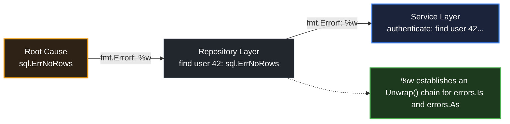

# Error wrapping

> *"Wrapping in an error type is more work but more useful."*
> — Russ Cox, Go 2 Error Inspection proposal (2019)

## Learning objective

Wrap errors with additional context using `fmt.Errorf` and the `%w` verb, explain when wrapping is appropriate versus when it adds noise, and unwrap errors programmatically using `errors.Unwrap`.

## Why this matters

A bare error like `"not found"` tells you something went wrong but not where, why, or what operation failed. In a production system with dozens of database calls, API requests, and file reads, an unwrapped error is a dead end for debugging. Error wrapping is how Go engineers build a breadcrumb trail through the call stack so that the final error message reads like a narrative: `"fetch user: db query: not found"` instead of `"not found"`.

## Mental model

Think of error wrapping as nesting Russian dolls. Each `fmt.Errorf("context: %w", err)` call places the original error inside a new doll that carries a label. When you print the error with `%v` or `Error()`, you see the labels from outermost to innermost: `"context: inner context: original error"`. When you call `errors.Unwrap`, you open the outer doll to reveal the next one in. The entire chain is a singly linked list of errors.

## Visual model



## Core idea

Go 1.13 introduced error wrapping through the `fmt.Errorf` `%w` verb and the `errors.Unwrap` function. The `%w` verb creates a wrapped error that implements the `Unwrap() error` interface.

Once an error is wrapped, you cannot use `==` to compare it against a sentinel — the wrapped error is a different value. Instead, `errors.Is(err, target)` walks the entire error chain calling `Unwrap` at each level and checks if any error in the chain matches the target. This lets callers:

1. **Read the chain** -- `err.Error()` prints all levels with `:` separators.
2. **Check the chain** -- `errors.Is(err, sentinel)` walks the chain matching values.
3. **Extract from the chain** -- `errors.As(err, &target)` walks the chain matching types.

Not every error needs wrapping. Rules of thumb:

| Wrap when | Don't wrap when |
|---|---|
| Adding operation context (e.g., "fetch user") | The error already carries full context |
| Crossing a package boundary | The error is already the final user-facing message |
| The caller needs to check the original error type/value | Wrapping adds no new information (e.g., `fmt.Errorf("err: %w", err)`) |
| Building an error chain for debugging | The error is a simple, one-off message with no chain value |

## Under the hood

When the compiler sees `fmt.Errorf("read config: %w", err)`, it creates a `*fmt.wrapError` struct (unexported type in the `fmt` package). This struct stores:

- A `msg` string (the format text with `%w` replaced by the error's string).
- An `err` field holding the original error.

The struct's `Error()` method returns `msg`. Its `Unwrap()` method returns `err`. This satisfies the `interface { Unwrap() error }` contract that `errors.Is` and `errors.As` rely on.

`errors.Unwrap` simply checks if the error implements `Unwrap() error` and calls it, or returns `nil`. It only unwraps one level; `errors.Is` and `errors.As` call it repeatedly in a loop.

## How Go uses it

The standard library uses wrapping extensively:

- `os.PathError` wraps the underlying syscall error.
- `net.OpError` wraps DNS and I/O errors.
- `database/sql` wraps driver errors with query context.
- `*url.Error` wraps connection errors.

Your own code should follow the same pattern: wrap at every logical call boundary.

```go
_, err := db.QueryContext(ctx, query, args...)
if err != nil {
    return fmt.Errorf("query orders for user %d: %w", userID, err)
}
```

## Go example

```go
package main

import (
	"errors"
	"fmt"
)

var ErrNotFound = errors.New("resource not found")

func fetchData(source string) error {
	switch {
	case source == "":
		return fmt.Errorf("fetch %s: %w", source, ErrNotFound)
	case source == "badhost":
		return fmt.Errorf("fetch %s: %w", source, errors.New("connection refused"))
	case source == "valid":
		return nil
	default:
		return fmt.Errorf("fetch %s: %w", source, errors.New("unknown source"))
	}
}

func main() {
	sources := []string{"", "badhost", "valid"}
	for _, src := range sources {
		err := fetchData(src)
		if err == nil {
			fmt.Printf("fetchData(%q): OK\n", src)
			continue
		}
		fmt.Printf("fetchData(%q): %v\n", src, err)
		fmt.Printf("  errors.Is(err, ErrNotFound) = %v\n", errors.Is(err, ErrNotFound))
		fmt.Printf("  errors.Unwrap(err)          = %v\n", errors.Unwrap(err))
	}
}
```

## Step-by-step execution
1. `fetchData("")` returns `fmt.Errorf("fetch %s: %w", source, ErrNotFound)` — the error carries context ("fetch :") plus the wrapped sentinel.
2. `errors.Is(err, ErrNotFound)` walks the wrap chain and finds the sentinel: `true`.
3. `errors.Unwrap(err)` strips the context layer and prints the bare sentinel: "resource not found".
4. `fetchData("badhost")` wraps a fresh "connection refused" error; `errors.Is` returns `false` because the chain does not contain `ErrNotFound`.
5. `fetchData("valid")` returns `nil` — the caller prints OK.
## Common mistakes

- **Using `%v` or `%s` instead of `%w`**: `fmt.Errorf("context: %v", err)` prints the error string but discards the error value. `errors.Is` and `errors.As` will not find the original error. Only `%w` preserves the unwrap chain.

- **Wrapping a nil error**: `fmt.Errorf("context: %w", nil)` returns a non-nil error that formats as `"context: %!w(<nil>)"` and unwraps to nil. Always guard with `if err != nil` before wrapping.

- **Multiple `%w` verbs**: A single `fmt.Errorf` can only have one `%w`. Using multiple causes a compile error `"calling Errorf with multiple %w verbs"`. Use `errors.Join` to combine multiple errors.

- **Wrapping in a loop**: Each wrap adds a layer. Ten wraps in a loop produce a ten-layer chain. This is rarely useful. Wrap at logical boundaries, not in mechanical loops.

- **Wrapping with `fmt.Errorf` when you mean `errors.New`**: `fmt.Errorf("some error")` works but should be `errors.New("some error")` for a simple sentinel.

## Debugging walkthrough

```go
package main

import (
	"errors"
	"fmt"
)

var ErrInvalidInput = errors.New("invalid input")

func process(input string) error {
	if input == "" {
		return ErrInvalidInput
	}
	return nil
}

func handleRequest(data string) error {
	err := process(data)
	if err != nil {
		return fmt.Errorf("handle request: %w", err)
	}
	return nil
}

func main() {
	err := handleRequest("")
	fmt.Println(err)
	fmt.Println(errors.Is(err, ErrInvalidInput))
}
```

**Symptom**: `main()` prints the wrapped error `"handle request: invalid input"` and `errors.Is` returns `true`.

**Investigation**: Change `%w` to `%v` in `handleRequest`:

```go
return fmt.Errorf("handle request: %v", err)
```

Now `errors.Is(err, ErrInvalidInput)` returns `false`. The error message is the same, but the chain is broken.

**Root cause**: `%v` calls `err.Error()` to produce a string but does not store the original error. The chain is lost.

**Fix**: Always use `%w` when the caller needs to inspect the original error. Use `%v` only when the error is a terminal message that no caller will ever match against.

## Production notes

- **Wrap at every I/O boundary**: Database queries, HTTP calls, file operations, and RPCs should always wrap errors with operation context (what you were doing, what identifier you were using).

- **Don't wrap at the top level**: The outermost handler (HTTP middleware, CLI main) typically logs the full error chain and returns a user-friendly message. Wrapping there adds noise.

- **Structured logging**: Some teams avoid `fmt.Errorf` wrapping and use structured logging with error fields instead. This is a valid trade-off when you have a logging system that can aggregate errors by type.

- **Sentinel errors should be public**: Define `var ErrX = errors.New(...)` as exported package-level variables so callers can use `errors.Is`.

- **Avoid wrapping errors from external packages you don't control**: You may accidentally match an internal sentinel. Wrap with your own domain error instead.

## Performance implications

`fmt.Errorf` with `%w` allocates a new `*fmt.wrapError` struct and a string for the message. This is a heap allocation. In hot paths (thousands of errors per second), this adds GC pressure. For high-throughput systems:

- Error paths are usually cold (exceptional), so allocation cost is negligible.
- For truly hot error paths, use a custom error type with pre-allocated structs or avoid wrapping entirely.
- `errors.New` also allocates but only once (the sentinel value is a singleton).

## Practice task

Write a function `fetchData(source string) error` that:

1. Returns `fmt.Errorf("fetch %s: %w", source, ErrNotFound)` when `source` is empty.
2. Returns `fmt.Errorf("fetch %s: %w", source, errors.New("connection refused"))` when `source == "badhost"`.
3. Returns `nil` when `source == "valid"`.

In `main()`, call `fetchData` with all three inputs, print each error, and use `errors.Is` and `errors.Unwrap` to inspect the results.

## Tests / verification

```bash
go run ./curriculum/modules/04-functions-errors-data-semantics/lessons/10-error-wrapping
go test ./curriculum/modules/04-functions-errors-data-semantics/lessons/10-error-wrapping
```

## Review questions

1. What does `%w` do differently from `%v` in `fmt.Errorf`?
2. How many `%w` verbs can appear in a single `fmt.Errorf` call?
3. What does `errors.Unwrap` return if the error does not implement `Unwrap() error`?
4. When is it appropriate to NOT wrap an error?
5. If you wrap a nil error with `fmt.Errorf("x: %w", nil)`, what happens?

## NEXT UP

Advance to sentinel error inspection with errors.Is:

- [Lesson 11: errors.Is](../11-errors-is/README.md)
