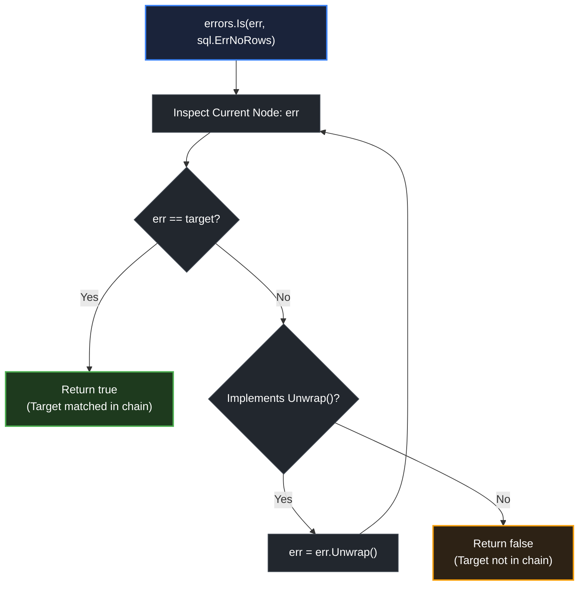

# errors.Is

> *"Controlling complexity is the essence of computer programming."* — Brian Kernighan

## Learning objective

Use `errors.Is` to match sentinel errors through a wrapping chain, explain the difference between `==` and `errors.Is`, and implement a custom `Is` method on an error type.

## Why this matters

A database function wraps `sql.ErrNoRows` with `"query user: %w"`. A file parser wraps `io.EOF` with `"parse chunk: %w"`. Without `errors.Is`, every caller would need to unwrap errors manually or match against string prefixes. `errors.Is` provides a single, consistent way to ask: "does this error chain contain the target sentinel?" It is the standard tool for error matching in modern Go.

## Mental model

Imagine a chain of linked envelopes. Each envelope contains a message and a pointer to the next envelope. `errors.Is(err, target)` starts at the outermost envelope, checks if its contents match the target, then opens it and repeats on the next envelope. If any envelope matches, the answer is `true`. If the chain runs out, `false`. It is a depth-first search of a singly linked list.

## Visual model



## Core idea

`errors.Is` compares an error against a target by:

1. First checking `err == target` (pointer/value equality).
2. If the error implements `Is(error) bool`, calling that method (custom matching logic).
3. Calling `Unwrap()` and repeating on the inner error.

This means `errors.Is` handles three scenarios:

- **Direct match**: `err == target` -- the error is the sentinel itself.
- **Wrapped match**: `err` wraps a chain that contains `target`.
- **Custom match**: The error type has an `Is` method that defines equality differently (e.g., a network error that matches any timeout).

## Under the hood

`errors.Is` is defined in the standard library:

```go
func Is(err, target error) bool {
    if target == nil {
        return err == target
    }
    isComparable := reflectlite.TypeOf(target).Comparable()
    for {
        if isComparable && err == target {
            return true
        }
        if x, ok := err.(interface{ Is(error) bool }); ok {
            if x.Is(target) {
                return true
            }
        }
        switch x := err.(type) {
        case interface{ Unwrap() error }:
            err = x.Unwrap()
            if err == nil {
                return false
            }
        case interface{ Unwrap() []error }:
            for _, e := range x.Unwrap() {
                if Is(e, target) {
                    return true
                }
            }
            return false
        default:
            return false
        }
    }
}
```

The `for` loop walks the chain. At each step it checks equality (if comparable), then custom `Is`, then tries `Unwrap`. The target is never unwrapped -- it is the fixed sentinel we match against.

## How Go uses it

`errors.Is` is ubiquitous in Go codebases:

```go
// File I/O
_, err := os.Open(path)
if errors.Is(err, fs.ErrNotExist) { ... }

// I/O completion
_, err := reader.Read(buf)
if errors.Is(err, io.EOF) { ... }

// Context cancellation
select {
case <-ctx.Done():
    return errors.Is(ctx.Err(), context.Canceled)
}

// SQL
if errors.Is(err, sql.ErrNoRows) { ... }
```

## Go example

```go
package main

import (
	"errors"
	"fmt"
)

var ErrTimeout = errors.New("timeout")

type NetworkError struct {
	Msg       string
	IsTimeout bool
}

func (n *NetworkError) Error() string {
	return n.Msg
}

func (n *NetworkError) Is(target error) bool {
	return target == ErrTimeout && n.IsTimeout
}

func callService(shouldTimeout bool) error {
	if shouldTimeout {
		return &NetworkError{Msg: "service timed out", IsTimeout: true}
	}
	return &NetworkError{Msg: "service failed", IsTimeout: false}
}

func main() {
	for _, val := range []bool{true, false} {
		err := callService(val)
		if errors.Is(err, ErrTimeout) {
			fmt.Printf("callService(%v): timeout error: %v\n", val, err)
		} else {
			fmt.Printf("callService(%v): other error: %v\n", val, err)
		}
	}
}
```

## Step-by-step execution
1. `callService(true)` returns a `*NetworkError` with `IsTimeout: true`.
2. `errors.Is(err, ErrTimeout)` does not just compare pointers — it calls the error's own `Is(target)` method, which returns `true` because `IsTimeout` is set and the target matches the sentinel.
3. `callService(false)` returns a `*NetworkError` with `IsTimeout: false`; its `Is` method returns `false`, so `errors.Is` reports a non-timeout failure.
4. The lesson: a custom error type can participate in `errors.Is` matching by implementing `Is(target error) bool` — no wrapping required.
## Common mistakes

- **Using `==` instead of `errors.Is` on wrapped errors**: `err == ErrNotFound` returns `false` when `err` wraps `ErrNotFound`. Always use `errors.Is` when the error might be wrapped.

- **Using `errors.Is` with a non-sentinel error value**: Passing a dynamically allocated error (e.g., `fmt.Errorf("oops")`) as the target. `errors.Is` checks equality by `==`, so two dynamically allocated errors with the same string are never equal.

- **Passing arguments in wrong order**: `errors.Is(target, err)` instead of `errors.Is(err, target)`. The first argument is the error chain; the second is the sentinel target.

- **Assuming `errors.Is` works with string matching**: `errors.Is` does not compare `Error()` strings. It checks pointer/value equality and custom `Is` methods.

- **Using `errors.Is` with nil target**: `errors.Is(err, nil)` returns `err == nil`. This is almost always a mistake.

## Debugging walkthrough

```go
package main

import (
	"errors"
	"fmt"
)

var ErrPermission = errors.New("permission denied")

type AppError struct {
	Code int
	Msg  string
}

func (a *AppError) Error() string {
	return fmt.Sprintf("code %d: %s", a.Code, a.Msg)
}

func doSomething() error {
	return &AppError{Code: 403, Msg: "forbidden"}
}

func main() {
	err := doSomething()
	if errors.Is(err, ErrPermission) {
		fmt.Println("permission error")
	} else {
		fmt.Println("unknown error:", err)
	}
}
```

**Symptom**: Prints "unknown error: code 403: forbidden" instead of "permission error".

**Investigation**: `*AppError` wraps nothing and does not implement `Is(error) bool`. `err == ErrPermission` is `false` because they are different types.

**Root cause**: The error type `*AppError` is not a sentinel -- it is a struct with fields. `errors.Is` cannot structurally match the code 403 to `ErrPermission`.

**Fix**: Either return `ErrPermission` directly when permission is denied, or implement `Is` on `*AppError`:

```go
func (a *AppError) Is(target error) bool {
    return target == ErrPermission && a.Code == 403
}
```

## Production notes

- **Always use `errors.Is` for sentinel matching in library code**: Callers may wrap your sentinel. Using `errors.Is` in your own internal checks makes your code reliable to its own wrapping.

- **Prefer sentinel errors over error types when callers only need equality**: A sentinel (`var ErrX = errors.New(...)`) is simpler and works with `errors.Is` trivially. Only create a custom type when you need to carry structured data.

- **Custom `Is` is rare but powerful**: Use it when two different error values should be considered equal (e.g., any HTTP 4xx matches `ErrClientError`).

- **Benchmark `errors.Is` in hot paths**: The chain walk is O(n) in chain depth. In hot error-checking paths (e.g., every request), keep chains shallow (1-2 wraps).

## Performance implications

`errors.Is` allocates no heap memory in the common case (the loop uses only stack variables). However, the chain walk is O(depth). Each `Unwrap` call is a virtual method call (interface dispatch). For typical chains of 1-3 levels, the cost is negligible. For chains longer than 10 levels, consider restructuring or using a custom error type that avoids deep wrapping.

Custom `Is` methods may allocate if they perform string comparison or other logic -- evaluate on a case-by-case basis.

## Practice task

Define a sentinel `var ErrTimeout = errors.New("timeout")` and a custom error type `NetworkError` with fields `Msg string` and `IsTimeout bool`. Implement `Error() string` and `Is(target error) bool` on `*NetworkError` so that `errors.Is(err, ErrTimeout)` returns `true` when `IsTimeout` is true.

Write a function `callService(shouldTimeout bool) error` that returns a `*NetworkError`. In `main`, call it with both `true` and `false` and use `errors.Is` to check for `ErrTimeout`.

## Tests / verification

```bash
go run ./curriculum/modules/04-functions-errors-data-semantics/lessons/11-errors-is
go test ./curriculum/modules/04-functions-errors-data-semantics/lessons/11-errors-is
```

## Review questions

1. What is the difference between `err == ErrSentinel` and `errors.Is(err, ErrSentinel)`?
2. What does `errors.Is(err, target)` return if `target` is `nil`?
3. Can `errors.Is` match a target through an error chain of depth 5? How?
4. When would you implement a custom `Is` method on your error type?
5. What happens in the `errors.Is` loop when the error implements `Unwrap() []error`?

## NEXT UP

Advance to error type assertions with errors.As:

- [Lesson 12: errors.As](../12-errors-as/README.md)
