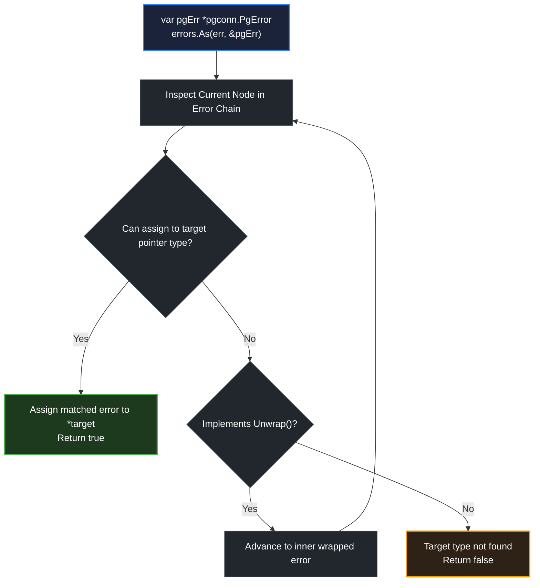

# errors.As

> *"The programmer, like the poet, works only slightly removed from pure thought-stuff."* — Fred Brooks

## Learning objective

Use `errors.As` to find and extract the first error in a chain that matches a target type, explain the difference between `errors.As` and a direct type assertion, and implement a custom `As` method on an error type.

## Why this matters

Sentinel errors (checked with `errors.Is`) tell you _which_ error occurred. Custom error types (extracted with `errors.As`) tell you _what details_ the error carries -- a status code, a field name, a correlation ID. When your database layer returns a `*pgconn.PgError` with a Postgres error code, or your HTTP client returns an `*APIError` with a retry-after header, you need `errors.As` to extract those details through the wrapping chain.

## Mental model

`errors.Is` asks "does this chain contain the target value?" `errors.As` asks "does this chain contain a value of the target type?" Think of `errors.As` as a type-aware probe: it walks the chain, checks if each error's type matches (or implements) the target, and if so, assigns the error to the target pointer and returns `true`. It stops at the first match, not the deepest.

## Visual model



## Core idea

`errors.As` searches the error chain for the first error that can be assigned to the target. The target must be a non-nil pointer to either an error type or an interface type. It works by:

1. Checking if `err` can be assigned to `target` (using reflection-like assignment via `reflectlite`).
2. If not, calling `Unwrap()` and repeating.
3. If a match is found, assigning `err` to the target and returning `true`.

Unlike `errors.Is`, which checks by value equality, `errors.As` checks by type compatibility. This makes it the right tool for extracting structured error data.

## Under the hood

The core loop of `errors.As`:

```go
func As(err error, target interface{}) bool {
    if target == nil {
        panic("errors.As: target cannot be nil")
    }
    val := reflectlite.ValueOf(target)
    typ := val.Type()
    if typ.Kind() != reflectlite.Ptr || val.IsNil() {
        panic("errors.As: target must be a non-nil pointer")
    }
    targetType := typ.Elem()
    if targetType.Kind() != reflectlite.Interface && !targetType.Implements(errorType) {
        panic("errors.As: target must be an error interface or implement error")
    }
    for {
        if reflectlite.TypeOf(err).AssignableTo(targetType) {
            val.Elem().Set(reflectlite.ValueOf(err))
            return true
        }
        if x, ok := err.(interface{ As(interface{}) bool }); ok && x.As(target) {
            return true
        }
        switch x := err.(type) {
        case interface{ Unwrap() error }:
            err = x.Unwrap()
            if err == nil {
                return false
            }
        case interface{ Unwrap() []error }:
            for _, e := range x.Unwrap() {
                if As(e, target) {
                    return true
                }
            }
            return false
        default:
            return false
        }
    }
}
```

The `target` must always be a `*T` where `T` implements `error`. Common usage: `var myErr *MyErrorType; errors.As(err, &myErr)`.

## How Go uses it

```go
// Extracting a DNS error
var dnsErr *net.DNSError
if errors.As(err, &dnsErr) {
    fmt.Println("DNS server:", dnsErr.Server)
}

// Extracting a Postgres error
var pgErr *pgconn.PgError
if errors.As(err, &pgErr) {
    fmt.Println("SQLSTATE:", pgErr.Code)
}

// Extracting an HTTP response error
var httpErr *HTTPError
if errors.As(err, &httpErr) {
    fmt.Println("Status:", httpErr.StatusCode)
}
```

## Go example

```go
package main

import (
	"errors"
	"fmt"
)

type HTTPError struct {
	StatusCode int
	Body       string
}

func (h *HTTPError) Error() string {
	return fmt.Sprintf("HTTP %d: %s", h.StatusCode, h.Body)
}

func fetchURL(url string) error {
	switch url {
	case "/missing":
		return fmt.Errorf("fetch %s: %w", url, &HTTPError{StatusCode: 404, Body: "not found"})
	case "/broken":
		return fmt.Errorf("fetch %s: %w", url, &HTTPError{StatusCode: 500, Body: "server error"})
	case "/ok":
		return nil
	default:
		return fmt.Errorf("fetch %s: %w", url, &HTTPError{StatusCode: 400, Body: "bad request"})
	}
}

func main() {
	urls := []string{"/missing", "/broken", "/ok", "/other"}
	for _, url := range urls {
		err := fetchURL(url)
		var httpErr *HTTPError
		if errors.As(err, &httpErr) {
			fmt.Printf("URL %s -> HTTP %d: %q\n", url, httpErr.StatusCode, httpErr.Body)
		} else if err == nil {
			fmt.Printf("URL %s -> OK\n", url)
		} else {
			fmt.Printf("URL %s -> unknown: %v\n", url, err)
		}
	}
}
```

## Step-by-step execution
1. `fetchURL("/missing")` wraps a `*HTTPError{404, "not found"}` with `%w`.
2. `errors.As(err, &httpErr)` walks the chain, finds a `*HTTPError`, and points `httpErr` at it — the caller extracts `StatusCode` and `Body`.
3. `/broken` and `/other` are handled the same way with different status codes.
4. `/ok` returns `nil`, so `errors.As` is skipped and the caller prints OK.
5. `errors.As` differs from `errors.Is`: it matches by **type** (extracting the struct) rather than by **value** (matching a sentinel).
## Common mistakes

- **Passing `nil` as the target pointer**: `errors.As(err, nil)` panics. The target must be a non-nil pointer.

- **Passing `**MyType` instead of `*MyType`**: `var target *MyType; errors.As(err, target)` where `target` is nil. The target pointer itself must be non-nil (even if it points to nil). Use `&target`.

- **Using `errors.As` when `errors.Is` suffices**: If you only need to know _which_ sentinel matched, use `errors.Is`. `errors.As` is for extracting data from the error.

- **Forgetting that `errors.As` assigns to the first match**: If the chain contains multiple matching errors, `errors.As` returns the first (outermost) one, not the deepest or most specific.

- **Checking the extracted value without checking the return**: Always guard with `if errors.As(err, &target)` before using `target`. If `As` returns `false`, `target` is unchanged (nil).

## Debugging walkthrough

```go
package main

import (
	"errors"
	"fmt"
)

type TempError struct {
	Temp int
}

func (t *TempError) Error() string {
	return fmt.Sprintf("temp %d", t.Temp)
}

func main() {
	err := fmt.Errorf("wrap: %w", &TempError{Temp: 95})
	var target *TempError
	if errors.As(err, &target) {
		fmt.Println("Temp:", target.Temp)
	}
}
```

**Symptom**: Prints `"Temp: 95"`. Works correctly.

**Investigation**: Change to `var target *TempError; errors.As(err, target)` (without `&`):

**Symptom**: Panics with "target must be a non-nil pointer".

**Root cause**: `target` is nil. The function receives a nil `*TempError`. The `reflectlite` code sees a nil pointer and panics.

**Fix**: Always use `&target`:

```go
var target *TempError
if errors.As(err, &target) {
    fmt.Println("Temp:", target.Temp)
}
```

## Production notes

- **Prefer `errors.As` over type assertions in public APIs**: If your function returns a wrapped error, callers can use `errors.As` to extract it. A direct type assertion `err.(*MyType)` fails on wrapped errors.

- **Extract once, use many**: Extract the typed error at the boundary and convert to domain-specific logic. Avoid calling `errors.As` multiple times for the same error.

- **Custom `As` method**: Implement `As(target interface{}) bool` on your error type when the error type hierarchy doesn't match Go's type hierarchy (e.g., a `NetworkError` should match `*TimeoutError`, `*DNSError`, etc.).

## Performance implications

`errors.As` uses reflection (`reflectlite.TypeOf`, `AssignableTo`) at each step of the chain walk. This is more expensive than `errors.Is` which uses only `==`. For typical chains (depth 1-3), the cost is acceptable. In hot paths, consider:

- Minimizing chain depth.
- Using `errors.Is` for sentinel matching and only falling back to `errors.As` when you need the extracted data.
- Pre-allocating the target pointer (`var target *MyType`) outside a loop to avoid allocating the pointer each time.

## Practice task

Define a custom error type `HTTPError` with fields `StatusCode int` and `Body string`. Implement `Error() string`. Write a function `fetchURL(url string) error` that:

- Returns `&HTTPError{StatusCode: 404, Body: "not found"}` when `url == "/missing"`.
- Returns `&HTTPError{StatusCode: 500, Body: "server error"}` when `url == "/broken"`.
- Wraps it with `fmt.Errorf("fetch %s: %w", url, err)`.
- Returns `nil` when `url == "/ok"`.

In `main()`, call `fetchURL` with all three inputs. Use `errors.As` to extract `*HTTPError` and print the status code and body.

## Tests / verification

```bash
go run ./curriculum/modules/04-functions-errors-data-semantics/lessons/12-errors-as
go test ./curriculum/modules/04-functions-errors-data-semantics/lessons/12-errors-as
```

## Review questions

1. What is the difference between `errors.As` and a direct type assertion like `err.(*MyType)`?
2. Why must the target in `errors.As` be a non-nil pointer?
3. What happens if `errors.As` finds no error of the target type in the chain?
4. Can `errors.As` match an interface type as the target? Give an example.
5. When would you implement a custom `As` method on your error type?

## NEXT UP

Advance to structured input validation:

- [Lesson 13: Validation](../13-validation/README.md)
