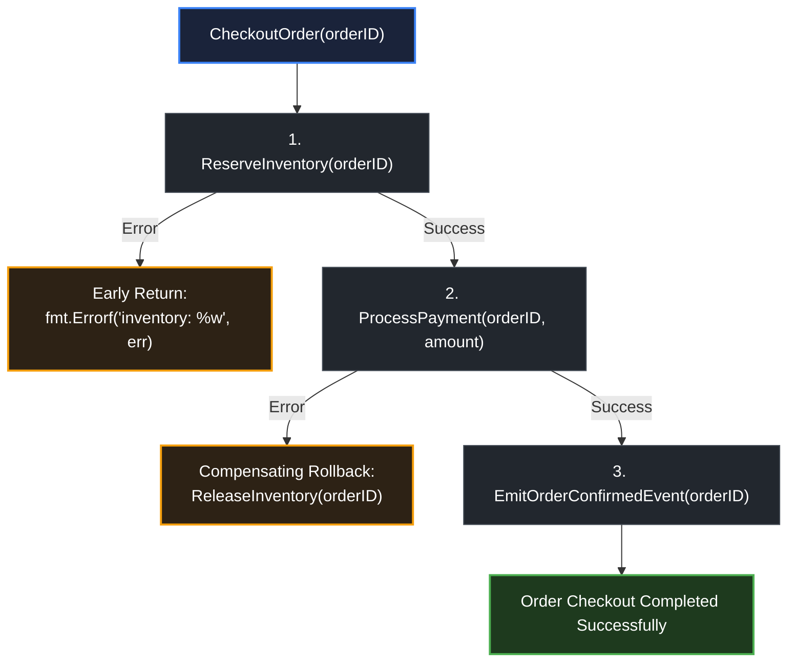

# Orchestration

> *"Fools ignore complexity. Pragmatists suffer it. Some can avoid it. Geniuses remove it."* — Alan Perlis

## Learning objective

Compose multiple functions that return errors, implement short-circuit and collect-all error strategies, and build resilient retry logic with error handling.

## Why this matters

Real-world Go programs rarely call a single function. They call a database function, then a business-logic function, then a notification function, then an audit-log function. Each can fail. How you handle those failures -- stop on first error, collect all errors, retry transient failures, or degrade gracefully -- determines the reliability of your system. Orchestration is the art of coordinating multi-step operations with clear error semantics.

## Mental model

Think of orchestration as a pipeline of steps connected by error policy. Each step is a function `func(...) (Result, error)`. The orchestrator decides:

- **Short-circuit**: Stop on first error (fail-fast).
- **Collect all**: Run every step regardless of failures (best-effort).
- **Retry**: If a step fails with a transient error, retry it (resilience).
- **Fallback**: If a step fails, use a degraded result (graceful degradation).

The orchestrator is not the business logic -- it is the glue that calls the logic and decides what happens when things go wrong.

## Visual model



## Core idea

Go makes error orchestration explicit because errors are values. There is no exception system to silently skip error handling. Every call that returns an error must be handled, which forces the developer to decide the orchestration strategy.

Basic orchestration patterns:

```go
// Short-circuit (fail-fast)
func process(ctx context.Context, input Input) error {
    user, err := fetchUser(ctx, input.UserID)
    if err != nil {
        return fmt.Errorf("fetch user: %w", err)
    }
    order, err := createOrder(ctx, user, input.Items)
    if err != nil {
        return fmt.Errorf("create order: %w", err)
    }
    if err := notify(ctx, order); err != nil {
        return fmt.Errorf("notify: %w", err)
    }
    return nil
}
```

```go
// Collect all errors (best-effort)
func syncAll(ctx context.Context) error {
    var errs []error
    if err := syncUsers(ctx); err != nil {
        errs = append(errs, fmt.Errorf("sync users: %w", err))
    }
    if err := syncProducts(ctx); err != nil {
        errs = append(errs, fmt.Errorf("sync products: %w", err))
    }
    if err := syncOrders(ctx); err != nil {
        errs = append(errs, fmt.Errorf("sync orders: %w", err))
    }
    return errors.Join(errs...)
}
```

## Under the hood

Error-orchestration patterns are not built into the Go runtime -- they are composable patterns built from functions, errors, and control flow. The compiler compiles each `if err != nil` branch into a conditional jump. There is no hidden cost to error checking.

Retry logic requires a loop, a backoff duration, and a predicate to distinguish transient from permanent errors:

```go
func retry(attempts int, backoff time.Duration, fn func() error) error {
    var err error
    for i := 0; i < attempts; i++ {
        if err = fn(); err == nil {
            return nil
        }
        if !isTransient(err) {
            return err
        }
        time.Sleep(backoff)
        backoff *= 2 // exponential backoff
    }
    return fmt.Errorf("all %d attempts failed: %w", attempts, err)
}
```

## How Go uses it

Every production Go HTTP handler is an orchestrator:

```go
func handleCreateOrder(w http.ResponseWriter, r *http.Request) {
    var req CreateOrderRequest
    if err := json.NewDecoder(r.Body).Decode(&req); err != nil {
        http.Error(w, "invalid request", http.StatusBadRequest)
        return
    }
    user, err := store.GetUser(r.Context(), req.UserID)
    if err != nil {
        http.Error(w, "user not found", http.StatusNotFound)
        return
    }
    order, err := business.CreateOrder(r.Context(), user, req.Items)
    if err != nil {
        http.Error(w, "order failed", http.StatusInternalServerError)
        return
    }
    json.NewEncoder(w).Encode(order)
}
```

Each step is synchronous and checked. The pattern forces you to handle each failure mode at the point where it occurs.

## Go example

```go
package main

import (
	"errors"
	"fmt"
	"math/rand"
	"time"
)

var (
	ErrTransient = errors.New("transient error")
	ErrPermanent = errors.New("permanent error")
)

func build(service string) error {
	if service == "" {
		return fmt.Errorf("build: %w", ErrPermanent)
	}
	return nil
}

func test(service string) error {
	if rand.Intn(2) == 0 {
		return fmt.Errorf("test: %w", ErrTransient)
	}
	return nil
}

func deployToProd(service string) error {
	return nil
}

func isTransient(err error) bool {
	return errors.Is(err, ErrTransient)
}

func retry(attempts int, fn func() error) error {
	var err error
	for i := 0; i < attempts; i++ {
		if err = fn(); err == nil {
			return nil
		}
		if !isTransient(err) {
			return err
		}
		time.Sleep(10 * time.Millisecond)
	}
	return fmt.Errorf("all %d attempts failed: %w", attempts, err)
}

func deploy(service string) error {
	if err := build(service); err != nil {
		return fmt.Errorf("deploy: %w", err)
	}
	if err := retry(3, func() error { return test(service) }); err != nil {
		return fmt.Errorf("deploy: %w", err)
	}
	if err := deployToProd(service); err != nil {
		return fmt.Errorf("deploy: %w", err)
	}
	return nil
}

func main() {
	rand.Seed(time.Now().UnixNano())
	for _, svc := range []string{"", "my-api"} {
		err := deploy(svc)
		if err == nil {
			fmt.Printf("deploy(%q): success\n", svc)
		} else {
			fmt.Printf("deploy(%q): %v\n", svc, err)
		}
	}
}
```

## Step-by-step execution
1. `deploy("")` calls `build`, which fails with `ErrPermanent` wrapped as "deploy: build: permanent error" — `deploy` returns immediately.
2. `deploy("my-api")` passes `build` and enters `retry(3, test)`.
3. `test` fails randomly with `ErrTransient` — `isTransient` returns `true`, so `retry` sleeps 10 ms and tries again, up to three attempts.
4. When `test` succeeds, `deployToProd` runs (always succeeds) and `deploy` returns `nil`.
5. Had `test` failed with a permanent error, `retry` would return immediately without further attempts — transient errors retry, permanent errors abort.
## Common mistakes

- **Silent error swallowing**: `go someFunc()` starts a goroutine whose error is never checked. Either handle the error in the goroutine or pass it back via a channel.

- **Continuing after a permanent error**: Checking `err != nil` but continuing execution because the error isn't returned. Always return or handle the error decisively.

- **Infinite retries**: Retry loops without a maximum attempt count can run forever. Always cap retries.

- **Retrying permanent errors**: Wasting resources retrying an error that will never succeed (e.g., invalid input). Distinguish transient from permanent errors.

- **Nested orchestration without context**: Each layer wraps the error, but the chain can become deep. Keep orchestration flat (1-2 layers).

## Debugging walkthrough

```go
package main

import (
	"errors"
	"fmt"
)

var ErrDiskFull = errors.New("disk full")

func writeLog(entry string) error {
	return ErrDiskFull
}

func processItem(id int) error {
	if err := writeLog(fmt.Sprintf("process %d", id)); err != nil {
		return fmt.Errorf("write log: %w", err)
	}
	// ... more processing
	return nil
}

func batchProcess(ids []int) error {
	var errs []error
	for _, id := range ids {
		if err := processItem(id); err != nil {
			errs = append(errs, err)
		}
	}
	return errors.Join(errs...)
}

func main() {
	err := batchProcess([]int{1, 2, 3})
	if err != nil {
		fmt.Println(err)
		if errors.Is(err, ErrDiskFull) {
			fmt.Println("Disk is full! Stop processing.")
		}
	}
}
```

**Symptom**: Prints all three "write log: disk full" errors and "Disk is full! Stop processing."

**Investigation**: The code continues processing all items even after the first failure. The disk is full -- none of the remaining items will succeed.

**Root cause**: `batchProcess` collects all errors, but the operation is fundamentally broken (disk full). Collecting all errors adds no value; short-circuiting would stop the wasted work.

**Fix**: Short-circuit on permanent errors that make remaining work futile:

```go
func batchProcess(ids []int) error {
    for _, id := range ids {
        if err := processItem(id); err != nil {
            if errors.Is(err, ErrDiskFull) {
                return err // stop immediately
            }
        }
    }
    return nil
}
```

## Production notes

- **Choose the right strategy**: Fail-fast for operations where all steps are required. Collect-all for fan-out operations where steps are independent. Retry with backoff for transient failures.

- **Add a circuit breaker**: If a downstream service is repeatedly failing, stop calling it for a cooldown period. Implement with `https://pkg.go.dev/github.com/sony/gobreaker` or a simple in-memory counter.

- **Timeouts and context**: Pass `context.Context` through the orchestrator. Every step should respect context cancellation so a slow step doesn't block the entire pipeline.

- **Observability**: Log each step's outcome (success/failure, duration) in production orchestrators. This lets you pinpoint which step is failing in a multi-step operation.

## Performance implications

- Error checking (`if err != nil`) compiles to a single comparison and conditional jump. It is negligible.
- Retry loops consume CPU and I/O during retries. Exponential backoff with jitter reduces load on downstream services.
- Collecting all errors with `errors.Join` allocates a new error struct. For fan-out to hundreds of operations, consider a more memory-efficient collection approach.
- Deeply nested orchestration (5+ layers of wrapping) adds O(depth) allocation cost per error. Keep orchestration flat.

## Practice task

Write a function `deploy(service string) error` that orchestrates three steps:
1. `build(service) error` -- fails if service is empty, returns `ErrPermanent`.
2. `test(service) error` -- fails 50% of the time, returns `ErrTransient`.
3. `deployToProd(service) error` -- always succeeds.

Use retry with 3 attempts for the test step. Short-circuit on build failure. In `main`, call `deploy` with `""` and `"my-api"` and print results.

## Tests / verification

```bash
go run ./curriculum/modules/04-functions-errors-data-semantics/lessons/14-orchestration
go test ./curriculum/modules/04-functions-errors-data-semantics/lessons/14-orchestration
```

## Review questions

1. What is the difference between short-circuit and collect-all error orchestration?
2. When would you use a retry loop instead of returning the first error?
3. How do you distinguish a transient error from a permanent error in Go?
4. What happens if you start a goroutine inside an orchestrator and don't handle its error?
5. Why should orchestrators pass `context.Context` through to every step?

## NEXT UP

Advance to defer mechanics and cleanup stacks:

- [Lesson 15: Defer mechanics](../15-defer-mechanics/README.md)
