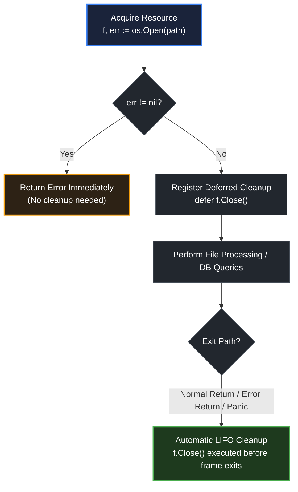

# defer for cleanup

> *"Handle normal and worst cases separately as a rule, because the requirements for the two are quite different: the normal case must be fast, and the worst case must make some progress."*
> — Butler Lampson, *Hints for Computer System Design* (1983)

## Learning objective

Use `defer` to release resources safely: close files, unlock mutexes, commit or roll back transactions, and clean up in error paths. Recognize and avoid defer-in-loop pitfalls.

## Why this matters

A file handle not closed, a mutex not unlocked, or a database transaction not rolled back corrupts state or leaks resources. Before `defer`, cleanup code was duplicated at every `return` statement, and adding a new return path meant adding new cleanup -- a formula for leaks. `defer` eliminates this by binding cleanup to function exit. It is the single most important tool for writing reliable resource-handling code in Go.

## Mental model

`defer` is a contract you make with the function: "When I acquire this resource, I promise to release it before I leave." By placing the release immediately after the acquire, you never forget. The cleanup is guaranteed to run regardless of how the function exits -- normal return, error return, or panic. This is RAII (Resource Acquisition Is Initialization) adapted to Go's explicit error-handling style.

## Visual model



## Core idea

The canonical cleanup pattern in Go:

```go
f, err := os.Open(path)
if err != nil {
    return err
}
defer f.Close()
// ... use f ...
```

This pattern works because:
1. `f.Close()` is deferred before any further code that might fail.
2. It runs on normal return, on error return, and on panic.
3. The `err` check happens before the defer, so `f` is never nil when `Close` is called.

This generalizes to mutexes, transactions, HTTP responses, temporary directories -- any pair of acquire/release operations.

## Under the hood

The compiler tracks `defer` statements and inserts cleanup code in the function epilogue. When the function returns (normally or via panic), the deferred functions execute in LIFO order. This means cleanup happens in reverse acquisition order -- exactly what you want when later resources depend on earlier ones (e.g., a transaction depends on a connection).

The runtime guarantee: `defer` always runs, even through panics. This is implemented in `runtime.gopanic`, which iterates the goroutine's defer list and executes each deferred function during stack unwinding.

## How Go uses it

```go
// Mutex cleanup
mu.Lock()
defer mu.Unlock()

// Transaction commit/rollback
tx, err := db.BeginTx(ctx, nil)
if err != nil {
    return err
}
defer tx.Rollback() // no-op if Commit succeeds
if err := doWork(ctx, tx); err != nil {
    return err
}
return tx.Commit()

// HTTP response body
resp, err := http.Get(url)
if err != nil {
    return err
}
defer resp.Body.Close()

// Temporary directory cleanup
dir, err := os.MkdirTemp("", "example")
if err != nil {
    return err
}
defer os.RemoveAll(dir)
```

## Go example

```go
package main

import (
	"errors"
	"fmt"
	"os"
)

func writeToFile(filename, content string) (err error) {
	file, err := os.Create(filename)
	if err != nil {
		return fmt.Errorf("create file: %w", err)
	}
	defer func() {
		if cerr := file.Close(); cerr != nil && err == nil {
			err = fmt.Errorf("close file: %w", cerr)
		}
	}()
	_, err = file.WriteString(content)
	if err != nil {
		return fmt.Errorf("write file: %w", err)
	}
	return nil
}

func safeProcess(items []string) error {
	var errs []error
	for _, item := range items {
		filename := item + ".txt"
		content := "Content for " + item
		if err := writeToFileToLoop(filename, content); err != nil {
			errs = append(errs, err)
		}
	}
	return errors.Join(errs...)
}

// writeToFileToLoop opens and closes a file within a single iteration (no defer in loop).
func writeToFileToLoop(filename, content string) error {
	file, err := os.Create(filename)
	if err != nil {
		return fmt.Errorf("create: %w", err)
	}
	_, err = file.WriteString(content)
	closeErr := file.Close()
	if err != nil {
		return fmt.Errorf("write: %w", err)
	}
	if closeErr != nil {
		return fmt.Errorf("close: %w", closeErr)
	}
	return nil
}

func main() {
	if err := writeToFile("hello.txt", "Hello, World!"); err != nil {
		fmt.Println("writeToFile error:", err)
	} else {
		fmt.Println("writeToFile: success")
	}

	if err := safeProcess([]string{"a", "b"}); err != nil {
		fmt.Println("safeProcess error:", err)
	} else {
		fmt.Println("safeProcess: success")
	}

	// Cleanup test files
	os.Remove("hello.txt")
	os.Remove("a.txt")
	os.Remove("b.txt")
}
```

## Step-by-step execution
1. `writeToFile` opens `hello.txt`; on success the `defer` registers a closure that closes the file.
2. `WriteString` writes the content; when the function returns, the deferred close runs — and because the return value is **named** (`err error`), the closure can override it if `Close` fails after a successful write.
3. `safeProcess` deliberately does NOT use `defer` inside its loop — deferring in a loop would hold every file open until the function returns; instead `writeToFileToLoop` opens, writes, and closes within each iteration.
4. Errors from each iteration are collected with `errors.Join` and returned together.
## Common mistakes

- **Deferring close on a nil resource**: If `os.Open` returns an error, `f` is nil. `defer f.Close()` would panic because `Close` is called on a nil pointer. Always check the error before deferring.

```go
f, err := os.Open(path)
defer f.Close() // BUG: panics if err != nil
if err != nil {
    return err
}
```

- **Defer in a loop**: Each iteration defers a cleanup that runs only when the function returns, not at the end of the iteration. For large loops, this accumulates O(n) open resources.

```go
for _, path := range paths {
    f, err := os.Open(path)
    if err != nil { return err }
    defer f.Close() // all closes run at function return, not per iteration
    // process f
}
```

- **Shadowed variable in defer closure**: The loop variable capture bug:

```go
for _, name := range names {
    f, err := os.Open(name)
    if err != nil { return err }
    defer func() {
        f.Close() // captures f by reference — f changes each iteration!
    }()
}
```

- **Assuming defer runs before `os.Exit`**: `os.Exit` skips deferred functions. Use `log.Fatal` with care.

## Debugging walkthrough

```go
package main

import "fmt"

type DB struct {
	connected bool
}

func (db *DB) Connect() error {
	db.connected = true
	return nil
}

func (db *DB) Close() error {
	db.connected = false
	return nil
}

func process(db *DB) error {
	if err := db.Connect(); err != nil {
		return err
	}
	defer db.Close()
	return fmt.Errorf("processing error")
}

func main() {
	db := &DB{}
	err := process(db)
	fmt.Println("error:", err)
	fmt.Println("connected:", db.connected) // should be false
}
```

**Symptom**: `db.connected` is `false` after `process` returns, even though the function returned an error. The `defer db.Close()` ran.

**Investigation**: The deferred `Close()` runs after the `return fmt.Errorf(...)` sets the return value but before the function returns to the caller.

**Root cause**: None -- this is correct behavior. The defer ensures cleanup happens even on error.

**Fix**: None needed. This is the intended design.

## Production notes

- **Always pair acquire and defer in the same function**: When you acquire a resource, defer its release in the same function before doing anything that might cause a return. If you pass the resource to another function, that function owns the cleanup.

- **Transaction pattern**: `defer tx.Rollback()` before `tx.Commit()`. If `Commit` succeeds, `Rollback` becomes a no-op. If `Commit` fails, `Rollback` cleans up. This is the standard database transaction pattern in Go.

- **Mutex pattern**: `mu.Lock(); defer mu.Unlock()`. Never use a mutex without defer. The only exception is when the lock must be held across a function call boundary.

- **Error handling in deferred functions**: A deferred `Close()` that returns an error is typically logged, not returned (the function's return value is already set). If you need to handle close errors, use a named return:

```go
func readFile(path string) (data []byte, err error) {
    f, err := os.Open(path)
    if err != nil {
        return nil, err
    }
    defer func() {
        if cerr := f.Close(); cerr != nil && err == nil {
            err = cerr
        }
    }()
    return io.ReadAll(f)
}
```

## Performance implications

- Each `defer` in a function without panic/recover is inlined at each return site (Go 1.14+), making defer essentially free for the common case.
- Deferring in a loop still defers at function scope, not loop scope. For iterating over many items, close resources explicitly at the end of each iteration instead of using defer.
- A deferred function call has the same cost as a direct function call (after the optimization). No additional allocation.

## Practice task

Write a function `writeToFile(filename, content string) error` that:

1. Creates the file with `os.Create`.
2. Defers `file.Close()`.
3. Writes the content with `file.WriteString`.
4. Returns any error from `WriteString`.
5. Returns `nil` on success.

Then write a function `safeProcess(items []string) error` that processes each item by calling `writeToFile`. For each item, open and close the file within the loop iteration (NOT using defer in the loop).

## Tests / verification

```bash
go run ./curriculum/modules/04-functions-errors-data-semantics/lessons/16-defer-for-cleanup
go test ./curriculum/modules/04-functions-errors-data-semantics/lessons/16-defer-for-cleanup
```

## Review questions

1. Why should `defer` be placed immediately after resource acquisition?
2. What happens if you defer `Close()` on a nil resource?
3. How does the transaction pattern `defer tx.Rollback()` followed by `tx.Commit()` work?
4. Why is defer in a loop problematic?
5. Can a deferred function modify the return value of the enclosing function?

## NEXT UP

Advance to crash boundaries with panic and recover:

- [Lesson 17: Panic and recover](../17-panic-and-recover/README.md)
