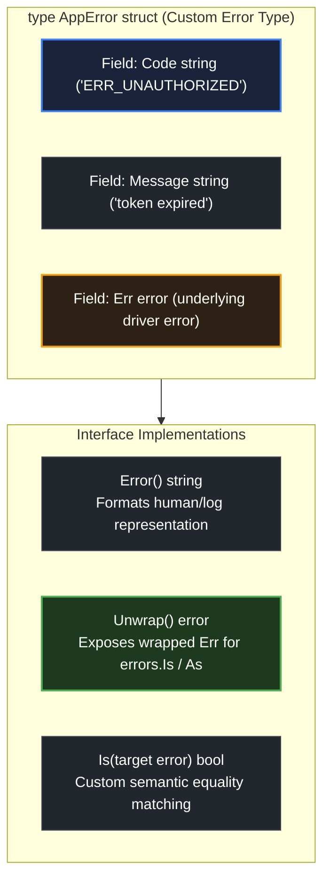

# Custom error types

> *"The connections between modules are the assumptions which the modules make about each other."* — David Parnas

## Learning objective

Design custom error types that implement the `error` interface, carry structured context fields, implement `Is`/`As`/`Unwrap` methods for chain compatibility, and enable callers to extract typed error data.

## Why this matters

Sentinel errors (`var ErrX = errors.New(...)`) tell you _which_ error happened. Custom error types tell you _everything_ about the error: a status code, a field name, a correlation ID, a retry-after duration, or an underlying driver error. In a production system, structured errors are how monitoring systems categorize failures, how API responses render error details, and how operators debug incidents. Go's interface-based error design makes this both possible and idiomatic.

## Mental model

A sentinel error is a post-it note with a message. A custom error type is a structured form with labeled fields. The `Error()` method is the cover page. The `Unwrap()` method links to a related form. The `Is()` method defines what counts as "the same" error. The `As()` method controls how this error can be extracted as another type. The `error` interface is the single requirement; everything else is optional but powerful.

## Visual model



## Core idea

The `error` interface is one method:

```go
type error interface {
    Error() string
}
```

Any type that implements `Error() string` satisfies `error`. A custom error type adds fields for structured data:

```go
type ValidationError struct {
    Field string
    Value interface{}
    Rule  string
}

func (e *ValidationError) Error() string {
    return fmt.Sprintf("%s: rule %q (value=%v)", e.Field, e.Rule, e.Value)
}
```

Optional methods that integrate with the standard library:

- `Unwrap() error` -- supports `errors.Is` and `errors.As` chain walking.
- `Is(target error) bool` -- custom equality logic for `errors.Is`.
- `As(target interface{}) bool` -- custom type-extraction logic for `errors.As`.

## Under the hood

When you assign a custom error to an `error` variable, Go stores a two-word interface value: a pointer to the type information and a pointer to the data. The `Error()` method is called via interface dispatch.

`errors.As` checks if the custom error type is assignable to the target type using `reflectlite.TypeOf(err).AssignableTo(targetType)`. If the custom error implements `As(interface{}) bool`, that method is called instead, allowing the error to control how it is matched.

`errors.Is` follows the same pattern: first `==`, then custom `Is`, then `Unwrap` and repeat.

## How Go uses it

```go
// net.DNSError carries the DNS server IP and the failing name
type DNSError struct {
    Err       string
    Name      string
    Server    string
    IsTimeout bool
}

// *os.PathError carries the operation, path, and underlying error
type PathError struct {
    Op   string
    Path string
    Err  error
}
func (e *PathError) Unwrap() error { return e.Err }

// JSON syntax error
type SyntaxError struct {
    Offset int64
    error
}
```

## Go example

```go
package main

import (
	"errors"
	"fmt"
)

type DBError struct {
	Code    string
	Message string
	Err     error
}

func (e *DBError) Error() string {
	if e.Err != nil {
		return fmt.Sprintf("DB %s: %s (cause: %v)", e.Code, e.Message, e.Err)
	}
	return fmt.Sprintf("DB %s: %s", e.Code, e.Message)
}

func (e *DBError) Unwrap() error {
	return e.Err
}

func (e *DBError) Is(target error) bool {
	t, ok := target.(*DBError)
	if !ok {
		return false
	}
	return e.Code == t.Code
}

var ErrNotFound = &DBError{Code: "NOT_FOUND", Message: "not found"}

func queryDB(id string) error {
	switch {
	case id == "":
		return fmt.Errorf("queryDB: %w", &DBError{Code: "NOT_FOUND", Message: "user not found"})
	case id == "dup":
		return fmt.Errorf("queryDB: %w", &DBError{
			Code:    "DUPLICATE_KEY",
			Message: "duplicate",
			Err:     errors.New("unique constraint violation"),
		})
	default:
		return nil
	}
}

func main() {
	for _, id := range []string{"", "dup", "valid"} {
		err := queryDB(id)
		var dbErr *DBError
		switch {
		case errors.As(err, &dbErr):
			fmt.Printf("queryDB(%q): code=%s msg=%q", id, dbErr.Code, dbErr.Message)
			if dbErr.Err != nil {
				fmt.Printf(" cause=%v", dbErr.Err)
			}
			fmt.Println()
		case err == nil:
			fmt.Printf("queryDB(%q): success\n", id)
		default:
			fmt.Printf("queryDB(%q): unexpected: %v\n", id, err)
		}

		if errors.Is(err, ErrNotFound) {
			fmt.Printf("  -> matches ErrNotFound\n")
		}
	}
}
```

## Step-by-step execution
1. `queryDB("")` returns a `*DBError` with `Code: "NOT_FOUND"` and no wrapped cause.
2. `errors.Is(err, ErrNotFound)` matches — `DBError` implements `Is`, mapping its `Code` to the sentinel.
3. `queryDB("dup")` returns a `*DBError` with `Code: "DUPLICATE_KEY"` and a wrapped cause ("unique constraint violation"); `Error()` prints the code, message, and cause.
4. `queryDB("valid")` returns `nil` — success.
5. The custom type carries structured fields the caller can inspect with `errors.As` — something a bare `errors.New` string cannot express.
## Common mistakes

- **Defining a custom error type when a sentinel suffices**: If you only need equality checking and no structured data, use `errors.New`. Custom types add complexity.

- **Not exporting the error type**: If the error type is unexported, callers cannot use `errors.As` to extract it because they cannot name the type. Export custom error types, or at least expose an interface they satisfy.

- **Value receiver vs pointer receiver**: `Error() string` should usually be on a pointer receiver (`*MyError`) because errors are typically shared by pointer. If `Error()` is on a value receiver, `errors.As` with `*MyError` won't match.

- **Not implementing `Unwrap`**: If your custom error wraps another error (e.g., stores an underlying error), implement `Unwrap() error` so the chain is visible to `errors.Is` and `errors.As`.

- **Storing sensitive data in the error**: Error messages may be logged or sent to the client. Never include passwords, tokens, or PII in error fields.

## Debugging walkthrough

```go
package main

import (
	"errors"
	"fmt"
)

type TempError struct {
	Temp    int
	Message string
}

func (t TempError) Error() string { // value receiver
	return fmt.Sprintf("temp %d: %s", t.Temp, t.Message)
}

func checkTemp(t int) error {
	if t > 100 {
		return TempError{Temp: t, Message: "too hot"}
	}
	return nil
}

func main() {
	err := checkTemp(120)
	var target *TempError
	if errors.As(err, &target) {
		fmt.Println("Temperature:", target.Temp)
	} else {
		fmt.Println("did not match")
	}
}
```

**Symptom**: Prints "did not match".

**Root cause**: `TempError.Error()` uses a value receiver. The function `checkTemp` returns `TempError` (value), not `*TempError` (pointer). `errors.As(err, &target)` tries to assign a `TempError` value to a `*TempError` pointer. They are different types.

**Fix**: Either change `TempError.Error()` to a pointer receiver:

```go
func (t *TempError) Error() string { ... }
```

Or use `errors.As` with a `*TempError` value (not pointer-to-pointer):

```go
var target TempError
if errors.As(err, &target) { ... }
```

## Production notes

- **Export custom error types**: Callers need to name the type for `errors.As`. Always export the struct or at least an interface.

- **Use `Unwrap()` for wrapping**: If your custom error contains an underlying error, implement `Unwrap()` so the error chain is maintained.

- **Implement `Is()` for semantic equality**: If two error instances should match even with different field values (e.g., any 404 `APIError` matches `ErrNotFound`), implement `Is()`.

- **Prefer error types over magic strings**: A `StatusCode` field is more actionable than parsing `"404"` from an error string.

- **Don't over-engineer**: A custom error with 10 fields that is never inspected with `errors.As` is over-engineering. Start simple and add structure as callers need it.

## Performance implications

- Custom error types are heap-allocated when returned (escape analysis will place them on the heap since the caller captures the error interface).
- The `Error()` method is called lazily (usually once when logging or formatting). Allocating the string only on demand can save allocations if errors are created but rarely printed.
- `errors.As` with custom types uses reflection (`reflectlite`), which is slower than a direct type assertion. For hot error-checking paths, minimize the chain depth.
- Custom `Is()` and `As()` methods avoid reflection overhead for matching, making them faster than the default `errors.Is`/`errors.As` paths.

## Practice task

Define a custom error type `DBError` with fields `Code string` (e.g., "NOT_FOUND", "DUPLICATE_KEY"), `Message string`, and `Err error` (the underlying driver error). Implement `Error()`, `Unwrap()`, and `Is()` (so two `DBError`s with the same `Code` match).

Write a function `queryDB(id string) error` that returns:
- `&DBError{Code: "NOT_FOUND", Message: "user not found"}` when `id == ""`.
- `&DBError{Code: "DUPLICATE_KEY", Message: "duplicate", Err: errors.New("unique constraint violation")}` when `id == "dup"`.
- `nil` otherwise.

In `main`, use `errors.Is` to check for a sentinel `ErrNotFound` and `errors.As` to extract `*DBError` and print its `Code` and `Message`.

## Tests / verification

```bash
go run ./curriculum/modules/04-functions-errors-data-semantics/lessons/18-custom-error-types
go test ./curriculum/modules/04-functions-errors-data-semantics/lessons/18-custom-error-types
```

## Review questions

1. What is the minimum requirement for a type to satisfy the `error` interface?
2. Why should custom error types typically use pointer receivers for `Error()`?
3. What does implementing `Unwrap() error` on a custom error type enable?
4. When would you implement a custom `Is()` method on your error type?
5. If a custom error type is unexported, can callers use `errors.As` to extract it? Why or why not?

## NEXT UP

Advance to the hands-on project for Module 04:

- [Project: Order Summary Refactor](../../projects/order-summary-refactor/README.md)

Then continue to [Structs](../../../05-types-interfaces-packages-modules/lessons/01-structs/README.md) in Module 05.
