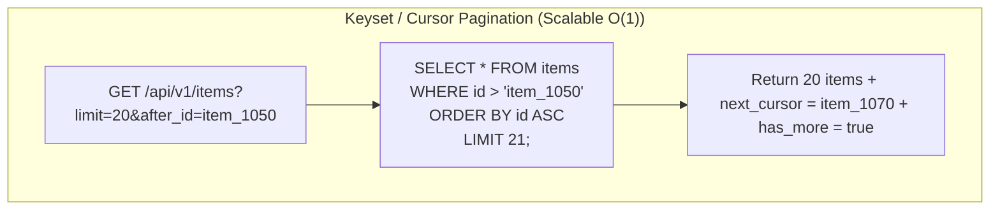

# Pagination and filtering

## Learning objective

Implement offset-based and cursor-based pagination for RESTful list endpoints, parse filter parameters from query strings, and apply sorting with configurable sort keys.

## Why this matters

Real APIs return thousands or millions of records. Returning all of them in one response is impossible -- it exhausts memory, clogs bandwidth, and creates a terrible client experience. Pagination, filtering, and sorting are the core mechanisms that make list endpoints usable at scale. Every production API you use (GitHub Issues, Stripe Charges, Slack Messages) implements these patterns.

## Mental model

Think of pagination like reading a book:

- **Offset pagination**: "Turn to page 42." You know the page number and the number of items per page. Simple, but if items are inserted/deleted between requests, pages shift (phantom reads).
- **Cursor pagination**: "Start from the last word on page 42." The cursor is a bookmark. You always continue from where you left off. Stable despite insertions, but no random access to pages.

Filtering is like asking for "all books by this author, published after 2020, under $30." Each query parameter narrows the result set.

Sorting is like saying "sort by price, cheapest first" or "by date, newest first."

## Visual model



## Core idea

**Offset pagination** uses `page` and `limit` parameters:

```
GET /products?page=2&limit=20
```

Response includes metadata so clients know the total and can compute pages:

```json
{
  "data": [...],
  "page": 2,
  "limit": 20,
  "total": 95,
  "total_pages": 5
}
```

**Cursor pagination** uses a `cursor` (opaque value, often the last item's ID) and `limit`:

```
GET /products?cursor=42&limit=20
```

Response indicates whether more results exist:

```json
{
  "data": [...],
  "cursor": 62,
  "has_more": true
}
```

**Filtering** uses query parameters:

| Parameter | Example | Effect |
|---|---|---|
| `q` | `?q=laptop` | Search by name |
| `category` | `?category=electronics` | Filter by category |
| `min_price` | `?min_price=10` | Minimum price |
| `max_price` | `?max_price=100` | Maximum price |

**Sorting** uses a `sort` parameter:

| Value | Effect |
|---|---|
| `price_asc` | Sort by price, low to high |
| `price_desc` | Sort by price, high to low |
| `name` | Sort alphabetically by name |

## Under the hood

Offset pagination translates to SQL like:

```sql
SELECT * FROM products LIMIT 20 OFFSET 40;
```

Cursor pagination translates to:

```sql
SELECT * FROM products WHERE id > 42 ORDER BY id LIMIT 20;
```

Cursor is faster on large datasets because it can use the index directly, while `OFFSET` scans and skips rows. However, cursor pagination doesn't support random page access (you can't jump to page 5).

In Go, you parse query parameters, apply filters by iterating the slice (or by building SQL queries), apply sorting, and slice the result based on offset/limit.

## How Go uses it

The Go community uses both pagination strategies. `chi` and `gin` have pagination middleware/helpers. The standard library's `net/url` package provides `Values.Get()` for parsing query parameters.

Most Go ORMs (GORM, Ent) support `.Offset()` and `.Limit()` for pagination and `.Where()` for filtering.

## Go example

```go
package main

import (
	"encoding/json"
	"fmt"
	"log"
	"net/http"
	"strconv"
	"strings"
)

type Product struct {
	ID       int     `json:"id"`
	Name     string  `json:"name"`
	Category string  `json:"category"`
	Price    float64 `json:"price"`
}

var allProducts = []Product{
	{ID: 1, Name: "Laptop", Category: "electronics", Price: 999.99},
	{ID: 2, Name: "Mouse", Category: "electronics", Price: 29.99},
	{ID: 3, Name: "Keyboard", Category: "electronics", Price: 89.99},
	{ID: 4, Name: "Desk", Category: "furniture", Price: 299.99},
	{ID: 5, Name: "Chair", Category: "furniture", Price: 499.99},
	{ID: 6, Name: "Monitor", Category: "electronics", Price: 349.99},
	{ID: 7, Name: "Notebook", Category: "stationery", Price: 4.99},
	{ID: 8, Name: "Pen Set", Category: "stationery", Price: 12.99},
	{ID: 9, Name: "Lamp", Category: "furniture", Price: 79.99},
	{ID: 10, Name: "Tablet", Category: "electronics", Price: 399.99},
}

type PaginatedResponse struct {
	Data       []Product `json:"data"`
	Page       int       `json:"page"`
	Limit      int       `json:"limit"`
	Total      int       `json:"total"`
	TotalPages int       `json:"total_pages"`
}

type CursorResponse struct {
	Data    []Product `json:"data"`
	Cursor  int       `json:"cursor"`
	HasMore bool      `json:"has_more"`
}

func productsHandler(w http.ResponseWriter, r *http.Request) {
	if r.Method != http.MethodGet {
		http.Error(w, `{"error":"method not allowed"}`, http.StatusMethodNotAllowed)
		return
	}

	w.Header().Set("Content-Type", "application/json")

	filtered := filterProducts(r)
	sorted := sortProducts(filtered, r.URL.Query().Get("sort"))

	page, limit := parsePagination(r)
	total := len(sorted)
	totalPages := (total + limit - 1) / limit

	start := (page - 1) * limit
	if start >= total {
		json.NewEncoder(w).Encode(PaginatedResponse{
			Data:       []Product{},
			Page:       page,
			Limit:      limit,
			Total:      total,
			TotalPages: totalPages,
		})
		return
	}

	end := start + limit
	if end > total {
		end = total
	}

	json.NewEncoder(w).Encode(PaginatedResponse{
		Data:       sorted[start:end],
		Page:       page,
		Limit:      limit,
		Total:      total,
		TotalPages: totalPages,
	})
}

func parsePagination(r *http.Request) (page, limit int) {
	page, _ = strconv.Atoi(r.URL.Query().Get("page"))
	if page < 1 {
		page = 1
	}
	limit, _ = strconv.Atoi(r.URL.Query().Get("limit"))
	if limit < 1 || limit > 100 {
		limit = 20
	}
	return
}

func filterProducts(r *http.Request) []Product {
	q := strings.ToLower(r.URL.Query().Get("q"))
	category := strings.ToLower(r.URL.Query().Get("category"))
	minPrice, _ := strconv.ParseFloat(r.URL.Query().Get("min_price"), 64)
	maxPrice, _ := strconv.ParseFloat(r.URL.Query().Get("max_price"), 64)

	var result []Product
	for _, p := range allProducts {
		if q != "" && !strings.Contains(strings.ToLower(p.Name), q) {
			continue
		}
		if category != "" && strings.ToLower(p.Category) != category {
			continue
		}
		if minPrice > 0 && p.Price < minPrice {
			continue
		}
		if maxPrice > 0 && p.Price > maxPrice {
			continue
		}
		result = append(result, p)
	}
	return result
}

func sortProducts(products []Product, sort string) []Product {
	if sort == "" {
		return products
	}

	result := make([]Product, len(products))
	copy(result, products)

	switch sort {
	case "price_asc":
		for i := 0; i < len(result); i++ {
			for j := i + 1; j < len(result); j++ {
				if result[j].Price < result[i].Price {
					result[i], result[j] = result[j], result[i]
				}
			}
		}
	case "price_desc":
		for i := 0; i < len(result); i++ {
			for j := i + 1; j < len(result); j++ {
				if result[j].Price > result[i].Price {
					result[i], result[j] = result[j], result[i]
				}
			}
		}
	case "name":
		for i := 0; i < len(result); i++ {
			for j := i + 1; j < len(result); j++ {
				if result[j].Name < result[i].Name {
					result[i], result[j] = result[j], result[i]
				}
			}
		}
	}

	return result
}

func cursorProductsHandler(w http.ResponseWriter, r *http.Request) {
	if r.Method != http.MethodGet {
		http.Error(w, `{"error":"method not allowed"}`, http.StatusMethodNotAllowed)
		return
	}

	w.Header().Set("Content-Type", "application/json")

	cursorStr := r.URL.Query().Get("cursor")
	cursor := 0
	if cursorStr != "" {
		cursor, _ = strconv.Atoi(cursorStr)
	}

	limit, _ := strconv.Atoi(r.URL.Query().Get("limit"))
	if limit < 1 || limit > 100 {
		limit = 5
	}

	filtered := filterProducts(r)

	var start int
	for i, p := range filtered {
		if p.ID > cursor {
			start = i
			break
		}
	}

	end := start + limit
	if end > len(filtered) {
		end = len(filtered)
	}

	hasMore := end < len(filtered)
	var nextCursor int
	if hasMore && len(filtered) > 0 {
		nextCursor = filtered[end-1].ID
	}

	json.NewEncoder(w).Encode(CursorResponse{
		Data:    filtered[start:end],
		Cursor:  nextCursor,
		HasMore: hasMore,
	})
}

func main() {
	mux := http.NewServeMux()
	mux.HandleFunc("/api/products", productsHandler)
	mux.HandleFunc("/api/products/cursor", cursorProductsHandler)

	log.Println("Products API with pagination on :8080")
	if err := http.ListenAndServe(":8080", mux); err != nil {
		log.Fatal(err)
	}
}

var _ = fmt.Sprintf
```

## Step-by-step execution

Client requests `GET /products?category=electronics&page=2&limit=2`:

1. `productsHandler` parses query params: `category=electronics`, `page=2`, `limit=2`.
2. Filtering: iterates all products, keeps only `category == "electronics"`. Result: 5 products.
3. Pagination: `page=2`, `limit=2`. `start = (2-1)*2 = 2`, `end = 4`.
4. Slices `filtered[2:4]` -- returns the 3rd and 4th electronic products.
5. Response: `{"data": [...], "page": 2, "limit": 2, "total": 5, "total_pages": 3}`.

For cursor pagination, client requests `GET /products/cursor?limit=3`:

1. No cursor in query, so `cursor = 0` (start from beginning).
2. Filtering applied. For each product, check `product.ID > 0` -- all pass.
3. First 3 products returned. `next_cursor = 3`, `has_more = true`.
4. Client follows up: `GET /products/cursor?cursor=3&limit=3`.
5. Products with ID > 3 are found and returned.

## Common mistakes

- Not validating `page` and `limit`. Negative values can cause crashes. Always clamp to sensible defaults.
- Returning the full dataset without pagination. This is the most common production pagination bug.
- Using offset pagination for real-time feeds where items are constantly added. Cursor is better.
- Not returning pagination metadata (`total`, `total_pages`, `has_more`). Clients cannot build UI without it.
- Exposing raw database IDs as cursors (security concern). Use a hash or opaque token for public APIs.
- Filtering after pagination (pagination slice before filter). Apply filter first, then paginate.

## Debugging walkthrough

A client reports page 2 returns the same items as page 1:

```go
func badPagination(w http.ResponseWriter, r *http.Request) {
    page, _ := strconv.Atoi(r.URL.Query().Get("page"))
    limit, _ := strconv.Atoi(r.URL.Query().Get("limit"))
    start := (page - 1) * limit
    end := start + limit
    // BUG: operating on original slice, not filtered
    json.NewEncoder(w).Encode(products[start:end])
}
```

**Symptom**: `GET /products?category=electronics&page=2&limit=2` returns the same as page 1 because filter is applied to the full list but pagination uses a different slice.

**Investigation**: The handler never applies the filter before pagination. It paginates the raw `products` slice.

**Fix**: Apply filter first, store in `filtered`, then paginate `filtered`.

## Production notes

- Set a maximum limit (e.g., 100) to prevent abuse. Return a 400 if exceeded.
- For cursor pagination, use a base64-encoded opaque token rather than exposing internal IDs.
- Include total count only on the first page or when explicitly requested (`?include_total=true`) to avoid expensive COUNT queries.
- Cache filtered results for popular queries (e.g., "all electronics sorted by price") using Redis or similar.
- Document pagination, filtering, and sorting parameters in your API docs.

## Performance implications

- Offset pagination becomes slow on large datasets (OFFSET 100000 scans 100k rows). Cursor pagination is O(log n).
- Filtering by iterating a Go slice is O(n). For in-memory datasets under 100k items, this is fine. For larger datasets, push filtering to the database.
- Sorting with bubble sort (as shown in the example) is O(n^2). Use `sort.Slice` in production.
- Include `Cache-Control` headers on paginated responses if data changes infrequently.

## Practice task

1. Create a list endpoint for `Order` with fields: `id`, `customer`, `total`, `status`, `created_at`.
2. Implement offset pagination with `page` and `limit` (max 50).
3. Add filtering by `status` (pending, shipped, delivered) and `min_total` / `max_total`.
4. Add sorting by `total_asc`, `total_desc`, `date_asc`, `date_desc`.
5. Implement cursor pagination as an alternative endpoint.
6. Write table-driven tests for: default pagination, custom page/limit, filters, sorting, and cursor traversal.

## Tests / verification

```bash
go test ./curriculum/modules/08-http-rest-apis/lessons/19-pagination-and-filtering -v
```

Tests cover parsing, filtering, sorting, offset pagination, cursor pagination edge cases (page beyond end, zero values), and method validation.

## Review questions

1. What is the difference between offset pagination and cursor pagination? When should you use each?
2. Why is cursor pagination often faster on large datasets than offset pagination?
3. What metadata should a paginated response include so clients can build page navigation?
4. Why should filtering be applied before pagination rather than after?
5. How would you handle a request with `limit=100000`? What's the maximum reasonable limit?

## NEXT UP

[Openapi Basics](../20-openapi-basics/README.md)
