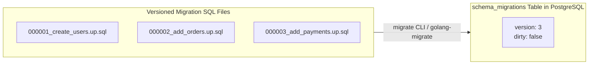

# Migrations

## Learning objective

Apply schema migrations in Go using versioned, idempotent migration files, understand migration tooling (golang-migrate, goose), and implement a simple migration runner with up/down semantics.

## Why this matters

In production, schema changes are deployed separately from application code. A migration might add a column, create an index, or rename a table — and must be applied in order, without data loss, and rolled back if something goes wrong. Without migrations, teams manually run SQL on production databases, leading to inconsistencies, unreproducible deployments, and downtime.

## Mental model

Each migration is a numbered step with two directions: up (apply the change) and down (undo it).

```
Migration 001_create_users.sql
  ↑ (up):   CREATE TABLE users (...)
  ↓ (down): DROP TABLE users

Migration 002_add_email.sql
  ↑ (up):   ALTER TABLE users ADD COLUMN email TEXT
  ↓ (down): ALTER TABLE users DROP COLUMN email
```

A migrations table tracks which steps have been applied. The tool compares the current version to the latest and applies missing migrations in order.

## Visual model



## Core idea

A migration system needs:
1. **Versioned files**: `001_*.sql`, `002_*.sql`, etc. — applied in order.
2. **Up and Down**: Forward and reverse operations.
3. **State tracking**: A table (e.g., `schema_migrations`) that records which version is current.
4. **Idempotency**: Running migrations twice produces the same result (using `IF NOT EXISTS`, `IF EXISTS`).

```go
type Migration struct {
    Version int
    Up      string
    Down    string
}
```

## Under the hood

Popular Go migration tools:

| Tool | Approach | Storage |
|---|---|---|
| golang-migrate/migrate | File-based, many DB drivers | `schema_migrations` table |
| pressly/goose | File-based, supports Go migrations | `goose_db_version` table |
| ariga/atlas | Declarative schema comparison | `atlas_schema_revisions` table (versioned mode) |

All work similarly:
1. Read all migration files, sorted by version.
2. Check the migrations tracking table for the current version.
3. Apply any unapplied migrations in order.
4. Record each applied version.
5. For down, apply in reverse order.

## How Go uses it

- **Application startup**: Many Go apps run migrations automatically on startup.
- **CLI commands**: Separate `migrate up`, `migrate down`, `migrate create` commands.
- **CI/CD pipelines**: Migrations run as a deployment step before the new version starts.
- **Test setup**: Migrations applied to a test database to mirror production schema.

## Go example

```go
package main

import (
	"database/sql"
	"fmt"
	"log"
	"sort"
	"strings"

	_ "modernc.org/sqlite"
)

type Migration struct {
	Version int
	Up      string
	Down    string
}

var migrations = []Migration{
	{
		Version: 1,
		Up: `CREATE TABLE IF NOT EXISTS users (
			id INTEGER PRIMARY KEY,
			name TEXT NOT NULL,
			email TEXT NOT NULL
		)`,
		Down: "DROP TABLE IF EXISTS users",
	},
	{
		Version: 2,
		Up:      "ALTER TABLE users ADD COLUMN age INTEGER DEFAULT 0",
		Down: `CREATE TABLE IF NOT EXISTS users_backup AS SELECT id, name, email FROM users;
DROP TABLE users;
CREATE TABLE users (id INTEGER PRIMARY KEY, name TEXT NOT NULL, email TEXT NOT NULL);
INSERT INTO users SELECT id, name, email FROM users_backup;
DROP TABLE IF EXISTS users_backup;`,
	},
}

type Migrator struct {
	db *sql.DB
}

func NewMigrator(db *sql.DB) *Migrator {
	return &Migrator{db: db}
}

func (m *Migrator) ensureTable() error {
	_, err := m.db.Exec(`CREATE TABLE IF NOT EXISTS schema_migrations (
		version INTEGER PRIMARY KEY,
		applied_at TIMESTAMP DEFAULT CURRENT_TIMESTAMP
	)`)
	return err
}

func (m *Migrator) CurrentVersion() (int, error) {
	if err := m.ensureTable(); err != nil {
		return 0, err
	}
	var version sql.NullInt64
	err := m.db.QueryRow("SELECT MAX(version) FROM schema_migrations").Scan(&version)
	if err != nil {
		return 0, err
	}
	if version.Valid {
		return int(version.Int64), nil
	}
	return 0, nil
}

func (m *Migrator) Up() error {
	current, err := m.CurrentVersion()
	if err != nil {
		return err
	}
	sort.Slice(migrations, func(i, j int) bool {
		return migrations[i].Version < migrations[j].Version
	})
	for _, mig := range migrations {
		if mig.Version <= current {
			continue
		}
		log.Printf("Applying migration %d...\n", mig.Version)
		if err := m.apply(mig); err != nil {
			return fmt.Errorf("migration %d: %w", mig.Version, err)
		}
	}
	return nil
}

func (m *Migrator) apply(mig Migration) (err error) {
	tx, err := m.db.Begin()
	if err != nil {
		return err
	}
	defer func() {
		if err != nil {
			tx.Rollback()
		}
	}()

	statements := strings.Split(mig.Up, ";")
	for _, stmt := range statements {
		stmt = strings.TrimSpace(stmt)
		if stmt == "" {
			continue
		}
		_, err = tx.Exec(stmt)
		if err != nil {
			return fmt.Errorf("statement %q: %w", stmt[:clip(len(stmt), 60)], err)
		}
	}

	_, err = tx.Exec("INSERT INTO schema_migrations (version) VALUES (?)", mig.Version)
	if err != nil {
		return err
	}
	return tx.Commit()
}

func clip(n, max int) int {
	if n > max {
		return max
	}
	return n
}

func (m *Migrator) Down() error {
	current, err := m.CurrentVersion()
	if err != nil {
		return err
	}
	if current == 0 {
		return nil
	}
	sort.Slice(migrations, func(i, j int) bool {
		return migrations[i].Version > migrations[j].Version
	})
	for _, mig := range migrations {
		if mig.Version > current {
			continue
		}
		log.Printf("Reverting migration %d...\n", mig.Version)
		if err := m.revert(mig); err != nil {
			return fmt.Errorf("revert migration %d: %w", mig.Version, err)
		}
		break
	}
	return nil
}

func (m *Migrator) revert(mig Migration) error {
	tx, err := m.db.Begin()
	if err != nil {
		return err
	}
	defer tx.Rollback()

	statements := strings.Split(mig.Down, ";")
	for _, stmt := range statements {
		stmt = strings.TrimSpace(stmt)
		if stmt == "" {
			continue
		}
		if _, err := tx.Exec(stmt); err != nil {
			return err
		}
	}

	if _, err := tx.Exec("DELETE FROM schema_migrations WHERE version = ?", mig.Version); err != nil {
		return err
	}
	return tx.Commit()
}

func main() {
	db, err := sql.Open("sqlite", ":memory:")
	if err != nil {
		log.Fatal(err)
	}
	defer db.Close()

	m := NewMigrator(db)
	if err := m.Up(); err != nil {
		log.Fatal(err)
	}

	var tableCount int
	db.QueryRow("SELECT COUNT(*) FROM sqlite_master WHERE type='table' AND name='users'").Scan(&tableCount)
	fmt.Printf("Users table exists: %v\n", tableCount == 1)

	var hasAge int
	rows, err := db.Query("PRAGMA table_info(users)")
	if err != nil {
		log.Fatal(err)
	}
	defer rows.Close()
	for rows.Next() {
		var cid int
		var name, ctype string
		var notnull bool
		var dflt sql.NullString
		var pk int
		if err := rows.Scan(&cid, &name, &ctype, &notnull, &dflt, &pk); err != nil {
			log.Fatal(err)
		}
		if name == "age" {
			hasAge = 1
		}
	}
	fmt.Printf("Age column exists: %v\n", hasAge == 1)

	version, _ := m.CurrentVersion()
	fmt.Printf("Current migration version: %d\n", version)
}
```

## Step-by-step execution

Starting from version 0:
1. `ensureTable()` creates `schema_migrations` if not exists.
2. `CurrentVersion()` queries `MAX(version)` — returns 0.
3. `Up()` sorts migrations ascending.
4. Migration 1 (version > 0): applied inside a transaction that also inserts the version row; a failed statement aborts the whole transaction and the error is wrapped with the migration number.
5. Migration 2 (version > 1): `ALTER TABLE users ADD COLUMN age INTEGER DEFAULT 0` applied the same way.
6. `main()` then verifies the result directly: `sqlite_master` confirms the `users` table exists, `PRAGMA table_info(users)` confirms the `age` column was added, and `CurrentVersion()` reports 2.

`Down()` runs the reverse path: it finds the highest applied version, executes that migration's `Down` SQL in a transaction, and deletes its version row — leaving the schema exactly one step behind.

## Common mistakes

- **Irreversible down migrations**: A down migration that drops a column loses data. Always test down migrations in staging.
- **Running migrations out of order**: Multiple developers creating migrations with the same version number. Use timestamp-based versioning.
- **Not using transactions**: DDL in SQLite supports transactional DDL — use it.
- **Missing down migrations**: Every up migration should have a corresponding down.

## Debugging walkthrough

**Scenario**: Re-running migration 3 on production fails with "duplicate column name".

**Root cause**: The migration ran twice — the version tracking table was missing a row (a hand-applied migration, a restored backup, or a parallel deploy), so the runner replayed an already-applied `ALTER TABLE ... ADD COLUMN`.

**Fix**: The correct fix is making the version tracking authoritative, not papering over the SQL. `CREATE TABLE IF NOT EXISTS` works for additive table creation, but note that SQLite has **no** `ADD COLUMN IF NOT EXISTS` (verified: SQLite rejects the syntax, while PostgreSQL supports it since 9.6). For SQLite, either restore the missing version row and re-run the runner, or guard the statement by checking `PRAGMA table_info` before issuing the `ALTER TABLE`.

## Production notes

- Apply migrations before deploying new code.
- Additive changes (new columns, new tables) are safe. Destructive changes require multi-step process.
- Some DDL in PostgreSQL takes `ACCESS EXCLUSIVE` lock. Plan during low traffic.

## Performance implications

- DDL operations lock tables. Small frequent migrations are better than one huge migration.
- The `schema_migrations` table is tiny — no performance impact.

## Practice task

Write a `Migrator` that supports `Up`, `Down`, and `Reset` (down all then up all) with 3 migrations.

## Tests / verification

```bash
go run ./curriculum/modules/09-sql-postgres-persistence/lessons/19-migrations
go test ./curriculum/modules/09-sql-postgres-persistence/lessons/19-migrations
```

## Review questions

1. Why must every up migration have a corresponding down migration?
2. What information does the `schema_migrations` table store?
3. Why is it dangerous to run migrations automatically on production startup?
4. How do timestamp-based migration versions prevent conflicts compared to sequential numbers?
5. What is the difference between a schema migration and a data migration?

## NEXT UP

[Joins](../20-joins/README.md)
